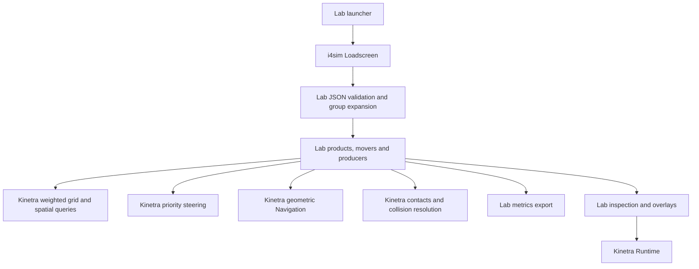

# Factory simulation architecture

The factory application lives in Lab and consumes reusable simulation capabilities from the editable Kinetra submodule.

## Table of contents

- [Ownership](#ownership)
- [Execution](#execution)
- [Compatibility and fidelity](#compatibility-and-fidelity)
- [Verification](#verification)

[Directory guide](README.md) · [Project overview](../README.md) · [Application guide](../labs/i4sim/README.md)

## Ownership

| C# reference component | C++ owner / implementation |
| --- | --- |
| Blueprint, MoverGroup, ProducerGroup, model tables | [Lab blueprint loader](../labs/i4sim/src/blueprint.cpp) |
| BasicSteering, BorderRepulsionRect, CollisionDetection, CollisionAvoidance, SeekAndArrival | [Kinetra priority steering](../external/Kinetra/src/simulation/priority_steering.cpp) |
| AStarHeatmap / graph topology and congestion | [Kinetra WeightedGrid](../external/Kinetra/include/kinetra/weighted_grid.h); Lab chooses occupancy and replan timing |
| Rectangle geometry, neighborhood queries | Existing Kinetra Body/contact and SpatialGrid APIs |
| Blocked route recovery | Existing Kinetra Navigation with a snapshot of blocked grid cells and neighboring bodies |
| Dummy product actors, allocation managers, producer queues | [Lab deterministic simulation](../labs/i4sim/src/simulation.cpp) |
| Parking and producer approach policy | Lab reservations, staging and queue ownership |
| LoadingScreen / rendering / interaction | [Lab session](../labs/i4sim/src/session.cpp), shared Kinetra LaunchMenu, Runtime and bitmap text |
| Tick / render cycles | Existing Kinetra FixedClock and session loop; Lab chooses UPS |
| Dumps / metrics | Lab summary export |
| MQTT / actor framework / Windows platform | Excluded |

Kinetra never imports factory models or Lab headers. Existing `steer`/`Navigation` contracts used by Demo and Dotio remain intact. The priority steering mode supplements them rather than changing existing application tuning. The engine also exposes right-button state and optional menu heading/status text; original left-button semantics and default launcher appearance remain intact.

## Execution

A fixed tick generates bounded local workload, refreshes occupancy, moves agents using a consistent neighbor snapshot, and advances products through waiting, transport, queue and processing states. Recipes retain their mover until completion. A producer reserves a bounded queue slot before transport starts. Queue heads own the processing position; other reservations wait outside it. Consecutive supported interactions retain the same station reservation. Other completed interactions release the processor and clear its approach area. Blocked producer/mover controls retain products for resumption or retry; no network services participate.

Grid occupancy uses the original four-corner contributions of 4/8/16 per mover according to its size relative to a cell. The occupancy includes the querying mover itself, so high local weight alone does not trigger replanning. After 100 ticks without progress, weighted A* reconsiders the route; progress is measured along the remaining polyline rather than straight-line distance to the destination. Optional route recovery uses the existing finer geometric planner around actual bodies; it is disabled by default. Steering profiles never switch automatically. Improved prediction, original priority steering, experimental tangent/spring steering and experimental Reciprocal avoidance are selected explicitly. The local priority is overlap safety, predictive avoidance, then seek/arrival, followed by wall-normal velocity constraints; acceleration and speed are capped in original tick units. Lab's default lookahead is 32 ticks. Improved steering opts into exact rectangular clearance for axis-aligned mover pairs; the engine's conservative circular envelope remains the default for existing consumers. Parked/processing movers have zero prediction velocity and are fixed during mover-pair contact correction, so passing traffic cannot displace their reservations.

Reciprocal adapts the shared [avoidance controller](../external/Kinetra/include/kinetra/avoidance.h) to millimeters per tick with `dt = 1`. It reads an immutable snapshot; parked and blocked neighbors are noncooperative. Pairs use exact fixed axis-aligned rectangular envelopes with 2 mm clearance per axis; mixed shapes in the shared controller retain enclosing circles. Improved remains the default while factory throughput and contact behavior are evaluated. The last movement tick's `AVOID LIMIT` counter includes infeasible constraints and subsequent contact/border overrides. Existing wall constraints and rectangular contact correction still apply; reciprocal feasibility alone does not certify the final command or guarantee progress.

Optional `MotionSettings::parking_traffic` is application-owned parking coordination,
independent of the steering profile and disabled by default. Before movement, an
automatic return whose parking footprint intersects an active non-parking route
is redirected to a free staging cell outside protected routes. Deferred movers
retain their own parking reservation and cannot be allocated to a new product.
The original parking goal resumes when the conflict clears. New production or
manual goals cancel deferral; blocked departures stop protecting their route.
Disabling the option restores deferred parking goals without teleporting bodies.
Staging changes goals, while the existing steering and contact paths still govern
all movement. Decisions use stable mover order and are retried each tick; waiting
counts are exposed as `PARK WAIT`. Already parked, blocked and manually commanded
movers are not relocated. If no staging cell is available, the existing goal and
local avoidance remain active. This is a parking interlock, not intersection
reservation, corridor scheduling or a guarantee against starvation/deadlock.

Optional `MotionSettings::junction_traffic` detects isolated T/+ cells whose open
cardinal neighbors are degree-two corridor cells. It uses the shared
[`TrafficGate`](../external/Kinetra/include/kinetra/traffic.h), with one gate per
junction and spatially indexed candidate queries. Movers request their next zone
within a bounded route lookahead. A braking-travel check retains approaching
requests after goal changes until coasting can no longer enter the zone. Complete physical-occupancy snapshots include
parked and blocked movers. Non-admitted approaches get temporary stop lines enforced
by the existing acceleration-bounded border controller; they appear noncooperative
to reciprocal avoidance. Occupants may always exit. Goals are preserved and all
routes are prepared before the admission snapshot when junction coordination is
active. With no detected junctions, route preparation retains its original order.

The option is off by default. `CROSS WAIT` exposes waiting movers and detected zone
count; the boundary layer outlines detected zones. Disabling clears logical gates
and waits without moving bodies. A stopped occupant continues blocking admission;
there is no expiry timer. This policy does not reserve exits, solve head-on
single-lane traffic, coordinate adjacent intersection complexes or guarantee
progress through a permanently occupied zone.

Weighted routes validate the mover's rectangular footprint on every swept link,
including exact start and destination coordinates. Contiguous wall segments are
merged so raster seams do not create artificial corners. Wall constraints bound
approach speed and penetration recovery without replacing steering along a wall;
all profiles retain their goal braking. Debug border vectors show the applied
acceleration correction. Final arrival requires position error below 0.1 mm,
speed below 0.05 mm/tick and a clear snap to the reserved destination.

Parking routes whose cell-center approach crosses a stationary mover are refined
with a bounded visibility graph using the original grid waypoints and expanded
rectangular mover corners. The same refinement runs after sustained lack of
progress, including movers that have stalled for at least 100 ticks. This supplies
safe aisle approaches without a circular envelope excluding a tight parking slot.
Transport allocation also requires a clear departure route around stationary/stalled
bodies, so a reserved mover trapped behind parked neighbors is skipped in favor
of an available mover. Refinement considers current stationary/stalled bodies, preserves grid clearance
and falls back to the weighted route if no connection exists or the 256-node
budget is exceeded. Other moving traffic still uses local avoidance. This is
separate from optional geometric recovery and does not guarantee progress in
arbitrary crowds.

Route recovery converts millimeter geometry into units of one planner resolution (a quarter of the smaller factory cell dimension), then converts the route back to millimeters. This keeps long factory routes within the planner's spatial query budget while retaining the configured resolution and mover clearance.

The loader accepts case-insensitive property names and string/numeric IDs, expands original groups, checks model names, nonnegative integer fields, finite dimensions, queue bounds and duplicate model-qualified IDs. Inputs are limited to 8 MiB, 10000 movers/producers and one million grid cells. Error messages include the source path. H/Madrid stations intentionally extend beyond the navigable world; their processing rectangles remain inside it.

## Compatibility and fidelity

The [application guide](../labs/i4sim/README.md#provenance-and-differences) is authoritative for intentional differences. This is a local C++ implementation of the case, not a binary-compatible replacement for actor/MQTT contracts. Numerical trajectories and asynchronous task ordering differ. Neither bit-for-bit behavioral parity nor identical throughput is established by the tests.

All source edits belong to `Kinetra-Lab` or its `external/Kinetra` repository. The sibling engine and original i4sim remain unchanged. Engine modifications require a future engine commit and a corresponding Lab submodule-pointer update by the maintainer; no Git staging, commits or publication are performed as part of this implementation.

## Verification

See [i4sim tests](../labs/i4sim/tests/README.md), [Lab integration commands](../README.md#tests-and-resources) and [independent engine checks](../external/Kinetra/docs/development.md). Validation must include all original blueprints, complete recipes, a loaded factory under local workload, existing applications, graphics input, and the public engine consumer.

Contact episodes are counted per unordered mover pair or mover-boundary segment before physical correction. Pair/segment duration is tracked separately in ticks. The 0.001 mm artificial thickness of wall collision proxies is excluded; touching a wall without physical penetration is not a contact. Forces use a shared pre-step snapshot; contacts use the integrated snapshot and are resolved once per pair. Manual goals reserve free movers until arrival without interrupting other assignments.
