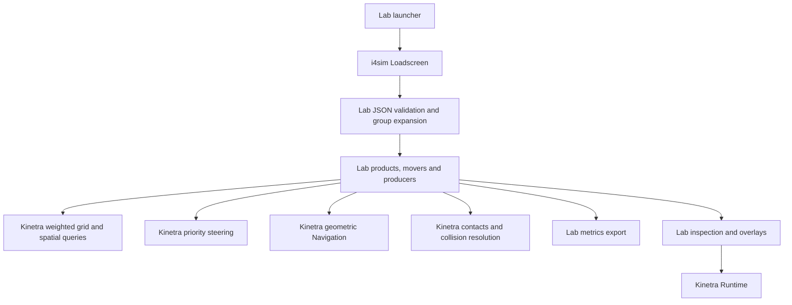
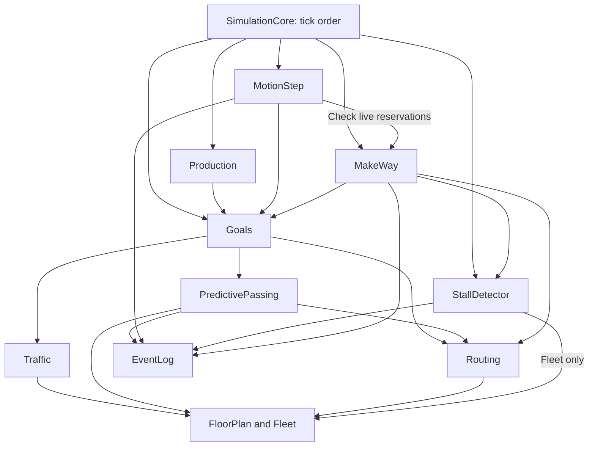
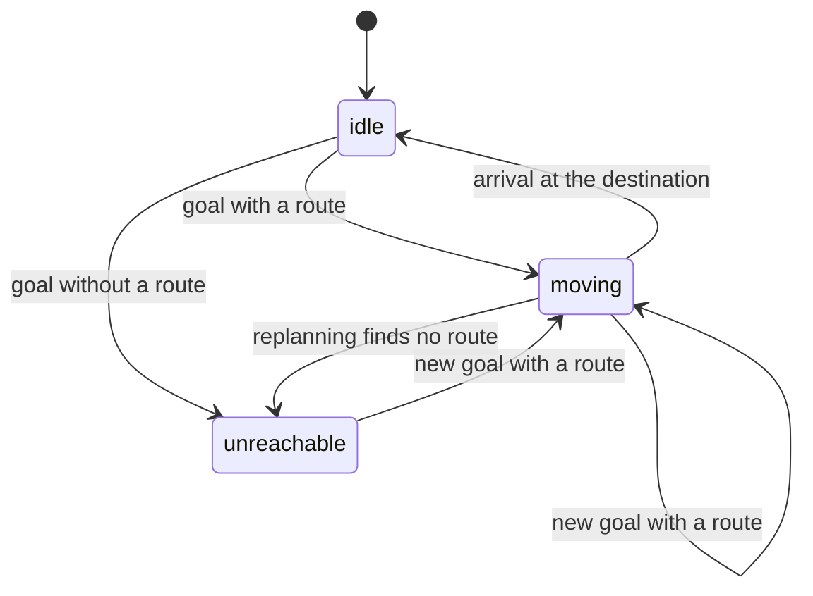

# Factory simulation architecture

The factory application lives in Lab and consumes reusable simulation capabilities from the editable Kinetra submodule. This page holds the contracts: who owns what against the C# reference and the engine, how the simulation is composed, and the exact rules and limits of every traffic policy. The [application guide](../labs/i4sim/README.md) explains how the module is built, how a frame and a tick run, and how the algorithms work.

## Table of contents

- [Ownership](#ownership)
- [Simulation structure](#simulation-structure)
- [Execution](#execution)
- [Compatibility and fidelity](#compatibility-and-fidelity)
- [Predictive passing](#predictive-passing)
- [Verification](#verification)

[Directory guide](README.md) · [Project overview](../README.md) · [Application guide](../labs/i4sim/README.md)

## Ownership

| C# reference component | C++ owner / implementation |
| --- | --- |
| Blueprint, MoverGroup, ProducerGroup, model tables | [Lab blueprint loader](../labs/i4sim/src/blueprint/blueprint.cpp) |
| BasicSteering, BorderRepulsionRect, CollisionDetection, CollisionAvoidance, SeekAndArrival | [Kinetra priority steering](../external/Kinetra/src/simulation/priority_steering.cpp) |
| AStarHeatmap / graph topology and congestion | [Kinetra WeightedGrid](../external/Kinetra/include/kinetra/simulation/weighted_grid.h); Lab chooses occupancy and replan timing |
| Rectangle geometry, neighborhood queries | Existing Kinetra Body/contact and SpatialGrid APIs |
| Blocked route recovery | Existing Kinetra Navigation with a snapshot of blocked grid cells and neighboring bodies |
| Dummy product actors, allocation managers, producer queues | [Lab production](../labs/i4sim/src/simulation/production.cpp) in the [deterministic simulation](#simulation-structure) |
| Parking and producer approach policy | Lab reservations, staging and queue ownership |
| LoadingScreen / rendering / interaction | Lab [controller](../labs/i4sim/include/i4sim/controller.h) (headless: input to commands) and [session](../labs/i4sim/src/presentation/session.cpp) with its blueprint screen, world view and HUD ([structure](../labs/i4sim/README.md#structure)); shared Kinetra LaunchMenu, Runtime and bitmap text |
| Tick / render cycles | Existing Kinetra FixedClock and session loop; Lab chooses UPS |
| Dumps / metrics | Lab summary export |
| MQTT / actor framework / Windows platform | Excluded |

Kinetra never imports factory models or Lab headers. Priority steering is a separate engine mode next to `steer` and `Navigation`, so Demo keeps its own tuning. The controller reads the engine's right-button input state, and the blueprint screen draws its list with `LaunchMenu`'s optional heading, and its message in `LaunchMenu`'s error panel.

## Simulation structure

`Simulation` ([simulation.h](../labs/i4sim/include/i4sim/simulation/simulation.h)) is a facade. Every call forwards to `detail::SimulationCore`, which owns one instance of each component below and runs the tick. The component headers are private to `labs/i4sim/src/`, so the public header stays small and the components can change without touching callers. A copy of a simulation is deep; the tests copy a running simulation to branch off a replay.

| Component | File | Owns | Responsibility |
| --- | --- | --- | --- |
| `FloorPlan` | [floor_plan.h](../labs/i4sim/include/i4sim/simulation/detail/floor_plan.h) | Weighted grid, borders, zone geometry, processing cells | Topology built once from the blueprint; heatmap weights |
| `Fleet` | [fleet.h](../labs/i4sim/include/i4sim/simulation/detail/fleet.h) | Movers, progress counters, per-tick controls and stop lines | Shared mover data that the components pass to each other |
| Routing | [routing.h](../labs/i4sim/include/i4sim/simulation/detail/routing.h) | Nothing | Grid routes refined around stationary movers; Navigation recovery routes |
| `Traffic` | [traffic.h](../labs/i4sim/include/i4sim/simulation/detail/traffic.h) | Gates, exit reservations, corridor recoveries | Junction and corridor admission, exit pockets, corridor recovery |
| `PredictivePassing` | [predictive_passing.h](../labs/i4sim/include/i4sim/simulation/detail/predictive_passing.h) | Kinetra's `PassingCoordinator`, which holds plans, retry ticks and plan ids | [Predictive passing](#predictive-passing) |
| `Goals` | [goals.h](../labs/i4sim/include/i4sim/simulation/detail/goals.h) | Nothing (a view built per call) | Setting a goal and cancelling what depended on the old one; holding places; parking interlock |
| `Production` | [production.h](../labs/i4sim/include/i4sim/simulation/detail/production.h) | Producers, products, workload generator | Scheduling, queues, processing, recipes |
| `MotionStep` | [motion_step.h](../labs/i4sim/include/i4sim/simulation/detail/motion_step.h) | Contact pairs and counters | Route following, coordination order, steering, integration, arrival, contacts |
| `MakeWay` | [make_way.h](../labs/i4sim/include/i4sim/simulation/detail/make_way.h) | Active refuge and return trips | Checked parking relief after stall observation, including outward withdrawal from newly protected space |
| `EventLog` | [event_log.h](../labs/i4sim/include/i4sim/simulation/detail/event_log.h) | Recording flag, events | Opt-in passing, contact, stall and make-way events |
| `Shuttle` | [shuttle.h](../labs/i4sim/include/i4sim/simulation/detail/shuttle.h) | Shuttling movers, their two ends, the tick they all arrived | When shuttling movers turn together (`Simulation::shuttle`); decides only, `SimulationCore` sends the legs |
| `StallDetector` | [stall_detector.h](../labs/i4sim/include/i4sim/simulation/detail/stall_detector.h) | Kinetra's [`StallDetector`](../external/Kinetra/docs/engine/navigation.md#stall-detection), which holds the observations and the active episode's onset diagnosis | Tell the detector each mover's state and route progress after motion, production and shuttle updates. Supply the inspector and record episode transitions. |

*Takeaway:* dependencies point down to the floor and the fleet, without a cycle. Only `Goals` gives a mover a new goal, so a new goal always ends the mover's corridor recovery and passing plans. `MotionStep` reaches traffic and passing through the same `Goals` view. Components store no references to each other: `SimulationCore` passes what each call needs, so copying a simulation cannot leave a reference into the original.

**Tick order.** `SimulationCore::tick` runs, in this order:

1. Count the tick and remember every mover's position for drawing.
2. Open a random product while the workload is on and fewer products than movers are open.
3. Refresh the heatmap on the first tick of every ten.
4. Run the parking interlock (`Goals::coordinate_parking`).
5. Move (`MotionStep::run`): prepare routes, grant and end rights of way (RIGHT OF WAY), snapshot the bodies, then corridor recovery, predictive passing and zone admission, then steer and integrate each mover against the snapshot, and finally count and resolve contacts.
6. Advance production and drop completed products.
7. Turn the shuttle: once every shuttling mover has stood still for `shuttle_pause_ticks` (400), send each one to its other end through the checks of `move_to`.
8. Observe stall episodes, then advance MAKE WAY trips.
9. Update waiting counters.
10. At the blueprint's tick cap, change to `RunState::finished`.

**Mover state.** Each axis of a mover's state is one value. The lifecycle:

The goal kind says who chose the goal: `automatic` (production, parking), `manual` (an operator command or a shuttle leg, kept until arrival), `parking_staging` (waiting outside another mover's route), or `making_way` (temporarily leaving a parking place and returning on a checked route). Both temporary goal kinds survive arrival at their refuge. The operator hold (`held`) is independent of both. `Coordination` holds what traffic, passing and the right of way decided in the last tick; several of its flags can be true at once. `mover_status` reduces this to the HUD's status. The stall detector observes completed ticks and exposes episodes through `Simulation::stall_details` for the [inspector](../labs/i4sim/README.md#controls). MAKE WAY also uses active episodes to decide when to check a route.

## Execution

A fixed tick generates bounded local workload, refreshes occupancy, moves agents using a consistent neighbor snapshot, and advances products through waiting, transport, queue and processing states. Recipes retain their mover until completion. A producer reserves a bounded queue slot before transport starts. Queue heads own the processing position; other reservations wait outside it. Consecutive supported interactions retain the same station reservation. Other completed interactions release the processor and clear its approach area. Blocked producer/mover controls retain products for resumption or retry; no network services participate.

Grid occupancy uses the original four-corner contributions of 4/8/16 per mover according to its size relative to a cell. The occupancy includes the querying mover itself, so high local weight alone does not trigger replanning. After 100 ticks without progress, weighted A* reconsiders the route; progress is measured along the remaining polyline rather than straight-line distance to the destination. With `MotionSettings::path_planning` off, the grid route only decides whether a goal is reachable; the route a mover follows is the destination alone, and local steering with the wall constraints carries it there. Optional route recovery uses the existing finer geometric planner around actual bodies; it is disabled by default. Steering profiles never switch automatically. Improved prediction, original priority steering, experimental tangent/spring steering and experimental Reciprocal avoidance are selected explicitly. The local priority is overlap safety, predictive avoidance, then seek/arrival, followed by wall-normal velocity constraints; acceleration and speed are capped in original tick units. Lab's default lookahead is 32 ticks. Improved steering opts into exact rectangular clearance for axis-aligned mover pairs; the engine's conservative circular envelope remains the default for existing consumers. Parked/processing movers have zero prediction velocity and are fixed during mover-pair contact correction, so passing traffic cannot displace their reservations.

Reciprocal adapts the shared [avoidance controller](../external/Kinetra/include/kinetra/simulation/avoidance.h) to millimeters per tick with `dt = 1`. It reads an immutable snapshot; parked and blocked neighbors are noncooperative. Pairs use exact fixed axis-aligned rectangular envelopes with 2 mm clearance per axis; mixed shapes in the shared controller retain enclosing circles. Improved remains the default while factory throughput and contact behavior are evaluated. The last movement tick's `AVOID LIMIT` counter includes infeasible constraints and subsequent contact/border overrides. Existing wall constraints and rectangular contact correction still apply; reciprocal feasibility alone does not certify the final command or guarantee progress.

Optional `MotionSettings::parking_traffic` is application-owned parking coordination,
independent of the steering profile and disabled by default. Before movement, an
automatic return whose parking footprint intersects an active non-parking route
is redirected to a free staging cell outside protected routes. Deferred movers
retain their own parking reservation and cannot be allocated to a new product.
The original parking goal resumes when the conflict clears. New production or
manual goals cancel deferral; blocked departures stop protecting their route.
Disabling the option restores deferred parking goals without teleporting bodies.
Staging changes goals, while the existing steering and contact paths still govern
all movement. Decisions use stable mover order and are retried each tick; waiting
counts are exposed as `PARK WAIT`. Already parked, blocked and manually commanded
movers are not relocated. If no staging cell is available, the existing goal and
local avoidance remain active. This is a parking interlock, not intersection
reservation, corridor scheduling or a guarantee against starvation/deadlock.

Optional `MotionSettings::junction_traffic` detects isolated T/+ cells whose open
cardinal neighbors are degree-two corridor cells. It uses the shared
[`TrafficGate`](../external/Kinetra/include/kinetra/simulation/traffic.h), with one gate per
junction and spatially indexed candidate queries. Movers request their next zone
within a bounded route lookahead. A braking-travel check retains approaching
requests after goal changes until coasting can no longer enter the zone. Complete physical-occupancy snapshots include
parked and blocked movers. Non-admitted approaches get temporary stop lines enforced
by the existing acceleration-bounded border controller; they appear noncooperative
to reciprocal avoidance. Occupants may always exit. Goals are preserved and all
routes are prepared before the admission snapshot when junction coordination is
active. With no detected junctions, route preparation retains its original order.

The option is off by default. `CROSS WAIT` exposes waiting movers and detected zone
count. `EXIT` counts requests/approaches held for exit space. The boundary layer
outlines junctions in cyan and admitted exit pockets in lime. Disabling clears
logical gates, reservations and waits without moving bodies. A stopped occupant
continues blocking admission; there is no expiry timer.

Before a new grant, i4sim follows the route to the first fully clear exit and
reserves its swept rectangular footprint plus a bounded braking pocket (clipped
to the next waypoint). Static geometry, other bodies, their braking travel and
existing exit reservations must leave this pocket clear. A goal ending inside the
junction supplies no exit and is ineligible for a new grant. A MAKE WAY mover contributes physical
occupancy and may withdraw from a newly enabled zone. Its temporary trip makes no
new admission or exit request. The oldest eligible
request may pass a blocked request, whose FIFO ticket remains intact. An admitted
exit stays reserved while that agent still requests or physically occupies the
zone, including after a goal change; it is not revoked by later readiness changes.
Other approaches get bounded stop-line constraints outside that pocket. Bodies
already inside a pocket or junction may leave freely. Physical queries reuse the
movement snapshot's spatial index.

This reserves space to clear the junction, not the entire outbound route. Existing
intrusions, infeasible braking after late activation, opposing single-lane traffic,
adjacent intersection complexes and permanently occupied zones still require
additional policy; this is not a general liveness or collision-free guarantee.

Optional `MotionSettings::corridor_traffic` applies the same gate/exit machinery to
whole straight single-cell corridors. The detector collects maximal horizontal or
vertical runs bounded on both sides by blocked cells, up to 256 cells long. Both
ends must open into a free three-cell-wide, two-cell-deep room. Dead ends, bends,
complex branches and longer runs are excluded. Zones store their actual rectangular
bounds and axis; existing junction APIs keep their original indexing.

Corridor admission is exclusive for the entire run. Waiting approaches stop far
enough into the entrance rooms to leave a full mover-length exit pocket plus
braking space free at either end, including when a parked occupant has no departure
route yet. The holder's actual exit is reserved and protected through the existing
readiness checks and bounded stop-line controller. After it fully clears the
corridor, the next request may enter; local reciprocal avoidance handles passing
in the wider room. Manual destinations and original parking reservations stay
intact. The application reuses the existing shared `TrafficGate` without an engine
API extension.

The option is disabled by default and lives under DEBUG → TRAFFIC → CORRIDOR TRAFFIC,
with the other traffic policies. Blue outlines identify controlled corridors, lime outlines their reserved
exits, and `LANE WAIT` reports waiting movers/detected corridor count. Admission and
reservation state are cleared only for disabled policy types.

With exactly two active, unblocked opposing occupants, recovery may start after
both have at least 120 ticks without route progress and speed at most 0.05 mm/tick.
At most four candidates are checked: either mover reversing to either side of its
entrance room. Static footprint-aware routing and 2 mm peer/reservation clearance
must validate the complete retreat path and refuge against the current snapshot.
Refuges account for the mover's full rectangular footprint, including bodies longer
than a cell. The shortest valid path wins; equal costs prefer the higher stable ID.
Unsuccessful checks retry no more often than every 120 ticks.

The passing mover holds its initial position while the yielding mover follows a
private temporary route. Once settled in the refuge, the yielding mover waits until
the other fully clears the corridor. Both then resume ordinary control. Temporary
control targets retain original destinations, manual flags, task state and parking
reservations; movement still uses normal avoidance, border constraints and bounded
acceleration. Temporary targets cannot complete a production arrival. A new goal
cancels the affected recovery immediately; configuration rebuilds its routes, and
disabling corridor traffic clears recovery without moving bodies. Blocking a
participant suspends its motion and can be resumed. `RETREAT` counts active
recoveries, and pink path arrows show the current temporary steering target.

The mechanism does not relocate permanent blockers, handle three or more opposing
occupants, coordinate branched networks, or guarantee starvation freedom. A refuge
is checked when the manoeuvre is selected; later intrusions can still delay it via
local avoidance. Without a clear path/refuge, logical admission stays protected
and no forced escape or teleportation is attempted.

Weighted routes validate the mover's rectangular footprint on every swept link,
including exact start and destination coordinates. Contiguous wall segments are
merged so raster seams do not create artificial corners. Wall constraints bound
approach speed and penetration recovery without replacing steering along a wall;
all profiles retain their goal braking. Debug border vectors show the applied
acceleration correction. Final arrival requires position error below 0.1 mm,
speed below 0.05 mm/tick and a clear snap to the reserved destination.

Parking routes whose cell-center approach crosses a stationary mover are refined
with a bounded visibility graph using the original grid waypoints and expanded
rectangular mover corners. The same refinement runs after sustained lack of
progress, including movers that have stalled for at least 100 ticks. This supplies
safe aisle approaches without a circular envelope excluding a tight parking slot.
Initial transport allocation requires a clear departure route around stationary or
stalled bodies. If refinement finds no connection or exceeds its 256-node budget,
allocation skips that mover. Ordinary routing can use the weighted route in those
cases. When a product already has a mover and reaches the front of the producer's
queue, dispatch uses ordinary routing by default. The [stall detection replay](design/2026-11-26-i4sim-stall-detection.md#problem)
shows how that can leave a mover with an obstructed first leg. With DEPARTURE CHECK on, that
departure needs the same refined route as an allocation; without one the mover keeps
waiting at its holding place for at most 1,200 ticks, then departs as before
([departure check](../labs/i4sim/README.md#departure-check)). Other moving
traffic still uses local avoidance. Optional geometric recovery is a separate policy.

Route recovery converts millimeter geometry into units of one planner resolution (a quarter of the smaller factory cell dimension), then converts the route back to millimeters. This keeps long factory routes within the planner's spatial query budget while retaining the configured resolution and mover clearance.

The loader accepts case-insensitive property names and string/numeric IDs, expands original groups, checks model names, nonnegative integer fields, finite dimensions, queue bounds and duplicate model-qualified IDs. Inputs are limited to 8 MiB, 10000 movers/producers and one million grid cells. Error messages include the source path. H/Madrid stations intentionally extend beyond the navigable world; their processing rectangles remain inside it.

## Compatibility and fidelity

The [application guide](../labs/i4sim/README.md#provenance-and-differences) is authoritative for intentional differences. This is a local C++ implementation of the case, not a binary-compatible replacement for actor/MQTT contracts. Numerical trajectories and asynchronous task ordering differ. Neither bit-for-bit behavioral parity nor identical throughput is established by the tests.

## Predictive passing

Kinetra supplies the [conflict prediction, lane candidates and guard](../external/Kinetra/docs/engine/navigation.md#predictive-passing)
and the `PassingCoordinator` that owns plan state, priority, waiting and retries
([ADR 0018](../external/Kinetra/docs/decisions/0018-stall-remedies-in-the-engine.md)).
i4sim tells it what each mover is (free, under another control, or standing), checks
each lane against its floor and traffic zones, restores routes after a plan, and logs
the plan's events with the factory's end reasons.

[Lab coordination](../labs/i4sim/src/simulation/predictive_passing.cpp) is an opt-in policy
for Improved and Reciprocal. It predicts conflicting, approximately opposite route
headings using preferred speed and a footprint-dependent lookahead. Detection uses
an immutable spatial snapshot; sorted encounter times and mover IDs make pairing
deterministic. Each mover can join one pair. Original destinations, product ownership
and manual commands remain intact; this policy overrides the current steering target.

Pairs commit to two stages: both reach stationary entry points in separate lateral
lanes, then both reach exit points beyond the encounter before replanning to their
original goals. Formation requires longitudinal separation of at least twice the
combined projected half extents plus 32 mm. Lane offsets use each rectangular
footprint plus 8 mm; two side choices and three shared lateral translations allow
passing near a wall. Temporary points use intermediate-waypoint braking. Both
participants must be within 0.1 mm and below 0.05 mm/tick before a stage completes.

Every formation/crossing sweep checks static grid clearance with 2 mm footprint
inflation, all other mover footprints in the snapshot, detected traffic zones, and
the swept envelopes of existing pairs. Detected narrow passages are excluded even
when their optional admission policy is off. Corridor recovery has precedence, and a mover with a checked MAKE WAY route stays out of new passing plans.
If no candidate fits, ordinary steering keeps its existing route.

Every tick a guard rechecks each participant's remaining legs against the current
bodies. A stationary mover (idle, unreachable or held) on a remaining leg, or a mover
driving toward the participant along its lane, ends the plan as `obstructed`. A mover
predicted, along its current velocity, to enter the lane the participant reaches within
the steering horizon plus its braking distance makes the participant stop at its braking
point; it resumes once that lane has been clear for 20 ticks, and a 240-tick wait ends
the plan as `obstructed`. Participants yield to movers outside every plan and to older
plans, and ignore movers behind them.

Disabling the feature, blocking a participant or issuing a new goal releases the
pair and rebuilds the original routes. A pair also releases after 240 ticks without
measurable progress. After a plan that did not complete, both participants wait 120
ticks before retrying; after a completed one, or one that a new goal or switching the
feature off ended, they may pair again from the next tick. Body positions
are never snapped by this policy. Existing local avoidance and contact correction
remain active. The guard predicts along current velocities; this is not a general
collision-free or starvation-free scheduler.

Each plan has an id. With the event log on (`Simulation::record_events`), the
simulation records the plan's formation with both entry and exit targets, the start
of crossing, and its end with the first reason that applied, in the order the policy
checks them: disabled, participant stopped, participant held, corridor recovery took a
participant, obstructed, no progress, completed, or a new goal. Contact starts are recorded
with tick and participants, flagged when a participant was in a plan. Recording never
changes a decision. The [pressure scenarios](../labs/i4sim/tests/README.md#golden-and-pressure-lines)
require contact-free arrival in situations a formation check alone does not cover.
The [regression and benchmark guide](../labs/i4sim/tests/README.md) describes coverage.

## Verification

See [i4sim tests](../labs/i4sim/tests/README.md), [Lab integration commands](../README.md#tests-and-resources) and [independent engine checks](../external/Kinetra/docs/development.md). Validation must include all original blueprints, complete recipes, a loaded factory under local workload, existing applications, graphics input, and the public engine consumer.

Contact episodes are counted per unordered mover pair or mover-boundary segment before physical correction. Pair/segment duration is tracked separately in ticks. The 0.001 mm artificial thickness of wall collision proxies is excluded; touching a wall without physical penetration is not a contact. Forces use a shared pre-step snapshot; contacts use the integrated snapshot and are resolved once per pair. Manual goals reserve free movers until arrival without interrupting other assignments.
