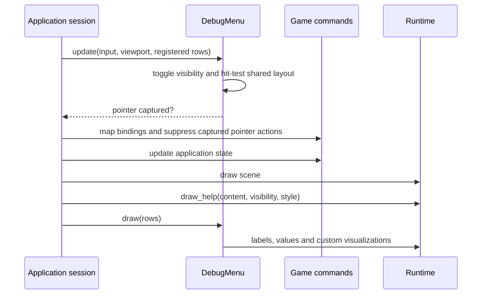

# Launcher and overlays

Optional public infrastructure owns shared menu behavior, session transitions and overlay layout. Applications register content and callbacks.

## Table of contents

- [Registration](#registration)
- [Launcher transitions](#launcher-transitions)
- [Debug and help interaction](#debug-and-help-interaction)
- [Contracts and verification](#contracts-and-verification)

## Registration

| API | Supplied by application | Owned by Kinetra Launcher or overlays |
| --- | --- | --- |
| `LaunchChoice` | Name, description, optional configuration names/default | Value copies and validation |
| `ApplicationRegistration` | Factory accepting camera/configuration index; captures optional launch arguments | Registry and factory dispatch |
| `LaunchMenu` | Choice values | Selection, optional configuration screen, picking and drawing |
| `SessionHost` / `run_launcher` | Registrations, selected application/configuration | Unique session ownership, first-update isolation and optional standard event loop |
| `DebugOption` | Label, borrowed bool, action, text/number getter or visualization | Common row layout, capture and drawing |
| `HelpOverlay` / `draw_help` | Control/category/section text, style and optional toggle key | Shared panel rendering and optional visibility controller |

```cpp
#include <kinetra/launcher.h>

// create_application is an application-provided factory returning unique_ptr<Session>.
kinetra::SessionHost host({{
    {"MY APP", "SIMULATION", {"SMALL", "LARGE"}, 0},
    create_application
}});
kinetra::LaunchMenu menu(host.choices());
```

The bundled [composition root](../launcher/src/main.cpp) supplies CLI arguments and factories. Its [menu adapter](../launcher/include/menu.h) supplies Dotio difficulty names; the engine contains no Demo/Dotio enums, headers or rules.

## Launcher transitions

```mermaid
stateDiagram-v2
    [*] --> Menu
    Menu --> Configuration: select registered app with options
    Configuration --> Menu: M / cancel
    Menu --> Creating: select app without options
    Configuration --> Creating: confirm configuration
    Creating --> Running: factory returns session; commit camera
    Creating --> Menu: factory failure; caller handles exception
    Running --> Running: update then render
    Running --> Menu: return_to_menu destroys session
    Running --> Creating: custom caller requests replacement
    Creating --> Running: failed replacement preserves old session
    Menu --> Shutdown: close / Escape
    Running --> Shutdown: close / Escape
    Shutdown --> [*]: destroy session then Runtime
```



The first update receives empty input and zero elapsed time. The standard Kinetra loop resets its wall-clock baseline after loading. Factory exceptions propagate; the bundled executable reports them and exits, while custom launchers can recover. The host preserves its old camera/session on failure, but cannot roll back arbitrary side effects inside application factories. Dotio's static raster forbids overlapping Dotio worlds; return to the menu before constructing another.

## Debug and help interaction



Rows with no control/getter act as section labels. Numeric getters supply statistics; text getters supply formatted values. Actions execute once per captured click. A custom visualization draws at its row origin. Applications own referenced values and callback captures for the duration of update/draw. Keep getters observational and update/draw row collections consistent for that frame.

Help content is registered as a span of text lines, including category headings if desired. Existing application command systems own their help boolean and H binding; consumers can instead use HelpOverlay's visibility controller. Help is informational and captures no gameplay input. DebugMenu consumes pointer input inside its visible panel, including held shooting; the session applies that capture before commands. Backquote is the default debug toggle; update accepts an alternate key.

## Contracts and verification

Public headers: [launcher.h](https://github.com/SMB-M87/Kinetra/blob/main/include/kinetra/launcher.h), [session.h](https://github.com/SMB-M87/Kinetra/blob/main/include/kinetra/session.h), [debug_view.h](https://github.com/SMB-M87/Kinetra/blob/main/include/kinetra/debug_view.h), [help_view.h](https://github.com/SMB-M87/Kinetra/blob/main/include/kinetra/help_view.h), [bitmap_text.h](https://github.com/SMB-M87/Kinetra/blob/main/include/kinetra/bitmap_text.h).

[Generic launcher tests](https://github.com/SMB-M87/Kinetra/blob/main/tests/launcher_tests.cpp) cover registration, configuration, factory failure, cleanup, input/time isolation and debug actions. [Bundled menu tests](../launcher/tests/menu_tests.cpp) cover difficulty and resized picking. [Integration tests](../launcher/tests/runtime_tests.cpp) and both application presentation suites cover actual rendering and pointer capture.
