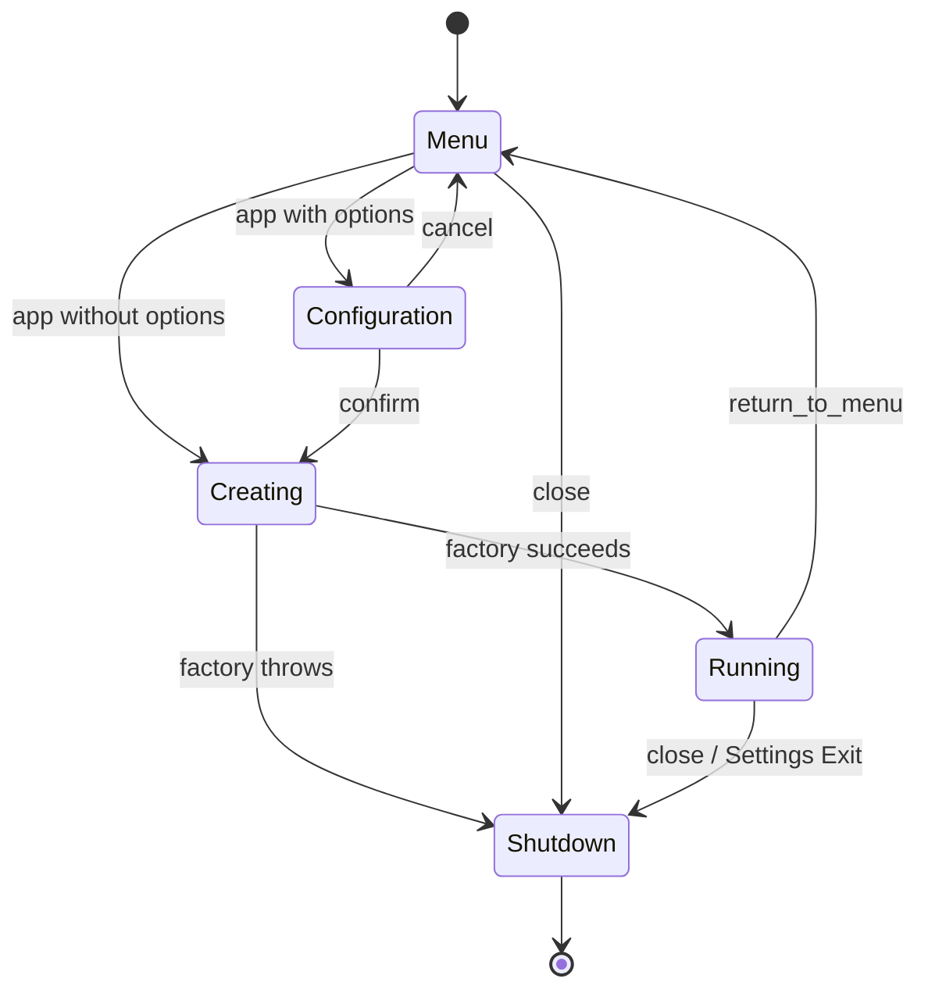
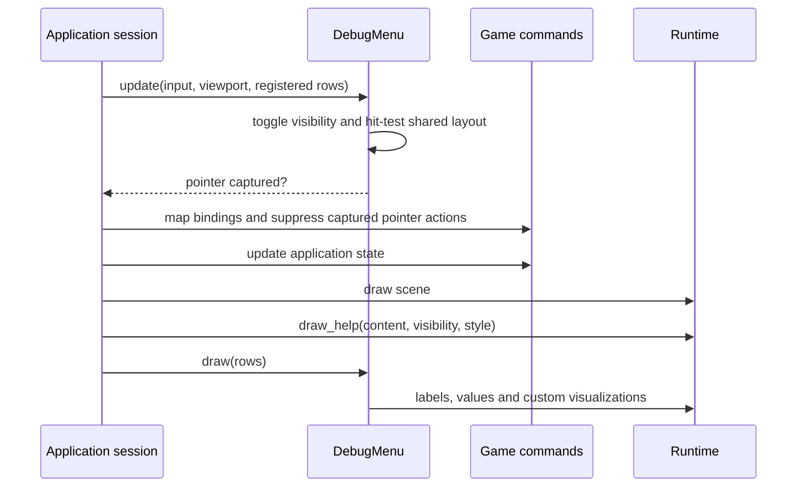

# Launcher and overlays

Optional public infrastructure owns shared menu behavior, session transitions and overlay layout. Applications register content and callbacks.

## Table of contents

- [Registration](#registration)
- [Launcher transitions](#launcher-transitions)
- [Debug and help interaction](#debug-and-help-interaction)
- [Contracts and verification](#contracts-and-verification)

[Directory guide](README.md) · [Project overview](../README.md) · [Documentation index](README.md)

## Registration

| API | Supplied by application | Owned by Kinetra Launcher or overlays |
| --- | --- | --- |
| `LaunchChoice` | Name, description, optional configuration names/default | Value copies and validation |
| `ApplicationRegistration` | Factory accepting camera/configuration index; captures optional launch arguments | Registry and factory dispatch |
| `LaunchMenu` | Choice values | Selection, optional configuration screen, picking and drawing |
| `SessionHost` / `run_launcher` | Registrations, selected application/configuration | Unique session ownership, first-update isolation and optional standard event loop |
| `DebugOption` | Label, borrowed bool, action, text/number getter or visualization | Common row layout, capture and drawing |
| `HelpOverlay` / `draw_help` | Control/category/section text, style and optional toggle key | Shared panel rendering and optional visibility controller |

```cpp
#include <kinetra/launcher.h>

// create_application is an application-provided factory returning unique_ptr<Session>.
kinetra::SessionHost host({{
    {"MY APP", "SIMULATION", {"SMALL", "LARGE"}, 0},
    create_application
}});
kinetra::LaunchMenu menu(host.choices());
```

The bundled [composition root](../launcher/src/main.cpp) supplies CLI arguments and factories. Its [menu adapter](../launcher/include/menu.h) supplies Dotio difficulty names; the engine contains no Demo/Dotio enums, headers or rules.

## Launcher transitions

The title is KINETRA LAUNCHER, without a Select Application subtitle. Moving the pointer over an application or configuration preselects it without confirming; a resting pointer preserves keyboard selection. Exit and page actions turn blue on hover, matching Settings.

The menu is centered and shows at most six entries per page. Previous and Next buttons wrap between pages; keyboard selection keeps the selected entry visible. The footer contains Exit and, for longer lists, these page buttons.



The bundled launcher uses its own [Lab event loop](../launcher/src/session.cpp) so the application-owned settings action controls return navigation; M has no action during a run. The diagram shows its navigation lifecycle. The selected application factory initializes the camera and creates a fresh session. While running, each frame updates and then renders the session. Returning to the menu destroys the session; shutdown destroys the session before the Runtime.

Custom callers can request a replacement while a session is running. If the factory throws, the old session and camera remain active and the exception propagates to the caller. A caller can catch the exception and continue; this recovery path is separate from the standard loop shown above.

The first update receives empty input and zero elapsed time. The Lab loop discards loading time with its first-update isolation. Factory exceptions propagate; the bundled executable reports them and exits, while custom launchers can recover. The host preserves its old camera/session on failure, but cannot roll back arbitrary side effects inside application factories. Dotio's static raster forbids overlapping Dotio worlds; return to the menu before constructing another.

## Debug and help interaction



Rows with no control/getter act as section labels. Numeric getters supply statistics; text getters supply formatted values. Actions execute once per captured click. A custom visualization draws at its row origin. Applications own referenced values and callback captures for the duration of update/draw. Keep getters observational and update/draw row collections consistent for that frame.

Demo and Dotio use the centered modal [Settings](../labs/settings.h) panel instead of an always-visible help legend. Ctrl or the compact SETTINGS button opens it; Resume or Ctrl closes it. While visible, the application is paused and every gameplay input is suppressed, including the click that closes the panel. The SETTINGS button, settings actions and actionable debug rows turn blue on hover, using their click regions. Zoom In and Zoom Out highlight independently. Launcher, Resume and Exit share a centered bottom row, followed by an always-visible CTRL Settings hint. The panel fits the text with a small margin and shrinks when controls are hidden. Zoom In and Zoom Out are centered together on a row with a tab-sized gap, followed by Statistics and Debug Mode. Show/Hide Sim Controls and Show/Hide Debug Controls independently expand their respective sections. Both start hidden. Expanded help starts one 14-pixel layout row below its toggle; the last simulation help row sits one row above the debug toggle. The launcher actions retain their 28-pixel spacing after the last debug help row. Escape has no exit action. Space no longer pauses and M no longer returns to the menu. Backquote opens debug tools only when Debug Mode is enabled and settings is closed. Wheel zoom is enabled only during debug gameplay. The reusable engine HelpOverlay remains available to other consumers. DebugMenu consumes pointer input inside its visible panel, including held shooting; the session applies that capture before commands. Backquote is the default debug toggle; update accepts an alternate key.

## Contracts and verification

Public headers: [launcher.h](https://github.com/SMB-M87/Kinetra/blob/main/include/kinetra/launcher.h), [session.h](https://github.com/SMB-M87/Kinetra/blob/main/include/kinetra/session.h), [debug_view.h](https://github.com/SMB-M87/Kinetra/blob/main/include/kinetra/debug_view.h), [help_view.h](https://github.com/SMB-M87/Kinetra/blob/main/include/kinetra/help_view.h), [bitmap_text.h](https://github.com/SMB-M87/Kinetra/blob/main/include/kinetra/bitmap_text.h).

[Generic launcher tests](https://github.com/SMB-M87/Kinetra/blob/main/tests/launcher_tests.cpp) cover registration, configuration, factory failure, cleanup, input/time isolation and debug actions. [Bundled menu tests](../launcher/tests/menu_tests.cpp) cover difficulty and resized picking. [Integration tests](../launcher/tests/runtime_tests.cpp) and both application presentation suites cover actual rendering and pointer capture.
