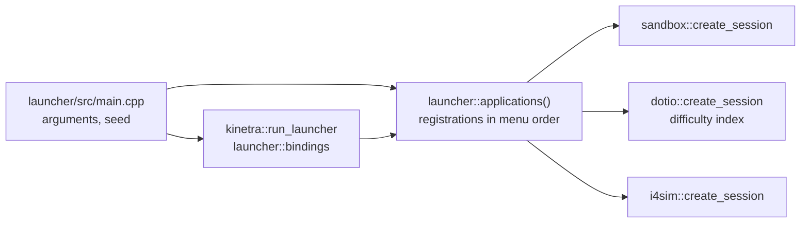

# Launcher and overlays

How Lab composes Kinetra's launcher, session requests and settings overlay into one program, and which overlay policy every Lab application shares. The mechanisms themselves (menu, `SessionHost`, `run_launcher`, `SettingsOverlay`, `DebugMenu`) are Kinetra's; their contracts are in [launcher, sessions and overlays](../external/Kinetra/docs/engine/launcher-overlays.md).

## Table of contents

- [Composition](#composition)
- [Navigation](#navigation)
- [Settings policy](#settings-policy)
- [Debug menu](#debug-menu)
- [Tests](#tests)

[Directory guide](README.md) · [Project overview](../README.md) · [Documentation index](README.md)

## Composition

*Takeaway:* the launcher only decides which applications exist, in which order and with which camera; each application owns its session.

- [applications.cpp](../launcher/src/applications.cpp) registers Demo, Dotio and i4sim in `launcher::Variant` order. Each factory resets the camera to the origin at the application's initial zoom (`sandbox::initial_zoom`, `dotio::initial_zoom`, `i4sim::initial_zoom`) and creates a fresh session.
- Dotio's configurations are its difficulty names from `dotio::difficulty_names()`; the launcher passes the chosen index back to `dotio::create_session`. The launcher never sees Dotio's difficulty type.
- `--variant` starts an application directly through `launcher::selection()`, with the `--difficulty` from the command line.
- Dotio's world is a singleton. `SessionHost` destroys the old session before the factory creates the next one, so two Dotio worlds never coexist.

## Navigation

Lab runs `kinetra::run_launcher` with `launcher::bindings` = `{std::nullopt, false}`: no menu key, and Escape never closes the window. Every Lab session derives from `lab::Session`, whose `close_on_escape()` is false, because Escape belongs to the applications (i4sim's blueprint screen uses it).

The window title is "Launcher" in the menu and the application's name in a session: "Demo", "Dotio" or "i4sim". State such as pause, counters or the loaded blueprint is drawn in the window, not put in the title. `lab::Session::status()` returns that state as one line for tests and diagnostics; the graphics tests read pause state and screen changes from it.

| Action | In the launcher | In a direct executable (`kinetra_demo`, `kinetra_dotio`, `kinetra_i4sim`) |
| --- | --- | --- |
| Settings LAUNCHER (`SessionRequest::menu`) | Back to the menu | Ends the program (`run_session` has no menu) |
| Settings EXIT (`SessionRequest::exit`) | Ends the program | Ends the program |
| i4sim blueprint screen: Escape or M (`menu`) | Back to the menu | Ends the program |
| Window close button | Ends the program | Ends the program |

## Settings policy

Each session owns a `kinetra::SettingsOverlay` built by `lab::settings_rows()` ([labs/common](../labs/common/include/lab/settings.h)), so every Lab panel has the same rows in the same order: ZOOM, STATISTICS, DEBUG MODE, FRAME TIMES, SIM CONTROLS and DEBUG CONTROLS. FRAME TIMES (off by default) draws Kinetra's frame-time graph at the top center of the window: the time between the last 240 presented frames, to tell a stalled frame from uneven presentation by the compositor ([runtime guide](../external/Kinetra/docs/engine/runtime.md#sessions-and-timing)). Applications supply only their zoom limits and their help lines; DEBUG CONTROLS always starts with `WHEEL  ZOOM`.

| Application | Zoom limits (pixels per unit) | Sim controls lines |
| --- | --- | --- |
| Demo | 17–100, 5–100 in Debug Mode | 4 |
| Dotio | 25–50, 2.5–50 in Debug Mode | 3 |
| i4sim | 0.005–10 (pixels per millimeter) | 4 |

While the panel is open:
- the application is paused by `lab::ModalPause`, which restores the earlier pause state on close (i4sim may have been paused before);
- every gameplay input is suppressed, including the click that closes the panel;
- the debug menu is hidden.

Wheel zoom uses `kinetra::zoom` with the same limits, and works only in Debug Mode while the panel is closed. Movement keys come from `lab::direction` (WASD or arrows).

## Debug menu

With Debug Mode on, the toolbar shows a DEBUG button next to SETTINGS. The button, or Backquote, opens the application's `kinetra::DebugMenu` at screen pixels (8, 32). The menu captures pointer input inside its panel, including held shooting; the session drops captured pointer commands before they reach the application. Demo and i4sim start with Debug Mode and every debug layer on; Dotio starts with them off.

## Tests

| Behavior | Test |
| --- | --- |
| Overlay layout, rows, capture and actions | Kinetra `kinetra_settings_view`, with Demo- and Dotio-shaped row sets |
| `run_launcher` requests, menu key and Escape policy | Kinetra `kinetra_engine_graphics` |
| Movement mapping and modal pause | `kinetra_lab_common` |
| The registrations: names, order, Dotio difficulties and default | `kinetra_menu` |
| Real sessions: settings, zoom, debug gating and navigation with an OpenGL context | `kinetra_graphics` and the application `*_graphics` suites |
