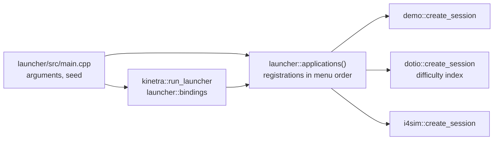

# Launcher and overlays

How Lab composes Kinetra's launcher, session requests and settings overlay into one program, and which overlay policy every Lab application shares. The mechanisms themselves (menu, `SessionHost`, `run_launcher`, `SettingsOverlay`, `DebugMenu`) are Kinetra's; their contracts are in [launcher, sessions and overlays](../external/Kinetra/docs/engine/launcher-overlays.md).

The agent inspector uses the application's current selection and opens at the top right while the debug menu stays usable on the left. Wheel input over the inspector scrolls its rows. Its X clears the selection. The optional frame-time graph moves below the inspector. An open settings panel takes input priority.

## Table of contents

- [Composition](#composition)
- [Navigation](#navigation)
- [Settings policy](#settings-policy)
- [Debug menu](#debug-menu)
- [Tests](#tests)

[Directory guide](README.md) · [Project overview](../README.md) · [Documentation index](README.md)

## Composition

*Takeaway:* the launcher only decides which applications exist, in which order and with which camera; each application owns its session.

- [applications.cpp](../launcher/src/applications.cpp) registers Demo, Dotio and i4sim in `launcher::Variant` order. Each factory resets the camera to the origin at the application's initial zoom (`demo::initial_zoom`, `dotio::initial_zoom`, `i4sim::initial_zoom`) and creates a fresh session.
- Demo and Dotio supply their configuration names through `demo::scenario_labels()` and `dotio::difficulty_names()`. The launcher passes the selected index to the application's factory.
- `--variant` starts an application directly through `launcher::selection()`. `--scenario` selects a Demo layout and `--difficulty` selects a Dotio difficulty.
- The application list shows an embedded screenshot and a short description for the highlighted lab. The pointer and arrow keys use the same selection.
- Dotio's world is a singleton. `SessionHost` destroys the old session before the factory creates the next one, so two Dotio worlds never coexist.

## Navigation

Lab runs `kinetra::run_launcher` with `launcher::bindings` = `{std::nullopt, false}`: no menu key, and Escape never closes the window. Every Lab session derives from `kinetra_lab::Session`, whose `close_on_escape()` is false, because Escape belongs to the applications (i4sim's blueprint screen uses it).

The window title is "Launcher" in the menu and the application's name in a session: "Demo", "Dotio" or "i4sim". State such as pause, counters or the loaded blueprint is drawn in the window, not put in the title. `kinetra_lab::Session::status()` returns that state as one line for tests and diagnostics; the graphics tests read pause state and screen changes from it. `kinetra_lab::Session::debug_rows()` returns the labels and depths of the session's debug-menu rows as they stand, so a tool can click a row by its label: the capture tool's tour does.

| Action | In the launcher | In a direct executable (`kinetra_demo`, `kinetra_dotio`, `kinetra_i4sim`) |
| --- | --- | --- |
| Settings LAUNCHER (`SessionRequest::menu`) | Back to the menu | Ends the program (`run_session` has no menu) |
| Debug menu SCENARIOS (Demo) or DIFFICULTY (Dotio) (`SessionRequest::configurations`) | Back to the application's configuration page, with the running configuration selected | Ends the program |
| Settings EXIT (`SessionRequest::exit`) | Ends the program | Ends the program |
| i4sim blueprint screen: Escape or M (`menu`) | Back to the menu | Ends the program |
| Window close button | Ends the program | Ends the program |

## Settings policy

Each session owns a `kinetra::SettingsOverlay` built by `kinetra_lab::settings_rows()` ([labs/shared](../labs/shared/include/kinetra_lab/settings.h)), so every Lab panel has the same rows in the same order: STATISTICS, DEBUG MODE, FRAME TIMES, FRAME LIMIT, SIM CONTROLS and DEBUG CONTROLS. Applications supply only their help lines; DEBUG CONTROLS always starts with `SHIFT + CTRL  DEBUG MENU` and `WHEEL  ZOOM`.

| Row | Effect |
| --- | --- |
| STATISTICS | The application's statistics line |
| DEBUG MODE | The debug layers, the DEBUG toolbar button and the debug zoom range. Shift+Ctrl switches it on as well |
| FRAME TIMES | Off by default. Draws Kinetra's frame-time graph in the top-right corner: the time between the last 240 presented frames and what paces them, to tell a stalled frame from uneven presentation by the compositor ([runtime guide](../external/Kinetra/docs/engine/runtime.md#sessions-and-timing)) |
| FRAME LIMIT | On by default. Where the platform has no VSync (WSLg), the runtime paces frames at the display's refresh rate; off shows the unpaced loop for comparison. Without effect where VSync works. The choice belongs to the window (`kinetra_lab::FrameLimitSwitch`), so it carries over to the next application started from the launcher |

| Application | Zoom limits (pixels per unit) | Sim controls lines |
| --- | --- | --- |
| Demo | 17–100, 5–100 in Debug Mode | 4 |
| Dotio | 25–50, 2.5–50 in Debug Mode | 3 |
| i4sim | 0.005–10 (pixels per millimeter) | 4 |

While the panel is open:
- the application is paused by `kinetra_lab::ModalPause`, which restores the earlier pause state on close (the application may have been paused before);
- every gameplay input is suppressed, including the click that closes the panel;
- the debug menu is hidden.

Ctrl opens and closes the panel when the key is released. Movement keys come from `kinetra_lab::direction` (WASD or arrows).

## Debug menu

Shift+Ctrl opens and closes the application's `kinetra::DebugMenu` at screen pixels (8, 32), and switches Debug Mode on when it was off. With Debug Mode on, the toolbar also shows a DEBUG button next to SETTINGS. The menu captures pointer input inside its panel, including held shooting and the wheel; the session drops captured pointer commands before they reach the application. Demo and i4sim start with Debug Mode and every debug layer on; Dotio starts with them off.

Every application builds its rows in its logic layer, as `kinetra::DebugEntry` values, so the menu is tested without a window. All three menus have the same shape:

| Part | Content |
| --- | --- |
| SIMULATION | RUNNING, SINGLE TICK, the speed of time (SPEED, or UPS in i4sim) and the application's own switches |
| LAYERS | What Debug Mode draws, each row with the color it is drawn in |
| Tuning sections | Values the simulation reads while it runs: MOTION and AGENTS in Demo, ENEMIES and SPAWNING in Dotio, MOTION and TRAFFIC in i4sim |
| Below the rule | ZOOM, then the application's commands, the last of which leaves for the application's own menu: GHOST CAMERA, RESET PARAMETERS and SCENARIOS in Demo or DIFFICULTY in Dotio, which return to the launcher's configuration page; FRAME SCENE and BLUEPRINTS in i4sim, which returns to its blueprint screen |

One section is open at a time (`kinetra::DebugFolds`). The rows of each application are listed in its README: [Demo](../labs/demo/README.md), [Dotio](../labs/dotio/README.md), [i4sim](../labs/i4sim/README.md).

**Zoom** is a debug tool. The ZOOM row (`kinetra_lab::ZoomControl` in [kinetra_lab/debug.h](../labs/shared/include/kinetra_lab/debug.h)) and the wheel both zoom through `kinetra::zoom` with the application's limits; the wheel only in Debug Mode and not over a panel. Leaving Debug Mode clamps the zoom to the normal range.

## Tests

| Behavior | Test |
| --- | --- |
| Overlay layout, rows, capture and actions, Ctrl and Shift+Ctrl | Kinetra `kinetra_settings_view` |
| Debug-menu clicks and buttons | Kinetra `kinetra_launcher` |
| `run_launcher` requests, the configuration page, menu key and Escape policy | Kinetra `kinetra_engine_graphics` |
| SCENARIOS and DIFFICULTY ask for the configuration page | `kinetra_graphics` |
| Movement mapping, modal pause, the settings rows, the ZOOM and SPEED rows | `kinetra_lab` |
| Each application's menu rows and what they change | `kinetra_demo_logic`, `kinetra_dotio`, `kinetra_i4sim_controller` |
| The registrations: names, order, Dotio difficulties and default | `kinetra_menu` |
| Real sessions: settings, zoom, debug gating and navigation with an OpenGL context | `kinetra_graphics` and the application `*_graphics` suites |
