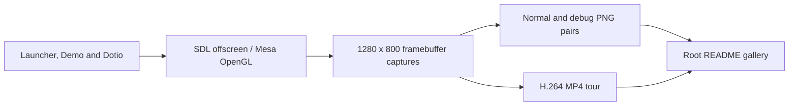

# Screenshots and demo video

Real application captures used by the project's README gallery.

## Table of contents

- [Visual overview](#visual-overview)
- [Files](#files)
- [Capture details](#capture-details)

[Parent guide / documentation index](../README.md) · [Project overview](../../README.md#screenshots-and-demo)

## Visual overview

The media records real application output; the gallery consumes the resulting files.

## Files

| Files | Contents |
| --- | --- |
| [launcher.png](launcher.png), [launcher-difficulty.png](launcher-difficulty.png) | Application menu and Dotio difficulty selection |
| [demo.png](demo.png), [demo-debug.png](demo-debug.png) | Demo with debug layers disabled and enabled |
| [dotio.png](dotio.png), [dotio-debug.png](dotio-debug.png) | Dotio with debug layers disabled and enabled |
| [dotio-settings.png](dotio-settings.png) | Dotio settings with both control sections expanded |
| [kinetra-lab-tour.mp4](kinetra-lab-tour.mp4) | 23-second tour, H.264, 1280 × 800, 30 fps, no audio |
| [i4sim.png](i4sim.png), [i4sim-debug.png](i4sim-debug.png) | i4sim with debug mode disabled and enabled |

## Capture details

Captured from the Lab launcher and session renderers using the bundled `external/Kinetra` checkout, an SDL offscreen OpenGL context and Mesa software rendering. PNG files preserve the original 1280 × 800 framebuffer. The video advances the real simulations at 60 Hz and records every second update; timing is simulated rather than a performance measurement.

Sessions use seed 42, 36 Demo agents and Medium Dotio difficulty. Each screenshot pair shows the same scene with debug mode enabled or disabled. The debug views enable vectors, steering probes, paths, collision shapes and active-agent markers; Dotio also shows AI states and uses Invulnerable during the debug portion. The normal screenshots have Debug Mode disabled.

The launcher capture shows Dotio preselected by hover and Exit highlighted blue. The tour starts with Demo selected, hovers Dotio at 0:00.5 and Exit at 0:01.

The tour shows the launcher at 0:00, difficulty selection at 0:01.5, Demo at 0:03, Demo debug at 0:07, Dotio at 0:12, Dotio debug at 0:16 and expanded Dotio settings at 0:21. PNG screenshots are linked separately so readers can inspect full-resolution details.

To refresh the media, rebuild the current checkout using the [root verification commands](../../README.md#tests-and-resources), run the applications with the [Demo controls](../../labs/demo/README.md) and [Dotio controls](../../labs/dotio/README.md), and capture at the same viewport size. Keep filenames synchronized with the [README gallery](../../README.md#screenshots-and-demo). Encode video as H.264 with `yuv420p` and MP4 fast start for broad playback support.
