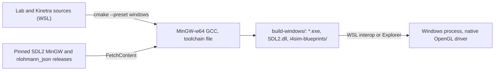

# Windows

How Kinetra-Lab builds and runs as native Windows executables, cross-compiled from Linux (WSL) with MinGW-w64. Graphics in WSL pass through WSLg: Mesa's `d3d12` driver renders, and the frame then goes through the WSLg compositor (RDP) to the Windows desktop. A native executable skips both.

## Table of contents

- [Overview](#overview)
- [Quick start from WSL](#quick-start-from-wsl)
- [How it works](#how-it-works)
- [Tests](#tests)
- [Continuous integration](#continuous-integration)
- [Limits](#limits)
- [How to change it](#how-to-change-it)

[Documentation index](README.md) · [Project overview](../README.md) · [System architecture](architecture.md)

## Overview



*Takeaway:* the source and the build stay in WSL; only the output runs on Windows.

## Quick start from WSL

Requires the Linux prerequisites from the [README](../README.md#quick-start) plus the cross compiler. On Arch Linux:

```sh
pacman -S --needed mingw-w64-gcc
```

Build and test (the first configure downloads SDL2 and nlohmann_json once per build directory):

```sh
cmake --workflow --preset windows
```

Run from WSL; interop starts the `.exe` as a Windows process:

```sh
./build-windows/kinetra.exe
./build-windows/kinetra.exe --variant i4sim
```

From Windows, open `\\wsl.localhost\<distribution>\<path to Kinetra-Lab>\build-windows\kinetra.exe` in Explorer. To run without WSL, copy the executable together with `SDL2.dll` and `i4sim-blueprints/`; nothing else is needed.

## How it works

| Piece | Where | What it does |
| --- | --- | --- |
| Toolchain file | [cmake/toolchains/x86_64-w64-mingw32.cmake](../cmake/toolchains/x86_64-w64-mingw32.cmake) | Selects `x86_64-w64-mingw32-gcc/g++`, searches libraries and packages only in the MinGW sysroot, and links the GCC runtime statically (`-static`) |
| Dependencies | [cmake/WindowsDependencies.cmake](../cmake/WindowsDependencies.cmake), included from the root [CMakeLists.txt](../CMakeLists.txt) only when cross-compiling for Windows | Downloads SDL2-devel 2.32.10 (MinGW) and nlohmann_json 3.12.0, each pinned by SHA-256; copies `SDL2.dll` next to the executables |
| Presets | [CMakePresets.json](../CMakePresets.json) | `windows`: cross build in `build-windows/`. `windows-native`: the `ci` settings for a native MSYS2 shell |
| Executable path | `default_blueprint_directory()` in [blueprint.cpp](../labs/i4sim/src/blueprint.cpp) | Finds `i4sim-blueprints/` beside the executable through `/proc/self/exe` on Linux and `GetModuleFileNameW` on Windows |

Two details of the dependency module that are easy to break:

- The SDL2 MinGW archive exports only `include/SDL2`, while Kinetra includes `<SDL2/SDL.h>`. The module adds the parent include directory to `SDL2::SDL2` before Kinetra's own `find_package(SDL2)` reuses the target.
- The host's nlohmann_json package cannot be reused: its target adds `/usr/include`, and the Linux C headers there then shadow MinGW's. The module fetches the release instead and overrides `find_package(nlohmann_json)`.

Each executable imports only `SDL2.dll` and the Windows Universal C Runtime, which is part of Windows 10 and later.

The five application executables (`kinetra`, `kinetra_sandbox`, `kinetra_demo`, `kinetra_dotio`, `kinetra_i4sim`) embed the Kinetra icon through Kinetra's `kinetra_executable_icon(<target>)` ([runtime guide](../external/Kinetra/docs/engine/runtime.md#lifecycle)), so Explorer and shortcuts show it. Every window also sets it at run time.

## Tests

`cmake --workflow --preset windows` (or `ctest --preset windows` after a build) runs every test through WSL interop on Windows, the graphics tests included: they open their windows on the Windows desktop with the real GPU driver.

Two characterization cases are excluded on Windows by the `windows` and `windows-native` test presets:

- `kinetra_demo_crowd_characterization:a dense idle crowd reproduces its recorded summary`
- `kinetra_i4sim_golden:the experimental RVO profile reproduces its recorded summary`

Their recorded summaries hash exact floating-point trajectories. They were recorded on Linux, and the Windows C runtime rounds transcendental functions differently in the last bit: the i4sim profile ends at 17582.889 mm instead of 17582.890 mm. The other golden and characterization cases match on both platforms. Linux CI still runs both cases.

## Continuous integration

The `windows` job in [ci.yml](../.github/workflows/ci.yml) runs on `windows-latest` with MSYS2 (UCRT64): GCC, CMake, Ninja, SDL2 and nlohmann_json from MSYS2's packages, then `cmake --workflow --preset windows-native`. That builds everything with the `ci` settings (engine warnings as errors, Lab warnings reported) and runs the non-graphics tests natively. The runner has no GPU for OpenGL 3.3, so the graphics tests are compiled only. The cross build itself is not run in CI; it uses the same compiler family.

## Limits

- **Frame rate.** The Windows build presents with VSync, so it runs at the monitor's refresh rate. WSLg does not apply VSync, which makes a frame count look higher there even though the compositor shows fewer frames. Simulation rates (i4sim UPS) do not depend on either.
- **Console window.** The executables use the console subsystem, so starting one from Explorer also opens a console. It shows the messages the applications print (seed, errors).
- **Warnings.** Windows is LLP64 (`long` is 32-bit), so `-Wconversion` reports more Lab warnings there than on Linux. They are reported, not errors, like on Linux; the engine has none on either platform.
- **Not covered.** MSVC and clang-cl builds are not supported: the warning flags and `-static` are GCC-specific.

## How to change it

- **Update SDL2 or nlohmann_json:** change the version and SHA-256 in [WindowsDependencies.cmake](../cmake/WindowsDependencies.cmake). The SDL2 digest is shown with the release asset on GitHub; nlohmann_json publishes none, so compute it with `sha256sum` from the downloaded `json.tar.xz`. Delete `build-windows/` and run the `windows` workflow.
- **Use a local SDL2 copy:** configure with `-DSDL2_DIR=<SDL2-devel-mingw>/cmake`; the download is then skipped.
- **Add platform-specific code:** keep it behind `#ifdef _WIN32` in a source file, as in `blueprint.cpp`, so headers and logic stay platform-neutral.
- **A golden case starts to differ on Windows:** first check whether the change is a real behavior change on Linux too. Exclude it in both Windows test presets only if the difference is last-bit floating point, and list it here.
