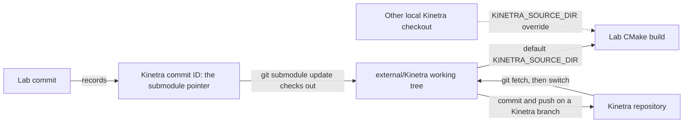

# External dependencies

Kinetra-Lab consumes the reusable Kinetra engine as a Git submodule in `Kinetra/`. This page explains how the submodule and the build fit together, and gives the manual Git steps for changing the engine, moving Lab's pointer and receiving published changes.

## Table of contents

- [How Lab consumes Kinetra](#how-lab-consumes-kinetra)
- [Rules for changes across both repositories](#rules-for-changes-across-both-repositories)
- [Change Kinetra from inside Lab](#change-kinetra-from-inside-lab)
- [Change Kinetra in a standalone checkout](#change-kinetra-in-a-standalone-checkout)
- [Build against an unpublished checkout](#build-against-an-unpublished-checkout)
- [Receive published Lab changes](#receive-published-lab-changes)
- [Put the submodule on Kinetra main](#put-the-submodule-on-kinetra-main)

[Parent guide](../README.md) · [Documentation index](../docs/README.md) · [Agent rules](../AGENTS.md)

Directory guides: [Kinetra](Kinetra/README.md).

## How Lab consumes Kinetra

Kinetra-Lab and Kinetra have separate Git histories. A Lab commit records one exact Kinetra commit (the submodule pointer), not a branch. The root CMake project builds whatever is checked out in `external/Kinetra`, or the checkout named by `KINETRA_SOURCE_DIR`; no installed package is needed. Which targets Lab links is described in the [system architecture](../docs/architecture.md#build-boundaries).



*Takeaway:* the build compiles the checked-out sources; editing `external/Kinetra` publishes nothing and does not move Lab's pointer. Only a commit in Kinetra publishes engine code, and only a Lab commit (`git add external/Kinetra`) moves the pointer. A sibling `../Kinetra` checkout is independent of both.

When Kinetra sources change, rebuilding Lab rebuilds the affected engine targets automatically. Lab's CTest runs only Lab tests; run Kinetra's own tests in Kinetra. Use a fresh build directory when switching source checkouts. Generated build outputs and downloaded build dependencies do not belong in this directory.

## Rules for changes across both repositories

The order of branches, pushes, pull requests and merges is defined in [Git with the engine submodule](../AGENTS.md#git-with-the-engine-submodule) and in the Kinetra workflow's [changes across Kinetra and Lab](Kinetra/docs/workflow.md#changes-across-kinetra-and-lab). In short: commit the engine change in Kinetra on its own branch, push it and open its pull request, then commit the pointer in Lab. The Lab pull request links the Kinetra one, and Kinetra merges first with a merge commit. The steps below are those rules as commands.

Inspect `git status` in both repositories before switching branches or updating the submodule, and preserve local work first. Stage explicit paths only.

## Change Kinetra from inside Lab

The submodule normally sits on a detached HEAD. Create a Kinetra branch before editing engine code; keep application changes in Lab.

```sh
git -C external/Kinetra switch -c <type>/<topic>
```

Edit `external/Kinetra`, then test the engine on its own and Lab against the same sources. `./build.sh` runs both (`build-core/` and `build/`); the Lab presets give the [verification level](../AGENTS.md#verification-in-lab) that the change needs:

```sh
./build.sh
cmake --workflow --preset headless
cmake --workflow --preset ci
```

For runtime changes, also run Kinetra's [graphics execution](Kinetra/docs/development.md#graphics-execution) and Lab's `cmake --workflow --preset graphics` ([tests and resources](../README.md#tests-and-resources)).

Commit the engine change in Kinetra, push its branch and open the Kinetra pull request:

```sh
git -C external/Kinetra status
git -C external/Kinetra add <engine files>
git -C external/Kinetra commit -m "<type>(<scope>): <summary>"
git -C external/Kinetra push -u origin <type>/<topic>
```

Then commit the pointer on a Lab branch, together with any application changes, push it and open the Lab pull request that links the Kinetra one:

```sh
git diff --submodule=log external/Kinetra
git add external/Kinetra
git commit -m "<type>(<scope>): <summary>"
git push -u origin <type>/<topic>
```

Once Kinetra merges, move the pointer on the Lab branch to Kinetra's merge commit before the Lab pull request merges, so Lab `main` always records a commit on Kinetra `main` ([rule](../AGENTS.md#git-with-the-engine-submodule)). The branch commit stays reachable after a merge-commit merge, but it is not the tip of `main`, so a submodule on `main` would show as modified:

```sh
git -C external/Kinetra fetch origin
git -C external/Kinetra switch main
git -C external/Kinetra pull --ff-only
git -C external/Kinetra diff --stat <recorded commit> HEAD   # empty: the verification stands
git add external/Kinetra
git commit -m "build(deps): record Kinetra main (<commit>)"
git push
```

When the diff is not empty, Kinetra `main` gained other changes; verify the Lab branch again before pushing. If the Kinetra pull request was squashed, the same steps move the pointer to the squashed commit. If the Lab pull request merged first, [put the submodule on Kinetra main](#put-the-submodule-on-kinetra-main) in a small pointer pull request.

## Change Kinetra in a standalone checkout

Develop, test, commit and push the engine branch in the standalone Kinetra repository, and open its pull request. Then select that commit in Lab's submodule and continue with the pointer commit above:

```sh
git -C external/Kinetra fetch origin
git -C external/Kinetra switch --detach origin/<type>/<topic>
cmake --workflow --preset ci
git diff --submodule=log external/Kinetra
```

Fetching alone does not change the checked-out engine, and pushing Kinetra alone does not update Lab.

## Build against an unpublished checkout

To try unpublished engine work from a sibling checkout, configure a separate build directory with an override:

```sh
cmake -S . -B build-local-core -DCMAKE_BUILD_TYPE=Release -DKINETRA_SOURCE_DIR=../Kinetra
cmake --build build-local-core --parallel
ctest --test-dir build-local-core --output-on-failure
```

The override does not move the submodule pointer, and the presets always use `external/Kinetra`. Before pushing Lab, select the pushed Kinetra commit in `external/Kinetra` and verify the normal build. If `build/` used an override before, restore it with `-DKINETRA_SOURCE_DIR="$PWD/external/Kinetra"` when configuring.

## Receive published Lab changes

Preserve local changes, pull, then check out the engine commit that Lab records:

```sh
git pull --ff-only
git submodule update --init --recursive
git submodule status
cmake --workflow --preset dev
```

In `git submodule status`, a leading space means the checkout matches Lab's recorded commit, `-` means uninitialized, and `+` means a different commit is checked out. `git submodule update` selects Lab's recorded commit, not the latest Kinetra `main`. Lab application changes never flow into Kinetra; make reusable engine changes in Kinetra and publish them there.

## Put the submodule on Kinetra main

`git submodule update` checks out the commit that Lab records, not a branch, so `external/Kinetra` normally sits on a detached HEAD. That is the intended state: the build uses exactly the engine Lab was tested with. A branch is only needed to commit in Kinetra ([above](#change-kinetra-from-inside-lab)) or to follow Kinetra's `main`.

To put the submodule on Kinetra's `main`, check that it has no local work, then switch and pull:

```sh
git -C external/Kinetra status
git -C external/Kinetra switch main
git -C external/Kinetra pull --ff-only
git submodule status
```

If the pull asks for SSH authentication, switch the submodule to HTTPS as in the [quick start](../README.md#quick-start).

In lazygit: in the Lab repository, open the *Submodules* tab of the Files panel (`]` cycles the tabs) and press Enter on `external/Kinetra`. In its Branches panel (`3`), select `main`, check it out with space and pull with `p`. Esc returns to Lab.

Switching usually moves the checkout away from the recorded commit, even when that commit is already in `main`: after a merge-commit merge, the tip of `main` is the merge commit, not the commit Lab records. `git submodule status` then shows `+`, and `git status` in Lab shows `modified: external/Kinetra (new commits)`. Pick one:

| Goal | Action |
| --- | --- |
| Keep Lab's recorded engine | `git submodule update external/Kinetra`, which returns to the recorded commit on a detached HEAD. Being on `main` locally changes nothing for others |
| Record Kinetra `main` in Lab | Commit the pointer on a Lab branch, push it and open a Lab pull request, as below |

Record the pointer only when the submodule is on a commit that is already on `origin/main`: `git -C external/Kinetra status -sb` must show `## main...origin/main` without `[ahead N]`. Then no Kinetra pull request is needed:

```sh
git switch -c build/<topic>
git diff --submodule=log external/Kinetra
git add external/Kinetra
git commit -m "build: update Kinetra to its main"
git push -u origin build/<topic>
```

Open the pull request with `gh pr create`; it merges like any Lab change. In lazygit, stage `external/Kinetra` in the Lab Files panel with space, commit with `c` and push with `P`, after creating the branch in the Branches panel with `n`. Stage the pointer on purpose: a moved submodule is easy to commit by accident together with other Lab changes.
