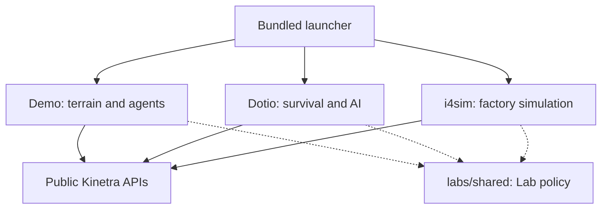

# Labs

Applications and experiments built on the public Kinetra APIs. Each lab owns its application logic, presentation and tests; reusable engine functionality belongs in Kinetra. The [applications table](../README.md#applications) lists their targets.

## Table of contents

- [Visual overview](#visual-overview)
- [Shared Lab code](#shared-lab-code)
- [Build and run](#build-and-run)
- [Verification](#verification)

[Parent guide](../README.md) · [Documentation index](../docs/README.md)

Directory guides: [demo](demo/README.md), [dotio](dotio/README.md), [i4sim](i4sim/README.md).

## Visual overview

Each application owns its policy and tests while consuming shared engine mechanisms.



## Shared Lab code

Code shared between applications stays application-neutral ([Lab boundaries](../AGENTS.md#lab-boundaries)):

- [shared/include/kinetra_lab](shared/include/kinetra_lab/) (target `kinetra_lab`, header-only; include as `"kinetra_lab/input.h"`) holds the policy every application shares: `kinetra_lab::Session` (Escape never closes a Lab window), `kinetra_lab::settings_rows` (the settings panel's rows), `kinetra_lab::direction` (WASD and arrows), `kinetra_lab::without_keys` (a frame's input without the keys a typed number took), `kinetra_lab::ModalPause` (pause while the panel is open), and `kinetra_lab::ZoomControl` and `kinetra_lab::ups_entry` (the ZOOM and UPS rows of every debug menu, with Lab's UPS limits of 1 to 1,000,000 and `tick_share`, the share of a frame its ticks may use). Each application's FPS row is Kinetra's `FrameRateSetting`. The shared drawing helpers include `kinetra_lab::route_start` (the start of a route that a PATHS layer draws over its own body, in `kinetra_lab/route.h`), and `kinetra_lab::draw_vector_start` and `draw_line_start` (the part of a body's own debug arrow or line drawn over that body, in `kinetra_lab/under_bodies.h`). Input and pause are in `kinetra_lab/input.h` and the debug rows in `kinetra_lab/debug.h`; both need no window, so an application's logic library may use them. The route helper needs no window. The others need the runtime. The mechanisms behind them are Kinetra's; see [launcher and overlays](../docs/launcher-overlays.md#settings-policy).
- [kinetra_lab/testing/test_support.h](shared/tests/include/kinetra_lab/testing/test_support.h) holds header-only helpers for the test programs (target `kinetra_lab_testing`, built only with `BUILD_TESTING`).

## Build and run

Build from the repository root; this directory is included by the top-level CMake project. See the [quick start](../README.md#quick-start) for dependencies and Kinetra setup.

```sh
cmake -S . -B build -DCMAKE_BUILD_TYPE=Release
cmake --build build --parallel
./build/kinetra_demo --frames 120
./build/kinetra_dotio --difficulty medium --frames 120
./build/kinetra_i4sim --frames 120
```

The [launcher](../launcher/README.md) also provides a shared menu for all applications.

## Verification

For logic tests without graphical applications, run from the repository root:

```sh
cmake --workflow --preset headless
```

It configures, builds and tests in `build-headless/` with `KINETRA_LAB_BUILD_RUNTIME=OFF`. See [tests and resources](../README.md#tests-and-resources) for graphics checks. Application-specific behavior and verification are documented in the guides above.

Use at least 100,000 ticks per run for sustained headless comparisons. The i4sim motion benchmark defaults to 1,000,000 ticks. A fixed simulation tick keeps its duration at every requested UPS. The headless workloads execute without waiting on wall-clock time. Measured UPS depends on the workload and machine. [Performance measurement commands](../docs/performance.md#how-to-measure)
