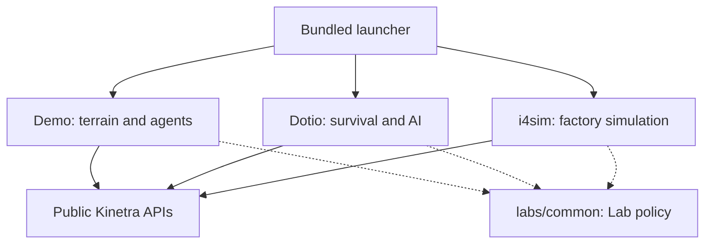

# Labs

Applications and experiments built on the public Kinetra APIs. Each lab owns its application logic, presentation and tests; reusable engine functionality belongs in Kinetra. The [applications table](../README.md#applications) lists their targets.

## Table of contents

- [Visual overview](#visual-overview)
- [Shared Lab code](#shared-lab-code)
- [Build and run](#build-and-run)
- [Verification](#verification)

[Parent guide](../README.md) · [Documentation index](../docs/README.md)

Directory guides: [demo](demo/README.md), [dotio](dotio/README.md), [i4sim](i4sim/README.md).

## Visual overview

Each application owns its policy and tests while consuming shared engine mechanisms.



## Shared Lab code

Code shared between applications stays application-neutral ([Lab boundaries](../AGENTS.md#lab-boundaries)):

- [common/include/lab](common/include/lab/) (target `kinetra_lab_common`, header-only) holds the policy every application shares: `lab::Session` (Escape never closes a Lab window), `lab::settings_rows` (the settings panel's rows), `lab::direction` (WASD and arrows) and `lab::ModalPause` (pause while the panel is open). The mechanisms behind them are Kinetra's; see [launcher and overlays](../docs/launcher-overlays.md#settings-policy).
- [test_support/test_support.h](test_support/test_support.h) holds header-only helpers for the test programs (target `kinetra_lab_test_support`, built only with `BUILD_TESTING`).

## Build and run

Build from the repository root; this directory is included by the top-level CMake project. See the [quick start](../README.md#quick-start) for dependencies and Kinetra setup.

```sh
cmake -S . -B build -DCMAKE_BUILD_TYPE=Release
cmake --build build --parallel
./build/kinetra_demo --frames 120
./build/kinetra_dotio --difficulty medium --frames 120
./build/kinetra_i4sim --frames 120
```

The [launcher](../launcher/README.md) also provides a shared menu for all applications.

## Verification

For logic tests without graphical applications, run from the repository root:

```sh
cmake --workflow --preset headless
```

It configures, builds and tests in `build-headless/` with `KINETRA_LAB_BUILD_RUNTIME=OFF`. See [tests and resources](../README.md#tests-and-resources) for graphics checks. Application-specific behavior and verification are documented in the guides above.
