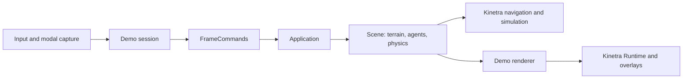
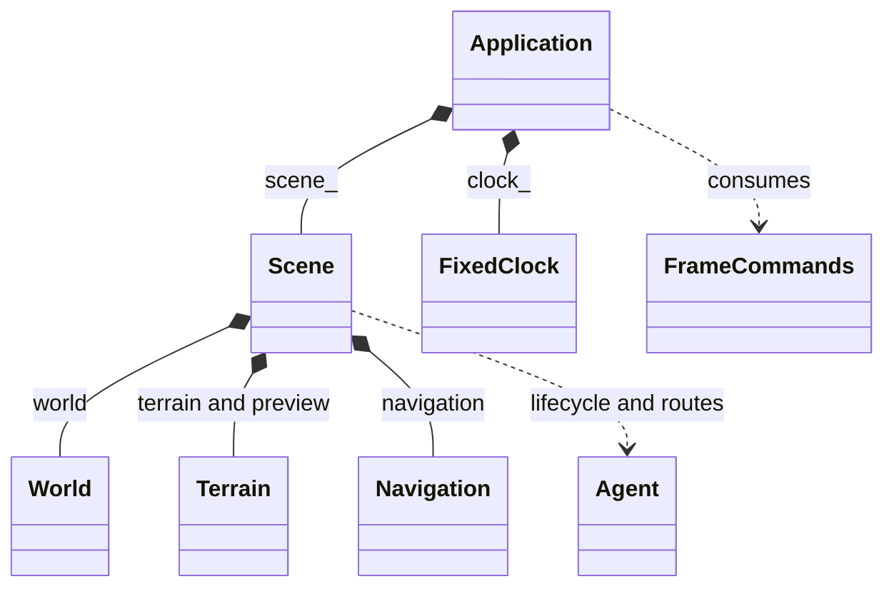

# Demo

Reference application for public Kinetra physics, navigation, camera, runtime and UI APIs. [Setup and commands](../../README.md#quick-start) are maintained in the root README.

## Table of contents

- [Visual overview](#visual-overview)
- [Layout](#layout)
- [Controls](#controls)
- [Scene ownership and streaming](#scene-ownership-and-streaming)
- [Navigation and agents](#navigation-and-agents)
- [Verification and limits](#verification-and-limits)

[Parent guide](../README.md) · [Project overview](../../README.md) · [Documentation index](../../docs/README.md)

## Visual overview

The session adapts input and rendering; the headless application owns simulation policy.



## Layout

```text
labs/demo/
  include/demo/
    application.h  debug_panel.h  zoom.h
    world/          agent.h  terrain.h  scene.h  tuning.h
    input/          mapping.h  commands.h  player_control.h
    presentation/   session.h  renderer.h  help_overlay.h
  src/              application.cpp  debug_panel.cpp  main.cpp
    presentation/   renderer.cpp  session.cpp
  tests/            one doctest suite per behavior area
```

Headers are included by their path below `include/`, for example `"demo/world/agent.h"`. These are Lab-owned interfaces, not part of the public Kinetra engine API.

| Folder | Holds | Target |
| --- | --- | --- |
| `include/demo/`, `src/` | The headless application coordinator and the debug menu rows | `kinetra_demo_logic` |
| `world/` | Headless scene state: the physics world, streamed terrain, agents and their tuning | `kinetra_demo_logic` |
| `input/` | Window-free input mapping and the per-frame commands it produces | `kinetra_demo_logic` |
| `presentation/` | Session and drawing; needs `Kinetra::Runtime` | `kinetra_demo_presentation` |
| `src/main.cpp` | The direct executable | `kinetra_demo` |

The application owns the scene and the fixed clock; the scene owns the world, terrain and navigation and drives the agents. Solid diamonds denote owned values; dashed arrows show supplied commands and lifecycle control.



| Header | Responsibility |
| --- | --- |
| [application.h](include/demo/application.h) | Headless application coordinator and fixed clock; the caller supplies elapsed time, intent and the camera viewport |
| [debug_panel.h](include/demo/debug_panel.h) | The debug menu rows and the state they change, the debug-layer colors and the `tuning_step` limits |
| [world/scene.h](include/demo/world/scene.h) | World, terrain residency, mixed population, immutable avoidance snapshots and body-index remapping |
| [world/agent.h](include/demo/world/agent.h) | Seeded wandering, commanded routes and lifecycle state |
| [world/terrain.h](include/demo/world/terrain.h) | Seeded chunk generation and preview cache |
| [world/tuning.h](include/demo/world/tuning.h) | Motion and wander values that change while the scene runs; the defaults reproduce the former constants |
| [input/commands.h](include/demo/input/commands.h) | One frame of commands and presentation options |
| [input/mapping.h](include/demo/input/mapping.h) | Input mapping and debug capture adapter |
| [input/player_control.h](include/demo/input/player_control.h) | Player movement intent |
| [presentation/session.h](include/demo/presentation/session.h) | Demo Session factory and default initial population |
| [presentation/renderer.h](include/demo/presentation/renderer.h) | Scene rendering interface |
| [presentation/help_overlay.h](include/demo/presentation/help_overlay.h) | Application help content |
| [zoom.h](include/demo/zoom.h) | Zoom limits in and outside Debug Mode, apart from the scene headers so the launcher can start a Demo without compiling the scene |

| Source | Responsibility |
| --- | --- |
| [application.cpp](src/application.cpp) | Command, camera, pointer and fixed-update ordering |
| [debug_panel.cpp](src/debug_panel.cpp) | The menu sections, their rows and the commands the rows produce |
| [presentation/session.cpp](src/presentation/session.cpp) | Session adapter, bindings, enabled-by-default debug layers and reciprocal/legacy avoidance selection |
| [presentation/renderer.cpp](src/presentation/renderer.cpp) | World rendering with matching convex polygon fills/outlines, culling and application overlays; path and steering-probe strokes are three logical pixels at every zoom |
| [main.cpp](src/main.cpp) | Direct executable and argument handling |

`main.cpp` and the bundled launcher's factory create the same session from `session.h`, so a direct launch and a launch from the menu behave alike.

## Controls

| Input | Behavior |
| --- | --- |
| WASD / arrows | Move player; move camera only in debug Ghost |
| Q/E or Shift+Left/Right | Rotate; manual input cancels walking |
| Click | Select agent, command selected agent, otherwise walk player |
| Click selected agent again | Clear selection |
| Right-click | Clear selection |
| Click in Ghost | Teleport real player to free visible destination, when settings is closed |
| SETTINGS button / Ctrl | Open/close centered settings; pause while open |
| Settings Statistics / Debug Mode | Toggle statistics / enable debug tools |
| Settings Frame Times / Frame Limit | Show the frame-time graph / pace frames where the platform has no VSync |
| Shift+Ctrl | Open/close the upper-left debug menu; switches Debug Mode on when it was off |
| DEBUG button (next to Settings) | Toggle the debug menu in Debug Mode |
| Wheel / ZOOM row of the debug menu | Zoom in Debug Mode: 5–100 px/unit; leaving Debug Mode clamps to 17–100 |
| Settings Launcher / Exit | Return to bundled launcher / exit the application |

Settings shows the help lines of SIM CONTROLS and DEBUG CONTROLS only after a click on their heading, and consumes all gameplay input. Resume or Ctrl closes settings and resumes the run. Space and M have no gameplay action. F/P/R/G/Tab/C have no gameplay shortcuts.

Demo starts with Debug Mode, statistics and the layers VECTORS, STEERING PROBES, PATHS, COLLISION SHAPES and ACTIVE AGENTS on. Ghost Camera, Gravity, HOME RANGE and CLICK SETS GOAL start off; the debug menu starts closed.

### Debug menu

The menu is a tree with one section open at a time; SIMULATION is open at the start. [`DebugPanel`](include/demo/debug_panel.h) builds it in the logic layer, so its rows are tested without a window ([launcher and overlays](../../docs/launcher-overlays.md#debug-menu)).

| Section | Rows |
| --- | --- |
| SIMULATION | RUNNING (pause and resume), SINGLE TICK (pauses, then runs one 120 Hz tick per click), SPEED (time scale 0.125× to 4×), GRAVITY |
| LAYERS | VECTORS, STEERING PROBES, PATHS, COLLISION SHAPES, ACTIVE AGENTS, HOME RANGE, each with the color it is drawn in. HOME RANGE draws a line from every awake agent to its home, and the range circle of the selected agent |
| MOTION | AVOIDANCE (RECIPROCAL or LEGACY), MAX SPEED, ACCELERATION, RESPONSE, CLEARANCE; then HORIZON and PASSING BIAS for reciprocal avoidance, or LOOKAHEAD, SEPARATION and SEP WEIGHT for legacy steering |
| AGENTS | WANDER (STEERING or ROUTE), HOME RANGE, then WANDER REACH and WANDER JITTER for steering wander, and CLICK SETS GOAL |
| Below the rule | ZOOM, GHOST CAMERA, RESET PARAMETERS (the default motion and wander values, reciprocal avoidance, speed 1×) |

The MOTION and AGENTS rows change the scene's [`Tuning`](include/demo/world/tuning.h) between ticks, within limits the steering code accepts (`tuning_step` in [debug_panel.h](include/demo/debug_panel.h)); the defaults are the values the scene used as constants before. Debug Mode gates layers, gravity and Ghost; leaving it restores player following. The tuned values, the avoidance model and the time scale persist outside Debug Mode. CLICK SETS GOAL makes a click command every awake agent; switch it off for individual selection. LEGACY compares the nearest-obstacle steering with the reciprocal avoidance in the same scene. The statistics line shows PAUSED or the time scale when the scene does not run in real time.

The camera follows the player by default. Ghost moves only the camera; clicking teleports the player and clears momentum/routes after validating destination clearance. No swept teleport path is required. A yellow outline identifies the selected agent. Overlay pointer capture precedes gameplay mapping.

## Scene ownership and streaming

See [Demo architecture](../../docs/demo-architecture.md) for component ownership, lifecycle and the engine boundary.

Drawing runs between fixed ticks: `Application` keeps every body's pose before and after the last 120 Hz tick, and the renderer draws moving bodies at `presented_pose(id)`, with the camera on the drawn player for that frame ([drawing between ticks](../../docs/architecture.md#session-ownership-and-frame-flow)).

Moving bodies now include circles, boxes, triangles, pentagons and hexagons. Polygon rendering and collision outlines use the same convex vertices. Circle and nonrotating box/polygon pairs use continuous contact detection on a shared timeline, including moving/moving pairs. Pairs containing rotating boxes/polygons still use discrete contacts. Steering and navigation remain conservative envelope-based; this is not yet a collision-free multi-agent or vehicle simulation.

Terrain uses 32-world-unit chunks with seeded static circles/rotated rectangles. Independent seed/coordinate streams regenerate identical geometry, including negative coordinates and revisits. Each process chooses and prints a new seed. Generation reserves the initial spawn area and rejects local overlaps; global navigability is not guaranteed.

| Region / bound | Policy |
| --- | --- |
| Physics terrain residency | Player-centered 1.25× maximum debug view |
| Ghost preview | Separate cached visible terrain, without distant physics/population |
| Agent activation | Body-AABB overlap with 1.75× maximum normal player view |
| Agent retention | Evict beyond 1.25× maximum debug player view |
| Navigation | Activation area plus 24-unit wander margin |
| Population | 48 initial agents near the player; new activation chunks attempt 12 safe spawns; cap 1,200 |

The launcher’s `--agents 0..300` overrides the default initial population. The standalone Demo also starts with 48 agents. Initial agents sample a 72×48-unit region centered on the initial player, with reserved player/prop clearances. Zoom and Ghost position do not affect player-centered lifecycle bounds; viewport size does. Dormant agents discard paths, ignore new goals and freeze timers. During physics they temporarily become fixed obstacles; full body state is restored afterward. Distant-agent eviction compacts movers and remaps surviving agent/player indices. Terrain rebuilding preserves movers before appending static obstacles.

Terrain validates finite ordered views, ±200,000-unit bounds and a maximum 4,096 chunks. Camera centers are clamped to ±100,000. Neither agent state nor world edits persist after eviction; revisits can create fresh agents. Physics outside resident terrain is inactive.

## Navigation and agents

The reusable [planner](../../external/Kinetra/docs/engine/navigation.md) owns A*, swept clearance and route shortening. Demo selects one-unit spacing and a conservative 0.85-unit circular envelope. Exact free clicks stay exact; occupied clicks project to the closest reachable free node. Outside/disconnected free goals fail. Outward recovery can leave conservative clearance margins without crossing a surface.

| Decision | Demo policy |
| --- | --- |
| Home | Where the agent was placed. Beyond its home range (12 units, tunable) it turns back, so the population stays spread over the terrain instead of drifting away from where it was created |
| Wander by steering (default) | No route. The agent aims at a point on a circle ahead of it: WANDER REACH (3 units) along its direction of travel, half of that out at a wander angle that drifts by a seeded random amount of at most WANDER JITTER (4 rad/s). Beyond 60 % of the home range the direction blends toward home, fully at the range |
| Stalled steering wanderer | Slower than 30 % of its top speed, an agent turns its heading on the spot at 2 rad/s, and the pull toward home fades over one second, so it walks out of a pocket between terrain before it heads home again |
| Wander by route | Persistent seeded heading with bounded turns; short reachable goals 4–8 units away; beyond the home range a leg starts toward home |
| Route sampling | At most 12 candidates per choice; retry failed choices after two simulated seconds |
| Replan | Every two simulated seconds and after terrain invalidation |
| Route wander timeout | 0.8–1.6 active simulated seconds; bounded acceleration smooths frequent goal changes into curves |
| Command timeout | 20 active simulated seconds |
| Arrival / expired command | Resume wandering from the current/arrival location; the home range then brings the agent back |
| Failed route | Hold position and retry while the relevant policy permits |

Commanded travel (a click on a selected agent, or CLICK SETS GOAL) always plans a route, because its goal can lie behind obstacles. Route following looks ahead around visible corners and brakes only at the final endpoint. Agents use the shared [reciprocal local avoidance](../../external/Kinetra/docs/engine/navigation.md#reciprocal-local-avoidance) with, by default, a 1.5-second horizon, speed limit 4, acceleration limit 12 and 0.05-unit clearance. All active agents read the same neighbor snapshot. Sleeping agents are stationary noncooperative neighbors; the manually controlled player and passive props also receive full avoidance responsibility from agents. Keyboard player control remains direct. The legacy comparison mode retains its personal-space separation.

Avoidance considers moving-body envelopes. A route keeps its own clearance from terrain, so an agent on a route looks at movers only. An agent that wanders by steering has no route and also avoids the terrain near it: as bodies for the legacy steering, and for the reciprocal avoidance as noncooperative circles, a rotated box as a row of up to six circles along its long side. The scene keeps a spatial index of the loaded terrain for this and rebuilds it only when terrain changes. Neighbor reach includes the horizon, the largest actor footprint and current actor speeds. `AVOID LIMIT` in statistics counts active agents whose requested avoidance constraints could not all be met in the last fixed tick; it does not count physical collisions. Headings turn gradually. Global pause consumes elapsed clock time without advancing simulation, commands or wander timers; a single tick runs one tick of a paused scene.

## Verification and limits

### Tests

Every test program is a doctest suite: each `TEST_CASE` is one behavior, named after its expected outcome, and CTest registers it as `<suite>:<case>`. How to write cases is in [Kinetra testing](../../external/Kinetra/docs/testing.md#writing-a-doctest-suite). All suites except the presentation one run without a window; that one needs an OpenGL context.

| Source | CTest suite (cases) | Coverage |
| --- | --- | --- |
| [crowd_characterization_tests.cpp](tests/crowd_characterization_tests.cpp) | `kinetra_demo_crowd_characterization` (4) | Pins crowd behavior in both wander modes, so a refactor can prove that it preserves behavior. A dense idle crowd (240 agents, seed 123, 480 frames) and a player walking through newly streamed chunks with commanded agents (40 agents, seed 456, 1200 frames) check every frame for finite motion, an intact swept-event budget, a one-to-one agent-to-body mapping and at most 0.01 units of overlap between moving bodies. Each scenario and wander mode is one case and must reproduce a recorded summary line with a trajectory fingerprint; a mismatch shows the expected and actual line. `KINETRA_PRINT_GOLDEN=1` prints the current lines for a deliberate update |
| [crowd_stability_tests.cpp](tests/crowd_stability_tests.cpp) | `kinetra_demo_crowd` (5) | 60 simulated seconds per case. 240 initial agents with seeds 123 and 456 and steering wander, and seed 123 with route wander; rejects swept-event starvation, nonfinite motion and the spinning tangent-contact freeze. Two more cases watch 48 agents around a standing player, one per wander mode: at least 80 % of those awake after a second are still awake after a minute (labels `unit` and `soak`, 180-second timeout per case) |
| [contact_tests.cpp](tests/contact_tests.cpp) | `kinetra_demo_contacts` (6) | Slow/fast head-on elastic moving contacts at 60/120 Hz, momentum/energy conservation, transformed circle/box contacts, off-center angular momentum and resting-wall stability; circle/box/polygon thin-wall translation regressions (rotation and avoidance remain outside this guarantee) |
| [terrain_tests.cpp](tests/terrain_tests.cpp) | `kinetra_demo_terrain` (24) | Deterministic terrain streaming and compaction, crowded polygon population near the initial camera, sleep/wake, wandering by steering and by route, the home range, commands, detours, clearance, recovery and arrival, navigation and Ghost preview isolation |
| [application_tests.cpp](tests/application_tests.cpp), [debug_panel_tests.cpp](tests/debug_panel_tests.cpp) | `kinetra_demo_logic` (27) | Pause/resume, time scale and single tick, input commands and bindings, camera/pointer ordering, avoidance-mode switching and reset behavior; tuning defaults, limits and effect; steering wanderers around terrain in both avoidance models; the debug menu's rows, limits and commands |
| [presentation_tests.cpp](tests/presentation_tests.cpp) | `kinetra_demo_graphics` (1) | Help overlay placement, camera preservation, routes and OpenGL rendering; one case, because every check shares one `Runtime` (label `graphics`) |

Run the suites that need no window from the repository root:

```sh
cmake --preset headless
cmake --build --preset headless --target kinetra_demo_terrain_tests kinetra_demo_tests kinetra_demo_contact_tests kinetra_demo_crowd_tests kinetra_demo_crowd_characterization_tests
ctest --preset headless -R '^kinetra_demo(|_terrain|_contacts|_crowd|_crowd_characterization):'
```

Add `-LE soak` to skip the five 60-second crowd runs. One case runs on its own through CTest (`-R 'kinetra_demo_terrain:a ghost camera'`) or the executable (`./build-headless/kinetra_demo_terrain_tests --test-case='a ghost camera*'`).

After a deliberate change to crowd behavior, print the new characterization lines, copy them into `crowd_characterization_tests.cpp` and explain the change in the commit message:

```sh
KINETRA_PRINT_GOLDEN=1 ./build-headless/kinetra_demo_crowd_characterization_tests
```

For `kinetra_demo_graphics`, use the `graphics` preset, which needs an OpenGL context as described in [Tests and resources](../../README.md#tests-and-resources): `cmake --preset graphics`, `cmake --build --preset graphics --target kinetra_demo_presentation_tests`, then `ctest --preset graphics -R '^kinetra_demo_graphics:'`.

### Limits

The circular planning envelope can reject narrow gaps; moving crowds may prevent arrival. An agent whose home lies within its range of the edge of the active area can still walk out and fall asleep there, and in a dense crowd agents stray up to about ten units beyond their range for moments. The fixed clock runs at most 16 ticks per frame, so at the fastest time scale of 4 simulated time falls behind below 30 frames per second. Rendering culls offscreen bodies and reuses Ghost chunks. Physics and steering still consume resident data. Desktop feel/performance requires manual Artix checks. Decisions behind this design: [terrain](../../external/Kinetra/docs/decisions/0002-camera-driven-terrain.md), [application boundary](../../external/Kinetra/docs/decisions/0004-sandbox-application-boundaries.md), [agent lifecycle](../../external/Kinetra/docs/decisions/0005-sandbox-agent-lifecycle.md).
