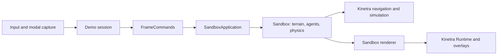

# Demo

Reference application for public Kinetra physics, navigation, camera, runtime and UI APIs. [Setup and commands](../../README.md#quick-start) are maintained in the root README.

## Table of contents

- [Visual overview](#visual-overview)
- [Controls](#controls)
- [Scene ownership and streaming](#scene-ownership-and-streaming)
- [Navigation and agents](#navigation-and-agents)
- [Verification and limits](#verification-and-limits)
- [Source navigation](#source-navigation)

[Parent guide](../README.md) · [Project overview](../../README.md) · [Documentation index](../../docs/README.md)

Directory guides: [include](include/README.md), [src](src/README.md), [tests](tests/README.md).

## Visual overview

The session adapts input and rendering; the headless application owns simulation policy.

## Controls

| Input | Behavior |
| --- | --- |
| WASD / arrows | Move player; move camera only in debug Ghost |
| Q/E or Shift+Left/Right | Rotate; manual input cancels walking |
| Click | Select agent, command selected agent, otherwise walk player |
| Click selected agent again | Clear selection |
| Click in Ghost | Teleport real player to free visible destination, when settings is closed |
| SETTINGS button / Ctrl | Open/close centered settings; pause while open |
| Settings zoom buttons | Adjust camera scale: 17–100 px/unit normally; 5–100 in debug |
| Settings Statistics / Debug Mode | Toggle statistics / enable debug tools |
| Debu button (next to Settings) | Toggle the upper-left debug menu in Debug Mode |
| Wheel | Zoom during gameplay only in Debug Mode |
| Settings Launcher / Exit | Return to bundled launcher / exit the application |

Settings reveals centered help controls only after clicking Show Controls and consumes all gameplay input. Resume or Ctrl closes settings and resumes the run. Space and M have no gameplay action. Statistics and Debug Mode are configured exclusively in settings.

Debug rows, in order: Ghost Camera, Vectors, Steering Probes, Paths, Collision Shapes, Active Agents, Agent Goal, Gravity. Debug Mode gates visualization/Ghost; leaving it restores player following. Gravity is last. Agent Goal makes clicks command all active agents; disable it for individual selection. F/P/R/G/Tab/C have no gameplay shortcuts.

The camera follows the player by default. Ghost moves only the camera; clicking teleports the player and clears momentum/routes after validating destination clearance. No swept teleport path is required. A yellow outline identifies the selected agent. Overlay pointer capture precedes gameplay mapping.

## Scene ownership and streaming

See [Demo architecture](../../docs/demo-architecture.md) for component ownership, lifecycle and the engine boundary.

Terrain uses 32-world-unit chunks with seeded static circles/rotated rectangles. Independent seed/coordinate streams regenerate identical geometry, including negative coordinates and revisits. Each process chooses and prints a new seed. Generation reserves the initial spawn area and rejects local overlaps; global navigability is not guaranteed.

| Region / bound | Policy |
| --- | --- |
| Physics terrain residency | Player-centered 1.25× maximum debug view |
| Ghost preview | Separate cached visible terrain, without distant physics/population |
| Agent activation | Body-AABB overlap with 1.75× maximum normal player view |
| Agent retention | Evict beyond 1.25× maximum debug player view |
| Navigation | Activation area plus 24-unit wander margin |
| Population | Zero initial agents; new activation chunks attempt three safe spawns; cap 1,200 |

`--agents 0..300` optionally adds an initial seeded population. Zoom and Ghost position do not affect player-centered lifecycle bounds; viewport size does. Dormant agents discard paths, ignore new goals and freeze timers. During physics they temporarily become fixed obstacles; full body state is restored afterward. Distant-agent eviction compacts movers and remaps surviving agent/player indices. Terrain rebuilding preserves movers before appending static obstacles.

Terrain validates finite ordered views, ±200,000-unit bounds and a maximum 4,096 chunks. Camera centers are clamped to ±100,000. Neither agent state nor world edits persist after eviction; revisits can create fresh agents. Physics outside resident terrain is inactive.

## Navigation and agents

The reusable [planner](https://github.com/SMB-M87/Kinetra/blob/main/docs/engine/navigation.md) owns A*, swept clearance and route shortening. Demo selects one-unit spacing and a conservative 0.85-unit circular envelope. Exact free clicks stay exact; occupied clicks project to the closest reachable free node. Outside/disconnected free goals fail. Outward recovery can leave conservative clearance margins without crossing a surface.

| Decision | Demo policy |
| --- | --- |
| Wander | Per-agent seeded forward-biased goals 5–16 units away; accept routes at least two units long |
| Sampling | At most 12 candidates per choice; retry failed choices after two simulated seconds |
| Replan | Every two simulated seconds and after terrain invalidation |
| Wander timeout | 10–18 active simulated seconds |
| Command timeout | 20 active simulated seconds |
| Arrival / expired command | Resume wandering from the current/arrival location, without returning home |
| Failed route | Hold position and retry while the relevant policy permits |

Route following looks ahead around visible corners and brakes only at the final endpoint. Local avoidance considers movers; planned static terrain does not compete with avoidance. Agents enable personal-space separation. Headings turn gradually. Global pause consumes elapsed clock time without advancing simulation, commands or wander timers.

## Verification and limits

[Terrain tests](tests/terrain_tests.cpp) cover deterministic streaming, compaction, sleep/wake, wandering, commands, detours, clearance, recovery and arrival. [Application tests](tests/sandbox_application_tests.cpp) cover pause, camera, pointer ordering and bindings. [Presentation tests](tests/presentation_tests.cpp) cover rendered scene/debug/help behavior.

The circular planning envelope can reject narrow gaps; moving crowds may prevent arrival. Rendering culls offscreen bodies and reuses Ghost chunks. Physics and steering still consume resident data. Desktop feel/performance requires manual Artix checks. Design history: [terrain](https://github.com/SMB-M87/Kinetra/blob/main/docs/decisions/0002-camera-driven-terrain.md), [application boundary](https://github.com/SMB-M87/Kinetra/blob/main/docs/decisions/0004-sandbox-application-boundaries.md), [agent lifecycle](https://github.com/SMB-M87/Kinetra/blob/main/docs/decisions/0005-sandbox-agent-lifecycle.md).

## Source navigation

[Headers](include/README.md) and [implementation](src/README.md) describe the local source layout.
