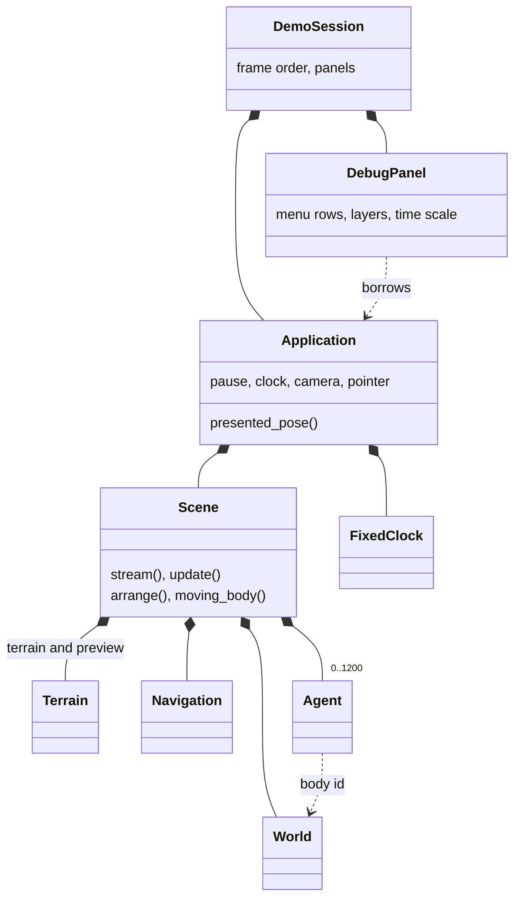
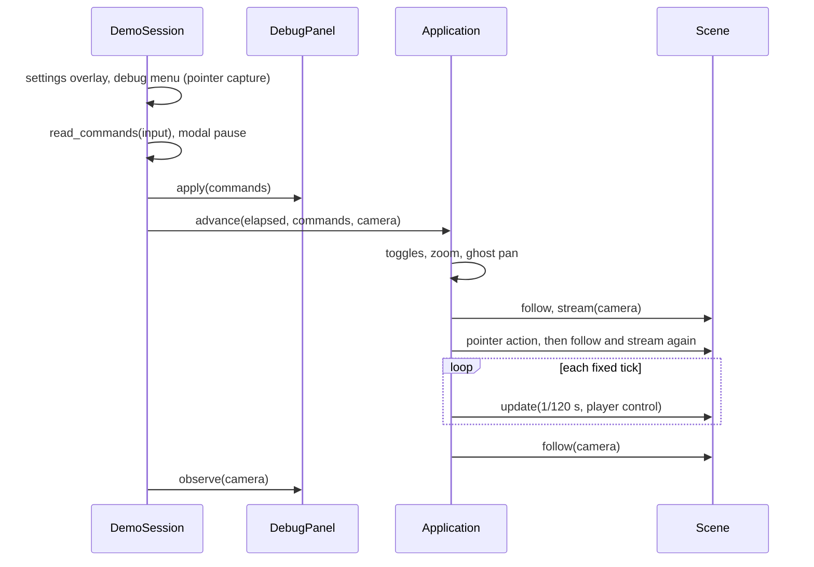
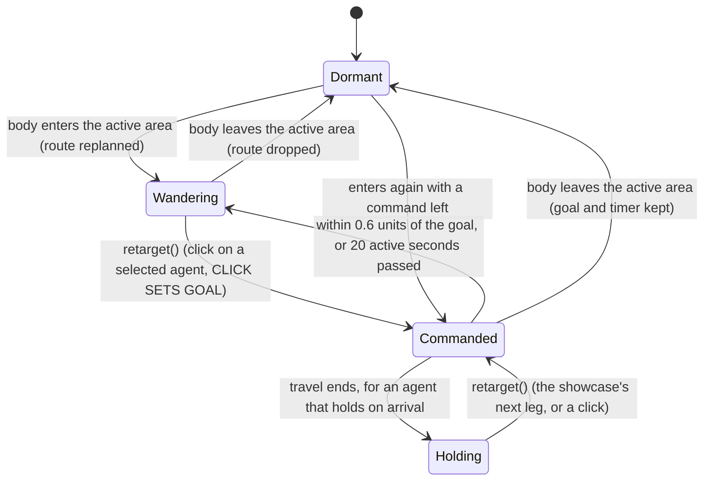

# Demo

The Demo is Kinetra-Lab's reference application for the public Kinetra engine. Its scenarios show streamed terrain, physics and contacts, route planning and local avoidance. Start it through the bundled launcher or `kinetra_demo`. [Setup and commands](../../README.md#quick-start) are in the root README.

## Table of contents

- [Purpose and scope](#purpose-and-scope)
- [Scenarios](#scenarios)
- [Controls](#controls)
- [Concepts](#concepts)
- [Structure](#structure)
- [How it works](#how-it-works)
- [Invariants and contracts](#invariants-and-contracts)
- [Changing this module](#changing-this-module)
- [Tests](#tests)
- [Open points](#open-points)

[Parent guide](../README.md) · [Project overview](../../README.md) · [Documentation index](../../docs/README.md)

## Purpose and scope

The Demo owns its policy: world generation, the population and where it spawns, agent decisions (wander, commands, sleep, holding), the showcase scripts, the player's controls, the tuning values and the debug menu's content. The mechanisms come from Kinetra: physics and contacts, `Navigation` (A*, swept clearance, route shortening), `steer` and reciprocal `avoid_collisions`, the spatial grid, the fixed clock, the camera, and the runtime with its overlays.

It is not a collision-free crowd simulation. Steering and navigation use conservative envelopes; agents can still touch, and a dense crowd can keep an agent from arriving. Agents on commanded travel can pass each other head-on in agreed lanes with PASSING on, through Kinetra's `PassingCoordinator` ([a tick](#a-tick)).

## Scenarios

Choose DEMO in the launcher to open the [scenario menu](../../docs/media/launcher-demo-scenarios.png). SCENARIOS in the settings panel returns to it, with the running scenario selected, in Debug Mode or not; the page's LAUNCHER button, or M, returns to the application list. In `kinetra_demo`, which has no launcher, SCENARIOS ends the program.

| Scenario | What to try |
| --- | --- |
| Terrain | Explore the seeded world and click to plan routes through its resident terrain. The launcher's `--agents` option sets the initial crowd count |
| Gravity | Watch dynamic shapes fall onto ramps and collide. Use SIMULATION → GRAVITY, RUNNING and SINGLE TICK to examine the contacts |
| Maze | Six agents shuttle between far cells of a labyrinth, each turning one second after it arrives. Click a cell across the maze to send the player; PATHS shows the routes |
| Doorway | Two groups shuttle through one opening and turn together two seconds after the last one arrived. Use MOTION → AVOIDANCE to switch between RECIPROCAL and LEGACY and watch the next encounter |
| Corridor | Two groups of six swap ends through a corridor 7 units wide and form lanes; try PASSING |
| Crossing | Two streams of six cross at right angles between four blocks |
| Circle | Sixteen agents on a circle cross to the opposite point and back; reciprocal avoidance turns them around one another in the middle |
| Bottleneck | Sixteen agents leave a room through one exit 2.4 units wide, and come back |
| Chaos | Forty agents travel to random points between five pillars, each pausing half a second; the points come from the seed |
| Fleet | Two arrow formations of six follow lures around one oval in opposite directions: they meet head-on twice per lap and split around the pillars |
| Swarm | Thirty agents follow one lure along a figure eight and flow around the pillar where it crosses |

`kinetra --variant demo` and `kinetra_demo` start Terrain by default. Use `--scenario` with a lowercase scenario name (`terrain`, `gravity`, `maze`, `doorway`, `corridor`, `crossing`, `circle`, `bottleneck`, `chaos`, `fleet`, `swarm`) with either executable to start that layout directly. `kinetra --scenario maze` selects Demo automatically. Authored scenes have fixed layouts and populations; the launcher shows the scenarios on two pages.

### Showcases

From Maze on every scenario is a showcase: a [`Showcase`](include/demo/world/showcase.h) script tells its agents where to go next, so the motion repeats without input, as in i4sim's [showcase scenes](../i4sim/blueprints/README.md#showcase-scenes). Its agents hold where their commanded travel ends instead of wandering (ACTIVITY HOLDING in the inspector). A script is one of three kinds:

- **Shuttle:** each agent cycles through its own stops. Turning *together* (Doorway, Corridor, Crossing, Circle, Bottleneck), the agents turn at once when every one has held for the pause; turning *alone* (Maze), each turns after its own pause.
- **Roam:** each agent travels to a seeded random point of an area and holds for the pause before it picks the next (Chaos).
- **Follow:** lures travel closed loops at a fixed speed, and every quarter second each agent is sent to its slot next to its lure, half a second ahead of the lure's motion; a formation's slots turn with the lure's heading (Fleet), a swarm's do not (Swarm).

A click on a selected agent, or CLICK SETS GOAL, sends agents elsewhere; the script leaves each one alone until it holds at that goal, then takes it back. A group that turns together does not wait for an agent sent away: it turns without it, and the agent joins the next turn after it holds, heading for the same end as its group. After CLICK SETS GOAL, which sends every agent away, the first agents to hold at the click turn, and the others join a later turn in step. An agent whose leg lasts longer than commanded travel's 20 seconds holds where it stands, so a shared turn never waits longer than that. With PASSING on, a showcase's new leg ends the agent's passing plan, as a user's command does; Fleet and Swarm send every agent to its slot four times a second, so PASSING has no effect there.

## Controls

| Input | Behavior |
| --- | --- |
| WASD / arrows | Move player; move camera only in debug Ghost |
| Q/E or Shift+Left/Right | Rotate; manual input cancels walking |
| Click | Select agent, command selected agent, otherwise walk player |
| Inspector X | Close the inspector and clear the selection |
| Click in Ghost | Teleport real player to free visible destination, when settings is closed |
| SETTINGS button / Ctrl | Open/close centered settings; pause while open |
| Settings Statistics / Debug Mode | Toggle statistics / enable debug tools |
| Settings Frame Times / Frame Limit | Show the frame-time graph / pace frames where the platform has no VSync |
| Shift+Ctrl | Open/close the upper-left debug menu; switches Debug Mode on when it was off |
| DEBUG button (next to Settings) | Toggle the debug menu in Debug Mode |
| Wheel / ZOOM row of the debug menu | Zoom in Debug Mode: 5–100 px/unit; leaving Debug Mode clamps to 17–100 |
| Settings Scenarios / Exit | Return to the launcher's scenario page / exit the application |

Settings shows the help lines of SIM CONTROLS and DEBUG CONTROLS only after a click on their heading, and consumes all gameplay input. Resume or Ctrl closes settings and resumes the run. Space and M have no gameplay action. F/P/R/G/Tab/C have no gameplay shortcuts.

Demo starts with Debug Mode, statistics and the layers VECTORS, STEERING PROBES, PATHS, COLLISION SHAPES and ACTIVE AGENTS on. Gravity starts on in its own scenario. Ghost Camera, HOME RANGE and CLICK SETS GOAL start off, and the debug menu starts closed.

### Debug menu

The menu is a tree with one section open at a time; SIMULATION is open at the start. [`DebugPanel`](include/demo/debug_panel.h) builds it in the logic layer, so its rows are tested without a window ([launcher and overlays](../../docs/launcher-overlays.md#debug-menu)).

| Section | Rows |
| --- | --- |
| SIMULATION | RUNNING (pause and resume), SINGLE TICK (pauses, then runs one 120 Hz tick per click), SPEED (time scale 0.125× to 4×), GRAVITY |
| LAYERS | VECTORS, STEERING PROBES, PATHS, COLLISION SHAPES, ACTIVE AGENTS, HOME RANGE, each with the color it is drawn in. HOME RANGE draws a line from every awake agent to its home, and the range circle of the selected agent |
| MOTION | AVOIDANCE (RECIPROCAL or LEGACY), MAX SPEED, ACCELERATION, RESPONSE, CLEARANCE; then HORIZON and PASSING BIAS for reciprocal avoidance, or LOOKAHEAD, SEPARATION and SEP WEIGHT for legacy steering |
| AGENTS | WANDER (STEERING or ROUTE), HOME RANGE, then WANDER REACH and WANDER JITTER for steering wander, CLICK SETS GOAL and PASSING (off at the start) |
| Below the rule | ZOOM, GHOST CAMERA, RESET PARAMETERS (the default motion and wander values, reciprocal avoidance, PASSING off, speed 1×) |

The MOTION and AGENTS rows change the scene's [`Tuning`](include/demo/world/tuning.h) between ticks, within the limits in [debug_panel.h](include/demo/debug_panel.h). Debug Mode gates layers, Ghost and gravity in Terrain and in every scenario from Maze on. Gravity keeps its gravity setting outside Debug Mode. The tuning values, avoidance model and time scale persist in all scenarios. CLICK SETS GOAL makes a click command every awake agent. PASSING lets agents on commanded travel pass each other head-on in agreed side lanes ([a tick](#a-tick)). LEGACY uses nearest-obstacle steering. The statistics line shows PAUSED or the time scale when the scene does not run in real time.

The default camera follows the player in Terrain and frames the center of the authored scenes. Ghost moves only the camera. Clicking in Ghost teleports the player and clears momentum and routes when the destination has clearance. A yellow outline identifies the selected agent. The top-right inspector shows its current state, motion settings, goal, route and steering. Click another agent to switch, or use X to clear the selection. The debug menu's RUNNING row pauses or resumes the simulation while inspecting. The frame-time graph moves below the inspector.

For a fixed-seed run without opening a window, use `kinetra_demo --scenario doorway --seed N --ticks N --inspect X,Y` with the exact coordinates shown in the inspector’s CLI SELECTOR row. Omit `--scenario` to trace Terrain. Standard output holds one JSON record per 120 Hz tick. The `groups` field is null when that agent is absent. The trace always uses the default motion and wander settings, RECIPROCAL avoidance, speed 1× and no input, so it differs from a graphical run that switched to LEGACY or changed the MOTION or AGENTS rows.

## Concepts

| Term | Meaning |
| --- | --- |
| World unit | The Demo's length unit. The player is 1.3 by 0.8 units, an agent about 0.64; a terrain chunk is 32 units square |
| Tick | One fixed simulation step of 1/120 simulated second, from `kinetra::FixedClock`; a frame runs as many as its elapsed time (times the time scale) is worth, at most 16 |
| Mover | A moving body: an agent, the player or one of six passive props. Movers occupy the world's first body ids, before the terrain |
| Terrain chunk | A 32-unit square of fixed circles and rotated boxes, generated from the seed and its coordinate alone, so it is the same on every visit |
| Resident area | Around the player, 1.25 times the view at the widest debug zoom (5 px/unit): the terrain physics uses, and the agents the scene keeps |
| Active area | Around the player, 1.75 times the view at the widest normal zoom (17 px/unit): agents inside it are awake, chunks inside it get populated once |
| Awake / dormant agent | An awake agent steers, plans and takes commands. A dormant one stands as a fixed obstacle, keeps its goal and timers, and has no route |
| Home and home range | Where an agent was placed, and the distance (12 units, tunable) beyond which it turns back |
| Wander | What an agent without a command does: steer toward a drifting point ahead (steering wander, the default) or plan short routes (route wander) |
| Commanded travel | Travel to a clicked goal, always along a planned route, for at most 20 active seconds |
| Ghost camera | A debug camera that moves free of the player. It streams only a preview of terrain for drawing; physics and the population stay around the player |
| Reciprocal avoidance / legacy steering | The two local avoidance models: Kinetra's velocity-obstacle `avoid_collisions` with shared responsibility, or `steer` with obstacle probes and personal-space separation |

## Structure



*Takeaway:* ownership runs one way, from the session down to the scene; agents refer to their bodies by id, which the scene renumbers when it evicts movers. Only `DemoSession` and the renderer need a window.

The logic library `kinetra_demo_logic` builds without the runtime and holds everything that decides something; `kinetra_demo_presentation` adds the session and the drawing; `kinetra_demo` is the direct executable. Headers are included by their path below `include/`, for example `"demo/world/agent.h"`; they are Lab interfaces, not part of the Kinetra API.

| File | Target | Responsibility |
| --- | --- | --- |
| [application.h](include/demo/application.h) | logic | Orders a frame's commands, camera, pointer and fixed ticks; keeps the poses for drawing between ticks |
| [debug_panel.h](include/demo/debug_panel.h) | logic | The debug menu's rows, what they set, the layer colors and the `tuning_step` limits |
| [zoom.h](include/demo/zoom.h) | logic | Zoom limits in and outside Debug Mode, apart from the scene so the launcher can start a Demo without compiling it |
| [scenario.h](include/demo/scenario.h) | logic | The scenario catalog and its CLI names |
| [world/scene.h](include/demo/world/scene.h) | logic | World, terrain residency, population, the tick, body renumbering |
| [world/agent.h](include/demo/world/agent.h) | logic | One agent's lifecycle, wander, commands, holding and route |
| [world/showcase.h](include/demo/world/showcase.h) | logic | The scripts that move a showcase's agents: shuttle, roam and follow |
| [world/terrain.h](include/demo/world/terrain.h) | logic | Seeded chunk generation and loading |
| [world/tuning.h](include/demo/world/tuning.h) | logic | Motion and wander values that change while the scene runs, and their validation |
| [input/commands.h](include/demo/input/commands.h), [input/player_control.h](include/demo/input/player_control.h) | logic | One frame of intent, the presentation options and action results |
| [input/mapping.h](include/demo/input/mapping.h) | logic | Keys, wheel and clicks to commands, without a window |
| [presentation/session.h](include/demo/presentation/session.h) | presentation | `create_session`, the default population, and the session interface the capture tool reads |
| [presentation/renderer.h](include/demo/presentation/renderer.h) | presentation | Drawing the scene, its debug layers and the overlays; the status text |
| [src/main.cpp](src/main.cpp) | `kinetra_demo` | Arguments (`--frames`), a fresh seed per process, the session loop |

The sources mirror the headers in `src/`, `src/world/`, `src/input/` and `src/presentation/`. `main.cpp` and the launcher's factory create the same session from `session.h`, so a direct launch and a launch from the menu behave alike.

## How it works

### A frame



*Takeaway:* everything that changes the scene happens before its ticks, in a fixed order, so a click resolves against this frame's camera and the ticks see the frame's settings.

The overlays come first: an open settings panel takes the whole frame and pauses the scene (`kinetra_lab::ModalPause`), and the debug menu takes the pointer while it is over the menu. `DebugPanel::apply` then completes the commands with what the menu decides: layers, the ghost camera, gravity, avoidance model, time scale, a single tick, zoom steps. `Application::advance` consumes clock time even while paused, so resuming never replays paused time; only the simulation runs on scaled time, the camera keeps real time.

Drawing runs between ticks: `Application` keeps every body's pose before and after the last tick, and `presented_pose(id)` blends them by how much of the next tick has accumulated. A body that changed outside the last tick (a teleport, renumbering) or a paused scene shows its exact state. The renderer moves the camera onto the drawn player for that frame only, so the player does not jitter ([drawing between ticks](../../docs/architecture.md#session-ownership-and-frame-flow)).

### Streaming

`Scene::stream(camera)` runs every frame, and again after a pointer action. Its areas are centered on the player and scale with the viewport, not with zoom or ghost position, so zooming or a ghost camera never wakes distant simulation:

1. **Evict.** Movers outside the resident area, except the player, are removed. The rest are compacted, and every agent's body id and the player's id are remapped in one step.
2. **Forget chunks.** Chunks that left the resident area are forgotten as populated, so a revisit can populate them afresh.
3. **Load terrain.** `Terrain::update` loads the chunks in the resident area and drops the others. If terrain or movers changed, the world is rebuilt as movers followed by the resident terrain.
4. **Populate.** Each chunk that overlaps the active area for the first time gets up to 12 agents from 160 seeded attempts; the seed is the terrain seed plus the chunk coordinate, so the result does not depend on the order of exploration.
5. **Rebuild indexes.** After a change: the terrain index for agents that avoid terrain, and the navigation over the active area plus a 24-unit margin for wander goals. Every route is replanned.
6. **Wake and sleep.** Agents whose body overlaps the active area wake up; the others sleep.

| Region / bound | Policy |
| --- | --- |
| Physics terrain residency | Player-centered 1.25× maximum debug view |
| Ghost preview | Separate cached visible terrain, without distant physics/population |
| Agent activation | Body-AABB overlap with 1.75× maximum normal player view |
| Agent retention | Evict beyond 1.25× maximum debug player view |
| Navigation | Activation area plus 24-unit wander margin |
| Population | 48 initial agents near the player; new activation chunks attempt 12 safe spawns; cap 1,200 |

A ghost camera additionally samples `preview()` terrain around the view, which only the renderer reads. The launcher's `--agents 0..300` sets the initial population; the standalone Demo starts with 48. Initial agents sample a 72 by 48 unit region around the player's start, clear of the player and the props. Terrain validates finite, ordered views within ±200,000 units and at most 4,096 chunks; the camera center is clamped to ±100,000. Neither agent state nor terrain edits survive eviction.

Terrain uses 32-unit chunks of seeded circles and rotated boxes. The same seed and coordinate always give the same geometry, also for negative coordinates and revisits. Each process picks and prints a new seed. Generation keeps the start area free and rejects overlaps within a chunk; it does not guarantee that the world is connected.

### A tick

`Scene::update(dt, control)` validates the tuning, then:

1. **Snapshot.** `prepare_tick` copies the movers. In the copy, sleeping agents are fixed and still, and every awake agent is marked cooperative. Every mover's steering reads this one snapshot, so the order in which agents steer cannot matter.
2. **Agents.** Each awake agent advances its navigation (below), which yields a target point. With PASSING on, `coordinate_passing` then replaces the target of every agent in a passing plan (below). `local_acceleration` turns the target into an acceleration. Reciprocal avoidance asks `avoid_collisions` for a velocity that keeps the predicted horizon (1.5 s) free of the snapshot's neighbors. Legacy steering uses `steer` with the neighbors as obstacles and personal-space separation. Sleeping agents become fixed bodies for the tick.
3. **Player.** Keyboard input drives the player directly and cancels a walk. A walk follows its route, replanned every two seconds, and steers around neighboring movers with `steer`; the player never uses reciprocal avoidance. Agents treat the player and the props as non-cooperative, so they take the whole avoidance effort themselves.
4. **Physics.** `World::step` integrates and resolves contacts. Afterwards the sleeping agents get back their exact state, so gravity, impulses and timers cannot move them.

**Passing.** With PASSING on, every tick hands the snapshot's moving bodies to Kinetra's [`PassingCoordinator`](../../external/Kinetra/include/kinetra/simulation/passing_coordinator.h) ([contract](../../external/Kinetra/docs/engine/navigation.md#predictive-passing)), with velocities per tick. Only agents on commanded travel are free and give a heading, toward their navigation target; a wanderer's next leg is too short and random for an agreement about lanes, so a wandering agent is busy. Sleeping agents are standing; the player and the props never join a plan and are standing while slower than the stop speed, busy otherwise. Two agents whose headings will bring them into contact agree on side lanes, which `coordinate_passing` checks against the loaded terrain with a box sweep; each steers to its entry, both cross to their exits, and a participant waits at its braking point for traffic with priority. Every agent of a plan that ends plans its route again, as does an agent that gets a new goal (its plan is cancelled). Streaming that renumbers bodies, `arrange` and turning PASSING off end every plan. The tuning is in `scene.cpp`, in world units and seconds converted to ticks: a 0.15-unit gap, exits 0.3 units past the midpoint, 0.6 units of formation room, arrival within 0.3 units below a quarter of the top speed, a 4-second timeout and a 1-second retry. With PASSING off, which is the default, a tick computes exactly what it did before.

Neighbor reach covers the horizon, the largest mover and the fastest current speed. A route keeps its own clearance from terrain, so an agent on a route avoids only movers. An agent that wanders by steering has no route, so it also avoids nearby terrain. For legacy steering terrain counts as bodies. For reciprocal avoidance it counts as non-cooperative circles: a rotated box becomes a row of up to six circles along its long side, because one bounding circle would block the free space beside a long wall. `AVOID LIMIT` in the statistics counts awake agents whose avoidance could not meet every constraint in the last tick; it does not count contacts.

### Agent lifecycle



*Takeaway:* sleep freezes an agent: it keeps its goal and timers and only loses its route, which it replans on waking. In a showcase, an agent holds where its travel ends instead of wandering, until the next command; the authored scenes keep every agent awake.

| Decision | Demo policy |
| --- | --- |
| Home | Where the agent was placed. Beyond its home range (12 units, tunable) it turns back, so the population stays spread over the terrain instead of drifting away from where it was created |
| Wander by steering (default) | No route. The agent aims at a point on a circle ahead of it: WANDER REACH (3 units) along its direction of travel, half of that out at a wander angle that drifts by a seeded random amount of at most WANDER JITTER (4 rad/s). Beyond 60 % of the home range the direction blends toward home, fully at the range |
| Stalled steering wanderer | Slower than 30 % of its top speed, an agent turns its heading on the spot at 2 rad/s, and the pull toward home fades over one second, so it walks out of a pocket between terrain before it heads home again |
| Wander by route | Persistent seeded heading with bounded turns; short reachable goals 4–8 units away; beyond the home range a leg starts toward home |
| Route sampling | At most 12 candidates per choice; retry failed choices after two simulated seconds |
| Replan | Every two simulated seconds and after terrain invalidation |
| Route wander timeout | 0.8–1.6 active simulated seconds; bounded acceleration smooths frequent goal changes into curves |
| Command timeout | 20 active simulated seconds |
| Arrival / expired command | Resume wandering from the current/arrival location; the home range then brings the agent back. A showcase's agent holds there instead: at the goal on arrival, where it stands when the command expired |
| Failed route | Hold position and retry while the relevant policy permits |

Commanded travel always plans a route, because its goal can lie behind obstacles. Route following looks ahead around visible corners and brakes only at the final endpoint. Navigation is Kinetra's [planner](../../external/Kinetra/docs/engine/navigation.md) with one-unit spacing and a conservative 0.85-unit circular envelope. An exact free click stays exact, an occupied click goes to the nearest reachable free node, and a goal outside the area or not connected to it fails. Outward recovery lets a body that a contact pushed into the planning margin leave it without crossing a surface.

## Invariants and contracts

- **Mover-first layout.** World body ids `0` to `moving_body_count() - 1` are movers, the rest is loaded terrain. Every agent's body id is a mover other than the player. `stream` and `arrange` keep this, and `moving_body` refuses terrain ids.
- **Renumbering.** Eviction renumbers movers. Hold an agent by its `Agent` value or its home (as the selection does), never by a stored body id across frames.
- **Determinism.** A seed fixes the terrain, the initial population, each chunk's population and each agent's random sequence. A run with the same seed, viewport and commands repeats exactly; the characterization tests rely on that. Nothing uses `std::rand` or global state.
- **Units.** World units, simulated seconds and radians in the logic. Logical window pixels for pointer positions and the zoom (pixels per unit).
- **Tuning.** `Scene::update` throws `std::invalid_argument`, before anything moves, for tuning that `validate` rejects. The debug menu's `tuning_step` limits keep every value valid.
- **Ghost isolation.** A ghost camera changes what is drawn, never what is simulated: lifecycle areas follow the player.
- **Pause.** A paused scene consumes clock time, streams and follows the camera, but runs no tick except a requested single one.

## Changing this module

- **A new tunable value.** Add it to `MotionTuning` or `WanderTuning` with a default equal to today's literal, and check it in `validate`. Give it a `tuning_step` and a row in `DebugPanel`, and have `prepare_tick` or `Agent` read it. Test the default and the limits in `application_tests.cpp`; the characterization lines must stay unchanged.
- **A new debug layer.** Add a flag to `DebugLayers` and a color to `layer_color`, a row in `DebugPanel::add_layer_entries`, and the drawing in `render`. `debug_panel_tests.cpp` checks the rows.
- **A test with exact geometry.** Build a `Scene`, then `arrange` the movers, the player and the obstacles, rather than relying on seeded terrain; `terrain_tests.cpp` has examples. `place_agents` puts new awake agents on arranged bodies and `command_agent` sends one to a goal, as `passing_tests.cpp` does.
- **A deliberate behavior change.** The crowd characterization lines will change. Print the new lines with `KINETRA_PRINT_GOLDEN=1` on Linux (Arch and Ubuntu give the same lines), never on Windows, whose lines still differ ([Windows tests](../../docs/windows.md#tests)); copy them into `crowd_characterization_tests.cpp`, and explain the change in the commit message.
- **Pitfalls.** Changing the order of floating-point operations in `update` or `stream` changes the characterization lines even when the change looks equivalent. Streaming renumbers bodies, so a reference from `world()` or `moving_body()` is only valid until the next `stream`.

## Tests

Every test program is a doctest suite: each `TEST_CASE` is one behavior, named after its expected outcome, and CTest registers it as `<suite>:<case>` ([writing a doctest suite](../../external/Kinetra/docs/testing.md#writing-a-doctest-suite)). All suites except the presentation one run without a window.

| Source | CTest suite (cases) | Coverage |
| --- | --- | --- |
| [crowd_characterization_tests.cpp](tests/crowd_characterization_tests.cpp) | `kinetra_demo_crowd_characterization` (4) | Pins crowd behavior in both wander modes, so a refactor can prove that it preserves behavior. A dense idle crowd (240 agents, seed 123, 480 frames) and a player walking through newly streamed chunks with commanded agents (40 agents, seed 456, 1200 frames) check every frame for finite motion, an intact swept-event budget, a one-to-one agent-to-body mapping and at most 0.01 units of overlap between moving bodies. Each scenario and wander mode is one case and must reproduce a recorded summary line with a trajectory fingerprint; a mismatch shows the expected and actual line. `KINETRA_PRINT_GOLDEN=1` prints the current lines for a deliberate update |
| [crowd_stability_tests.cpp](tests/crowd_stability_tests.cpp) | `kinetra_demo_crowd` (5) | 60 simulated seconds per case. 240 initial agents with seeds 123 and 456 and steering wander, and seed 123 with route wander; rejects swept-event starvation, nonfinite motion and the spinning tangent-contact freeze. Two more cases watch 48 agents around a standing player, one per wander mode: at least 80 % of those awake after a second are still awake after a minute (labels `unit` and `soak`, 180-second timeout per case) |
| [terrain_tests.cpp](tests/terrain_tests.cpp) | `kinetra_demo_terrain` (24) | Deterministic terrain streaming and compaction, crowded polygon population near the initial camera, sleep/wake, wandering by steering and by route, the home range, commands, detours, clearance, recovery and arrival, navigation and Ghost preview isolation |
| [application_tests.cpp](tests/application_tests.cpp), [debug_panel_tests.cpp](tests/debug_panel_tests.cpp) | `kinetra_demo` (31) | Pause/resume, time scale and single tick, input commands and bindings, camera/pointer ordering, avoidance-mode switching and reset behavior; tuning defaults, limits and effect; steering wanderers around terrain in both avoidance models; the debug menu's rows, limits and commands, PASSING among them |
| [presentation_tests.cpp](tests/presentation_tests.cpp) | `kinetra_demo_graphics` (2) | Inspector interactions, routes, and steering probes at different zoom levels (label `graphics`) |
| [passing_tests.cpp](tests/passing_tests.cpp) | `kinetra_demo_passing` (6) | Passing with PASSING on. A new goal, PASSING off and `place_agents` end a plan; the menu's extreme tuning (MAX SPEED 16, ACCELERATION 1, every HORIZON) runs. Four pressure cases, each under reciprocal avoidance and legacy steering: a head-on pair in the open arena completes its plan, one agent against two in a column, the player stopping on a lane exit (the plan ends as obstructed) and two streams of three through the doorway. Each case checks that its situation occurs, then that every agent reaches its goal and no two moving bodies overlap by more than 0.01 units. They assert outcomes, not recorded lines, so they hold on every toolchain |
| [scenario_tests.cpp](tests/scenario_tests.cpp) | `kinetra_demo` (4 scenario cases) | The catalog's eleven labels and CLI names; Gravity, the player's route through the maze and fixed layout lifetime, and Doorway's groups crossing and coming home |
| [showcase_tests.cpp](tests/showcase_tests.cpp) | `kinetra_demo` (13 showcase cases) | Holding on arrival and after the command limit; shuttles that turn together (in the same tick, after the last arrival and the pause) and alone; a shared turn without an agent a user sent away, which rejoins the next turn; CLICK SETS GOAL followed by turns in step once the agents hold; a turn alone unaffected by another agent's command; seeded roaming inside its area; following agents near their slots, and a commanded agent taken back once it holds; a showcase's command ending the passing plan of the old goal; Terrain refusing a showcase and a dormant agent waiting for its leg; rejected scripts; and every showcase scenario for 40 seconds: each agent completes its legs, a shuttle's legs end at their stops, Fleet's and Swarm's agents keep near their slots, and no two moving bodies overlap by more than 0.01 units |
| [CMakeLists.txt](CMakeLists.txt) | `kinetra_smoke:demo` (1) | `kinetra_demo --frames 120` starts, draws and exits with 0 (label `graphics`) |

Run the suites that need no window from the repository root:

```sh
cmake --preset release
cmake --build --preset release --target kinetra_demo_tests kinetra_demo_terrain_tests kinetra_demo_crowd_tests kinetra_demo_crowd_characterization_tests kinetra_demo_passing_tests
ctest --test-dir build-release -R '^kinetra_demo' -LE soak
```

`-LE soak` skips the five 60-second crowd runs; with CMake 3.28 it works with `--test-dir` but not with `--preset`. In the Debug `dev` preset the soak cases take minutes. One case runs on its own through CTest (`-R 'kinetra_demo_terrain:a ghost camera'`) or the executable (`./build-release/kinetra_demo_terrain_tests --test-case='a ghost camera*'`).

The characterization lines hold on Ubuntu 24.04 LTS in CI. Windows' C runtime still moves them, so the Windows presets exclude them ([Windows tests](../../docs/windows.md#tests)). They hash exact trajectories, so the logic computes angles with `kinetra::atan2` and `kinetra::asin`, which round the same on every C library in practice (the rare exception is in Kinetra's `math.h`), never with `std::atan2` or `std::asin` on floats ([design](../../docs/design/2026-11-22-linux-beyond-arch.md#problem)). If a line differs on one Linux only, look for such a call first.

For `kinetra_demo_graphics`, use the `graphics` preset ([tests and resources](../../README.md#tests-and-resources)): `cmake --workflow --preset graphics` builds everything and runs every suite with a software OpenGL context.

The contact response of whole bodies, which the Demo relies on, is tested in Kinetra (`kinetra_contact_response_tests`).

The graphics suite covers selected session interactions and rendering. Desktop feel and performance need manual checks.

## Open points

- The circular planning envelope can reject narrow gaps; moving crowds may prevent arrival. An agent whose home lies within its range of the edge of the active area can still walk out and fall asleep there, and in a dense crowd agents stray up to about ten units beyond their range for moments. The fixed clock runs at most 16 ticks per frame, so at the fastest time scale of 4 simulated time falls behind below 30 frames per second; the simulation itself needed 0.64 s of every second at the default 48 agents, mostly for the engine's spatial-grid rebuilds, and about 0.08 s since the engine indexes fixed bodies once and queries its grid without hashing (Demo does not use `priority_steer`, so hotspot 4 leaves it there) ([performance](../../docs/performance.md#demo)). Rendering culls offscreen bodies and reuses Ghost chunks. Physics and steering still consume resident data. Desktop feel/performance requires manual Artix checks.
- Showcase scripts are not drawn: no layer shows the stops, the lures or the formation slots. Fleet's formations are loose, because each agent is sent to its slot only every quarter second and slows down within a unit of it; a formation behavior that steers by its slot's velocity would hold them tighter.
- Passing plans are not drawn yet: no debug layer shows the agreed lanes, the waits or the braking points. In the doorway and in a column most plans end as obstructed, because the other agents of a stream soon stand or drive in the lanes; the agents then pass by avoidance alone.
- Decisions behind this design: [camera-driven terrain](../../external/Kinetra/docs/decisions/0002-camera-driven-terrain.md), [application boundary](../../external/Kinetra/docs/decisions/0004-sandbox-application-boundaries.md), [agent lifecycle](../../external/Kinetra/docs/decisions/0005-sandbox-agent-lifecycle.md).
