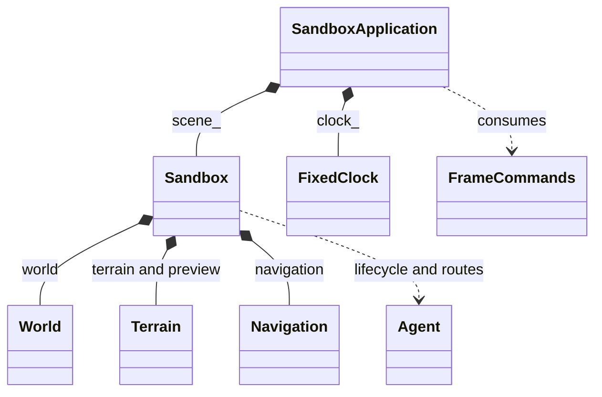

# Demo headers

Sources in this directory belong to `kinetra_sandbox_application and kinetra_demo_presentation`. These are Lab-owned interfaces and implementations; they are not part of the public Kinetra engine API.

## Table of contents

- [Visual overview](#visual-overview)
- [File map](#file-map)
- [Architecture and build](#architecture-and-build)

[Parent guide](../README.md) · [Project overview](../../../README.md) · [Documentation index](../../../docs/README.md)

## Visual overview

Solid diamonds denote owned values; dependencies show supplied commands and engine services.

## File map

| File | Responsibility |
| --- | --- |
| [sandbox_application.h](sandbox_application.h) | Headless application coordinator and fixed clock |
| [sandbox_scene.h](sandbox_scene.h) | World, terrain residency, population and body-index remapping |
| [agent.h](agent.h) | Agent route and lifecycle state |
| [terrain.h](terrain.h) | Seeded chunk generation and preview cache |
| [sandbox_commands.h](sandbox_commands.h) | Commands and presentation options |
| [sandbox_input.h](sandbox_input.h) | Input mapping and debug capture adapter |
| [player_control.h](player_control.h) | Player movement intent |
| [sandbox_renderer.h](sandbox_renderer.h) | Scene rendering interface |
| [session.h](session.h) | Public engine Session factory |
| [help_overlay.h](help_overlay.h) | Application help content |

## Architecture and build

See the [architecture guide](../../../docs/demo-architecture.md) for ownership and dependency contracts. Build through the repository root; the containing application or launcher CMake file defines these targets.
