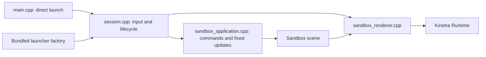

# Demo implementation

Sources in this directory belong to `kinetra_sandbox_application and kinetra_demo_presentation`. These are Lab-owned interfaces and implementations; they are not part of the public Kinetra engine API.

## Table of contents

- [Visual overview](#visual-overview)
- [File map](#file-map)
- [Architecture and build](#architecture-and-build)

[Parent guide](../README.md) · [Project overview](../../../README.md) · [Documentation index](../../../docs/README.md)

## Visual overview

The same session implementation serves the direct executable and bundled launcher.

## File map

| File | Responsibility |
| --- | --- |
| [sandbox_application.cpp](sandbox_application.cpp) | Command, camera, pointer and fixed-update ordering |
| [sandbox_renderer.cpp](sandbox_renderer.cpp) | World rendering, culling and application overlays |
| [session.cpp](session.cpp) | Session adapter, bindings and debug controls |
| [main.cpp](main.cpp) | Direct executable and argument handling |

## Architecture and build

See the [architecture guide](../../../docs/demo-architecture.md) for ownership and dependency contracts. Build through the repository root; the containing application or launcher CMake file defines these targets.

Path and steering-probe strokes use three logical screen pixels at every camera zoom.
