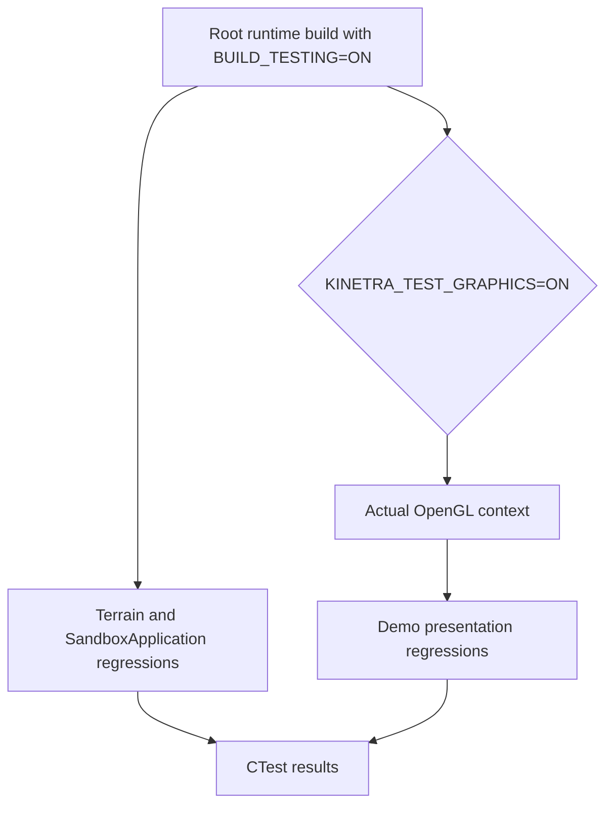

# Demo tests

Regression tests for the Demo simulation, application commands and presentation.

## Table of contents

- [Visual overview](#visual-overview)
- [Coverage](#coverage)
- [Build and run](#build-and-run)

[Parent guide](../README.md) · [Project overview](../../../README.md) · [Documentation index](../../../docs/README.md)

## Visual overview

The two test paths separate checks without a window from checks requiring a graphics context.



## Coverage

| Source | CTest name | Coverage |
| --- | --- | --- |
| [terrain_tests.cpp](terrain_tests.cpp) | `kinetra_terrain` | Terrain streaming, obstacles, agent lifecycle, navigation and Ghost preview isolation |
| [sandbox_application_tests.cpp](sandbox_application_tests.cpp) | `kinetra_sandbox_application` | Pause/resume, input commands, camera/pointer ordering and reset behavior |
| [presentation_tests.cpp](presentation_tests.cpp) | `kinetra_demo_graphics` | Help overlay placement, camera preservation, routes and OpenGL rendering |

## Build and run

Run from the repository root for the tests that need no window:

```sh
cmake -S . -B build-headless -DKINETRA_LAB_BUILD_RUNTIME=OFF -DBUILD_TESTING=ON
cmake --build build-headless --target kinetra_terrain_tests kinetra_sandbox_tests --parallel
ctest --test-dir build-headless -R '^kinetra_(terrain|sandbox_application)$' --output-on-failure
```

For `kinetra_demo_graphics`, use a runtime build with `KINETRA_TEST_GRAPHICS=ON` and an OpenGL context as described in [Tests and resources](../../../README.md#tests-and-resources). Filter that build's CTest run with `-R '^kinetra_demo_graphics$'`.
