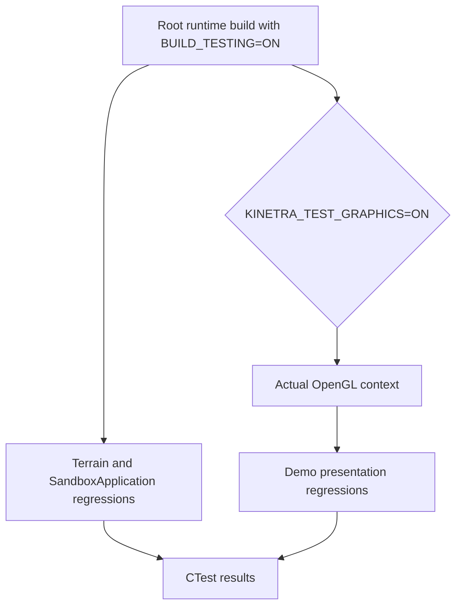

# Demo tests

Regression tests for the Demo simulation, application commands and presentation. Every program is a doctest suite: each `TEST_CASE` is one behavior, named after its expected outcome, and CTest registers it as `<suite>:<case>`. How to write cases is in [Kinetra testing](../../../external/Kinetra/docs/testing.md#writing-a-doctest-suite).

## Table of contents

- [Visual overview](#visual-overview)
- [Coverage](#coverage)
- [Build and run](#build-and-run)

[Parent guide](../README.md) · [Project overview](../../../README.md) · [Documentation index](../../../docs/README.md)

## Visual overview

The two test paths separate checks without a window from checks requiring a graphics context.



## Coverage

| Source | CTest suite (cases) | Coverage |
| --- | --- | --- |
| [crowd_characterization_tests.cpp](crowd_characterization_tests.cpp) | `kinetra_demo_crowd_characterization` (2) | Pins crowd behavior before the Demo refactor. A dense idle crowd (240 agents, seed 123, 480 frames) and a player walking through newly streamed chunks with commanded agents (40 agents, seed 456, 1200 frames) check every frame for finite motion, an intact swept-event budget, a one-to-one agent-to-body mapping and at most 0.01 units of overlap between moving bodies. Each scenario is one case and must reproduce a recorded summary line with a trajectory fingerprint; a mismatch shows the expected and actual line. `KINETRA_PRINT_GOLDEN=1` prints the current lines for a deliberate update |
| [crowd_stability_tests.cpp](crowd_stability_tests.cpp) | `kinetra_demo_crowd` (2) | 240 initial agents, 60 simulated seconds per seed, one case each for seeds 123 and 456; rejects swept-event starvation and nonfinite motion (labels `unit` and `soak`, 180-second timeout per case) |
| [contact_tests.cpp](contact_tests.cpp) | `kinetra_demo_contacts` (6) | Slow/fast head-on elastic moving contacts at 60/120 Hz, momentum/energy conservation, transformed circle/box contacts, off-center angular momentum and resting-wall stability; circle/box/polygon thin-wall translation regressions (rotation and avoidance remain outside this guarantee) |
| [terrain_tests.cpp](terrain_tests.cpp) | `kinetra_terrain` (19) | Terrain streaming, crowded polygon population near the initial camera, curved seeded wandering, obstacles, agent lifecycle, navigation and Ghost preview isolation |
| [sandbox_application_tests.cpp](sandbox_application_tests.cpp) | `kinetra_sandbox_application` (7) | Pause/resume, input commands, camera/pointer ordering, avoidance-mode switching and reset behavior |
| [presentation_tests.cpp](presentation_tests.cpp) | `kinetra_demo_graphics` (1) | Help overlay placement, camera preservation, routes and OpenGL rendering; one case, because every check shares one `Runtime` (label `graphics`) |

## Build and run

Run from the repository root for the tests that need no window:

```sh
cmake -S . -B build-headless -DKINETRA_LAB_BUILD_RUNTIME=OFF -DBUILD_TESTING=ON
cmake --build build-headless --target kinetra_terrain_tests kinetra_sandbox_tests kinetra_demo_contact_tests kinetra_demo_crowd_tests kinetra_demo_crowd_characterization_tests --parallel
ctest --test-dir build-headless -R '^kinetra_(terrain|sandbox_application|demo_contacts|demo_crowd|demo_crowd_characterization):' --output-on-failure
```

Add `-LE soak` to skip the two 60-second crowd runs. One case runs on its own through CTest (`-R 'kinetra_terrain:a ghost camera'`) or the executable (`./build-headless/kinetra_terrain_tests --test-case='a ghost camera*'`).

After a deliberate change to crowd behavior, print the new characterization lines, copy them into `crowd_characterization_tests.cpp` and explain the change in the commit message:

```sh
KINETRA_PRINT_GOLDEN=1 ./build-headless/kinetra_demo_crowd_characterization_tests
```

For `kinetra_demo_graphics`, use a runtime build with `KINETRA_TEST_GRAPHICS=ON` and an OpenGL context as described in [Tests and resources](../../../README.md#tests-and-resources). Filter that build's CTest run with `-R '^kinetra_demo_graphics:'`.
