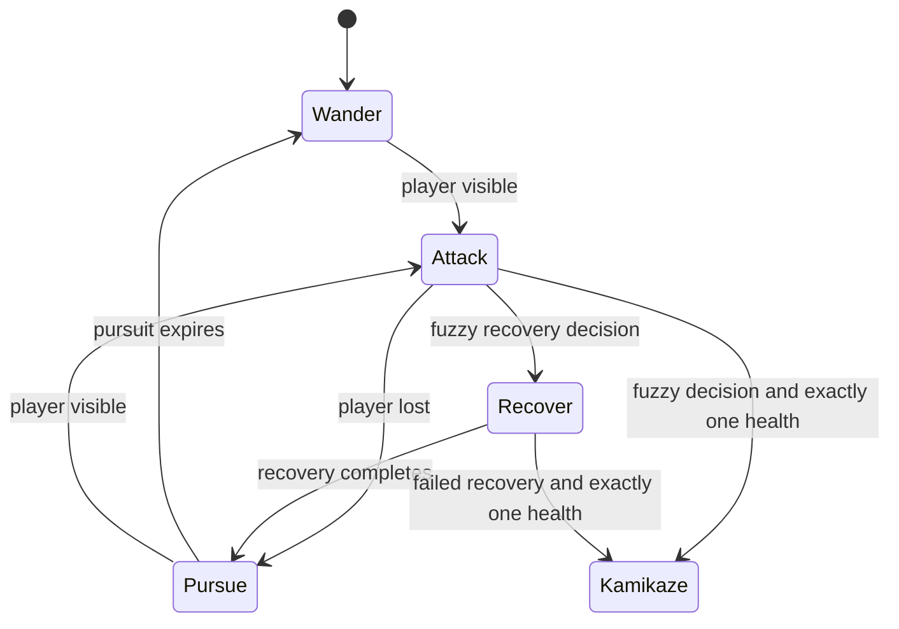

# Dotio on Kinetra

Portable local survival game in Kinetra-Lab. Build/run instructions are in [Quick start](../../README.md#quick-start); the independent upstream checkout is not required.

## Table of contents

- [Source navigation](#source-navigation)

- [Launch and controls](#launch-and-controls)
- [Application boundary](#application-boundary)
- [World and residency](#world-and-residency)
- [Population and progression](#population-and-progression)
- [AI and combat](#ai-and-combat)
- [Difficulty](#difficulty)
- [Verification and limits](#verification-and-limits)
- [Extraction](#extraction)
- [Provenance](#provenance)

## Launch and controls

The bundled launcher asks for Easy, Medium or Hard, default Medium. M cancels difficulty selection. Direct `--variant dotio --difficulty hard` skips the menu. The independent `kinetra_dotio` executable accepts `--difficulty` and `--frames`. `--agents` in the bundled launcher affects Demo only.

| Input | Behavior |
| --- | --- |
| WASD / arrows | Move player; move only camera in Ghost |
| Hold left click | Aim and shoot |
| Click in Ghost | Teleport real player, including while paused; suppress shooting |
| Wheel | Zoom: 25–50 px/unit normal; 2.5–50 debug |
| Space | Pause/resume |
| H / Backquote | Toggle initially collapsed help / initially closed debug menu |
| M / Escape | Return to bundled menu / exit; standalone has no menu |

No reset or click-navigation binding exists. F/P/R/G/Tab/C and V/Shift+V have no gameplay effects. Debug Mode gates vectors, shapes, AI labels, steering probes, active markers and paths. Ghost Camera is directly below Debug Mode; leaving either restores player following. Ghost has no purple player marker. Teleport checks walls, props and live enemies, then clears velocity.

Paths expands into wander, pursue, kamikaze, recovery and hiding-intersection filters. Independent Invulnerability starts off, prevents damage and removes mana cost. Statistics remains visible whenever enabled, even without Debug Mode. It shows FPS/UPS/TPS; Debug Mode adds AGENTS (resident live enemies) and ACTIVE (simulated subset) on a row above. Narrow windows scale/reposition statistics above the health/mana/bullet-speed HUD. Debug pointer capture suppresses all gameplay pointer actions.

## Application boundary

See [Dotio architecture](../../docs/dotio-architecture.md) for component ownership, lifecycle and the engine boundary.

## World and residency

Seeded 32-cell districts form irregular narrow passages, jittered junctions, bends, intersections, loops, multiple inter-district exits and occasional rooms. The original hand-authored maze is a structural reference, not a repeated tile. Absolute coordinates preserve terrain and visible wall gradients across rebases/revisits.

A 155×155-cell occupancy/navigation window shifts by multiples of 16 cells. Actors, camera, projectiles and props rebase together; paths and partitions rebuild. Moving/resizing residency refreshes entering/leaving strips and neighboring graph links, reusing overlap. Rebase still rebuilds the local window. Rendering samples Ghost terrain without spawning distant physics and culls full actor/projectile/prop bounds before tessellation.

| Player-centered region | Relative half-extents | Purpose |
| --- | --- | --- |
| Spawn exclusion | 1.1× maximum normal view | Entire spawned body stays outside |
| Local admission | 1.75× maximum normal view | Count nearby enemies against admission bound |
| Activity | 0.9× maximum debug view | Enemies simulate inside; freeze and clear paths outside |
| Retention | 1.25× maximum debug view | Retire enemies and release routes/partition references outside |

Maximum views use viewport size and fixed 25/2.5 px/unit zoom limits. Current zoom and Ghost position do not affect these regions. Brown circular crates are dynamic bodies, without AI: actors push them; drag slows them; walls/crates stop them; projectiles transfer impulses and are blocked by them. Loaded props preserve displacement/momentum; eviction forgets them and seeded room props regenerate on revisit. There is no world save.

## Population and progression

The pool contains 666 reusable enemy slots. Retirement releases paths and partitions; reuse restores full durability. Death clears live enemies and resets survival time while preserving difficulty.

Spawn placement expands linearly from 1.75× maximum normal view to the activity rectangle over 300 active simulated seconds. Pause freezes progression and spawn credit; death resets both. The local admission area and fuzzy pressure do not expand.

Fuzzy pressure depends only on nearby enemies, never health/mana. Contribution is full within 500 legacy pixels and falls to zero at 1,200. Sparse/occupied/crowded Sugeno rules blend 1/0.25/0 spawns per simulated second, then difficulty scales load/rate. Crowding and failed attempts do not accumulate catch-up bursts. One credit permits at most eight placement attempts and one successful spawn per update. Spawning rejects walls, props, exclusion bounds and insufficient enemy spacing. Existing threats are not deleted when local density rises.

## AI and combat

The diagram highlights principal transitions, not every fuzzy-rule combination. State implementations and tests remain authoritative.

| State | Behavior |
| --- | --- |
| Wander | Random nearby A* routes until player visibility |
| Attack | Fear/ammo-dependent distance and predictive shots |
| Pursue | A* routes after lost visibility, bounded pursuit cycles |
| Recover | Fear-biased HideStar shelter search and reload outside player sight |
| Kamikaze | Chase, fire remaining ammo, explode on contact |

Both fuzzy close/warrior/midway combat and failed recovery can enter kamikaze only at exactly one remaining health. Enemy ammunition capacity is ten. Player health/mana regenerate; shooting costs mana; kills increase bullet speed up to the original 100-kill cap. Contact kills restore mana, with state-specific additional rewards. Resource rewards clamp to maxima. Player death starts fresh population progression.

Player bolts sweep relative to each enemy's start/end movement and include their visible five-pixel radius. Earliest target hits are ordered against walls/crates. Each hit consumes the bolt; only lethal hits award kill/resource rewards. Walls sweep projectile centers; moving enemies are approximated by linear displacement per tick. Actor/prop contacts remain discrete.

## Difficulty

[Immutable presets](logic/include/difficulty.h) vary population and enemy behavior; player abilities, maze and spawn exclusion remain shared.

| Setting | Easy | Medium (default) | Hard |
| --- | --- | --- | --- |
| Ordinary projectile hits to kill | 1 | 2 | 3 |
| Local spawn admission | 8 | 12 | 18 |
| Maximum spawn rate / simulated second | 1 | 1.5 | 2 |
| Spawn spacing, legacy pixels | 350 | 325 | 275 |
| Fuzzy load multiplier | 1 | 0.7 | 0.5 |
| Enemy movement multiplier | 0.85 | 1 | 1.1 |
| Shot interval multiplier | 1.35 | 1 | 0.8 |
| Arrow speed, legacy pixels/frame | 11 | 13 | 15 |
| Predictive lead | 45% | 80% | 100% |
| Pursuit cycles | 6 | 10 | 16 |

## Verification and limits

[Logic/application tests](tests/dotio_tests.cpp) cover AI, fuzzy pressure, A*/HideStar, collision/sweeps, rewards, durability, progression/reset, pause, streaming, props, difficulty and debug capture. [Presentation tests](tests/presentation_tests.cpp) cover bindings and normal/debug rendering. The [Lab build](../../CMakeLists.txt) links Dotio without engine-private headers. Commands: [development](../../README.md#tests-and-resources).

Static raster storage permits only one active Dotio world. Absolute district integers and local float precision remain finite. Cross-platform random sequences/timing are not promised. Teleport tests destination clearance, not a swept route. Gameplay balance and desktop feel require manual Artix checks.

## Extraction

Dotio now lives in Kinetra-Lab and links only public Kinetra Simulation and Runtime targets. Its direct executable requires no Demo or launcher sources. The root build consumes Kinetra source from `external/Kinetra` or an explicit local checkout; see [build instructions](../../README.md). i4sim and the original sibling repositories are unchanged.

## Provenance

The `logic/` and `gmath/` sources originate from the independent local Dotio repository and retain author attribution. The checkout's [MIT license](../../LICENSE) applies here; no separate upstream license file was present. The Windows window, Direct2D backend, platform input and concurrent update threads were not copied. Port fixes preserve tests for empty paths, zero-vector normalization, frontier capacity, heuristic correctness, waypoint updates and projectile ordering. Original sibling repositories remain unchanged.

## Source navigation

[Headers](include/README.md) and [implementation](src/README.md) describe the local source layout.
