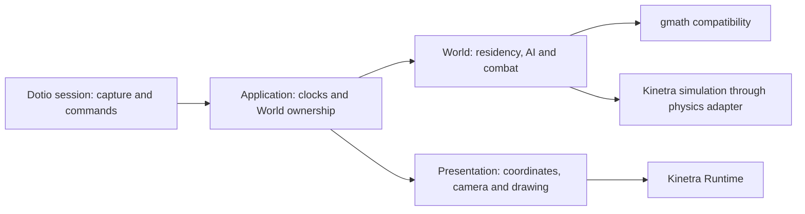
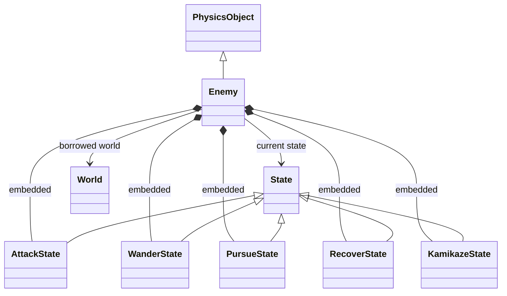
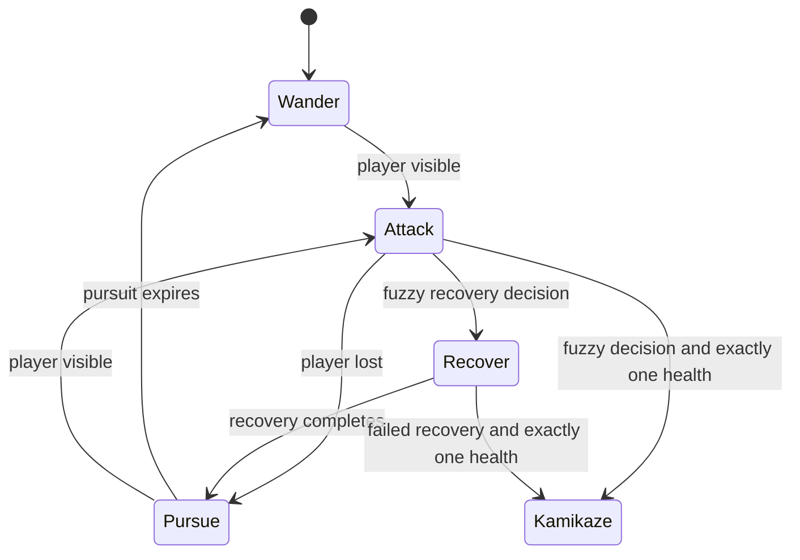

# Dotio on Kinetra

Portable local survival game in Kinetra-Lab. Build/run instructions are in [Quick start](../../README.md#quick-start); the independent upstream checkout is not required.

## Table of contents

- [Visual overview](#visual-overview)
- [Launch and controls](#launch-and-controls)
- [Application boundary](#application-boundary)
- [Layout](#layout)
- [World and residency](#world-and-residency)
- [Population and progression](#population-and-progression)
- [AI and combat](#ai-and-combat)
- [Difficulty](#difficulty)
- [Verification and limits](#verification-and-limits)
- [Provenance](#provenance)

[Parent guide](../README.md) · [Project overview](../../README.md) · [Documentation index](../../docs/README.md)

## Visual overview

The stable application-owned World separates game rules from input and drawing adapters.



## Launch and controls

The bundled launcher asks for Easy, Medium or Hard, default Medium. M cancels difficulty selection. Direct `--variant dotio --difficulty hard` skips the menu. The independent `kinetra_dotio` executable accepts `--difficulty` and `--frames`. `--agents` in the bundled launcher affects Demo only.

| Input | Behavior |
| --- | --- |
| WASD / arrows | Move player; move only camera in Ghost |
| Hold left click | Aim and shoot |
| Click in Ghost | Teleport real player, when settings is closed; suppress shooting |
| SETTINGS button / Ctrl | Open/close centered settings; pause while open |
| Settings Statistics / Debug Mode | Toggle statistics / enable debug tools |
| Settings Frame Times / Frame Limit | Show the frame-time graph / pace frames where the platform has no VSync |
| Shift+Ctrl | Open/close the upper-left debug menu; switches Debug Mode on when it was off |
| DEBUG button (next to Settings) | Toggle the debug menu in Debug Mode |
| Wheel / ZOOM row of the debug menu | Zoom in Debug Mode: 2.5–50 px/unit; leaving Debug Mode clamps to 25–50 |
| Settings Launcher / Exit | Return to bundled launcher / exit the application |

Settings shows the help lines of SIM CONTROLS and DEBUG CONTROLS only after a click on their heading, and consumes all gameplay input. Resume or Ctrl closes settings and resumes the run. Space and M have no gameplay action.

No reset or click-navigation binding exists. F/P/R/G/Tab/C and V/Shift+V have no gameplay effects. Debug Mode gates vectors, shapes, AI labels, steering probes, active markers and paths; leaving it restores player following. Ghost has no purple player marker. Teleport checks walls, props and live enemies, then clears velocity.

### Debug menu

The menu is a tree with one section open at a time; SIMULATION is open at the start. `Application::debug_entries()` builds it, so its rows are tested without a window ([launcher and overlays](../../docs/launcher-overlays.md#debug-menu)).

| Section | Rows |
| --- | --- |
| SIMULATION | RUNNING (pause and resume), SINGLE TICK (pauses, then runs one 60 Hz update per click), SPEED (time scale 0.125× to 4×), INVULNERABLE (no damage, no mana cost; starts off) |
| LAYERS | VECTORS, STEERING PROBES, PATHS with its parts WANDER, PURSUE, KAMIKAZE and RECOVERY while it is on, COLLISION SHAPES, ACTIVE AGENTS, AI STATES, HIDING HITS. A row drawn in one color shows that color; the PATHS parts show the color of their AI state. All start off |
| ENEMIES | WANDER (STEERING or PATH), MOVE SPEED, FIRE INTERVAL, ARROW SPEED, PREDICTION, PURSUIT CYCLES, HITS, and the force of each state: WANDER, ATTACK, PURSUE, RECOVER and KAMIKAZE FORCE |
| SPAWNING | ACTIVE LIMIT, SPAWN RATE, CROWD LOAD, SPACING |
| Below the rule | ZOOM, GHOST CAMERA, RESET PARAMETERS (the difficulty's preset, the default forces and wander mode, speed 1×) |

The ENEMIES and SPAWNING rows change the running world: its copy of the [difficulty preset](#difficulty) and its `EnemyTuning`. Movement, firing, pursuit and spawning follow at once; HITS applies to enemies that spawn afterwards. The rows stop at limits the world can run with (`tuning_step` in [application.h](include/dotio/application.h), within `dotio::validate`). A new session, and RESET PARAMETERS, start from the preset again; the player's death keeps the tuned values.

STEERING PROBES draws, for an enemy that wanders by steering, the three feelers its steering tests, and for every other enemy the original forward and rear probes. PATHS > WANDER draws nothing while enemies wander by steering, because they plan no path.

Statistics remains visible whenever enabled, even without Debug Mode. It shows FPS/UPS/TPS; Debug Mode adds AGENTS (resident live enemies) and ACTIVE (simulated subset) on a row above. Narrow windows scale/reposition statistics above the health/mana/bullet-speed HUD. Debug pointer capture suppresses all gameplay pointer actions.

## Application boundary

See [Dotio architecture](../../docs/dotio-architecture.md) for component ownership, lifecycle and the engine boundary.

Drawing runs between fixed ticks: `Application` keeps absolute positions of the player, enemies, arrows and bolts before and after the last 60 Hz tick, and `PresentedPositions` swaps the blended positions in for one frame's drawing. A tick that respawned the player is not blended ([drawing between ticks](../../docs/architecture.md#session-ownership-and-frame-flow)).

Dotio links only the public `Kinetra::Simulation` and `Kinetra::Runtime` targets. Its direct executable `kinetra_dotio` needs no Demo or launcher sources.

## Layout

Headers live under `include/dotio/` and are included as `"dotio/<folder>/<file>.h"`; `src/` mirrors their folders. `kinetra_dotio_logic` holds everything except `presentation/` and `main.cpp`, so it builds and tests without a window. `kinetra_dotio_presentation` holds `presentation/`; `kinetra_dotio` is `main.cpp`. These are Lab-owned files, not part of the public Kinetra engine API.

```text
labs/dotio/
  include/dotio/
    application.h world.h difficulty.h renderer.h zoom.h
    entities/      arrow.h bolt.h enemy.h player.h moving_object.h
                   physics_object.h static_object.h physics_adapter.h
    ai/            state.h wander.h fuzzy.h tracker.h
    navigation/    graph.h grid.h vertex.h priority_queue.h stack.h
    math/          gmath.h portable.h
    presentation/  session.h presentation.h
  src/  world.cpp difficulty.cpp main.cpp
        entities/ ai/ navigation/ math/ presentation/
  tests/  dotio_tests.cpp presentation_tests.cpp
```

| Folder | Content |
| --- | --- |
| top level | The application, the world, difficulty presets and the legacy drawing interface |
| `entities/` | Moving and static world objects and their physics |
| `ai/` | The enemy state machine, steering wander, fuzzy decisions and the population tracker |
| `navigation/` | The occupancy grid, the path graph and the storage that A* uses |
| `math/` | The small `gmath` vector helpers and the portable compatibility header, in namespace `dotio::math` |
| `presentation/` | Session and drawing; needs `Kinetra::Runtime` |

### Top level

| Header | Source | Responsibility |
| --- | --- | --- |
| [application.h](include/dotio/application.h) | header only | Application state, stable World ownership, clocks, debug-menu rows and tuning steps |
| [world.h](include/dotio/world.h) | [world.cpp](src/world.cpp) | World ownership, streaming, pools, population, progression and projectile ordering |
| [difficulty.h](include/dotio/difficulty.h) | [difficulty.cpp](src/difficulty.cpp) | Difficulty presets, the enemy tuning a world can change while it runs, and their validation |
| [renderer.h](include/dotio/renderer.h) | header only | Legacy drawing interface; the presentation adapter implements it and owns the Y-axis conversion |
| [zoom.h](include/dotio/zoom.h) | header only | Zoom limits and initial zoom in pixels per world unit, apart from the world headers so the launcher can start Dotio without compiling the world; the application reads it too, so it stays outside `presentation/` |

### entities/

| Header | Source | Responsibility |
| --- | --- | --- |
| [physics_object.h](include/dotio/entities/physics_object.h) | [physics_object.cpp](src/entities/physics_object.cpp) | Base physical object contract and behavior |
| [moving_object.h](include/dotio/entities/moving_object.h) | [moving_object.cpp](src/entities/moving_object.cpp) | Moving actor contract, movement and integration |
| [static_object.h](include/dotio/entities/static_object.h) | [static_object.cpp](src/entities/static_object.cpp) | Static object contract and initialization |
| [player.h](include/dotio/entities/player.h) | [player.cpp](src/entities/player.cpp) | Player movement, shooting, abilities and resources |
| [enemy.h](include/dotio/entities/enemy.h) | [enemy.cpp](src/entities/enemy.cpp) | Enemy state, updates and AI integration |
| [arrow.h](include/dotio/entities/arrow.h) | [arrow.cpp](src/entities/arrow.cpp) | Enemy projectiles |
| [bolt.h](include/dotio/entities/bolt.h) | [bolt.cpp](src/entities/bolt.cpp) | Player projectiles |
| [physics_adapter.h](include/dotio/entities/physics_adapter.h) | header only | Conversion between legacy bodies and Kinetra bodies and simulation |

### ai/

| Header | Source | Responsibility |
| --- | --- | --- |
| [state.h](include/dotio/ai/state.h) | [state.cpp](src/ai/state.cpp) | The five AI states (wander, attack, pursue, recover, kamikaze) and their transitions |
| [wander.h](include/dotio/ai/wander.h) | [wander.cpp](src/ai/wander.cpp) | Steering wander: heading drift, wall feelers and their constants |
| [fuzzy.h](include/dotio/ai/fuzzy.h) | [fuzzy.cpp](src/ai/fuzzy.cpp) | Fuzzy combat and density decisions |
| [tracker.h](include/dotio/ai/tracker.h) | header only | Fixed-pool population storage with circular slot reuse |

An enemy embeds one instance of each state and points at the current one; it borrows its World.



### navigation/

| Header | Source | Responsibility |
| --- | --- | --- |
| [grid.h](include/dotio/navigation/grid.h) | [grid.cpp](src/navigation/grid.cpp) | Static occupancy raster, seeded terrain and raster queries |
| [graph.h](include/dotio/navigation/graph.h) | [graph.cpp](src/navigation/graph.cpp) | Local A* pathfinding and fear-biased shelter search |
| [vertex.h](include/dotio/navigation/vertex.h) | [vertex.cpp](src/navigation/vertex.cpp) | Graph node |
| [priority_queue.h](include/dotio/navigation/priority_queue.h) | [priority_queue.cpp](src/navigation/priority_queue.cpp) | Search frontier |
| [stack.h](include/dotio/navigation/stack.h) | [stack.cpp](src/navigation/stack.cpp) | Path storage |

### math/

| Header | Source | Responsibility |
| --- | --- | --- |
| [gmath.h](include/dotio/math/gmath.h) | [gmath.cpp](src/math/gmath.cpp) | Legacy vector, position, segment and grid types; grid coordinate conversion, neighbor partitions and compatibility operators. Canonical vector math delegates to Kinetra |
| [portable.h](include/dotio/math/portable.h) | header only | Standard-library includes and the unqualified `min` and `max` the ported code relies on |

### presentation/

| Header | Source | Responsibility |
| --- | --- | --- |
| [session.h](include/dotio/presentation/session.h) | [session.cpp](src/presentation/session.cpp) | `dotio::Session`: input mapping, pointer capture and lifecycle; it also gives its `Application` to a tool that plays the game (the [capture tool](../../tools/capture/README.md)'s scripted player). Holds the factory shared by direct and bundled launch |
| [presentation.h](include/dotio/presentation/presentation.h) | [presentation.cpp](src/presentation/presentation.cpp) | Drawing adapter: coordinates, camera, terrain, actors and overlays |
| – | [main.cpp](src/main.cpp) | Direct executable `kinetra_dotio`: difficulty and frame-limit arguments |

## World and residency

Seeded 32-cell districts form irregular narrow passages, jittered junctions, bends, intersections, loops, multiple inter-district exits and occasional rooms. The original hand-authored maze is a structural reference, not a repeated tile. Absolute coordinates preserve terrain and visible wall gradients across rebases/revisits.

A 155×155-cell occupancy/navigation window shifts by multiples of 16 cells. Actors, camera, projectiles and props rebase together; paths and partitions rebuild. Moving/resizing residency refreshes entering/leaving strips and neighboring graph links, reusing overlap. Rebase still rebuilds the local window. Rendering samples Ghost terrain without spawning distant physics and culls full actor/projectile/prop bounds before tessellation.

| Player-centered region | Relative half-extents | Purpose |
| --- | --- | --- |
| Spawn exclusion | 1.1× maximum normal view | Entire spawned body stays outside |
| Local admission | 1.75× maximum normal view | Count nearby enemies against admission bound |
| Activity | 0.9× maximum debug view | Enemies simulate inside; freeze and clear paths outside |
| Retention | 1.25× maximum debug view | Retire enemies and release routes/partition references outside |

Maximum views use viewport size and fixed 25/2.5 px/unit zoom limits. Current zoom and Ghost position do not affect these regions. Brown circular crates are dynamic bodies, without AI: actors push them; drag slows them; walls/crates stop them; projectiles transfer impulses and are blocked by them. Loaded props preserve displacement/momentum; eviction forgets them and seeded room props regenerate on revisit. There is no world save.

## Population and progression

The pool contains 666 reusable enemy slots. Retirement releases paths and partitions; reuse restores full durability. Death clears live enemies and resets survival time while preserving difficulty.

Spawn placement expands linearly from 1.75× maximum normal view to the activity rectangle over 300 active simulated seconds. Pause freezes progression and spawn credit; death resets both. The local admission area and fuzzy pressure do not expand.

Fuzzy pressure depends only on nearby enemies, never health/mana. Contribution is full within 500 legacy pixels and falls to zero at 1,200. Sparse/occupied/crowded Sugeno rules blend 1/0.25/0 spawns per simulated second, then difficulty scales load/rate. Crowding and failed attempts do not accumulate catch-up bursts. One credit permits at most eight placement attempts and one successful spawn per update. Spawning rejects walls, props, exclusion bounds and insufficient enemy spacing. Existing threats are not deleted when local density rises.

## AI and combat



The diagram highlights principal transitions, not every fuzzy-rule combination. State implementations and tests remain authoritative.

| State | Behavior |
| --- | --- |
| Wander | Until the player is visible: by steering (default), following a heading that drifts at random and turning away from walls with three feelers; or, as the original game did, along A* routes to random nearby cells |
| Attack | Fear/ammo-dependent distance and predictive shots |
| Pursue | A* routes after lost visibility, bounded pursuit cycles |
| Recover | Fear-biased HideStar shelter search and reload outside player sight |
| Kamikaze | Chase, fire remaining ammo, explode on contact |

**Steering wander** ([wander.h](include/dotio/ai/wander.h)). Every decision tick (20 Hz) an enemy's wander heading drifts by up to 0.35 rad, drawn from a generator seeded with the world's seed. Every update a forward feeler of 0.9 cells and two side feelers of 0.6 cells at 0.6 rad are tested against the grid. A blocked forward feeler turns the heading to the first free direction of a fan (0.8, 1.6, 2.4 rad, to the enemy's preferred side first, then a half turn); a single blocked side feeler turns it away by 0.15 rad per update. The enemy accelerates along its heading with the WANDER force. No path is planned, so a wanderer needs no route to exist; it leaves a dead end by turning around in it.

Both fuzzy close/warrior/midway combat and failed recovery can enter kamikaze only at exactly one remaining health. Enemy ammunition capacity is ten. Player health/mana regenerate; shooting costs mana; kills increase bullet speed up to the original 100-kill cap. Contact kills restore mana, with state-specific additional rewards. Resource rewards clamp to maxima. Player death starts fresh population progression.

Player bolts sweep relative to each enemy's start/end movement and include their visible five-pixel radius. Earliest target hits are ordered against walls/crates. Each hit consumes the bolt; only lethal hits award kill/resource rewards. Walls sweep projectile centers; moving enemies are approximated by linear displacement per tick. Actor/prop contacts remain discrete.

## Difficulty

[Presets](include/dotio/difficulty.h) vary population and enemy behavior; player abilities, maze and spawn exclusion remain shared. A world starts with a copy of its preset, which the debug menu's ENEMIES and SPAWNING sections change while it runs ([debug menu](#debug-menu)).

| Setting | Easy | Medium (default) | Hard |
| --- | --- | --- | --- |
| Ordinary projectile hits to kill | 1 | 2 | 3 |
| Local spawn admission | 8 | 12 | 18 |
| Maximum spawn rate / simulated second | 1 | 1.5 | 2 |
| Spawn spacing, legacy pixels | 350 | 325 | 275 |
| Fuzzy load multiplier | 1 | 0.7 | 0.5 |
| Enemy movement multiplier | 0.85 | 1 | 1.1 |
| Shot interval multiplier | 1.35 | 1 | 0.8 |
| Arrow speed, legacy pixels/frame | 11 | 13 | 15 |
| Predictive lead | 45% | 80% | 100% |
| Pursuit cycles | 6 | 10 | 16 |

## Verification and limits

[Logic/application tests](tests/dotio_tests.cpp) cover AI, fuzzy pressure, A*/HideStar, collision/sweeps, rewards, durability, progression/reset, pause, streaming, props, difficulty and debug capture. [Presentation tests](tests/presentation_tests.cpp) cover bindings and normal/debug rendering. The [Lab build](../../CMakeLists.txt) links Dotio without engine-private headers. Commands: [development](../../README.md#tests-and-resources).

### Tests

Both test programs are doctest suites: each `TEST_CASE` is one behavior, named after its expected outcome, and CTest registers it as `<suite>:<case>`. How to write cases is in [Kinetra testing](../../external/Kinetra/docs/testing.md#writing-a-doctest-suite).

| Source | CTest suite (cases) | Coverage |
| --- | --- | --- |
| [dotio_tests.cpp](tests/dotio_tests.cpp) | `kinetra_dotio` (38) | Geometry, routing, streaming, combat, fuzzy AI, difficulty, lifecycle, debug camera and commands; tunable balance and its limits; steering wander (corridor, wall, dead end, corner, feelers, repeatability per seed); the debug menu's rows, time scale, single tick and zoom. Needs no window |
| [presentation_tests.cpp](tests/presentation_tests.cpp) | `kinetra_dotio_graphics` (3) | Drawing between ticks without moving the simulation or camera; wall colors without a window; then rendering resources, statistics, zoom-independent AI label placement and Ghost marker presentation in one case, because those checks share one `Runtime`. Needs an OpenGL context (label `graphics`) |

### Behavior benchmark

`kinetra_dotio_behavior_benchmark` ([behavior_benchmark.cpp](tests/behavior_benchmark.cpp)) plays seeded games headless at Easy, Medium and Hard: a scripted player walks the maze and shoots at the nearest enemy in sight, and the benchmark counts what the enemies do (time per AI state, pursuits and how many find the player, recoveries, kamikaze, damage to the player, routes missing, stuck enemies, wall overlaps). It prints one Markdown table and a fingerprint per difficulty. Options: `--seeds N` (12), `--first-seed S` (1), `--seconds T` (180), `--wander steering|path`, `--per-seed`. CTest runs only a 10-second smoke (`kinetra_dotio_behavior_smoke`); a full comparison runs from a Release build:

```sh
cmake --build --preset release --target kinetra_dotio_behavior_benchmark
./build-release/kinetra_dotio_behavior_benchmark --seeds 24 --seconds 300
```

The baseline of phase 6 is in [Dotio restructuring](../../docs/design/2026-11-21-dotio-restructuring.md#baseline).

Dotio's collision grid, `dotio::Grid::Array`, is global state. Generating or initializing a world overwrites all of it; cases that build on the plain bordered arena call `open_map()` first. No case depends on another case or on the order in which they run.

From the repository root, for the tests that need no window:

```sh
cmake --preset headless
cmake --build --preset headless --target kinetra_dotio_tests
ctest --preset headless -R '^kinetra_dotio:'
```

One case runs on its own through CTest (`-R 'kinetra_dotio:a failed escape'`) or the executable (`./build-headless/kinetra_dotio_tests --test-case='a failed escape*'`).

`kinetra_dotio_graphics` uses the `graphics` preset, which needs an OpenGL context as described in [Tests and resources](../../README.md#tests-and-resources): `cmake --preset graphics`, `cmake --build --preset graphics --target kinetra_dotio_presentation_tests`, then `ctest --preset graphics -R '^kinetra_dotio_graphics:'`.

### Limits

Static raster storage permits only one active Dotio world. Absolute district integers and local float precision remain finite. Cross-platform random sequences/timing are not promised. Teleport tests destination clearance, not a swept route. Gameplay balance and desktop feel require manual Artix checks.

## Provenance

The game logic and math sources (everything outside `presentation/` and `main.cpp`) come from the independent Dotio repository and keep their author attribution. Lab's [MIT license](../../LICENSE) applies to them; the upstream repository had no license file of its own. The Windows window, Direct2D backend, platform input and concurrent update threads are not part of the port. Tests cover the fixes made in the port: empty paths, zero-vector normalization, frontier capacity, heuristic correctness, waypoint updates and projectile ordering.
