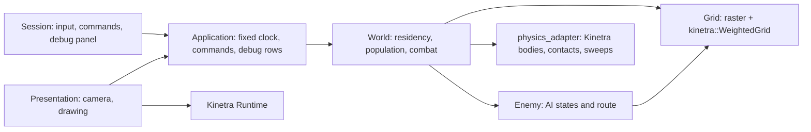
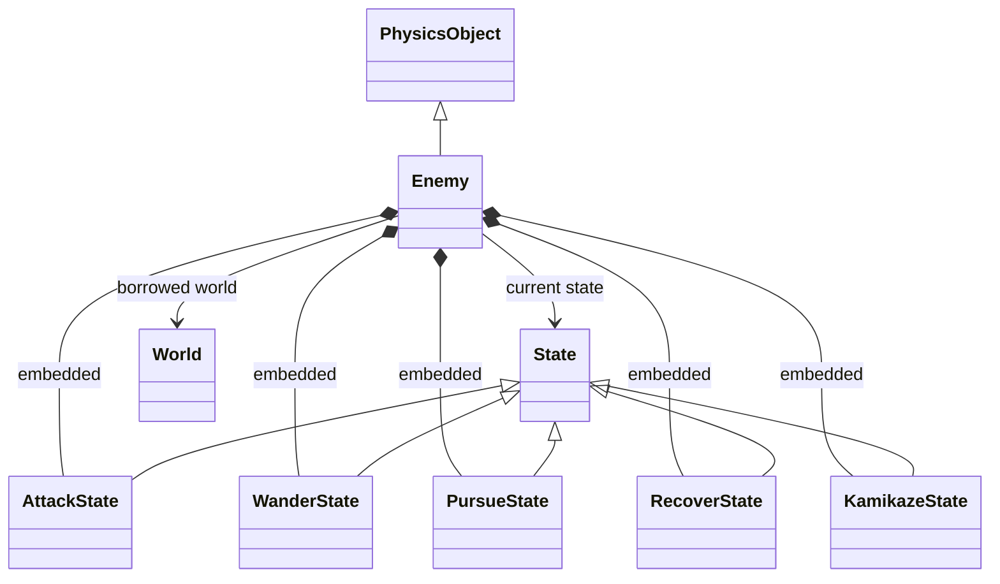
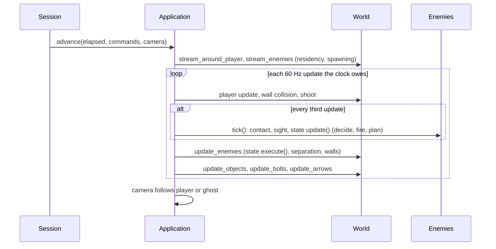
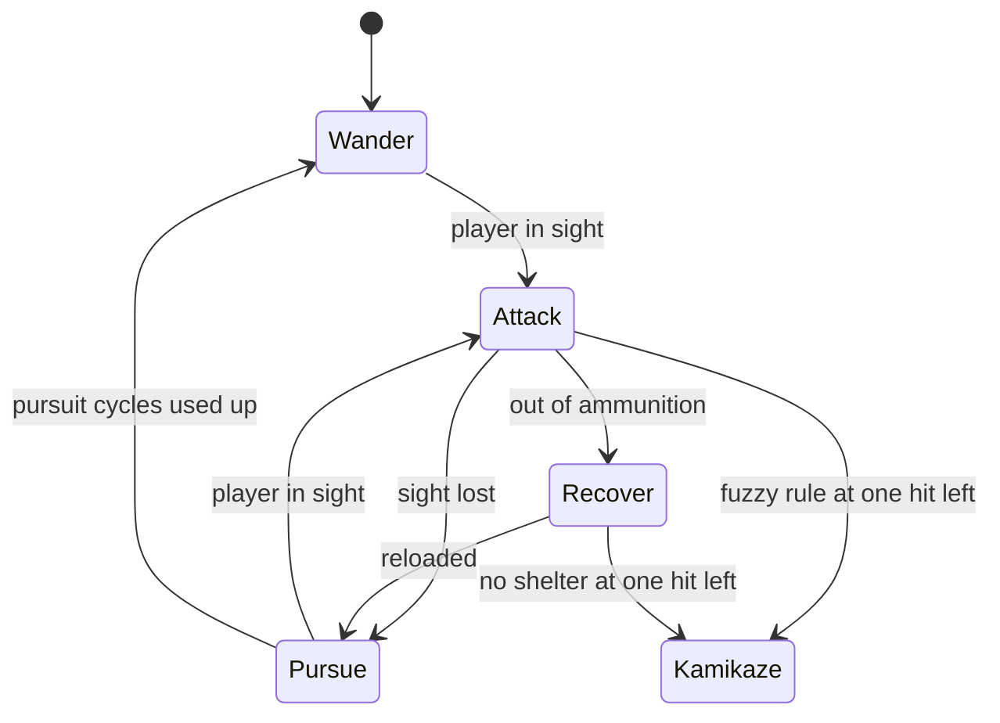

# Dotio

Dotio is the survival game of Kinetra-Lab: the player walks a seeded, endless maze while enemies wander, attack, pursue, recover and turn kamikaze, decided by a small state machine with fuzzy rules. It was ported from an independent game ([provenance](#provenance)) onto Kinetra's simulation and runtime. The bundled launcher starts it, and so does its own executable `kinetra_dotio`.

## Table of contents

- [Purpose and scope](#purpose-and-scope)
- [Concepts](#concepts)
- [Launch and controls](#launch-and-controls)
- [Structure](#structure)
- [How it works](#how-it-works)
  - [A frame and its ticks](#a-frame-and-its-ticks)
  - [World and residency](#world-and-residency)
  - [Population and progression](#population-and-progression)
  - [AI states](#ai-states)
  - [How the AI states use navigation](#how-the-ai-states-use-navigation)
  - [Steering wander](#steering-wander)
  - [Combat](#combat)
  - [Randomness and seeds](#randomness-and-seeds)
  - [Difficulty](#difficulty)
- [Invariants and contracts](#invariants-and-contracts)
- [Changing this module](#changing-this-module)
- [Tests](#tests)
- [Open points](#open-points)
- [Provenance](#provenance)

[Parent guide](../README.md) · [Project overview](../../README.md) · [Documentation index](../../docs/README.md)

## Purpose and scope

Dotio owns its game rules: the maze, the population, the AI states, combat, difficulty and its debug menu. Reusable mechanisms come from Kinetra: route planning (`kinetra::WeightedGrid`), physics, collision and sweeps (`Kinetra::Simulation`), and the window, overlays and session hosting (`Kinetra::Runtime`). Dotio does not plan with `kinetra::Navigation` or steer with Kinetra's steering models; those work on body geometry, while Dotio's world is a raster of square cells.

The logic (`kinetra_dotio_logic`) is headless and builds without the runtime. The presentation (`kinetra_dotio_presentation`) maps input to commands and draws; it contains no game rules.

## Concepts

| Term | Meaning |
| --- | --- |
| Legacy pixels | Dotio's own unit: 100 per grid cell, +Y down the screen. Kinetra world units are 25 legacy pixels with +Y up (`to_world`, `from_world` in [application.h](include/dotio/application.h)) |
| Update | One fixed step of 1/60 s. Speeds are legacy pixels per update, forces are speed gained per update |
| Decision tick | Every third update (20 Hz): enemies look, decide and plan |
| Grid, cell | The 155×155-cell occupancy raster of the resident window (`dotio::Grid`); a cell is a wall or floor. `GridEntry` is one (row, column) |
| Resident window | The part of the endless maze loaded around the player. Streaming shifts it by 16-cell steps; `World::world_offset()` gives its corner in the unbounded world |
| District | A 32×32-cell part of the maze, generated from the seed and its absolute position |
| Route | The waypoints an enemy follows (`dotio::Route`), planned on the grid's `kinetra::WeightedGrid` |
| Fear | An enemy's caution, about 2 to 10: the distance it keeps when attacking (in cells, scaled by ammunition used) and how far it runs to a shelter |
| Shelter | A cell out of the player's sight that a recovering enemy runs to (`plan_shelter`) |
| Activity, retention | The rectangles around the player inside which enemies are simulated, and outside which they are retired |
| Pool | Fixed slots for 666 enemies, 666 arrows and 20 bolts (`TrackerData`); slots are reused, never reallocated |

## Launch and controls

The bundled launcher asks for Easy, Medium or Hard, default Medium. M cancels difficulty selection. Direct `--variant dotio --difficulty hard` skips the menu. The independent `kinetra_dotio` executable accepts `--difficulty`, `--frames` and `--seed N`; it prints the seed it plays, and the same seed gives the same maze and the same enemy decisions for the same input. The bundled launcher prints a random world seed at start; `kinetra_dotio --seed` replays it. `--agents` in the bundled launcher affects Demo only.

| Input | Behavior |
| --- | --- |
| WASD / arrows | Move player; move only camera in Ghost |
| Hold left click | Aim and shoot |
| Shift+right-click | Inspect the enemy under the pointer |
| Inspector X | Close the inspector and clear the selection |
| Click in Ghost | Teleport real player, when settings is closed; suppress shooting |
| SETTINGS button / Ctrl | Open/close centered settings; pause while open |
| Settings Statistics / Debug Mode | Toggle statistics / enable debug tools |
| Settings Frame Times / Frame Limit | Show the frame-time graph / pace frames where the platform has no VSync |
| Shift+Ctrl | Open/close the upper-left debug menu; switches Debug Mode on when it was off |
| DEBUG button (next to Settings) | Toggle the debug menu in Debug Mode |
| Wheel / ZOOM row of the debug menu | Zoom in Debug Mode: 2.5–50 px/unit; leaving Debug Mode clamps to 25–50 |
| Settings Launcher / Exit | Return to bundled launcher / exit the application |

Settings shows the help lines of SIM CONTROLS and DEBUG CONTROLS only after a click on their heading, and consumes all gameplay input. Resume or Ctrl closes settings and resumes the run. Space and M have no gameplay action.

The inspector opens at the top right and follows one enemy at a time. Shift+right-click another enemy to switch. The selected enemy has a yellow outline. The inspector closes if the enemy despawns. Use the debug menu's RUNNING row to pause or resume while inspecting. The frame-time graph moves below the inspector.

`kinetra_dotio --seed N --ticks N --inspect SLOT-GENERATION` runs a fixed-seed inspection without opening a window. For a title of ENEMY 0-1, pass `--inspect 0-1`. Standard output holds one JSON record per 60 Hz update, with null `groups` before that enemy spawns and after it disappears.

No reset or click-navigation binding exists. F/P/R/G/Tab/C and V/Shift+V have no gameplay effects. Debug Mode gates vectors, shapes, AI labels, steering probes, active markers and paths; leaving it restores player following. Ghost has no purple player marker. Teleport checks walls, props and live enemies, then clears velocity.

### Debug menu

The menu is a tree with one section open at a time; SIMULATION is open at the start. `Application::debug_entries()` builds it, so its rows are tested without a window ([launcher and overlays](../../docs/launcher-overlays.md#debug-menu)).

| Section | Rows |
| --- | --- |
| SIMULATION | RUNNING (pause and resume), SINGLE TICK (pauses, then runs one 60 Hz update per click), SPEED (time scale 0.125× to 4×), INVULNERABLE (no damage, no mana cost; starts off) |
| LAYERS | VECTORS, STEERING PROBES, PATHS with its parts WANDER, PURSUE, KAMIKAZE and RECOVERY while it is on, COLLISION SHAPES, ACTIVE AGENTS, AI STATES, HIDING HITS. A row drawn in one color shows that color; the PATHS parts show the color of their AI state. All start off |
| ENEMIES | WANDER (STEERING or PATH), MOVE SPEED, FIRE INTERVAL, ARROW SPEED, PREDICTION, PURSUIT CYCLES, HITS, and the force of each state: WANDER, ATTACK, PURSUE, RECOVER and KAMIKAZE FORCE |
| SPAWNING | ACTIVE LIMIT, SPAWN RATE, CROWD LOAD, SPACING |
| Below the rule | ZOOM, GHOST CAMERA, RESET PARAMETERS (the difficulty's preset, the default forces and wander mode, speed 1×) |

The ENEMIES and SPAWNING rows change the running world: its copy of the [difficulty preset](#difficulty) and its `EnemyTuning`. Movement, firing, pursuit and spawning follow at once; HITS applies to enemies that spawn afterwards. The rows stop at limits the world can run with (`tuning_step` in [application.h](include/dotio/application.h), within `dotio::validate`). A new session, and RESET PARAMETERS, start from the preset again; the player's death keeps the tuned values.

STEERING PROBES draws, for an enemy that wanders by steering, the three feelers its steering tests, and for every other enemy the original forward and rear probes. PATHS > WANDER draws nothing while enemies wander by steering, because they plan no path.

Statistics remains visible whenever enabled, even without Debug Mode. It shows FPS/UPS/TPS; Debug Mode adds AGENTS (resident live enemies) and ACTIVE (simulated subset) on a row above. Narrow windows scale/reposition statistics above the health/mana/bullet-speed HUD. Debug pointer capture suppresses all gameplay pointer actions.

## Structure



*Takeaway:* the session and presentation are the only parts that know the runtime; the world, its enemies and the grid are headless, and the grid is the single owner of walls for collision, sight and planning.

`Application` owns the `World` through a `unique_ptr`, so its address stays stable: enemies and their AI states keep pointers to it. The session is a `dotio::Session` ([session.h](include/dotio/presentation/session.h)): a Lab session that also returns its `Application`, so a tool that plays the game reads the world between frames and answers with ordinary input (the [capture tool](../../tools/capture/README.md)'s scripted player). The launcher uses only the base type.

### Layout

Headers live under `include/dotio/` and are included as `"dotio/<folder>/<file>.h"`; `src/` mirrors their folders. `kinetra_dotio_logic` holds everything except `presentation/` and `main.cpp`; `kinetra_dotio_presentation` holds `presentation/`; `kinetra_dotio` is `main.cpp`. These are Lab-owned files, not part of the public Kinetra engine API.

```text
labs/dotio/
  include/dotio/
    application.h world.h difficulty.h renderer.h zoom.h
    entities/      arrow.h bolt.h enemy.h player.h moving_object.h
                   physics_object.h static_object.h physics_adapter.h
    ai/            state.h wander.h fuzzy.h tracker.h
    navigation/    grid.h route.h
    math/          vector.h cell.h random.h
    presentation/  session.h presentation.h
  src/  world.cpp difficulty.cpp main.cpp
        entities/ ai/ navigation/ math/ presentation/
  tests/  dotio_tests.cpp presentation_tests.cpp
```

| Folder | Content |
| --- | --- |
| top level | The application, the world, difficulty presets and the legacy drawing interface |
| `entities/` | Moving and static world objects and their physics |
| `ai/` | The enemy state machine, steering wander, fuzzy decisions and the population tracker |
| `navigation/` | The occupancy grid with its route planner (Kinetra's `WeightedGrid`), and enemy routes |
| `math/` | The legacy vector and grid-cell types and seeded random values, in namespace `dotio::math` |
| `presentation/` | Session and drawing; needs `Kinetra::Runtime` |

### Top level

| Header | Source | Responsibility |
| --- | --- | --- |
| [application.h](include/dotio/application.h) | header only | Application state, stable World ownership, the fixed clock, commands, debug-menu rows and tuning steps (headless: no runtime header) |
| [world.h](include/dotio/world.h) | [world.cpp](src/world.cpp) | World ownership, streaming, pools, population, progression and projectile ordering |
| [difficulty.h](include/dotio/difficulty.h) | [difficulty.cpp](src/difficulty.cpp) | Difficulty presets, the enemy tuning a world can change while it runs, and their validation |
| [renderer.h](include/dotio/renderer.h) | header only | Legacy drawing interface; the presentation adapter implements it and owns the Y-axis conversion |
| [zoom.h](include/dotio/zoom.h) | header only | Zoom limits and initial zoom in pixels per world unit, apart from the world headers so the launcher can start Dotio without compiling the world; the application reads it too, so it stays outside `presentation/` |

### entities/

| Header | Source | Responsibility |
| --- | --- | --- |
| [physics_object.h](include/dotio/entities/physics_object.h) | [physics_object.cpp](src/entities/physics_object.cpp) | Circular body with mass and friction (player, enemies) |
| [moving_object.h](include/dotio/entities/moving_object.h) | [moving_object.cpp](src/entities/moving_object.cpp) | Object with a velocity, integrated every update |
| [static_object.h](include/dotio/entities/static_object.h) | [static_object.cpp](src/entities/static_object.cpp) | Base of every placed object: position, direction, active flag |
| [player.h](include/dotio/entities/player.h) | [player.cpp](src/entities/player.cpp) | Player movement, shooting, abilities and resources |
| [enemy.h](include/dotio/entities/enemy.h) | [enemy.cpp](src/entities/enemy.cpp) | Enemy state, updates and AI integration |
| [arrow.h](include/dotio/entities/arrow.h) | [arrow.cpp](src/entities/arrow.cpp) | Enemy projectiles |
| [bolt.h](include/dotio/entities/bolt.h) | [bolt.cpp](src/entities/bolt.cpp) | Player projectiles |
| [physics_adapter.h](include/dotio/entities/physics_adapter.h) | header only | Conversion between legacy bodies and Kinetra bodies and simulation |

### ai/

| Header | Source | Responsibility |
| --- | --- | --- |
| [state.h](include/dotio/ai/state.h) | [state.cpp](src/ai/state.cpp) | The five AI states (wander, attack, pursue, recover, kamikaze) and their transitions |
| [wander.h](include/dotio/ai/wander.h) | [wander.cpp](src/ai/wander.cpp) | Steering wander: heading drift, wall feelers and their constants |
| [fuzzy.h](include/dotio/ai/fuzzy.h) | [fuzzy.cpp](src/ai/fuzzy.cpp) | Fuzzy combat and density decisions |
| [tracker.h](include/dotio/ai/tracker.h) | header only | Fixed-pool population storage with circular slot reuse |

An enemy embeds one instance of each state and points at the current one; it borrows its World.



### navigation/

| Header | Source | Responsibility |
| --- | --- | --- |
| [grid.h](include/dotio/navigation/grid.h) | [grid.cpp](src/navigation/grid.cpp) | The world's occupancy raster and the route planner kept in step with it, seeded terrain, collision and sight queries |
| [route.h](include/dotio/navigation/route.h) | [route.cpp](src/navigation/route.cpp) | `Route` (the waypoints an enemy follows), `plan_route` and the fear-biased shelter search `plan_shelter`, both on the grid's `kinetra::WeightedGrid` |

### math/

| Header | Source | Responsibility |
| --- | --- | --- |
| [vector.h](include/dotio/math/vector.h) | [vector.cpp](src/math/vector.cpp) | Legacy vector (`Vec2` and its aliases), color and segment types and their operators; canonical vector math delegates to Kinetra |
| [cell.h](include/dotio/math/cell.h) | [cell.cpp](src/math/cell.cpp) | Grid cells (`GridEntry`): conversion from and to legacy positions, and the neighbor partitions enemies separate by |
| [random.h](include/dotio/math/random.h) | header only | Uniform values from the raw bits of a seeded `std::mt19937`, the same on every standard library |

### presentation/

| Header | Source | Responsibility |
| --- | --- | --- |
| [session.h](include/dotio/presentation/session.h) | [session.cpp](src/presentation/session.cpp) | `dotio::Session`: input mapping, pointer capture, the debug panel and lifecycle; it also gives its `Application` to a tool that plays the game (the [capture tool](../../tools/capture/README.md)'s scripted player). Holds the factory shared by direct and bundled launch |
| [presentation.h](include/dotio/presentation/presentation.h) | [presentation.cpp](src/presentation/presentation.cpp) | Drawing adapter: coordinates, camera, terrain, actors and overlays |
| – | [main.cpp](src/main.cpp) | Direct executable `kinetra_dotio`: difficulty, seed and frame-limit arguments |

## How it works

### A frame and its ticks



*Takeaway:* movement runs every update and decisions every third, both in a fixed order on one thread, so a run depends only on its seed and its commands.

`Application::advance` turns elapsed time into updates with a fixed clock (`kinetra::FixedClock`, at most 8 per frame), scaled by the SPEED row; SINGLE TICK runs exactly one in a paused world. Drawing happens between ticks: `Application` keeps the positions of the player, enemies, arrows and bolts before and after the last update, and `PresentedPositions` swaps blended positions in for one frame's drawing. An update that respawned the player is not blended ([drawing between ticks](../../docs/architecture.md#session-ownership-and-frame-flow)).

### World and residency

Seeded 32-cell districts form irregular narrow passages, jittered junctions, bends, intersections, loops, multiple inter-district exits and occasional rooms ([grid.cpp](src/navigation/grid.cpp), `Grid::terrain_cell`). The original hand-authored maze is a structural reference, not a repeated tile. Absolute coordinates preserve terrain and visible wall gradients across rebases and revisits.

The 155×155-cell window shifts by multiples of 16 cells when the player leaves its middle (cells 48 to 106). Actors, camera, projectiles and props rebase together; routes and partitions are dropped. Moving or resizing residency rewrites only the entering and leaving strips through `Grid::set_cell`, and the route planner follows every written cell. Rendering samples Ghost terrain without spawning distant physics and culls full actor/projectile/prop bounds before tessellation.

| Player-centered region | Relative half-extents | Purpose |
| --- | --- | --- |
| Spawn exclusion | 1.1× maximum normal view | Entire spawned body stays outside |
| Local admission | 1.75× maximum normal view | Count nearby enemies against admission bound |
| Activity | 0.9× maximum debug view | Enemies simulate inside; freeze and drop routes outside |
| Retention | 1.25× maximum debug view | Retire enemies and release routes/partition references outside |

Maximum views use viewport size and fixed 25/2.5 px/unit zoom limits. Current zoom and Ghost position do not affect these regions. Brown circular crates are dynamic bodies, without AI: actors push them; drag slows them; walls/crates stop them; projectiles transfer impulses and are blocked by them. Loaded props preserve displacement/momentum; eviction forgets them and seeded room props regenerate on revisit. There is no world save.

### Population and progression

The pool contains 666 reusable enemy slots. Retirement releases routes and partitions; reuse restores full durability. Death clears live enemies and resets survival time while preserving difficulty.

Spawn placement expands linearly from 1.75× maximum normal view to the activity rectangle over 300 active simulated seconds. Pause freezes progression and spawn credit; death resets both. The local admission area and fuzzy pressure do not expand.

Fuzzy pressure depends only on nearby enemies, never health/mana. Contribution is full within 500 legacy pixels and falls to zero at 1,200. Sparse/occupied/crowded Sugeno rules blend 1/0.25/0 spawns per simulated second, then difficulty scales load/rate. Crowding and failed attempts do not accumulate catch-up bursts. One credit permits at most eight placement attempts and one successful spawn per update. Spawning rejects walls, props, exclusion bounds and insufficient enemy spacing. Existing threats are not deleted when local density rises.

### AI states

An enemy embeds one object per state and points at the current one (State pattern, [state.h](include/dotio/ai/state.h)). `execute()` runs every update and accelerates the enemy; `update()` runs at every decision tick and chooses the next state.



*Takeaway:* every path out of wander starts with sight of the player, and kamikaze is reachable only at exactly one hit left.

| State | Behavior |
| --- | --- |
| Wander | Until the player is in sight: by steering (default), or along routes to random nearby cells as the original game did |
| Attack | Keeps a distance of fear × ammunition used (plus half a cell) from the player, closing in from farther and backing off from nearer; shoots with a predictive lead |
| Pursue | Follows a route to the player after losing sight; every cooldown without sight uses a pursuit cycle; reloads above six arrows |
| Recover | Runs to a shelter out of sight and reloads two arrows per cooldown while unseen |
| Kamikaze | Runs at the player, shoots what it has left, explodes on contact |

The fuzzy kamikaze rule ([fuzzy.h](include/dotio/ai/fuzzy.h)) fires only for a close, warrior-fear enemy with midway ammunition.

### How the AI states use navigation

All planning goes through the world's grid ([route.h](include/dotio/navigation/route.h)). The grid owns a `kinetra::WeightedGrid` with one planning cell per raster cell, in legacy pixels; `Grid::set_cell` writes both, so a route never disagrees with the walls an enemy collides with. Routes are planned for a point (zero half extents) with eight neighbors and no corner cutting; a route is the centers of the cells between start and goal, then the goal itself, without the start.

| State | When it plans | What it plans | How it follows |
| --- | --- | --- | --- |
| Wander, path mode | Its route is empty | `plan_route` to the center of a random free cell at most five cells away (behavior stream) | Toward the next waypoint plus a random sway (the original game's), at the WANDER force |
| Wander, steering | Never | – | Its heading and feelers ([steering wander](#steering-wander)); it clears any route |
| Attack | Never | – | Straight toward or away from the player |
| Pursue | Its route is empty, or the player left the route's last cell | `plan_route` to the player's position; a failed plan keeps the old route | Waypoint by waypoint at the PURSUE force |
| Kamikaze | Out of sight, as pursue | As pursue | In sight straight at the player, otherwise along the route, at the KAMIKAZE force |
| Recover | Seen without a route, or the player within 2.5 cells on both axes | `plan_shelter`; none at one hit left turns kamikaze | Waypoint by waypoint at the RECOVER force, to the shelter's center |

Following: the enemy steers toward the next waypoint and passes it within 0.666 cells (0.1 cells for the last waypoint of a shelter route), so it turns before a cell center instead of stopping on it. Routes are whole: there is no length limit, and a pursuit of a standing player plans once.

**Shelter search.** `plan_shelter` uses `kinetra::WeightedGrid::search`, which settles cells from the enemy's cell in order of route cost (Dijkstra) and returns the route to the first cell a predicate accepts. Dotio supplies the rules of the original game: a cell may be entered only on the enemy's side of the player (inclusive along one axis, strict along the other, per the original quadrant test) and more than one cell from the player; a cell counts as hidden when the line from its center to the player meets a wall; the search takes the first hidden cell whose count, the start's cell included, exceeds the enemy's fear. A more fearful enemy therefore runs further. The original search ordered cells by route cost plus their distance back to the start; this one by route cost alone ([design](../../docs/design/2026-11-21-dotio-restructuring.md#step-4-routes-on-the-weighted-grid)).

### Steering wander

[wander.h](include/dotio/ai/wander.h). Every decision tick an enemy's wander heading drifts by up to 0.35 rad, drawn from the world's wander stream. Every update a forward feeler of 0.9 cells and two side feelers of 0.6 cells at 0.6 rad are tested against the grid. A blocked forward feeler turns the heading to the first free direction of a fan (0.8, 1.6, 2.4 rad, to the enemy's preferred side first, then a half turn); a single blocked side feeler turns it away by 0.15 rad per update. The enemy accelerates along its heading with the WANDER force. No route is planned, so a wanderer needs none to exist; it leaves a dead end by turning around in it.

### Combat

Enemy ammunition capacity is ten. Player health and mana regenerate; shooting costs mana; kills increase bolt speed up to the original 100-kill cap. Contact kills restore mana, with state-specific additional rewards; rewards clamp to the maxima. Player death starts fresh population progression.

Player bolts sweep relative to each enemy's start/end movement and include their visible five-pixel radius. Earliest target hits are ordered against walls and crates. Each hit consumes the bolt; only lethal hits award kill and resource rewards. Walls sweep projectile centers; moving enemies are approximated by linear displacement per update. Actor/prop contacts remain discrete.

### Randomness and seeds

Every random value comes from a stream the world seeds in `World::initialize` from its seed and a fixed tag, drawn as raw generator bits ([random.h](include/dotio/math/random.h)), so standard libraries cannot change a run:

| Stream | Draws |
| --- | --- |
| Population | Spawn positions |
| Wander | Steering headings, preferred sides and drift |
| Behavior | Fear on spawn, reset and reload; path-wander targets and sway |
| Placement | Player respawn, ghost start, the dormant pool's first positions |

Separate streams keep one feature from shifting another's sequence. The executables pick the seed (`--seed`, or a random one they print).

### Difficulty

[Presets](include/dotio/difficulty.h) vary population and enemy behavior; player abilities, maze and spawn exclusion remain shared. A world starts with a copy of its preset, which the debug menu's ENEMIES and SPAWNING sections change while it runs ([debug menu](#debug-menu)).

| Setting | Easy | Medium (default) | Hard |
| --- | --- | --- | --- |
| Ordinary projectile hits to kill | 1 | 2 | 3 |
| Local spawn admission | 8 | 12 | 18 |
| Maximum spawn rate / simulated second | 1 | 1.5 | 2 |
| Spawn spacing, legacy pixels | 350 | 325 | 275 |
| Fuzzy load multiplier | 1 | 0.7 | 0.5 |
| Enemy movement multiplier | 0.85 | 1 | 1.1 |
| Shot interval multiplier | 1.35 | 1 | 0.8 |
| Arrow speed, legacy pixels/update | 11 | 13 | 15 |
| Predictive lead | 45% | 80% | 100% |
| Pursuit cycles | 6 | 10 | 16 |

## Invariants and contracts

- **One seed, one run.** The same seed, difficulty and command sequence give the same world, enemies and outcome on one platform; the golden fingerprint pins it. Nothing in the logic reads `std::rand`, `std::random_device` or the clock.
- **The grid owns the walls.** Raster and route planner change only together (`Grid::set_cell`, `Grid::fill`, `Grid::generate`); collision, sight, sweeps and routes read the same cells.
- **Stable addresses.** The world lives behind a `unique_ptr` in `Application` and is not copyable; pool slots never move. Enemies, states and the partition map keep raw pointers into them. An enemy is not copied after `initialize()` bound its states.
- **Units.** Logic positions are legacy pixels of the resident window; anything kept across streaming adds `world_offset()`. Times are updates (movement) or seconds (cooldowns, spawning).
- **Tuning within limits.** `World::settings()` and `enemy_tuning()` are not checked when written; the debug rows stay inside what `dotio::validate` accepts (`tuning_step` in [application.h](include/dotio/application.h)).
- **Headless logic.** Nothing in `kinetra_dotio_logic` includes a runtime-only header; the debug panel lives in the session.

## Changing this module

- **Change how an enemy plans or follows a route.** Edit [route.cpp](src/navigation/route.cpp) or the helpers at the top of [state.cpp](src/ai/state.cpp). Run the route invariants (`routes between free cells…`, `a pursuer far away…`, `no enemy stands still…`), then the golden fingerprint: it will change; record the new value and say why in the commit. Compare with the [behavior benchmark](#behavior-benchmark).
- **Add a random decision.** Draw from the stream of its purpose (or add a stream with its own tag in `World::initialize`) through [random.h](include/dotio/math/random.h); never from a standard distribution. The golden fingerprint changes when an existing stream draws more.
- **Add an AI state.** Derive from `State`, embed it in `Enemy` next to the others with a getter and an `is_…` query, bind it in `Enemy::initialize()`, add its color to `state_color` and the drawing, and give it a transition test in `dotio_tests.cpp`.
- **Tune a difficulty.** Change the preset in [difficulty.h](include/dotio/difficulty.h), keep it inside `validate`, and update the [difficulty table](#difficulty) and the tests that compare presets.
- **Pitfall:** a constructor parameter with a member's name silently assigns the parameter to itself (`velocity = velocity`); name parameters differently (`start`, `start_velocity`).

## Tests

Both test programs are doctest suites: each `TEST_CASE` is one behavior, named after its expected outcome, and CTest registers it as `<suite>:<case>`. How to write cases is in [Kinetra testing](../../external/Kinetra/docs/testing.md#writing-a-doctest-suite).

| Source | CTest suite (cases) | Coverage |
| --- | --- | --- |
| [dotio_tests.cpp](tests/dotio_tests.cpp) | `kinetra_dotio` (44) | Routes clear of walls, pursuers that reach the player along one route, no enemy standing still, shelters out of sight, determinism per seed and a recorded fingerprint, independent worlds, geometry, streaming and the planner in step with it, combat, fuzzy AI, difficulty, lifecycle, debug camera and commands; tunable balance and its limits; steering wander (corridor, wall, dead end, corner, feelers, repeatability per seed); the debug menu's rows, time scale, single tick and zoom. Needs no window |
| [presentation_tests.cpp](tests/presentation_tests.cpp) | `kinetra_dotio_graphics` (3) | Drawing between ticks without moving the simulation or camera; wall colors without a window; then rendering resources, statistics, zoom-independent AI label placement and Ghost marker presentation in one case, because those checks share one `Runtime`. Needs an OpenGL context (label `graphics`) |

Every world owns its grid (`dotio::World::grid()`); cases that build on the plain bordered arena call `open_map()` on it, and `fixture()` starts on one. No case depends on another case or on the order in which they run. The golden fingerprint (`a seeded game reproduces its recorded fingerprint`) is skipped on Windows, whose compiler rounds differently ([CMakePresets.json](../../CMakePresets.json)).

From the repository root, for the tests that need no window:

```sh
cmake --preset headless
cmake --build --preset headless --target kinetra_dotio_tests
ctest --preset headless -R '^kinetra_dotio:'
```

One case runs on its own through CTest (`-R 'kinetra_dotio:a failed escape'`) or the executable (`./build-headless/kinetra_dotio_tests --test-case='a failed escape*'`).

`kinetra_dotio_graphics` uses the `graphics` preset, which needs an OpenGL context as described in [Tests and resources](../../README.md#tests-and-resources): `cmake --preset graphics`, `cmake --build --preset graphics --target kinetra_dotio_presentation_tests`, then `ctest --preset graphics -R '^kinetra_dotio_graphics:'`.

### Behavior benchmark

`kinetra_dotio_behavior_benchmark` ([behavior_benchmark.cpp](tests/behavior_benchmark.cpp)) plays seeded games headless at Easy, Medium and Hard: a scripted player walks the maze and shoots at the nearest enemy in sight, and the benchmark counts what the enemies do (time per AI state, pursuits and how many find the player, recoveries, kamikaze, damage to the player, routes missing, stuck enemies, wall overlaps). It prints one Markdown table and a fingerprint per difficulty. Options: `--seeds N` (12), `--first-seed S` (1), `--seconds T` (180), `--wander steering|path`, `--per-seed`. CTest runs only a 10-second smoke (`kinetra_dotio_behavior_smoke`); a full comparison runs from a Release build:

```sh
cmake --build --preset release --target kinetra_dotio_behavior_benchmark
./build-release/kinetra_dotio_behavior_benchmark --seeds 24 --seconds 300
```

The baseline of phase 6 and the measurements after each step are in [Dotio restructuring](../../docs/design/2026-11-21-dotio-restructuring.md#baseline).

Not covered: gameplay balance and desktop feel (a playtest), recovery under real play (too rare in the benchmark for statistics; the shelter cases test it directly), and a swept teleport route (teleport tests only the destination).

## Open points

- `dotio::math::Vec2` duplicates `kinetra::Vec2` with extra operators (length comparisons, component products) and seven type aliases (`Position`, `Point2`, …). Replacing it is a larger change than renaming.
- Route following passes waypoints by distance; it does not skip waypoints that are already in sight, as Kinetra's `route_target` does for `Navigation`. A raster version would make pursuers cut corners less.
- `Vec2::get_signed` returns absolute values, as in the original game; `Tracker::add_instance` overwrites the next slot whether it is in use or not.
- `Enemy` keeps three independent flags (`line_of_sight`, `debug`, `frozen`): perception, debug mode and residency, not one lifecycle, so they are not an enum.
- `<kinetra/runtime/timing.h>` (`FixedClock`) is header-only and headless but lives under Kinetra's `runtime/`; Demo and i4sim logic include it too.
- The shelter search may settle the whole resident window (24,025 cells) when no shelter exists; it runs only for recovering enemies near the player.
- Absolute district integers and local float precision remain finite.

## Provenance

The game logic and math sources (everything outside `presentation/` and `main.cpp`) come from the independent Dotio repository and keep their author attribution. Lab's [MIT license](../../LICENSE) applies to them; the upstream repository had no license file of its own. The Windows window, Direct2D backend, platform input and concurrent update threads are not part of the port. In phase 6 its own A*, shelter search, graph, priority queue and path stack were replaced by Kinetra's weighted grid, its randomness was seeded, and its names follow the Lab conventions ([design](../../docs/design/2026-11-21-dotio-restructuring.md)).
