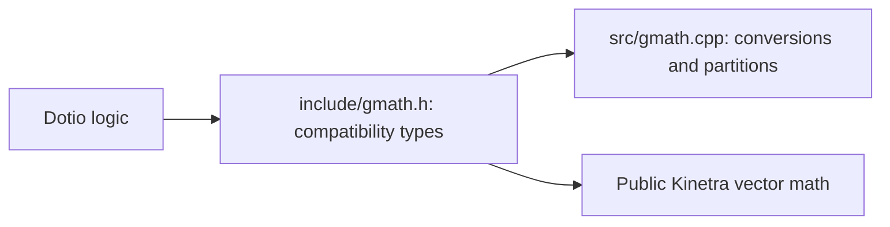

# Dotio math compatibility

Legacy coordinate and geometry adapters compiled into `kinetra_dotio_logic`. Canonical vector operations delegate to the public Kinetra math API; compatibility types preserve Dotio's coordinate conventions.

## Table of contents

- [Visual overview](#visual-overview)
- [Structure and contracts](#structure-and-contracts)

[Parent guide](../README.md) · [Project overview](../../../README.md) · [Documentation index](../../../docs/README.md)

Directory guides: [include](include/README.md), [src](src/README.md).

## Visual overview

Compatibility preserves legacy coordinates while canonical vector operations use Kinetra.

## Structure and contracts

[Headers](include/README.md) define the compatibility types; [implementation](src/README.md) handles coordinate conversion and grid operations. See [Dotio architecture](../../../docs/dotio-architecture.md) for adapter ownership and the [Dotio tests](../tests/README.md) for verification. Build through the repository root as described in the [Dotio guide](../README.md).
