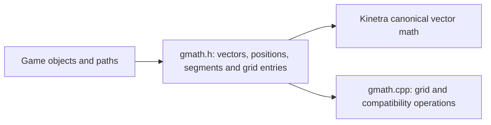

# Dotio math compatibility headers

Sources in this directory belong to `kinetra_dotio_logic`. These are Lab-owned interfaces and implementations; they are not part of the public Kinetra engine API.

## Table of contents

- [Visual overview](#visual-overview)
- [File map](#file-map)
- [Architecture and build](#architecture-and-build)

[Parent guide](../README.md) · [Project overview](../../../../README.md) · [Documentation index](../../../../docs/README.md)

## Visual overview

The header is the coordinate boundary seen by game logic.

## File map

| File | Responsibility |
| --- | --- |
| [gmath.h](gmath.h) | Legacy vector, position, segment and grid types; canonical vector math delegates to Kinetra |

## Architecture and build

See the [architecture guide](../../../../docs/dotio-architecture.md) for ownership and dependency contracts. Build through the repository root; the containing application or launcher CMake file defines these targets.
