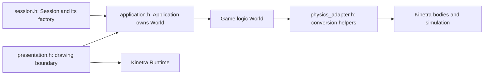

# Dotio application headers

Sources in this directory belong to `kinetra_dotio_logic` and `kinetra_dotio_presentation`. These are Lab-owned interfaces and implementations; they are not part of the public Kinetra engine API.

## Table of contents

- [Visual overview](#visual-overview)
- [File map](#file-map)
- [Architecture and build](#architecture-and-build)

[Parent guide](../README.md) · [Project overview](../../../README.md) · [Documentation index](../../../docs/README.md)

## Visual overview

Ownership stays in Application; presentation and physics adapters translate at engine boundaries.

## File map

| File | Responsibility |
| --- | --- |
| [application.h](application.h) | Header-defined application state, stable World ownership and clocks |
| [physics_adapter.h](physics_adapter.h) | Legacy body and physics conversion helpers |
| [portable.h](portable.h) | Portable compatibility includes and definitions |
| [presentation.h](presentation.h) | Rendering and input presentation boundary |
| [session.h](session.h) | `dotio::Session`, a Lab session that also gives its `Application` to a tool that plays the game (the [capture tool](../../../tools/capture/README.md)'s scripted player), and the factory shared by direct and bundled launch |

## Architecture and build

See the [architecture guide](../../../docs/dotio-architecture.md) for ownership and dependency contracts. Build through the repository root; the containing application or launcher CMake file defines these targets.
