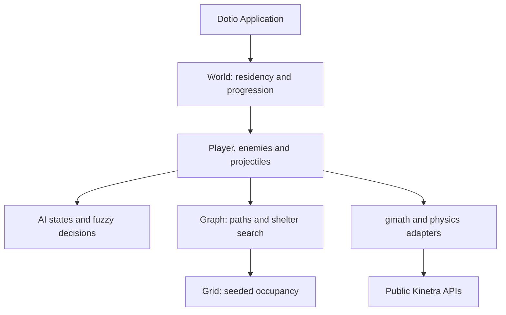

# Dotio game logic

Headless game rules compiled into `kinetra_dotio_logic`: world residency, enemies and AI states, combat, spawning and progression. Application policy stays here; reusable simulation mechanisms belong to Kinetra.

## Table of contents

- [Visual overview](#visual-overview)
- [Structure and contracts](#structure-and-contracts)

[Parent guide](../README.md) · [Project overview](../../../README.md) · [Documentation index](../../../docs/README.md)

Directory guides: [include](include/README.md), [src](src/README.md).

## Visual overview

World coordinates game policy; supporting modules provide decisions, paths and coordinate compatibility.

## Structure and contracts

[Headers](include/README.md) define game objects and rules; [implementation](src/README.md) updates them. See [Dotio architecture](../../../docs/dotio-architecture.md) for ownership, [gameplay contracts](../README.md) for behavior and [tests](../tests/README.md) for coverage and build commands.
