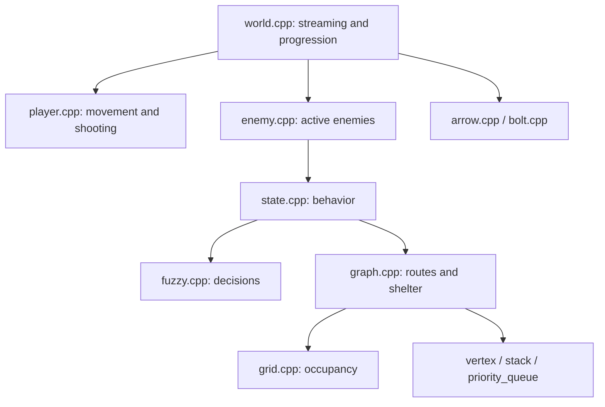

# Dotio game logic implementation

Sources in this directory belong to `kinetra_dotio_logic`. These are Lab-owned interfaces and implementations; they are not part of the public Kinetra engine API.

## Table of contents

- [Visual overview](#visual-overview)
- [File map](#file-map)
- [Architecture and build](#architecture-and-build)

[Parent guide](../README.md) · [Project overview](../../../../README.md) · [Documentation index](../../../../docs/README.md)

## Visual overview

Arrows show collaboration between implementations, rather than a complete tick ordering.

## File map

| File | Responsibility |
| --- | --- |
| [world.cpp](world.cpp) | Streaming, population, progression and projectile ordering |
| [enemy.cpp](enemy.cpp) | Enemy updates and AI integration |
| [state.cpp](state.cpp) | Wander, attack, pursue, recover and kamikaze behavior |
| [player.cpp](player.cpp) | Player movement, shooting and resources |
| [arrow.cpp](arrow.cpp) | Enemy projectiles |
| [bolt.cpp](bolt.cpp) | Player projectiles |
| [graph.cpp](graph.cpp) | A* and fear-biased shelter paths |
| [grid.cpp](grid.cpp) | Seeded occupancy and raster queries |
| [fuzzy.cpp](fuzzy.cpp) | Fuzzy decision evaluation |
| [physics_object.cpp](physics_object.cpp) | Physical object behavior |
| [moving_object.cpp](moving_object.cpp) | Movement and integration |
| [static_object.cpp](static_object.cpp) | Static object initialization |
| [priority_queue.cpp](priority_queue.cpp) | Search frontier operations |
| [stack.cpp](stack.cpp) | Path storage operations |
| [vertex.cpp](vertex.cpp) | Graph vertex operations |

## Architecture and build

See the [architecture guide](../../../../docs/dotio-architecture.md) for ownership and dependency contracts. Build through the repository root; the containing application or launcher CMake file defines these targets.
