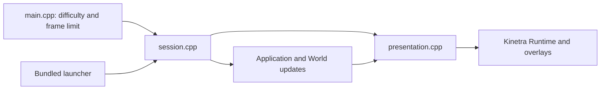

# Dotio presentation implementation

Sources in this directory belong to `kinetra_dotio_presentation`. These are Lab-owned interfaces and implementations; they are not part of the public Kinetra engine API.

## Table of contents

- [Visual overview](#visual-overview)
- [File map](#file-map)
- [Architecture and build](#architecture-and-build)

[Parent guide](../README.md) · [Project overview](../../../README.md) · [Documentation index](../../../docs/README.md)

## Visual overview

Both entry paths share input capture, game state and the presentation adapter.

## File map

| File | Responsibility |
| --- | --- |
| [presentation.cpp](presentation.cpp) | Legacy drawing adapter, camera and overlay rendering |
| [session.cpp](session.cpp) | Input mapping, pointer capture and Session lifecycle |
| [main.cpp](main.cpp) | Direct executable, difficulty and frame-limit arguments |

## Architecture and build

See the [architecture guide](../../../docs/dotio-architecture.md) for ownership and dependency contracts. Build through the repository root; the containing application or launcher CMake file defines these targets.
