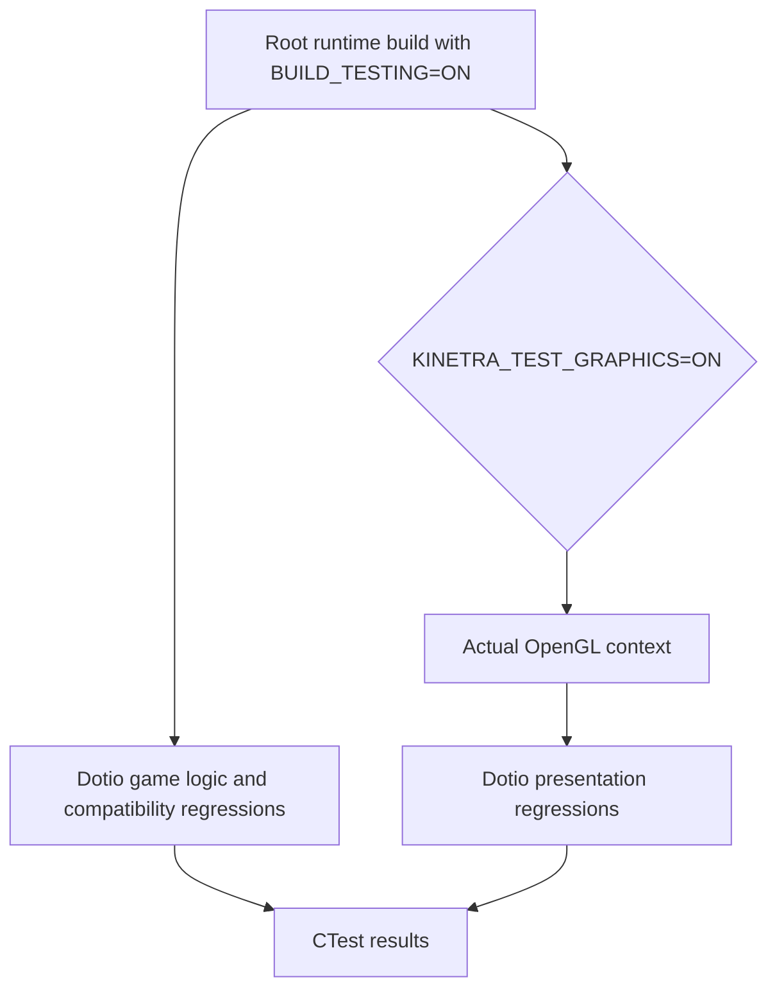

# Dotio tests

Regression tests for Dotio game logic, application commands and presentation. Both programs are doctest suites: each `TEST_CASE` is one behavior, named after its expected outcome, and CTest registers it as `<suite>:<case>`. How to write cases is in [Kinetra testing](../../../external/Kinetra/docs/testing.md#writing-a-doctest-suite).

## Table of contents

- [Visual overview](#visual-overview)
- [Coverage](#coverage)
- [Build and run](#build-and-run)

[Parent guide](../README.md) · [Project overview](../../../README.md) · [Documentation index](../../../docs/README.md)

## Visual overview

The two test paths separate checks without a window from checks requiring a graphics context.



## Coverage

| Source | CTest suite (cases) | Coverage |
| --- | --- | --- |
| [dotio_tests.cpp](dotio_tests.cpp) | `kinetra_dotio` (21) | Geometry, routing, streaming, combat, fuzzy AI, difficulty, lifecycle, debug camera and commands |
| [presentation_tests.cpp](presentation_tests.cpp) | `kinetra_dotio_graphics` (2) | Wall colors without a window; then rendering resources, statistics, zoom-independent AI label placement and Ghost marker presentation in one case, because those checks share one `Runtime` (label `graphics`) |

Dotio's collision grid, `logic::Grid::Array`, is global state. Generating or initializing a world overwrites all of it; cases that build on the plain bordered arena call `open_map()` first. No case depends on another case or on the order in which they run.

## Build and run

Run from the repository root for the tests that need no window:

```sh
cmake -S . -B build-headless -DKINETRA_LAB_BUILD_RUNTIME=OFF -DBUILD_TESTING=ON
cmake --build build-headless --target kinetra_dotio_tests --parallel
ctest --test-dir build-headless -R '^kinetra_dotio:' --output-on-failure
```

One case runs on its own through CTest (`-R 'kinetra_dotio:a failed escape'`) or the executable (`./build-headless/kinetra_dotio_tests --test-case='a failed escape*'`).

For `kinetra_dotio_graphics`, use a runtime build with `KINETRA_TEST_GRAPHICS=ON` and an OpenGL context as described in [Tests and resources](../../../README.md#tests-and-resources). Filter that build's CTest run with `-R '^kinetra_dotio_graphics:'`.
