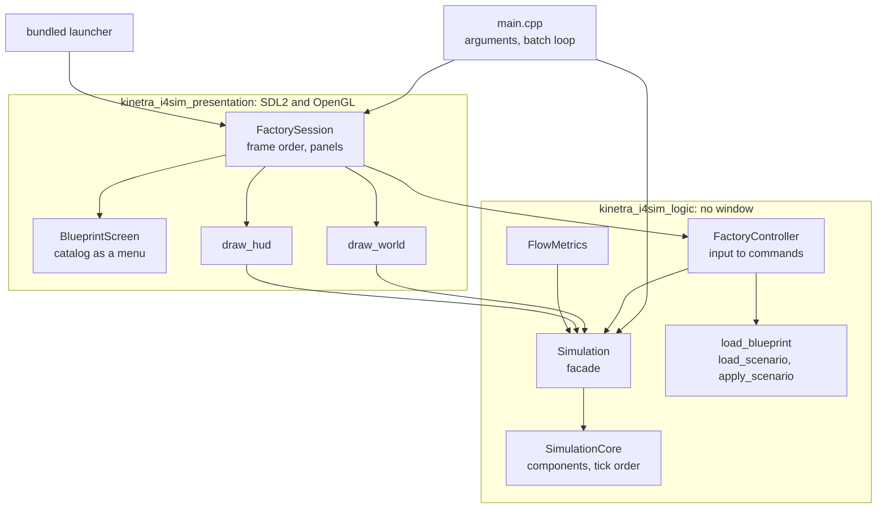
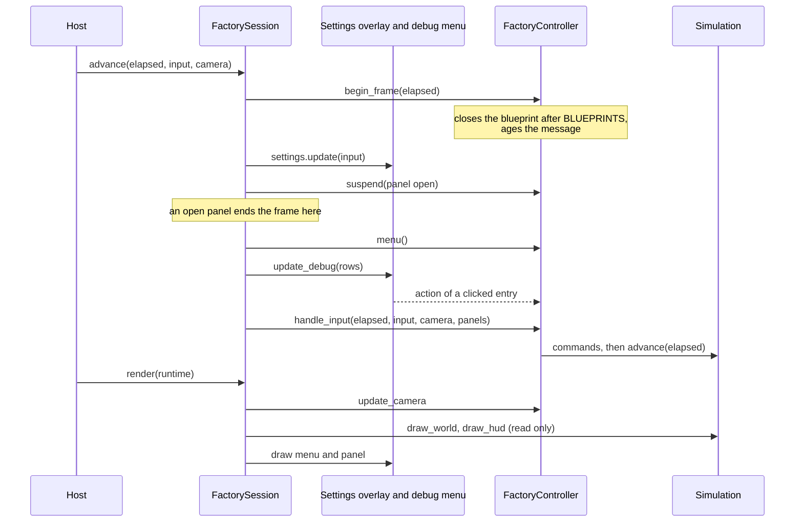
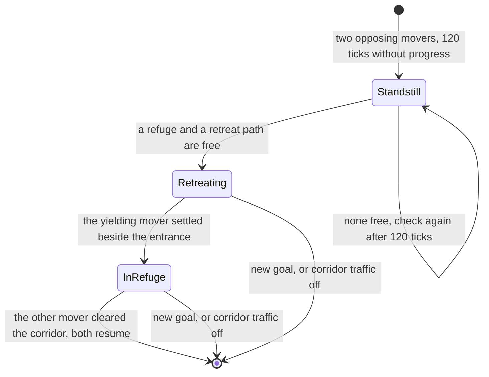
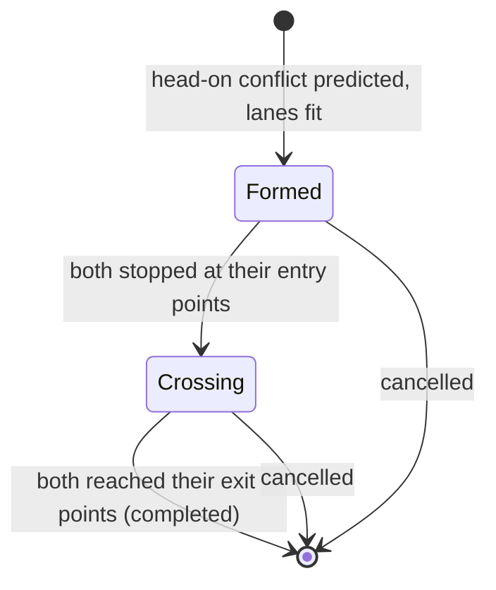

# i4sim

A local C++20 factory simulation, ported from the C# Industry 4.0 reference. Movers carry products between producers on a grid floor, and optional traffic policies keep them from blocking each other. It runs as a graphical session, from the bundled launcher or on its own, and as a batch program without a window. People use it to watch and compare motion and traffic policies; phases 7 and 8 of the [quality roadmap](../../docs/design/2026-11-18-quality-roadmap.md) build on it.

## Table of contents

- [Purpose and scope](#purpose-and-scope)
- [Build and run](#build-and-run)
- [Controls](#controls)
- [Concepts](#concepts)
- [Structure](#structure)
- [How it works](#how-it-works)
  - [A frame of the session](#a-frame-of-the-session)
  - [A tick of the simulation](#a-tick-of-the-simulation)
  - [Steering profiles](#steering-profiles)
  - [Junction traffic](#junction-traffic)
  - [Corridor traffic and recovery](#corridor-traffic-and-recovery)
  - [Predictive passing](#predictive-passing)
  - [Parking traffic](#parking-traffic)
- [Invariants and contracts](#invariants-and-contracts)
- [Changing this module](#changing-this-module)
- [Tests](#tests)
- [Provenance and differences](#provenance-and-differences)
- [Open points](#open-points)

[Parent guide](../README.md) · [Project overview](../../README.md) · [Documentation index](../../docs/README.md)

## Purpose and scope

i4sim answers one question: how does a fleet of movers behave on a given factory layout under a given steering profile and set of traffic policies? It loads a layout from a JSON blueprint, generates a product workload, and reports throughput, contacts and waiting.

- **In scope:** blueprint loading and validation, production scheduling, routes, traffic policies, the session with its inspection and debug views, and a summary export.
- **Not in scope:** the reusable mechanisms. The weighted grid, A*, steering, reciprocal avoidance, contact resolution, the traffic gate, the launcher menu and the overlays live in [Kinetra](../../external/Kinetra/README.md). i4sim chooses when and with which values to use them.
- **Not reproduced from the reference:** MQTT, the actor framework and the Windows rendering. See [provenance and differences](#provenance-and-differences).

The exact rules and limits of every policy are in the [factory simulation architecture](../../docs/factory-simulation-architecture.md). This page explains how the module is built and how its algorithms work; the blueprint and scenario formats are in the [blueprint guide](blueprints/README.md), and the suites and the benchmark in the [test guide](tests/README.md).

## Build and run

i4sim needs the header-only nlohmann JSON package (3.11+, `nlohmann-json3-dev` on Debian) in every build; the graphical session also needs SDL2 and OpenGL. From the repository root:

```sh
cmake -S . -B build -DCMAKE_BUILD_TYPE=Release
cmake --build build -j2
./build/kinetra --variant i4sim
./build/kinetra_i4sim
./build/kinetra_i4sim --blueprints /path/to/Blueprint
./build/kinetra_i4sim --blueprint labs/i4sim/blueprints/3840x2400.json --run --ups 200
```

The session opens on the **blueprint screen**, a paged list of the catalog. Choose a blueprint with the arrows and Enter, or with the mouse; it loads paused. The first row, SHOWCASE, opens a page with the [showcase scenes](blueprints/README.md#showcase-scenes): small blueprints whose `scenario` section sets the profile, the policies, the workload, mover goals and how the scene repeats, so pressing Space plays the scene. The scenes repeat: their movers drive back and forth between start and goal and turn together after a two-second pause, or, for corridor recovery, the scene starts again from its blueprint after the same pause.

CMake copies the catalog to `i4sim-blueprints/` beside the executables, and the session finds it through the executable's location, whatever the working directory is. Move that directory together with the executable, or pass `--blueprints DIR` for another catalog; `--blueprint FILE` loads one file directly. A file that fails to load reports its name and the cause, and the blueprint screen stays open. A missing or empty catalog shows the directory on screen and on standard error; restore the directory and press Enter to read it again.

The batch mode needs no window and also builds with `KINETRA_LAB_BUILD_RUNTIME=OFF`:

```sh
./build/kinetra_i4sim --blueprint labs/i4sim/blueprints/3840x2400.json --ticks 50000 --seed 42 --output /tmp/i4sim-results
```

| Option | Effect |
| --- | --- |
| `--blueprint FILE` | Load this file directly; with a `scenario` section, apply it |
| `--blueprints DIR` | Catalog directory of the blueprint screen |
| `--ticks N` | Batch mode: run N ticks without a window, or fewer when the blueprint's tick cap comes first. Needs `--blueprint` |
| `--output DIR` | Batch mode: write `summary.json` with run totals and per-mover, per-producer and per-product counters. A graphical session writes no summary |
| `--seed N` | Seed of the workload; 42 by default |
| `--run`, `--ups N` | Graphical: start a loaded blueprint running, and its ticks per second (1 to 10000, default 200) |
| `--frames N` | Graphical: stop after N frames, for smoke runs |

## Controls

Ctrl or the SETTINGS button opens the modal settings panel, which pauses the simulation and takes all input; closing it restores the earlier run state. LAUNCHER and EXIT are in that panel. Debug Mode, the statistics and every debug layer start on. Shift+Ctrl, or the DEBUG button next to SETTINGS, opens the debug menu.

| Input | Action |
| --- | --- |
| Escape / M on the blueprint screen | Leave i4sim: back to the bundled launcher, or exit the direct `kinetra_i4sim`. On the SHOWCASE page they return to the blueprint list |
| Space / P | Pause or resume |
| R | Restart the blueprint with the same seed, paused, and keep the motion settings. A showcase scene also gets its goals, workload and repeat setting again, so a changed setting can be compared with the original run |
| G | Toggle the automatic workload |
| Q / E | Halve / double the ticks per second |
| 1–6 | Toggle the Grid, Heatmap, Paths, Forces, Borders and Detection layers (drawn only in Debug Mode); a layer's parts keep their own selection |
| WASD / arrows | Pan the camera |
| Wheel (in Debug Mode) / F | Zoom / fit the floor in the window |
| Left click / right click | Inspect a mover or producer / also hold the mover or block the producer |
| Shift + left click | Send the selected mover there as a manual goal |

The debug menu has four sections. A click on a heading opens its rows below it and closes the open section; a second click closes it. SIMULATION is open at the start. On/off settings are check boxes, a number shows its value with `[-]` and `[+]` buttons, and PROFILE and PLANNER open a list of choices below them that closes on a choice. Below a rule follow ZOOM, with buttons of one zoom step each, FRAME SCENE and BLUEPRINTS (back to the blueprint screen).

| Section | Rows |
| --- | --- |
| SIMULATION | RUNNING, SINGLE TICK, UPS (ticks per second), WORKLOAD |
| LAYERS | GRID, HEATMAP, PATHS, FORCES, BORDERS, DETECTION, CONTACT SHAPES. While PATHS, FORCES or BORDERS is on, its parts are listed below it: ROUTES, RETREAT TARGETS and PASSING TARGETS; SEEK, COLLISION, BORDER, PREDICTIVE, VELOCITY and ACCELERATION; WALLS and TRAFFIC ZONES. A part is drawn only while it and its layer are on. A color swatch beside a row is the color it is drawn in |
| MOTION | PROFILE, PLANNER (HEAT A*, plain A*, or OFF: no route, straight at the goal), RECOVERY, SPEED, FORCE, HORIZON, RESET PARAMETERS |
| TRAFFIC | CORRIDOR TRAFFIC, JUNCTION TRAFFIC, PARKING TRAFFIC, PREDICTIVE PASS (`LEGACY` when the profile has no predictive passing) |

Motion settings can change while the factory runs: assignments, positions and routes stay, and a new SPEED, FORCE, HORIZON or PROFILE applies from the next tick. Only a PLANNER change plans every route again. Turning a policy off drops its state; passing plans end as `disabled`. A setting the simulation rejects, and a goal it rejects (the mover is held or carries a product, or the goal is blocked or unreachable), shows a message for four seconds and changes nothing.

The two statistics lines show ticks, ticks per second, contacts and contact duration, and the counters of the policies that are on: `PASS` (active passing pairs), `RETREAT` (corridor recoveries), `AVOID LIMIT` (Reciprocal: movers whose constraints were infeasible or overridden in the last tick), `PARK WAIT`, `CROSS WAIT` and `LANE WAIT` (waiting movers, with the number of detected zones) and `EXIT` (movers waiting for exit space). An inspected mover shows distance, contact ticks, its status and `STALLED` when it made no route progress for 120 ticks. That is a lack of progress, not a proven deadlock.

## Concepts

| Term | Meaning |
| --- | --- |
| Blueprint | A JSON file with the floor size, the grid cell size, movers, producers and forbidden zones. Validated on load; a data format, so changing a field is a contract change |
| Factory space | Millimeters from the floor's top-left corner, **Y down**. Blueprints, the simulation and every `Simulation` query use it. The camera's world has Y up; `flip_y` ([view.h](include/i4sim/simulation/view.h)) converts either way |
| Tick, UPS | The simulation advances in fixed ticks. Speeds are millimeters per tick, so changing the ticks per second (UPS) changes only how fast the wall clock runs |
| Mover | A rectangular transport vehicle. It has a parking place (its start), at most one goal, and at most one product |
| Producer | A robot or manual station with a processing place where a mover stands while it works, and a bounded queue |
| Product, recipe | A product needs a fixed sequence of interactions, each at a producer that supports it. It keeps one mover until it is complete |
| Workload | The generator that opens a random product while fewer products than movers are open |
| Goal kind | Who chose a mover's goal: the factory (`automatic`), the operator (`manual`), or parking traffic (`parking_staging`) |
| Hold, block | The operator's stop for a mover (it keeps goal and product) and for a producer (it accepts and processes nothing) |
| Steering profile | How movers avoid each other: Improved (default), Original, RVO experiment, Reciprocal |
| Traffic policy | An optional rule on top of steering: parking, junction or corridor traffic, or predictive passing. All are off by default |
| Zone | A junction or corridor that a traffic policy admits movers to, one at a time |
| Exit pocket | The space behind a zone that an admitted mover needs to leave it; it is reserved with the admission |
| Contact | A mover pair, or a mover and a wall segment, that starts touching. It counts once however long it lasts; the duration is counted separately in ticks |
| Scenario, showcase scene | A `scenario` section in a blueprint with motion settings, the workload switch, mover goals and a repeat mode; a showcase scene is a small blueprint with one |
| Shuttle | Movers that drive back and forth between their start and a goal and turn together after `shuttle_pause_ticks` (`Simulation::shuttle`); how most showcase scenes repeat |
| Event log, flow metrics | Opt-in observation: passing and contact events ([events.h](include/i4sim/simulation/events.h)), and waiting and stuck movers ([flow_metrics.h](include/i4sim/simulation/flow_metrics.h)). Neither changes a run |

## Structure



*Takeaway:* everything that decides something is in the headless library and is tested without a window: the simulation, the loaders and the controller that turns input into commands. The presentation only orders a frame, shows panels and draws; the world view and the HUD read the simulation and never change it.

The files follow the [directory layout](../../external/Kinetra/docs/conventions.md#directory-layout), by topic: `simulation/` is the rules and their components, `blueprint/` the file formats, `presentation/` the window side. Each topic keeps its private headers in `detail/`; `src/` mirrors the topics.

```text
include/i4sim/
  controller.h
  simulation/   simulation.h events.h flow_metrics.h view.h
    detail/     simulation_core.h, the components (routing, traffic, goals, ...), constants
  blueprint/    blueprint.h scenario.h
    detail/     json_fields.h
  presentation/ session.h
    detail/     world_view.h hud.h blueprint_screen.h
src/            controller.cpp main.cpp simulation/ blueprint/ presentation/
tests/include/i4sim/testing/   recorder.h event_counts.h showcase.h
```

Public headers, in [include/i4sim/](include/i4sim/):

| File | Responsibility |
| --- | --- |
| [blueprint.h](include/i4sim/blueprint/blueprint.h) | The validated layout types, the model tables, `load_blueprint`, catalog discovery |
| [scenario.h](include/i4sim/blueprint/scenario.h) | The optional `scenario` section: `load_scenario`, `apply_scenario` |
| [simulation.h](include/i4sim/simulation/simulation.h) | `Simulation`: the facade with all state queries and commands, `MotionSettings`, the mover, producer and product types |
| [events.h](include/i4sim/simulation/events.h), [flow_metrics.h](include/i4sim/simulation/flow_metrics.h) | The event log's types; waiting and stuck movers measured from outside |
| [view.h](include/i4sim/simulation/view.h) | `Layer`, `parent_layer` and `ViewLayers`, the zoom limits and `flip_y`: view state as plain data |
| [controller.h](include/i4sim/controller.h) | `FactoryController`: the loaded simulation, selection, messages, camera, keys, pointer and debug-menu entries |
| [session.h](include/i4sim/presentation/session.h) | `create_session`: the only entry to the graphical session |

Sources and private headers, in [src/](src/) and the `detail/` folders:

| File | Responsibility |
| --- | --- |
| [main.cpp](src/main.cpp) | Command line; the batch loop, or a `Runtime` with the session |
| [blueprint.cpp](src/blueprint/blueprint.cpp), [scenario.cpp](src/blueprint/scenario.cpp), [json_fields.h](include/i4sim/blueprint/detail/json_fields.h) | The loaders and the case-insensitive JSON field readers they share |
| [simulation.cpp](src/simulation/simulation.cpp), [simulation_core.cpp](src/simulation/simulation_core.cpp) | The facade, and the private core that owns the components and runs the tick |
| [floor_plan.cpp](src/simulation/floor_plan.cpp), [routing.cpp](src/simulation/routing.cpp), [goals.cpp](src/simulation/goals.cpp), [traffic.cpp](src/simulation/traffic.cpp), [predictive_passing.cpp](src/simulation/predictive_passing.cpp), [production.cpp](src/simulation/production.cpp), [motion_step.cpp](src/simulation/motion_step.cpp), [shuttle.cpp](src/simulation/shuttle.cpp) | The components of the simulation; their ownership and dependencies are in the [simulation structure](../../docs/factory-simulation-architecture.md#simulation-structure) |
| [fleet.h](include/i4sim/simulation/detail/fleet.h), [event_log.h](include/i4sim/simulation/detail/event_log.h), [geometry.cpp](src/simulation/geometry.cpp), [simulation_constants.h](include/i4sim/simulation/detail/simulation_constants.h) | Shared mover data, the event log, geometry helpers and the named tuning values |
| [flow_metrics.cpp](src/simulation/flow_metrics.cpp) | `FlowMetrics` |
| [controller.cpp](src/controller.cpp) | `FactoryController` |
| [session.cpp](src/presentation/session.cpp) | `FactorySession`: the frame order, the settings overlay and the debug menu |
| [blueprint_screen.cpp](src/presentation/blueprint_screen.cpp) | `BlueprintScreen`: the catalog on Kinetra's `LaunchMenu`, with the SHOWCASE page and the load-error screen |
| [world_view.cpp](src/presentation/world_view.cpp), [hud.cpp](src/presentation/hud.cpp) | Drawing in the world, and the screen-space text |

The headers in `detail/` are private. Callers, tests included, use the facade, so a component can change without touching them.

## How it works

### A frame of the session

The host (the launcher loop or `run_session`) calls `advance` and then `render`. While no blueprint is loaded, both go to the blueprint screen. With a blueprint:



*Takeaway:* the panels see the input first. An open settings panel takes the whole frame; the debug menu takes the pointer while it is over the menu. Only then does the controller map what is left to commands and advance the simulation.

- **Why the controller is separate.** Which key does what, when a click selects, how long a message stays and how the camera fits are rules, and rules need tests. In the controller they are tested from plain `kinetra::Input` values, without a window ([controller tests](tests/controller_tests.cpp)).
- **Menu entries.** The controller describes each debug-menu row as a `kinetra::DebugEntry`: a label, a kind (button, check box, list choice or heading), a nesting depth, and optionally an action, a state, a value text, `[-]` / `[+]` functions and a swatch. A `kinetra::DebugFolds` keeps which section and which list are open, and a `kinetra_lab::ZoomControl` collects the steps of the ZOOM row for the next camera update. The engine's menu draws marks, indentation and values, so the session passes the entries on unchanged. The colors stay with the drawing code: the session hands `layer_color` to `menu()`, which asks it for the swatch of every layer row. Every action changes the state where it lives, so no flag has to be mirrored between the menu and the simulation.
- **Deferred close.** BLUEPRINTS only sets a request. The frame that clicked it still finishes with its simulation; the next `begin_frame` closes it.
- **Drawing between ticks.** Movers are drawn between their last two ticks (`Mover::previous_position`, `Simulation::interpolation()`), so motion stays even at 60 frames and 200 ticks per second ([drawing between ticks](../../docs/architecture.md#session-ownership-and-frame-flow)).

### A tick of the simulation

`Simulation` forwards every call to a private `SimulationCore`, which owns one instance of each component and runs the tick: open a product when the workload allows it, refresh the heatmap every ten ticks, run the parking interlock, move, advance production, then turn the shuttling movers once all of them have stood still for the pause. Moving means: prepare routes, take one snapshot of all bodies, run corridor recovery, predictive passing and zone admission against that snapshot, steer and integrate every mover, and finally count and resolve contacts. The component table, their dependency diagram, the exact tick order and the mover's state diagram are in the [simulation structure](../../docs/factory-simulation-architecture.md#simulation-structure).

Two design choices explain most of the code:

- **One snapshot per tick.** Every decision of a tick reads the same positions, and movers are handled in a stable order. That makes a run reproducible: the same blueprint, seed, settings and commands give the same run, tick for tick.
- **Policies change targets, not bodies.** A traffic policy never moves a mover itself. It makes the mover wait (a stop line the steering respects) or gives it a temporary target, while the destination, the product and the parking place stay as they were. When the policy ends, the mover plans a route to its unchanged goal.

### Steering profiles

A route comes from A* on the weighted grid. With the heatmap, cells where movers stand cost more, so routes avoid crowds. A mover that makes no progress along its route for 100 ticks plans again. With path planning off (PLANNER → OFF, or `pathPlanning` in a scenario), the route is the destination alone: the mover steers straight at its goal, slides along walls that stand in the way, and passes their convex corners. A goal still needs a grid route to be accepted. Steering alone cannot leave a concave pocket, so OFF suits open floors such as the H.

| Profile | How a mover avoids others |
| --- | --- |
| Improved (default) | Priority steering (overlap safety, then predicted conflicts, then seek and arrive) followed by seek-and-avoid, with the exact rectangular clearance between movers instead of enclosing circles |
| Original | Priority steering alone, as in the reference |
| RVO experiment | Tangent steering around predicted conflicts |
| Reciprocal | Kinetra's reciprocal avoidance on the tick's snapshot, with rectangular envelopes and 2 mm clearance; parked and held movers do not cooperate |

Profiles never switch on their own. None of them guarantees a run without contacts; the [benchmark](tests/README.md#motion-benchmark) shows what each achieves on the large layouts.

### Junction traffic

*Problem:* at a crossing of one-cell corridors, two movers that enter together block each other.

- **Detection.** At construction, the floor plan marks every free cell with three or four open neighbors that are themselves corridor cells: an isolated T or + junction. Open floors and junctions next to each other are not detected.
- **Admission.** Each junction has one `kinetra::TrafficGate`. A mover whose route enters the junction within a bounded lookahead requests it; the gate grants requests first come, first served, one mover at a time.
- **Exit pocket.** A grant needs room to leave. The simulation follows the mover's route to the first place where it is clear of the junction and reserves that swept footprint plus braking space. If other bodies or reservations are in that pocket, the request waits and a later request with a free exit may go first.
- **Waiting.** A mover without a grant gets a stop line before the junction, enforced by the same controller that keeps movers off walls. Its goal is untouched. A mover inside may always leave.

Cyan outlines mark junctions and lime outlines the reserved exit. *Limit:* this reserves the space to clear the junction, not the route behind it.

### Corridor traffic and recovery

*Problem:* in a corridor one cell wide, two opposing movers cannot pass.

- **Detection.** A corridor is a straight run of free cells with blocked cells on both sides, up to 256 cells long, whose ends both open into a room at least three cells wide and two deep. Dead ends and bends are excluded.
- **Admission.** The gate and exit-pocket machinery of junctions is reused, for the whole run: one mover traverses, and the opposite approach waits in its room, far enough back to leave the holder a full exit pocket.

When corridor traffic is switched on late, or a mover parked inside starts, two movers can already face each other in the corridor. Recovery handles exactly that case:



*Takeaway:* one mover backs out to the side of an entrance room, the other passes, and both continue to their own goals. Up to four candidates are checked (either mover, to either side of its room); the shortest valid retreat wins. The pink arrow shows the retreat target and `RETREAT` counts active recoveries. *Limits:* two movers only, and a refuge is checked when the retreat starts, not during it.

### Predictive passing

*Problem:* on an open floor, two movers on a head-on course brake in front of each other, and local avoidance may take long or fail to separate them.

The policy pairs such movers early and has them agree on sides. It works for Improved and Reciprocal.



- **Prediction.** From the tick's snapshot, with preferred speed and a lookahead that depends on the footprints, the policy finds pairs with roughly opposite headings that would meet. Pairs are sorted by encounter time and mover index, so pairing is deterministic; a mover joins one pair at most.
- **Plan.** Each mover gets an *entry point* in its own side lane and an *exit point* beyond the encounter. The lanes are offset by the footprints plus 8 mm. Two side choices and three shared sideways shifts are tried, so a pair can also pass next to a wall.
- **Checks.** A plan is accepted only if both swept paths clear the static grid (with 2 mm inflation), every other mover in the snapshot, the detected junctions and corridors, and the paths of existing pairs. If nothing fits, ordinary steering continues.
- **Two stages.** Both movers first reach their entry points and stop (*formed*), then both drive to their exit points (*crossing*), and then they plan routes to their unchanged goals.
- **Cancellation.** A plan ends early when the feature is switched off, a participant is held or gets a new goal, corridor recovery takes a participant, or the pair makes no progress for 240 ticks; the movers then wait 120 ticks before trying again.

Mint arrows show the temporary targets and `PASS` counts active pairs. With the event log on, every plan records its formation, crossing and end with the reason. *Limits:* the checks use the snapshot of the tick in which the plan forms. A third mover that enters a lane later is not guarded against; the [pressure scenarios](tests/README.md#golden-and-pressure-lines) record what happens then, and roadmap phase 7 addresses it.

### Parking traffic

*Problem:* a mover returning to its parking place can seal in a neighbor that is about to leave.

Before movement, an automatic parking return whose parking footprint lies on another mover's active route is sent to a free staging cell instead (goal kind `parking_staging`). The mover keeps its parking place, is not given a new product while it waits, and resumes its own parking goal when the route is clear. `PARK WAIT` counts the movers that wait. Manual goals and new production take precedence.

## Invariants and contracts

- **Determinism.** The same blueprint, seed, motion settings and commands give the same run tick for tick. Randomness comes only from the seeded workload generator. The [golden and pressure suites](tests/README.md#golden-and-pressure-lines) pin this with fingerprints of every position after every tick, so they need exact floating-point results (no fast-math, no FMA contraction).
- **Units.** Millimeters, ticks, millimeters per tick. The frame time only selects how many ticks run; it never scales a physical value.
- **Observation only.** The event log, `FlowMetrics`, the world view and the HUD read the simulation through `const` access. Recording or drawing never changes a decision.
- **Copies are deep.** Copying a `Simulation` copies its whole state, including the event log. Components store no references to each other, so a copy cannot point into the original.
- **Only goals move goals.** A mover's destination changes only through the `Goals` view, which also cancels the corridor recovery and passing plan that depended on the old goal.
- **Controller preconditions.** Every `FactoryController` call that reads or commands the simulation requires `loaded()`. `simulation()` returns a reference that a load, a restart or a close invalidates; the drawing code takes it anew each frame.
- **Frame order.** `begin_frame`, `suspend`, menu actions, `handle_input`, and `update_camera` before drawing. Menu entries borrow the controller and are built anew for every update and every draw, because the open section, the open list and the selected layers decide which entries exist.
- **Failed loads change nothing.** `load_blueprint` never loads partially, and `FactoryController::load` builds the new simulation aside, so a failure leaves the loaded blueprint as it was.
- **Layers.** The headless library depends on `Kinetra::Simulation` and the headless `kinetra_lab/input.h` only; the presentation adds `Kinetra::Runtime`, the Lab session helpers and `Kinetra::Launcher` for the blueprint screen ([Lab boundaries](../../AGENTS.md#lab-boundaries)).

## Changing this module

| To | Change | Test with |
| --- | --- | --- |
| Add a key | `FactoryController::handle_keys`; the help lines in `session.cpp`; the [controls](#controls) table | A case in `controller_tests.cpp` |
| Add a debug-menu entry | The `add_*_entries` function of its section in `controller.cpp`; keep a row with `[-] [+]` within 21 characters | The section-listing cases in `controller_tests.cpp`. The graphics test clicks rows by number (`menu_row` in `presentation_tests.cpp`), so a new row above a clicked one moves those numbers |
| Add a debug layer or part | A `Layer` value (and `parent_layer` for a part), a row in `layer_rows` in `controller.cpp`, the drawing in `world_view.cpp` and its color in `layer_color`; a key in `handle_keys` for a top-level layer | Controller cases for the rows and `ViewLayers::shows`; the graphics suite for the drawing |
| Change what the HUD shows | `hud.cpp` | The graphics suite compares the statistics lines |
| Change simulation behavior | The component that owns it ([simulation structure](../../docs/factory-simulation-architecture.md#simulation-structure)) | The golden and pressure lines change: print them with `KINETRA_PRINT_GOLDEN=1`, update them, and explain the change in the commit |
| Restructure without changing behavior | Anything | The golden and pressure lines must stay identical after every commit |
| Add a motion setting or policy | `MotionSettings`, its component, `configure_motion`, a menu entry, the scenario reader in `scenario.cpp` and the [format table](blueprints/README.md#scenario-section-format) | Simulation cases, a showcase scene when it is worth showing |
| Add a blueprint or scenario field | `blueprint.cpp` or `scenario.cpp`, and the [blueprint guide](blueprints/README.md). A blueprint field is a contract change; the five originals in the catalog and the `MAS-demonstrator` test fixture stay unchanged | The loader cases in `simulation_tests.cpp` |
| Add a tuning value | `simulation_constants.h` when components share it, otherwise a named constant where it is used | |

Pitfalls:

- Positions in factory space have Y down. Convert with `flip_y` at the camera, never inside the simulation.
- A line width or marker size in world units must be divided by the camera zoom, or it changes with the zoom.
- The drawing order is the layering: later calls cover earlier ones.
- Warnings are errors for all of `labs/i4sim` in the `dev`, `ci` and `windows` presets.
- The session has no pixel-exact test in the repository. A restructuring of the drawing code is best checked by saving frames before and after and comparing them; `I4SIM_CAPTURE` in the graphics test saves one.

## Tests

| Suite | Covers | Needs |
| --- | --- | --- |
| `kinetra_i4sim` | Blueprints, recipes, production, motion and every traffic policy, the event log, flow metrics, scenarios | Nothing |
| `kinetra_i4sim_golden`, `kinetra_i4sim_pressure` | Ten seeded runs and eight passing scenarios under pressure, each pinned to one recorded line | Exact floating point |
| `kinetra_i4sim_controller` | Loading, keys, pointer, camera, modal pause and the debug-menu entries | Nothing |
| `kinetra_i4sim_graphics` | The session as a whole: blueprint screen, panels, rendered overlays, catalog recovery, showcase scenes | An OpenGL context |
| `kinetra_i4sim_relocation` | The catalog is found beside a relocated executable | Nothing |

```sh
cmake --preset release
cmake --build --preset release --target kinetra_i4sim_tests kinetra_i4sim_golden_tests kinetra_i4sim_pressure_tests kinetra_i4sim_controller_tests kinetra_i4sim
ctest --preset release -R '^kinetra_i4sim'
cmake --workflow --preset graphics   # adds kinetra_i4sim_graphics
```

Not covered: desktop feel and real-time performance, which software rendering cannot show, and the path where a scene cannot be replayed after `R`. The [test guide](tests/README.md) describes each suite, the demonstrations and the motion benchmark with its baseline.

## Provenance and differences

Reference: [SMB-M87/i4sim](https://github.com/SMB-M87/i4sim), local source revision `47230111b69c535d59fda4fe8af90fb7aaa80787`. Five of its fourteen JSON blueprints are bundled unchanged, and a sixth, `MAS-demonstrator`, is kept unchanged as a [test fixture](tests/README.md#suites); `H` became the h-crossing showcase scene (same floor and movers without its four stations, which the scene never used, with a scenario, a longer tick cap and a descriptive name), and the seven city aliases, each identical to one of the others apart from its name, were removed. MIT attribution is preserved in [LICENSE](LICENSE); translated engine algorithms carry the [engine license](../../external/Kinetra/LICENSE).

| Reference | This port |
| --- | --- |
| MQTT, Akka.NET actors, .NET, Win32/Direct2D | Absent. Deterministic state transitions per tick replace the actors, so the asynchronous scheduling and the pixel appearance are not reproduced |
| Bezier curves between cells | Waypoint paths that are checked against the mover's footprint, and optional geometric replanning; weighted costs use physical cell distances |
| Parking places compact and switch between model-specific spaces | Each mover keeps its own parking place |
| A cooldown counter for collisions | Contact episodes, with their duration counted separately |
| Per-tick text logs and dump formatting | One `summary.json` |
| `RVODeadlock` | Exposed as the RVO experiment, not as a collision-free solver |
| Radial-border steering | Not a separate mode |

These differences rule out bit-for-bit parity with the reference. Both recipes are implemented: Trimmer with four interactions and TrimmerPersonalized with six, at 1000 ticks per interaction.

## Open points

- `R` builds a new simulation at the default 200 ticks per second, so a session started with `--ups N` loses its rate on a restart.
- RESET PARAMETERS sets the horizon to 8 ticks, while a new simulation starts at 32.
- `create_session` accepts an `output` directory and ignores it; a graphical session writes no summary.
- A message that should expire, such as a rejected goal, stays on the blueprint screen when the blueprint is closed within its four seconds: the message ages only while a blueprint is loaded.
- With LAYERS open and every layer on, the debug menu is 24 rows high. It fits the default 1280 × 800 window, but in a window lower than about 650 pixels FRAME SCENE and BLUEPRINTS fall below the edge until a section or layer is closed.
- The graphics suite is one long case that clicks debug-menu rows by number. The numbers are named in `menu_row`, but they still follow the menu's layout by hand.
- Two movers can block each other for good close to a destination, mostly under Reciprocal on the larger factories. It happens without any setting change (2 of 48 seeded runs in the [measurement](../../docs/design/2026-11-20-i4sim-tuning-stall.md#verification)), and a SPEED, FORCE or HORIZON change can steer a run into it. RECOVERY does not resolve it.
- Predictive passing is not safe under pressure yet: a third mover in a passing lane, and three oncoming movers, are recorded as today's outcomes. Roadmap [phase 7](../../docs/design/2026-11-18-quality-roadmap.md#phase-7-predictive-passing-under-pressure) addresses them, and [phase 8](../../docs/design/2026-11-18-quality-roadmap.md#phase-8-shared-passing-mechanism) moves the proven mechanism to Kinetra.
- Desktop playtests and performance checks stay manual.
