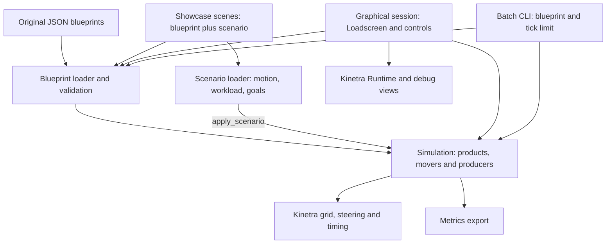

# i4sim

Local C++20 Industry 4.0 factory simulation, migrated from the C# reference.

## Table of contents

- [Visual overview](#visual-overview)
- [Build and run](#build-and-run)
- [Controls](#controls)
- [Behavior and ownership](#behavior-and-ownership)
- [Provenance and differences](#provenance-and-differences)
- [Verification](#verification)

[Parent guide](../README.md) · [Project overview](../../README.md) · [Documentation index](../../docs/README.md)

Directory guides: [headers](include/README.md), [sources](src/README.md), [tests](tests/README.md), [blueprints](blueprints/README.md).

## Visual overview

Graphical and batch entry paths share the same validated blueprint and deterministic simulation.



## Build and run

Install the existing CMake/C++20 and SDL2/OpenGL dependencies plus the header-only `nlohmann-json3-dev` package (3.11+). The JSON library is private to the application; Kinetra has no JSON dependency.

From the repository root:

```sh
cmake -S . -B build -DCMAKE_BUILD_TYPE=Release
cmake --build build -j2
./build/kinetra --variant i4sim
./build/kinetra_i4sim
./build/kinetra_i4sim --blueprints /path/to/Blueprint
./build/kinetra_i4sim --blueprint labs/i4sim/blueprints/MAS-demonstrator.json --run --ups 200
```

The launcher opens a paginated Loadscreen. Select a JSON blueprint using arrows/Enter or mouse; loading starts paused. The last row, SHOWCASE, opens a page with the [showcase scenes](blueprints/README.md#showcase-scenes): small blueprints whose `scenario` section sets the steering profile, coordination features, workload and mover goals, so pressing Space plays the scene. CMake bundles the default resources in `i4sim-blueprints/` beside the executable. Discovery uses the executable location, independent of the current working directory and the original build location. Move that directory together with the executable, or pass `--blueprints DIR` for another catalog. An explicit `--blueprint FILE` loads a file directly. Invalid input reports its filename and retains the loadscreen. A missing/empty catalog displays the directory and logs the full error to stderr. Restore the adjacent resource directory and press Enter to rediscover the catalog; then select a blueprint.

A deterministic batch executable is available even with `KINETRA_LAB_BUILD_RUNTIME=OFF`:

```sh
./build/kinetra_i4sim --blueprint labs/i4sim/blueprints/MAS-demonstrator.json --ticks 50000 --seed 42 --output /tmp/i4sim-results
```

`--ticks` runs without a window until the requested tick count or blueprint tick cap. `--frames N` bounds graphical smoke runs. `--output DIR` selects the summary directory; graphical sessions do not automatically export summaries. Export failures are displayed or reported to stderr during destruction. Summaries include mover/producer counters and active/completed product records.

## Controls

Ctrl or SETTINGS opens the modal settings panel and suspends simulation and world input.
Resume restores the previous pause state. Launcher and Exit are available there.
Debug Mode, statistics and every visual debug layer start enabled. Click DEBUG next to Settings to open the paged debug menu below the buttons.

| Input | Action |
| --- | --- |
| Escape / M on the Loadscreen | Leave i4sim: back to the bundled launcher, or exit the direct `kinetra_i4sim`. On the SHOWCASE page they return to the blueprint list |
| Space / P | Pause or resume |
| R | Reset the blueprint and seed, retaining motion configuration; start paused. A showcase scene also re-sends its goals and workload setting, so a changed motion setting can be compared against the original run |
| G | Toggle automatic factory workload |
| Q / E | Halve / double target UPS |
| 1–6 | Toggle the Grid, Heatmap, Paths, Forces, Borders and Detection layers (drawn only in Debug Mode) |
| WASD / arrows | Pan camera |
| Wheel (debug) / F | Zoom / frame scene |
| Left click / right click | Inspect / toggle blocked state |
| Shift + left click | Replace selected free mover's manual goal |

Debug View offers grid, heatmap, routes, force vectors, boundaries, detection and contact contours,
pause, single tick, workload, framing and blueprint selection. Debug Motion offers Improved,
Original Basic, experimental RVO and experimental Reciprocal steering, A*/heatmap A*, optional geometric route recovery,
speed, acceleration and lookahead adjustments with parameter reset (default lookahead: 32 ticks).
Pause before changing motion configuration. Factory assignments and positions survive configuration changes; routes are rebuilt.

Manual goals reserve only their mover until arrival; busy movers reject them. Invalid goals
leave the current goal intact. Other movers continue their factory work.

Improved steering uses exact rectangular clearance between axis-aligned movers rather than
inflating each mover to a circle. Routes are reconsidered after 100 ticks without progress
along the remaining route, rather than reacting to the mover's own heatmap footprint.
Parked and processing movers remain stationary during mover contact correction.
Geometric route recovery remains optional and disabled by default.

Reciprocal uses the shared Kinetra avoidance controller with immutable neighbor snapshots.
It operates directly in millimeters per tick (`dt = 1`); changing UPS does not change
its speed or acceleration settings. Fixed axis-aligned mover pairs use their exact
summed rectangular footprint with 2 mm clearance per axis, permitting narrow gaps
and parking departures that enclosing circles would reject.
Improved remains the default. `AVOID LIMIT` counts movers whose reciprocal constraints
were infeasible or whose command needed contact/border recovery in the last movement
tick. Wall constraints and rectangular contact correction remain active; this profile
does not guarantee collision freedom or factory throughput.

Optional **DEBUG → View → PREDICTIVE PASS** coordinates oncoming movers on
open floors before they become stuck. Improved and Reciprocal support it; Original
and RVO retain their existing behavior. Both movers first enter separate temporary
lanes, then pass and replan towards their unchanged destinations. Mint arrows show
the temporary targets and `PASS` counts active pairs. The policy starts disabled:
factory throughput depends on the layout and workload. Narrow passages keep their
existing admission/retreat policies. See the [passing contract](../../docs/factory-simulation-architecture.md#predictive-passing).

Optional **DEBUG → Motion → PARKING TRAFFIC** defers automatic parking returns
that would obstruct active routes. Movers use a staging area and resume their own
parking goal when the route clears; `PARK WAIT` shows the number deferred. Manual
goals take precedence. This policy is disabled by default and does not relocate
already parked movers. It improves several measured workloads but does not provide
general junction scheduling; see the [simulation contract](../../docs/factory-simulation-architecture.md).

Optional **DEBUG → Motion → JUNCTION TRAFFIC** admits movers in FIFO order at
isolated T/+ junctions with one-cell corridor arms. `CROSS WAIT` shows waiting movers
and the detected junction count; cyan outlines appear with the boundary view.
Waiting movers brake before entry, while physical occupants retain the zone until
they leave. Goals stay intact, including manual goals. The option is disabled by
default; open floors and adjacent junction complexes are outside this detector.
New entry also requires a clear exit pocket, outlined in lime. `EXIT` counts
movers waiting for that space. Blocked requests retain FIFO priority while traffic
to a free exit can pass. Already admitted space stays reserved until the mover
clears the zone. This does not relocate blockers or solve opposing single-lane traffic.
Use the [crossing demonstration](tests/README.md#crossing-demonstration) to compare
the behavior visually.

Optional **DEBUG → View → CORRIDOR TRAFFIC** reserves a complete straight narrow
corridor between two wider rooms. One mover traverses at a time; the opposite
approach waits outside its exit space. Blue outlines show controlled corridors,
lime shows the admitted exit, and `LANE WAIT` reports waiting movers and zone count.
It is disabled by default and covers straight runs up to 256 cells with room at
both ends. For two active opposing movers already stalled inside, it can hold one
and back the other into a validated free side position in an entrance room, then
resume both original goals. `RETREAT` counts active recoveries; pink path arrows
show the temporary steering target. Occupied refuges or blocked retreat routes
prevent recovery from starting. Use the [corridor demonstrations](tests/README.md#corridor-demonstration).

Contacts count new unordered mover-pair or mover-boundary contacts before correction. Duration
counts pair/segment contact ticks, not seconds. Ongoing contact is not a new event every tick.
Inspection reports mover contact ticks and marks lack of goal progress as STALLED, not a proven deadlock.

For diagnosis, a simulation can record an event log (`Simulation::record_events`, types in [events.h](include/events.h)): every predictive passing plan as it forms, starts crossing and ends, with the reason it ended, and every contact as it starts, with tick and participants. With `Simulation::seed()`, the blueprint and the motion settings, a contact can be replayed to its tick. [FlowMetrics](include/flow_metrics.h) observes a run from outside and counts waiting mover-ticks and movers that make no progress toward their destination for 2000 ticks. Both only observe; the [motion benchmark](tests/README.md#motion-benchmark) reports them.

## Behavior and ownership

[Factory simulation architecture](../../docs/factory-simulation-architecture.md) describes the implemented boundaries and remaining fidelity limits. The engine owns weighted A*, spatial queries, geometric recovery planning, contact resolution and priority steering. Lab owns model tables, JSON interpretation, workload, product recipes, queues, assignments, inspection and controls.

Both recipes are implemented: Trimmer has four interactions; TrimmerPersonalized has six. Producers advertise the original capabilities and spend 1000 ticks per interaction. Allocation retains the original linear queue/distance cost structure and keeps a mover with its product between interactions. Queue reservations are bounded; only the queue head approaches a processor. Other movers wait at reserved parking or free staging cells. A blocked mover stops; an ongoing blocked producer pauses processing until restored. Before processing, blocked producers release their reservation so the product can retry another producer.

Units remain millimeters and ticks: maximum speed 2 mm/tick, maximum acceleration 0.6 mm/tick per tick, original mover dimensions/payloads, default 200 UPS. Changing UPS changes wall-clock speed. Physics is fixed per tick and the update backlog is bounded. Blueprint `tickCap` pauses the simulation exactly at its limit.

## Provenance and differences

Reference: [SMB-M87/i4sim](https://github.com/SMB-M87/i4sim), local source revision `47230111b69c535d59fda4fe8af90fb7aaa80787`. The original checkout remains unchanged. All fourteen JSON files are bundled unchanged; their city aliases intentionally retain the original internal names. MIT attribution is preserved in [LICENSE](LICENSE); translated engine algorithms carry [engine license](../../external/Kinetra/LICENSE).

MQTT, Akka.NET, .NET and Win32/Direct2D are absent. Deterministic tick state transitions replace actors. The original asynchronous scheduling and pixel appearance are not reproduced exactly. The port uses safe waypoint paths and optional, explicitly enabled geometric replanning rather than unchecked Bezier curves; weighted costs use physical cell distances. Parking reservations remain owned by their original movers instead of compacting/switching between model-specific spaces. Collision counters count contact episodes; duration is reported separately, rather than reproducing the original cooldown counter. Summary JSON replaces per-tick text logs and original dump formatting. The tangent-based `RVODeadlock` translation is exposed as an experiment, not a collision-free solver. Radial-border steering is not a separate mode. These differences rule out bit-for-bit parity with the reference.

## Verification

The [test guide](tests/README.md) records behavioral and graphics coverage. Run Kinetra independently after engine edits, then the normal Lab integration build and CTest suite. Software OpenGL verifies rendering and input contracts, not desktop feel or real-time performance.
