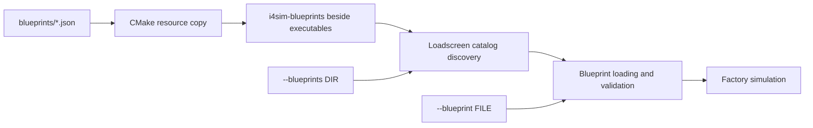

# Original JSON blueprints

## Table of contents

- [Visual overview](#visual-overview)
- [Contents and use](#contents-and-use)

[Parent guide](../README.md) · [Project overview](../../../README.md) · [Documentation index](../../../docs/README.md)

## Visual overview

Packaged blueprints must travel with relocated executables; explicit paths select custom inputs.

## Contents and use

Fourteen JSON files are copied unchanged from the C# reference. CMake copies these resources to `i4sim-blueprints/` beside the application and launcher executables. Keep that directory with a relocated executable. City aliases may retain a different internal `name`. Pass `--blueprints DIR` for a custom catalog or `--blueprint FILE` for a direct load.
