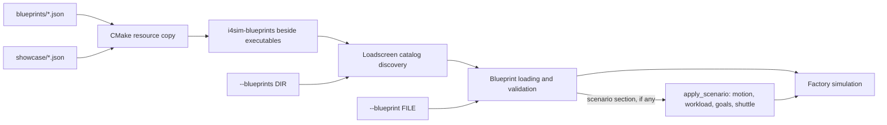

# Original JSON blueprints

## Table of contents

- [Visual overview](#visual-overview)
- [Contents and use](#contents-and-use)
- [Showcase scenes](#showcase-scenes)

[Parent guide](../README.md) · [Project overview](../../../README.md) · [Documentation index](../../../docs/README.md)

## Visual overview

Packaged blueprints must travel with relocated executables; explicit paths select custom inputs.



## Contents and use

Five JSON files are copied unchanged from the C# reference: `1680x960+`, `1680x960-`, `3840x2400`, `4320x2400` and `8640x4800`. The reference's `MAS-demonstrator` is not in the catalog; the tests keep it, unchanged, as a [fixture](../tests/README.md#suites) in `labs/i4sim/tests/`. The reference's `H` layout became the [h-crossing](#showcase-scenes) showcase scene, without its stations, and its seven city aliases of these layouts are not bundled. CMake copies these resources to `i4sim-blueprints/` beside the application and launcher executables. Keep that directory with a relocated executable. Pass `--blueprints DIR` for a custom catalog or `--blueprint FILE` for a direct load.

The five originals are the top-level files; discovery does not descend into subdirectories, so the catalog test finds exactly five.

## Showcase scenes

The files in [showcase/](showcase/) are small traffic scenes that double as test fixtures. The loadscreen lists them on the page behind its first row, SHOWCASE, sorted by file name; `--blueprint FILE` and the batch mode `--ticks` apply them the same way.

| File | Shows | Scenario | Repeat |
| --- | --- | --- | --- |
| [junction-crossing.json](showcase/junction-crossing.json) | Junction traffic: one mover waits until the other has crossed | Reciprocal, junction traffic | Shuttle |
| [corridor-passing.json](showcase/corridor-passing.json) | Corridor traffic: opposing movers take turns through a one-lane corridor | Reciprocal, corridor traffic | Shuttle |
| [corridor-recovery.json](showcase/corridor-recovery.json) | Corridor retreat: movers meet head-on inside the corridor and one backs out | Reciprocal, corridor traffic | Restart |
| [predictive-passing.json](showcase/predictive-passing.json) | Predictive passing: movers on a head-on course agree on sides | Reciprocal, no heatmap costs, predictive passing | Shuttle |
| [h-crossing.json](showcase/h-crossing.json) | H crossing: the four corner movers of the original `H` layout swap diagonal corners through its two-cell middle bar without path planning; each steers straight at its goal, slides along the walls in its way and avoids the others by steering alone | Improved, no path planning, force 0.5, horizon 16 | Shuttle |

The [README gallery](../../../README.md#screenshots-and-demo) shows one cycle of each scene as a looping clip.

Every scene disables the workload, gives every mover a goal and repeats, so the traffic situation shows again and again:

- **Shuttle:** the movers drive back and forth between their start and their goal. A mover that arrives waits until the others have arrived too; after `shuttle_pause_ticks` (400 ticks, two seconds at the default 200 ticks per second) all turn at once, so every leg meets the same way. The simulation turns them inside its tick, so a replay and the batch mode `--ticks` shuttle identically.
- **Restart:** corridor recovery cannot drive back. Its movers start inside the corridor, and on the way back the first mover admitted would park inside it and block the other for good. After every mover has stood still for the same pause (so a restarting scene needs the workload off), the session rebuilds the scene from its blueprint, as `R` does, but keeps the speed and keeps it running. The batch mode does not restart.

The two-mover scenes are the setups the [presentation test](../tests/README.md#crossing-demonstration) builds through the debug menu, and a test runs each scene, h-crossing included, tick for tick against that setup built by hand. The golden tests use the same goals and settings, except that their corridor-recovery run switches corridor traffic on only after 1500 ticks; a scenario has no timed steps.

### Scenario section format

A blueprint may carry one optional `scenario` object. `load_blueprint` ignores it; `load_scenario` in [scenario.h](../include/i4sim/blueprint/scenario.h) reads it and `apply_scenario` configures a `Simulation` with it and leaves its pause state unchanged; a new simulation starts paused. Property names are case-insensitive like the rest of the blueprint, but unknown names anywhere inside the section are rejected, so a misspelled setting fails instead of being ignored.

```json
"scenario": {
  "description": "Junction traffic: two movers reach one crossing; one waits until the other has passed.",
  "motion": {"profile": "reciprocal", "junctionTraffic": true},
  "workload": false,
  "repeat": "shuttle",
  "goals": [
    {"mover": "west", "position": {"x": 1100, "y": 700}},
    {"mover": "north", "position": {"x": 700, "y": 1100}}
  ]
}
```

| Property | Type and default | Meaning |
| --- | --- | --- |
| `description` | string, empty | One line drawn above the statistics while the scene runs |
| `motion.profile` | `improved` (default), `original`, `experimentalRvo` (or `experimental_rvo`), `reciprocal` | Steering profile |
| `motion.pathPlanning` | boolean, `true` | A* routes over the grid cells; `false` sends each mover straight at its goal, as PLANNER → OFF does |
| `motion.heatmap` | boolean, `true` | Congestion costs in route planning |
| `motion.recovery`, `parkingTraffic`, `junctionTraffic`, `corridorTraffic`, `predictivePassing` | boolean, `false` | Coordination features, as in DEBUG → MOTION and TRAFFIC |
| `motion.speed`, `motion.force`, `motion.horizon` | positive numbers, `2`, `0.6`, `32` | Top speed in millimeters per tick, acceleration in millimeters per tick squared, prediction horizon in ticks (at most 64) |
| `workload` | boolean, `true` | Automatic product workload |
| `repeat` | `none` (default), `shuttle`, `restart` | How the scene repeats once its movers have arrived; see [Showcase scenes](#showcase-scenes) |
| `goals[].mover` | string | The mover's `id` from the `movers` array, without the model prefix the loader adds |
| `goals[].position` | `{x, y}` in millimeters | Center of the goal, unlike blueprint positions, which are top-left corners |

A wrong type or an out-of-range number fails like an unknown property, with the file name. A goal that names no mover, names several (the same `id` under two models), or that `Simulation::move_to` (or `Simulation::shuttle`) rejects (a blocked cell, no route) makes loading the scene fail with the file name and the cause; the loadscreen shows the error and stays open.

