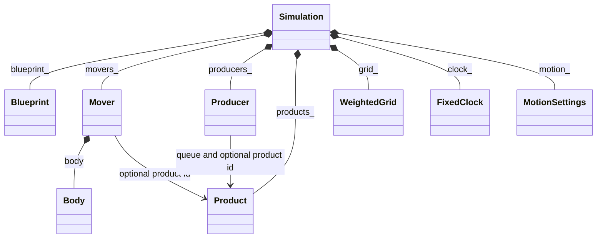

# Application headers

## Table of contents

- [Visual overview](#visual-overview)
- [Contents and use](#contents-and-use)

[Parent guide](../README.md) · [Project overview](../../../README.md) · [Documentation index](../../../docs/README.md)

## Visual overview

Simulation owns model and runtime state; Session construction stays at the graphical boundary.

## Contents and use

`blueprint.h` defines the validated scene/model data. `simulation.h` exposes headless factory state and operations. `session.h` is the runtime-only session factory. Engine algorithms are consumed through public Kinetra headers.

`factory_settings.h` owns the factory-specific modal controls and input layout; shared Lab settings remain unchanged. `simulation.h` exposes motion profiles, bounded parameter configuration, manual reservations, optional parking/junction traffic coordination with observable exit reservations and contact/wait statistics.
