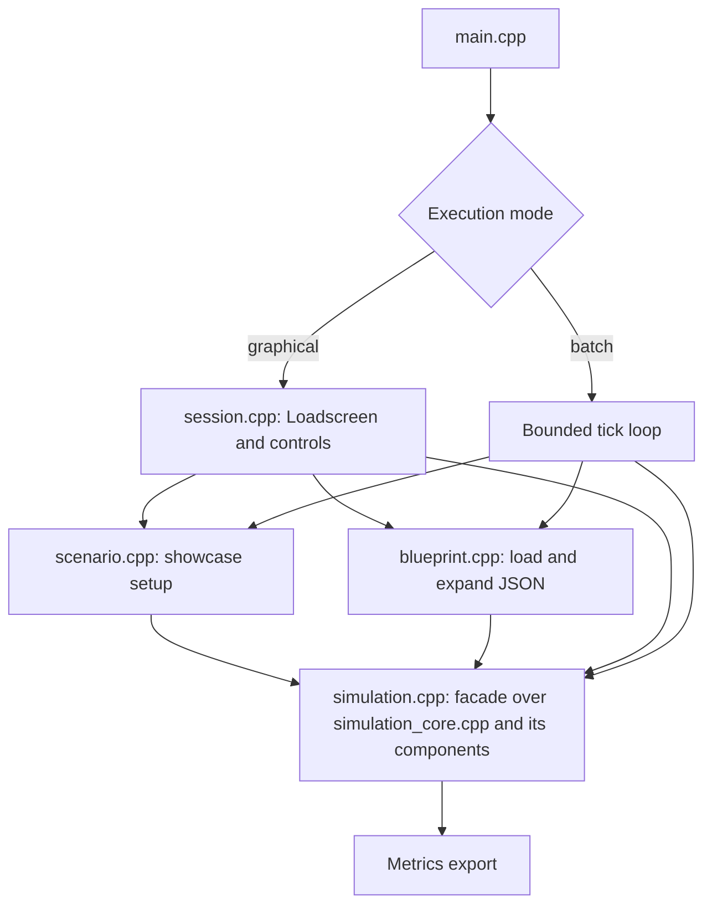

# Application implementation

## Table of contents

- [Visual overview](#visual-overview)
- [Contents and use](#contents-and-use)

[Parent guide](../README.md) · [Project overview](../../../README.md) · [Documentation index](../../../docs/README.md)

## Visual overview

Entry-point selection determines presentation and timing; factory policy is shared.

## Contents and use

`blueprint.cpp` loads and expands original JSON; `json_fields.h` holds the field readers it shares with `scenario.cpp`, which reads a blueprint's optional `scenario` section, applies it to a new simulation and decides when a restarting scene starts again (`RestartTimer`) ([format](../blueprints/README.md#scenario-section-format)). `simulation.cpp` forwards the public `Simulation` API to `simulation_core.cpp`, which composes the components and keeps the tick order: `floor_plan.cpp` (topology and heatmap), `routing.cpp` (route requests and refinement), `goals.cpp` (goal changes, holding places, parking interlock), `traffic.cpp` (junction and corridor admission, exit pockets, retreat recovery), `predictive_passing.cpp`, `production.cpp` (products, producers, recipes), `motion_step.cpp` (route following, steering, arrival, contacts) and `shuttle.cpp` (when shuttling movers turn together). `simulation_constants.h` names the shared tuning values; `geometry.cpp` holds the shared geometry helpers. See the [simulation structure](../../../docs/factory-simulation-architecture.md#simulation-structure) for the dependencies and the tick order. `session.cpp` provides the Loadscreen, interaction and rendering. Debug Mode and all visual layers start enabled; disabling Debug Mode hides the layers while preserving their individual selections. `main.cpp` provides graphical and batch entry points.

The optional Reciprocal profile adapts shared avoidance to tick units; the Motion
profile selector and statistics expose it without changing the Improved default.

Motion controls change the settings while the factory keeps its run state. Interaction errors expire after four seconds. Statistics use the shared yellow 1.5-scale style at the bottom of the viewport. Selected mover and producer information uses the same style and left alignment directly above the statistics and follows viewport resizing.

`predictive_passing.cpp` owns optional paired formation/crossing targets, swept
clearance checks, cancellation and retry timing; `event_log.h` records its events. It consumes engine geometry and
steering without introducing factory policy into Kinetra. See the
[passing contract](../../../docs/factory-simulation-architecture.md#predictive-passing).
