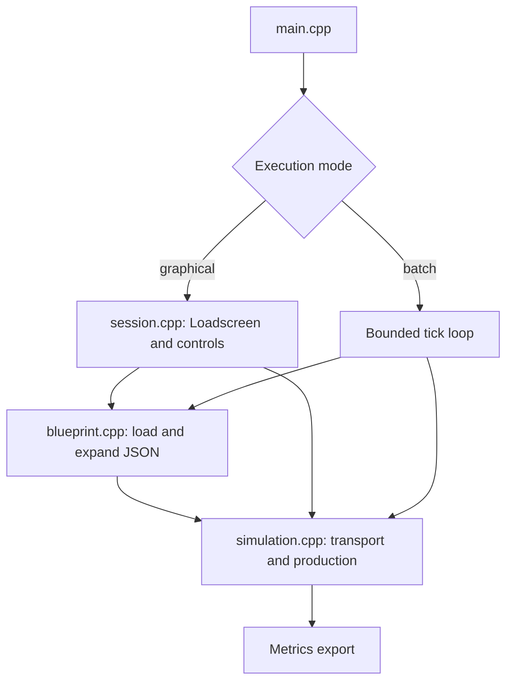

# Application implementation

## Table of contents

- [Visual overview](#visual-overview)
- [Contents and use](#contents-and-use)

[Parent guide](../README.md) · [Project overview](../../../README.md) · [Documentation index](../../../docs/README.md)

## Visual overview

Entry-point selection determines presentation and timing; factory policy is shared.

## Contents and use

`blueprint.cpp` loads and expands original JSON. `simulation.cpp` owns deterministic product/transport/production policy. `session.cpp` provides the Loadscreen, interaction and rendering. `main.cpp` provides graphical and batch entry points.
