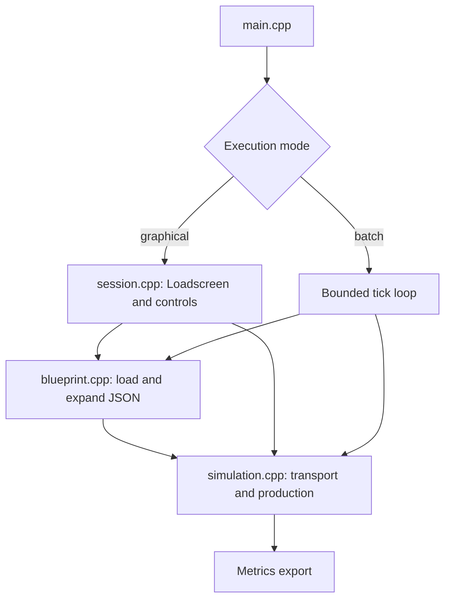

# Application implementation

## Table of contents

- [Visual overview](#visual-overview)
- [Contents and use](#contents-and-use)

[Parent guide](../README.md) · [Project overview](../../../README.md) · [Documentation index](../../../docs/README.md)

## Visual overview

Entry-point selection determines presentation and timing; factory policy is shared.

## Contents and use

`blueprint.cpp` loads and expands original JSON. `simulation.cpp` owns deterministic product/transport/production policy, footprint-aware route requests, parking approach refinement, optional parking/staging interlocks, isolated-junction admission and exit-pocket protection and arrival checks. See the [simulation contract](../../../docs/factory-simulation-architecture.md) for wall constraints and stalled-route handling. `session.cpp` provides the Loadscreen, interaction and rendering. Debug Mode and all visual layers start enabled; disabling Debug Mode hides the layers while preserving their individual selections. `main.cpp` provides graphical and batch entry points.

The optional Reciprocal profile adapts shared avoidance to tick units; the Motion
profile selector and statistics expose it without changing the Improved default.

Motion controls briefly pause configuration and restore the previous running state. Interaction errors expire after four seconds. Statistics use the shared yellow 1.5-scale style at the bottom of the viewport. Selected mover and producer information uses the same style and left alignment directly above the statistics and follows viewport resizing.
