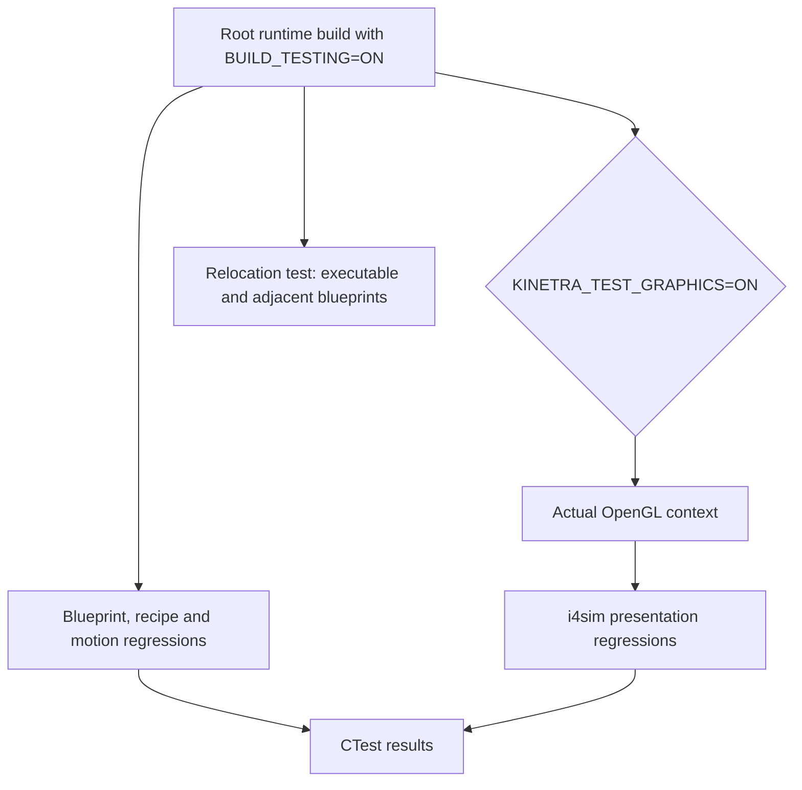

# i4sim verification

## Table of contents

- [Visual overview](#visual-overview)
- [Contents and use](#contents-and-use)

[Parent guide](../README.md) · [Project overview](../../../README.md) · [Documentation index](../../../docs/README.md)

## Visual overview

The two test paths separate checks without a window from checks requiring a graphics context.



## Contents and use

`simulation_tests.cpp` checks all original blueprints and group expansion, both complete recipes, a 50000-tick original MAS workload regression, queue bounds, producer blocking/resumption, exact production duration, pause/tick cap, determinism, blocked movers, invalid input and metrics export. `presentation_tests.cpp` exercises an actual OpenGL context, blueprint selection, pause, every debug layer, right-button edges, return-to-launcher behavior, and rediscovery after repairing a missing catalog. `relocation_tests.cmake` copies the headless resource probe and blueprints into a separate bundle, launches from an unrelated working directory, and verifies both successful discovery and actionable failure without adjacent assets.

The `3840x2400` and `8640x4800` workloads with seed `915839214` exercise route recovery across large factories and guard against spatial query limit failures.

Run from the repository root:

```sh
cmake -S . -B build -DCMAKE_BUILD_TYPE=Release -DKINETRA_SOURCE_DIR="$PWD/external/Kinetra" -DKINETRA_TEST_GRAPHICS=ON
cmake --build build -j2
SDL_VIDEODRIVER=offscreen LIBGL_ALWAYS_SOFTWARE=1 ctest --test-dir build --output-on-failure
```

Run `kinetra_i4sim --blueprint labs/i4sim/blueprints/MAS-demonstrator.json --ticks 50000 --output /tmp/i4sim-check` for a bounded local workload run. Headless tests and the batch executable also build with `KINETRA_LAB_BUILD_RUNTIME=OFF`.

Motion regressions cover manual reservation against factory allocation, paused single-step, all steering profiles, invalid horizons, and frontal/crossing encounters with goal completion and contact comparison. Large-factory recovery is explicitly enabled in its regression.
