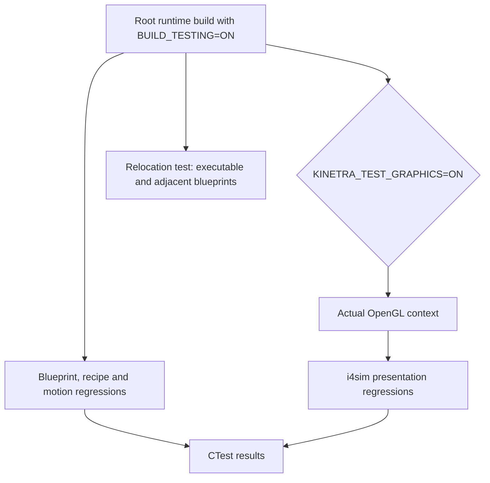

# i4sim verification

## Table of contents

- [Visual overview](#visual-overview)
- [Contents and use](#contents-and-use)
- [Crossing demonstration](#crossing-demonstration)
- [Corridor demonstration](#corridor-demonstration)
- [Motion benchmark](#motion-benchmark)

[Parent guide](../README.md) · [Project overview](../../../README.md) · [Documentation index](../../../docs/README.md)

## Visual overview

The two test paths separate checks without a window from checks requiring a graphics context.



## Contents and use

The C++ programs are doctest suites: each `TEST_CASE` is one behavior, named after its expected outcome, and CTest registers it as `<suite>:<case>`. How to write cases is in [Kinetra testing](../../../external/Kinetra/docs/testing.md#writing-a-doctest-suite).

| Source | CTest suite (cases) |
| --- | --- |
| `simulation_tests.cpp` | `kinetra_i4sim` (52) |
| `golden_tests.cpp` | `kinetra_i4sim_golden` (10, one per scenario) |
| `pressure_tests.cpp` | `kinetra_i4sim_pressure` (8: four scenarios under Reciprocal and Improved) |
| `presentation_tests.cpp` | `kinetra_i4sim_graphics` (1, because every check shares one `Runtime`; label `graphics`) |
| `relocation_tests.cmake` | `kinetra_i4sim_relocation` (one CTest script) |

`simulation_tests.cpp` checks all original blueprints and group expansion, both complete recipes, a 50000-tick original MAS workload regression, queue bounds, producer blocking/resumption, exact production duration, pause/tick cap, determinism, blocked movers, invalid input and metrics export. `presentation_tests.cpp` exercises an actual OpenGL context, blueprint selection, pause, Motion edits while running and paused (including rendered speed changes), every debug layer, right-button edges, return-to-launcher behavior, and rediscovery after repairing a missing catalog. `relocation_tests.cmake` copies `kinetra_i4sim_tests` and the blueprints into a separate bundle and runs its `the bundled catalog holds fourteen blueprints that all load` case from an unrelated working directory. It verifies both successful discovery and actionable failure without adjacent assets; renaming that case requires the same change in the script.

`golden_tests.cpp` (`kinetra_i4sim_golden`) pins the current behavior for the planned i4sim refactor. Ten seeded scenarios cover the MAS factory with default motion and with every coordination feature, the large `3840x2400` factory, the Original, RVO and recovery steering variants, and the junction, corridor, corridor-recovery and predictive-passing fixtures with manual goals. Each scenario is one case and must reproduce one recorded line: ticks, completed products, contacts, producer interactions, distance travelled and a 64-bit fingerprint of every mover's exact position and velocity after every tick. A mismatch shows the expected and actual line. A refactor must leave every line unchanged. For a deliberate behavior change, run `KINETRA_PRINT_GOLDEN=1 ./build-release/kinetra_i4sim_golden_tests` to print the current lines, update the expected values and explain the change in the commit. The fingerprint needs exact floating-point results; Release and Debug builds without fast-math reproduce it. The scenarios do not reach every path: heatmap refresh timing and the stalled-pair cancellation of predictive passing leave the values unchanged.

`pressure_tests.cpp` (`kinetra_i4sim_pressure`) records how predictive passing behaves under pressure, as the baseline for roadmap phase 7. Four blueprint fixtures in this directory run with manual goals, passing on and heatmap costs off, under Reciprocal and Improved:

| Fixture | Situation | The case first checks |
| --- | --- | --- |
| `pressure-three-oncoming.json` | One mover meets two oncoming movers in a column on its line | it forms a plan with the first one |
| `pressure-lane-intrusion.json` | A third mover crosses a passing pair at right angles | it comes within 250 mm of a participant while their plan is active |
| `pressure-simultaneous.json` | Two head-on pairs on parallel lines 400 mm apart | both pairs hold plans at the same time |
| `pressure-narrow-aisle.json` | A 113 mm and a 155 by 235 mm mover meet in a 400 mm aisle | both are in the aisle at the same time |

Each case then compares one recorded line: contacts, contacts during passing, plans formed and crossed, plan ends per reason, movers that arrived, waiting ticks, stuck movers, and a fingerprint of the trajectory and the event log. The lines are today's behavior, not requirements: under Reciprocal, the three-oncoming case leaves two movers shuffling in front of each other without a plan. Phase 7 turns the lines into required outcomes. Both suites share the recorder in `recorder.h`, and `KINETRA_PRINT_GOLDEN=1` prints the lines of either suite.

The `simulation_tests.cpp` cases on the event log check a plan's formation, crossing and completion, the `goal_changed` and `participant_held` reasons, mover and border contacts, and that recording changes no pose. The flow-metrics cases check a free trip, a corridor standstill, a held mover and invalid limits.

The `3840x2400` and `8640x4800` workloads with seed `915839214` exercise route recovery across large factories and guard against spatial query limit failures.

Run from the repository root:

```sh
cmake --preset release
cmake --build --preset release --target kinetra_i4sim_tests kinetra_i4sim_golden_tests kinetra_i4sim_pressure_tests kinetra_i4sim
ctest --preset release -R '^kinetra_i4sim' --output-on-failure
cmake --workflow --preset graphics   # adds kinetra_i4sim_graphics; needs an OpenGL context
```

One case runs on its own through CTest (`-R 'kinetra_i4sim:a T-junction'`) or the executable (`./build-release/kinetra_i4sim_tests --test-case='a T-junction*'`). The `8640x4800` recovery case takes most of the suite's time.

Run `kinetra_i4sim --blueprint labs/i4sim/blueprints/MAS-demonstrator.json --ticks 50000 --output /tmp/i4sim-check` for a bounded local workload run. Headless tests and the batch executable also build with `KINETRA_LAB_BUILD_RUNTIME=OFF`.

Motion regressions cover manual reservation against factory allocation, paused single-step, all steering profiles, invalid horizons, and frontal/crossing encounters with goal completion and contact comparison. Regressions also verify that a mover does not replan due to its own heatmap footprint,
that a valid geometric detour counts as progress, and that contact cannot displace a
parked mover. Parking regressions depart and return beside a wall, in a corner
and between parked neighbors under Improved, Original and Reciprocal steering. They require
zero contacts (including a flush wall reservation), bounded acceleration, exact
final reservations and no drift after arrival; footprint-invalid manual goals must
fail. Allocation must skip a mover trapped behind blocked neighbors. Frontal/crossing encounters under Improved
and Reciprocal require zero contacts. Reciprocal regressions also verify
tick-unit/UPS independence, bounded acceleration and feasible departure through a
rectangular gap whose circular envelopes overlap,
parked-neighbor immobility and visible profile selection/limitation statistics.
Parking-traffic regressions replay MAS seed 42 for 50000 ticks, require at least
15 completed products with zero contacts, preserve owned reservations and acceleration
bounds, and exercise wait/release, blocked departures, manual replacement and
disabling the interlock without teleportation. Graphics tests toggle the new
Motion row and verify wait statistics. Junction regressions use a single-cell
crossing where one uncoordinated mover remains moving after 5000 ticks; with
admission both arrive within 1000 ticks with zero contacts, exclusive occupancy,
bounded acceleration and unchanged goals. They also cover replay, blocked occupancy,
resumption, disabling, all four approach orientations, a turning T-junction and
early/late cancelled approaches. Graphics tests toggle the appended junction row
and render an actual crossing with cyan zone outlines, lime exit reservations and
manually commanded movers. Exit regressions block one arm in all four orientations,
require waiting outside while another exit clears, then free the blocker and require
all three goals with zero contacts. They also verify reserved space remains free of
an opposing approach and that coasting traffic prevents an unsafe new reservation. Large-factory recovery is explicitly enabled
in its regression.

## Crossing demonstration

[junction-crossing.json](junction-crossing.json) is the shared headless/graphics
fixture and a manually controlled visual example, separate from the fourteen
unchanged original blueprints:

```sh
./build/kinetra_i4sim --blueprint labs/i4sim/tests/junction-crossing.json
```

Keep the simulation paused while setting up. Disable workload with `G`, choose
Reciprocal and enable JUNCTION TRAFFIC in DEBUG → Motion, then close the menu.
Select the west mover and Shift-click the center of the east arm at `(1100, 700)`;
select the north mover and Shift-click the south arm at `(700, 1100)`. Press Space.
The cyan boundary marks the exclusive zone. Repeat with junction traffic disabled
to observe the uncoordinated narrow-crossing failure. There are no producers in
this fixture; goals are manual.

For a blocked-exit demonstration, reload and first send the north mover to
`(900, 700)`. Once it has stopped, command the west mover to `(1100, 700)`; it waits
before entry and `EXIT` increases. Move the blocker farther east to `(1250, 700)`
to free the pocket and let the west mover proceed. Lime outlines show an admitted
exit reservation, which protects enough space to clear the zone, not the entire
outbound corridor.

## Corridor demonstration

[corridor-passing.json](corridor-passing.json) contains two wide rooms joined by a
straight single-cell corridor, with two manually controlled movers:

```sh
./build/kinetra_i4sim --blueprint labs/i4sim/tests/corridor-passing.json
```

While paused, disable workload with `G`, select Reciprocal under DEBUG → Motion,
and enable CORRIDOR TRAFFIC under DEBUG → View. Close the menu. Select the west
mover and Shift-click `(1900, 700)`, then select the east mover and Shift-click
`(300, 700)`. Press Space. One waits in its entrance room while the other traverses
the blue corridor and clears the lime exit pocket. Repeating without corridor
traffic reproduces the head-on standstill. Enabling corridor traffic after a
standstill also permits the two-mover retreat recovery described below.

The regression runs all four orientations and requires exclusive full-body
occupancy, bounded acceleration, unchanged manual goals, deterministic replay,
arrival of both movers within 5000 ticks and zero contacts. It also checks blocked
occupancy/resumption, a previously parked occupant with no initial exit route,
independent junction toggling, disabling without teleportation, dead-end exclusion
and the 256-cell detection/indexing budget. Graphics tests exercise both the View
toggle/statistics and the actual blue corridor/lime reservation with moving agents.

[corridor-recovery.json](corridor-recovery.json) starts the movers inside the same
corridor, so recovery can be inspected directly:

```sh
./build/kinetra_i4sim --blueprint labs/i4sim/tests/corridor-recovery.json
```

Disable workload, choose Reciprocal and enable CORRIDOR TRAFFIC as above. Select
the mover at `(1000, 700)` and Shift-click `(1900, 700)`, then select `(1200, 700)`
and Shift-click `(300, 700)`. Run the scene. After sustained standstill one backs
into the side of an entrance room; its pink arrow and `RETREAT` identify the
manoeuvre. The other waits, passes, and both resume their unchanged goals.

Recovery regressions cover all four orientations after late activation, reverse
movement, deterministic replay, bounded acceleration and zero contacts. They also
exercise manual cancellation, disabling without teleportation, blocked/unblocked
participants, longer APM4350 rectangular bodies, and all four occupied refuges
with safe retry after one is freed. The graphics test renders the actual retreat
and checks its pink steering arrow. The targeted policy/probe also runs under UBSan.

## Motion benchmark

Build `kinetra_i4sim_motion_benchmark` with `BUILD_TESTING=ON` and run it explicitly:

```sh
./build/kinetra_i4sim_motion_benchmark > /tmp/i4sim-motion.csv
./build/kinetra_i4sim_motion_benchmark --recovery > /tmp/i4sim-recovery.csv
./build/kinetra_i4sim_motion_benchmark --profile reciprocal --ticks 50000 > /tmp/i4sim-reciprocal.csv
./build/kinetra_i4sim_motion_benchmark --profile reciprocal --parking-traffic > /tmp/i4sim-parking-traffic.csv
./build/kinetra_i4sim_motion_benchmark --profile reciprocal --parking-traffic --junction-traffic > /tmp/i4sim-junction-traffic.csv
./build/kinetra_i4sim_motion_benchmark --profile reciprocal --parking-traffic --junction-traffic --corridor-traffic > /tmp/i4sim-corridor-traffic.csv
```

The bundled blueprints run for 50000 ticks each with seeds 42 and 915839214.
`--profile` accepts `improved` (default), `original`, `rvo` or `reciprocal`;
`--ticks` accepts 1 through 1000000. Recovery, parking traffic, junction traffic and corridor traffic remain disabled unless explicitly requested.
The CSV has one line per blueprint and seed:

| Column | Meaning |
| --- | --- |
| `completed` | Completed products |
| `contacts`, `contact_ticks` | Contact episodes, and pair/segment contact ticks |
| `acceleration_change` | Summed changes in commanded acceleration: a diagnostic for steering activity, not a physical jerk measurement; contact impulses are not included |
| `waiting_ticks` | Mover-ticks with an active goal, below 0.05 mm/tick and more than 10 mm from the destination ([FlowMetrics](../include/flow_metrics.h)) |
| `stuck_movers`, `stuck_at_end` | Movers that went 2000 ticks without getting 10 mm closer to their destination at least once, and at the last tick |
| `passing_plans`, `passing_cancelled`, `passing_contacts` | Predictive passing plans formed, plans that ended without completing, and contacts that started while a participant was in a plan (from the event log) |
| `elapsed_ms` | Wall-clock time, including the event log and metrics; it depends on the machine and load |

The benchmark is deliberately outside CTest. See the
[simulation contract](../../../docs/factory-simulation-architecture.md).

**Baseline for roadmap phase 7**, measured on 2026-11-19 (Release, 50000 ticks, recovery and traffic policies off). Each cell shows predictive passing **off / on**; stuck movers show the count at the end in parentheses.

| Profile | Blueprint | Seed | Completed | Contacts | Waiting ticks | Stuck movers | Plans (cancelled) | Contacts in a plan |
| --- | --- | --- | --- | --- | --- | --- | --- | --- |
| Reciprocal | MAS-demonstrator | 42 | 10 / 10 | 0 / 0 | 24006 / 25041 | 1 (1) / 1 (1) | 4 (1) | 0 |
| Reciprocal | MAS-demonstrator | 915839214 | 16 / 16 | 0 / 0 | 12872 / 10842 | 2 (1) / 1 (1) | 5 (0) | 0 |
| Reciprocal | 3840x2400 | 42 | 59 / 59 | 0 / 0 | 1583 / 3095 | 0 / 0 | 11 (5) | 0 |
| Reciprocal | 3840x2400 | 915839214 | 61 / 61 | 0 / 0 | 651 / 3177 | 0 / 0 | 7 (3) | 0 |
| Reciprocal | 8640x4800 | 42 | 95 / 99 | 0 / 0 | 48187 / 45668 | 6 (0) / 6 (0) | 244 (87) | 0 |
| Reciprocal | 8640x4800 | 915839214 | 93 / 103 | 0 / 0 | 64702 / 58203 | 15 (1) / 10 (2) | 219 (74) | 0 |
| Improved | MAS-demonstrator | 42 | 16 / 15 | 53 / 42 | 278 / 1814 | 0 / 1 (1) | 3 (1) | 0 |
| Improved | MAS-demonstrator | 915839214 | 16 / 14 | 204 / 222 | 288 / 2071 | 0 / 1 (0) | 4 (4) | 0 |
| Improved | 3840x2400 | 42 | 59 / 57 | 3 / 3 | 634 / 1168 | 0 / 0 | 9 (2) | 0 |
| Improved | 3840x2400 | 915839214 | 59 / 59 | 0 / 6 | 962 / 1547 | 1 (0) / 1 (0) | 8 (5) | 0 |
| Improved | 8640x4800 | 42 | 98 / 96 | 384 / 767 | 2595 / 34343 | 2 (0) / 4 (0) | 242 (96) | 17 |
| Improved | 8640x4800 | 915839214 | 99 / 101 | 726 / 823 | 2953 / 33940 | 4 (1) / 6 (0) | 224 (89) | 5 |

On `8640x4800`, a run took about 9–10.5 s with passing off and 13–14.5 s with passing on, for both profiles; part of the Reciprocal runs shared the machine with a compile. Completed products and contacts equal the measurements of the [quality roadmap](../../../docs/design/2026-11-18-quality-roadmap.md#predictive-passing-baseline), so recording and measuring changed nothing. What the new columns show:

- Reciprocal on `MAS-demonstrator` ends with one stuck mover for both seeds, with and without passing, so a stuck mover alone does not explain the 10 products of seed 42 against 16. Seed 42 does wait about twice as long.
- With passing on, Improved waits 11–13 times longer on `8640x4800`, but only 17 and 5 of its 767 and 823 contacts start while a participant is in a plan.
- On `8640x4800`, about 35–40% of the plans end without completing.

Current wall/parking implementation, default Improved profile, recovery disabled,
50000 ticks per run:

| Blueprint | Seed | Completed products | Contact episodes | Contact ticks |
| --- | --- | --- | --- | --- |
| MAS-demonstrator | 42 | 16 | 53 | 71 |
| MAS-demonstrator | 915839214 | 16 | 204 | 214 |
| 3840x2400 | 42 | 59 | 3 | 3 |
| 3840x2400 | 915839214 | 59 | 0 | 0 |
| 8640x4800 | 42 | 98 | 384 | 395 |
| 8640x4800 | 915839214 | 99 | 726 | 773 |

Contact identities now use merged wall segments and exclude their artificial
0.001 mm collision skin. Counts are therefore not directly comparable to older
runs that counted raster seams and proxy-only touching. Crowded factories still
have physical contacts; these runs do not establish general collision freedom or
verify desktop animation smoothness. The focused parking tests independently
require zero contacts and exact settled reservations.

Reciprocal with fixed axis-aligned rectangular envelopes, the same 50000-tick
workloads and recovery disabled. Paired values compare parking traffic **off/on**:

| Blueprint | Seed | Completed products (off/on) | Contact episodes (off/on) | Contact ticks (off/on) |
| --- | --- | --- | --- | --- |
| MAS-demonstrator | 42 | 10 / 15 | 0 / 0 | 0 / 0 |
| MAS-demonstrator | 915839214 | 16 / 16 | 0 / 0 | 0 / 0 |
| 3840x2400 | 42 | 59 / 57 | 0 / 0 | 0 / 0 |
| 3840x2400 | 915839214 | 61 / 62 | 0 / 0 | 0 / 0 |
| 8640x4800 | 42 | 95 / 108 | 0 / 0 | 0 / 0 |
| 8640x4800 | 915839214 | 93 / 112 | 0 / 0 | 0 / 0 |

The interlock prevents an observed MAS return from sealing another mover's
parking departure. It improves throughput in four runs, preserves one, and reduces
one; it is not a universal improvement. Reciprocal and parking traffic remain
explicit options, with Improved still the default. These measurements do not
establish general collision freedom or starvation prevention. Runtime measurements
are omitted because other verification jobs ran concurrently.

With junction traffic also enabled, the six 50000-tick benchmark outcomes match
the parking-traffic-on column above exactly. These three factory layouts contain
no junctions matching the intentionally narrow detector, so this is a compatibility
check, not evidence of additional factory throughput. Crossing behavior is verified
using the dedicated fixture and its rotated/T-junction/cancellation variants.

Enabling corridor traffic as well preserves all six 50000-tick results above.
MAS-demonstrator, 3840x2400 and 8640x4800 contain no straight corridors matching
the room-to-room detector, so this verifies compatibility rather than added
throughput. The dedicated corridor fixture establishes the new passing behavior.

Predictive passing coverage uses eight encounter orientations with mixed square/long
rectangular footprints under Improved and Reciprocal. Tests check deterministic
replay, early commitment, preserved goals, bounded acceleration, zero contacts,
completion, cancellation, disable/block lifecycle, near-wall translated lanes and
rejection when no passing space exists. Congestion costs are disabled in these
controlled encounters to prevent A* from resolving the conflict before coordination.
Original and RVO are checked for absence of pair commitments.

`predictive-passing.json` provides an open-floor graphical fixture. Disable workload
with G, select Reciprocal, enable DEBUG → View → PREDICTIVE PASS, and assign swapped
center goals (1900, 800) and (500, 800) with Shift-click. Mint arrows show temporary
targets. The benchmark accepts `--predictive-passing` and
`--no-predictive-passing` (default); compare the same profile, seeds and policy flags.
The policy remains opt-in pending broader factory throughput evaluation.

Final 50000-tick runs with predictive passing enabled, default heatmap costs,
recovery/parking/junction/corridor policies disabled:

| Blueprint | Seed | Improved completed / contacts | Reciprocal completed / contacts |
| --- | --- | --- | --- |
| MAS-demonstrator | 42 | 15 / 42 | 10 / 0 |
| MAS-demonstrator | 915839214 | 14 / 222 | 16 / 0 |
| 3840x2400 | 42 | 57 / 3 | 59 / 0 |
| 3840x2400 | 915839214 | 59 / 6 | 61 / 0 |
| 8640x4800 | 42 | 96 / 767 | 99 / 0 |
| 8640x4800 | 915839214 | 101 / 823 | 103 / 0 |

Compared with the earlier reciprocal baseline above, the two large-layout runs
increase completed products from 95/93 to 99/103 while retaining zero contacts;
the other four reciprocal results are unchanged. Improved outcomes are mixed,
including increased contacts. These observations support keeping the policy optional.
Graphics coverage also exercises the toggle/statistics and actual mint target arrows
using the passing fixture. Runtime comparisons are omitted because verification ran
concurrently.
