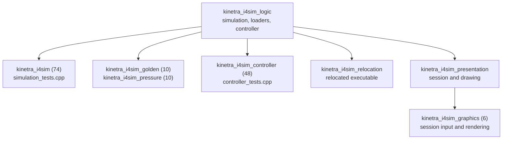

# i4sim tests

The suites that pin i4sim's behavior, the demonstrations that double as fixtures, and the motion benchmark with its baseline. The module itself is explained in the [i4sim guide](../README.md).

## Table of contents

- [Suites](#suites)
- [Running](#running)
- [What the simulation suite covers](#what-the-simulation-suite-covers)
- [Golden and pressure lines](#golden-and-pressure-lines)
- [Controller suite](#controller-suite)
- [Graphics suite](#graphics-suite)
- [Crossing demonstration](#crossing-demonstration)
- [Corridor demonstration](#corridor-demonstration)
- [Passing demonstration](#passing-demonstration)
- [Motion benchmark](#motion-benchmark)

[Parent guide](../README.md) · [Project overview](../../../README.md) · [Documentation index](../../../docs/README.md)

## Suites

The C++ programs are doctest suites: each `TEST_CASE` is one behavior, named after its expected outcome, and CTest registers it as `<suite>:<case>`. How to write cases is in [Kinetra testing](../../../external/Kinetra/docs/testing.md#writing-a-doctest-suite).



*Takeaway:* everything except the session's composition and drawing is tested without a window, also with `KINETRA_LAB_BUILD_RUNTIME=OFF`.

| Source | CTest suite (cases) | Purpose |
| --- | --- | --- |
| `simulation_tests.cpp` | `kinetra_i4sim` (74) | Required behavior of the loaders and the simulation |
| `golden_tests.cpp` | `kinetra_i4sim_golden` (10, one per scenario) | Pins whole seeded runs for refactoring |
| `pressure_tests.cpp` | `kinetra_i4sim_pressure` (10: five scenarios under Reciprocal and Improved) | Records predictive passing under pressure, as the baseline for roadmap phase 7 |
| `controller_tests.cpp` | `kinetra_i4sim_controller` (48) | The session's rules: loading, keys, pointer, camera, debug-menu entries |
| `presentation_tests.cpp` | `kinetra_i4sim_graphics` (6, label `graphics`) | Session input, blueprint-screen messages and rendering with OpenGL |
| `relocation_tests.cmake` | `kinetra_i4sim_relocation` (one CTest script) | The catalog beside a relocated executable |

Shared test code, in [include/i4sim/testing/](include/i4sim/testing/) and linked through the `kinetra_i4sim_testing` target: `recorder.h` (the per-tick fingerprint of the golden and pressure suites), `event_counts.h` (counts over the event log, among them contact episodes, also used by the benchmark) and `showcase.h` (paths of the blueprints in the source tree: `showcase_blueprint` in the catalog, which the target passes as `KINETRA_I4SIM_BLUEPRINT_SOURCE_DIR`, and `fixture_blueprint` in this directory, passed as `KINETRA_I4SIM_TEST_FIXTURE_DIR`). The four `pressure-*.json` files are the fixtures of the pressure suite. `MAS-demonstrator.json` is the original MAS blueprint of the C# reference, unchanged; it left the catalog, but the controller, golden and simulation suites, the graphics suite and the benchmark still run it.

## Running

From the repository root:

```sh
cmake --preset release
cmake --build --preset release --target kinetra_i4sim_tests kinetra_i4sim_golden_tests kinetra_i4sim_pressure_tests kinetra_i4sim_controller_tests kinetra_i4sim
ctest --preset release -R '^kinetra_i4sim' --output-on-failure
cmake --workflow --preset graphics   # adds kinetra_i4sim_graphics; needs an OpenGL context
```

One case runs on its own through CTest (`-R 'kinetra_i4sim:a T-junction'`) or the executable (`./build-release/kinetra_i4sim_tests --test-case='a T-junction*'`). The `8640x4800` recovery case takes most of the simulation suite's time; in a Debug build the large-factory cases take minutes.

For a bounded workload run by hand: `kinetra_i4sim --blueprint labs/i4sim/tests/MAS-demonstrator.json --ticks 50000 --output /tmp/i4sim-check`.

`relocation_tests.cmake` copies `kinetra_i4sim_tests` and the blueprints into a separate bundle and runs its `the bundled catalog holds five blueprints that all load` case from an unrelated working directory. It checks that discovery works there and that it fails with a usable message without the adjacent catalog. Renaming that case requires the same change in the script.

## What the simulation suite covers

| Area | The cases require |
| --- | --- |
| Blueprints | All five originals in the catalog load and have no scenario, groups expand as in the reference, and invalid input is rejected with the path and the cause |
| Production | Both recipes complete; a 50000-tick MAS workload reproduces its totals; queues stay bounded; a blocked producer pauses and resumes; an interaction takes exactly its duration |
| Run state | The run states and the tick cap; a single step while paused; a motion change while running equals pausing around it |
| Goals | A manual goal reserves its mover against allocation until arrival; the goal kinds; a goal whose footprint does not fit is rejected; the HUD status order |
| Steering | Every profile runs; invalid horizons are rejected; head-on and crossing encounters end without contact under Improved and Reciprocal; a mover does not stall on its own heatmap footprint; a valid detour never reports a stall; a contact cannot displace a parked mover |
| Stall diagnostics | Head-on stalls report both participants. The detector identifies a stationary blocker, reversals after a change of axis and oscillation across an anchor. Minor jitter does not supply evidence of oscillation. Goal changes, renewed progress and controlled waits reset observation. |
| Reciprocal | Results do not depend on the ticks per second; acceleration stays bounded; a mover leaves through a rectangular gap whose enclosing circles overlap; parked neighbors do not move |
| Parking | Leaving and returning beside a wall, in a corner and between parked neighbors, under Improved, Original and Reciprocal: no contact, bounded acceleration, the exact parking place and no drift afterwards. Allocation skips a mover trapped behind held neighbors |
| Parking traffic | MAS with seed 42 completes at least 15 products in 50000 ticks without contact; waiting and release, blocked departures, a manual goal replacing a deferral, and switching the policy off without moving a body |
| Junction traffic | At a one-cell crossing one uncoordinated mover is still moving after 5000 ticks; with admission both arrive within 1000 ticks without contact, one at a time, with unchanged goals. Also replay, a held occupant, resuming, switching off, all four approach directions, a turning T-junction and cancelled approaches |
| Exit pockets | With one arm blocked, in all four directions, a mover waits outside while another exit clears; after the blocker leaves all three arrive without contact. Reserved space stays free of an opposing approach, and coasting traffic prevents an unsafe reservation |
| Corridor traffic | All four directions: one mover in the corridor at a time, bounded acceleration, unchanged manual goals, deterministic replay, both arrive within 5000 ticks without contact. Also a held occupant, a parked occupant without an exit route, junction traffic switched independently, switching off, dead ends excluded and the 256-cell limit |
| Corridor recovery | All four directions after late activation: reverse movement, deterministic replay, bounded acceleration, no contact. Also cancellation by a manual goal, switching off, holding and releasing a participant, the longer APM4350 body, and all four refuges occupied with a retry after one is freed |
| Predictive passing | Eight encounter directions with square and long footprints under Improved and Reciprocal: deterministic replay, early commitment, unchanged goals, bounded acceleration, no contact, completion, cancellation, the switch-off and hold life cycle, shifted lanes near a wall, and no plan where no space exists. Original and RVO form no pairs. Heatmap costs are off in these cases, so A* does not resolve the conflict first |
| Path planning off | A mover's route is its destination alone, a goal without a grid route is still rejected, and a mover crosses the H past its convex corners without stopping |
| Event log | A plan's formation, crossing and completion; the `goal_changed` and `participant_held` reasons; mover and border contacts with tick and pair; recording changes no pose; contact episodes group the repeated contacts of one pair |
| Flow metrics | A free trip, a corridor standstill, a held mover, invalid limits |
| Scenarios | The six showcase scenes load and apply; each runs tick for tick like the same setup built by hand, past its first turn; invalid scenario sections, including wrong path-planning flags and out-of-range speed, force or horizon, are rejected with their cause |
| Shuttle and restart | Shuttling movers wait for each other, stand `shuttle_pause_ticks` and turn together; a manual goal ends shuttling for that mover only; every shuttling scene completes four legs in a row without contacts, and each scene with a coordination feature shows it on every leg; the h-crossing scene completes its legs without contacts when any one mover starts up to 300 ticks late; corridor recovery shows its retreat and its restart is due exactly one pause after its movers settle |
| Large factories | `3840x2400` and `8640x4800` with seed `915839214` and route recovery on, which guards the spatial query limits |
| Determinism and export | Equal runs for equal inputs; the summary file |

## Golden and pressure lines

`golden_tests.cpp` pins whole runs, so a restructuring cannot change behavior unnoticed. Ten seeded scenarios cover the MAS factory with default motion and with every coordination feature, the large `3840x2400` factory, the Original, RVO and recovery steering variants, and the junction, corridor, corridor-recovery and predictive-passing fixtures with manual goals. Each scenario is one case and must reproduce one recorded line: ticks, completed products, contacts, producer interactions, distance travelled and a 64-bit fingerprint of every mover's exact position and velocity after every tick. A mismatch shows the expected and the actual line.

- A refactor must leave every line unchanged.
- For a deliberate behavior change, run `KINETRA_PRINT_GOLDEN=1 ./build-release/kinetra_i4sim_golden_tests` to print the current lines, update the expected values and explain the change in the commit. The same variable prints the lines of the pressure suite.
- The fingerprint needs exact floating-point results; Release and Debug builds without fast-math reproduce it.
- The scenarios do not reach every path: heatmap refresh timing and the stalled-pair cancellation of predictive passing leave the values unchanged.

`pressure_tests.cpp` requires that predictive passing stays safe under pressure. Four blueprint fixtures in this directory run with manual goals, passing on and heatmap costs off, under Reciprocal and Improved; the lane-intrusion fixture serves two scenarios:

| Fixture | Situation | The case first checks |
| --- | --- | --- |
| `pressure-three-oncoming.json` | One mover meets two oncoming movers in a column on its line | it forms a plan with the first one |
| `pressure-lane-intrusion.json` | A third mover crosses a passing pair at right angles | it comes within 250 mm of a participant while their plan is active |
| `pressure-lane-intrusion.json`, other goals | A third mover drives to a participant's exit target and stops there after the plan formed | it stands within 130 mm of an active passing target |
| `pressure-simultaneous.json` | Two head-on pairs on parallel lines 400 mm apart | both pairs hold plans at the same time |
| `pressure-narrow-aisle.json` | A 113 mm and a 155 by 235 mm mover meet in a 400 mm aisle | both are in the aisle at the same time |

Each case then requires the outcome (no contact, every mover at its goal, no stuck mover) and compares one recorded line: contacts, contacts during passing, plans formed and crossed, plan ends per reason, movers that arrived, waiting ticks, stuck movers, and a fingerprint of the trajectory and the event log. The requirements date from roadmap phase 7 ([design](../../../docs/design/2026-11-21-i4sim-passing-under-pressure.md)): before it, under Reciprocal the three-oncoming case left two movers in front of each other until the end, and the stopping case pushed the stopped mover ahead for about 2000 ticks. A deliberate behavior change updates the lines with `KINETRA_PRINT_GOLDEN=1`, as in the golden suite.

## Controller suite

`controller_tests.cpp` drives `FactoryController` with plain input values, in the order the session uses: `begin_frame`, `suspend`, `handle_input`. It reads its blueprints from the source tree, so it needs no catalog beside the executable.

| Area | The cases require |
| --- | --- |
| Loading | A blueprint loads paused and awaiting its start, or running when asked, at the session's tick rate, with a camera fit pending; a showcase scene arrives running with its description, settings and goals; a failed load keeps the loaded blueprint and reports path and cause; a tick rate outside 1..10000 is rejected |
| Scene repeat | A restarting scene starts again by itself after its pause, running and at its tick rate; a paused one stepped past its pause with SINGLE TICK restarts paused, without awaiting its start; a shuttling scene is never restarted |
| Keys | Space and P, which end the wait for a start that a later pause does not bring back, G, 1 to 6, Q and E within the rate's bounds, F, and R: a restart keeps the current tick rate and motion settings, leaves a blueprint paused and awaiting its start, and replays a scene's goals running |
| RUN button | Centered below the toolbar, narrower in a narrow viewport and above the fitted floor; a left click on it starts a blueprint that awaits its start and picks nothing below it, a right click on it does nothing, and once started a click there reaches the floor again |
| Pointer | Selecting a mover or a producer and clearing the selection; a right click holds or blocks and keeps the selection on empty floor, but with Shift it only selects, as a left click does; Shift+left-click sends the selected mover; a rejected goal shows a message for four seconds; a captured pointer does nothing |
| Camera | The fit; panning scaled by frame time (capped at 0.1 s) and zoom; the wheel only in debug mode, and the ZOOM row's buttons, both within the zoom limits |
| Modal pause | An open panel pauses a running blueprint and restores it; a paused one stays paused |
| Debug menu | The menu opens with SIMULATION open; a heading opens its section and closes the other; each section lists its rows in order; layers, WORKLOAD, RUNNING, RECOVERY and the traffic policies are check boxes on the real state; a layer lists its parts only while it is on, and a part draws only while its layer is on; PROFILE and PLANNER open a list that chooses and closes, and a list closes with its section; the number rows show their value and step it while running; RESET PARAMETERS restores the default speed, force and horizon; a rejected setting shows its reason; `close_later()`, which the settings panel's BLUEPRINTS calls, closes the blueprint at the next frame |

Not covered: a scene that cannot be replayed after `R`, which needs a scenario that applies on load and fails later.

## Graphics suite

`presentation_tests.cpp` checks that a rejected goal expires after returning to the blueprint screen, that the settings panel's BLUEPRINTS returns there with Debug Mode off and leaves the next blueprint loaded, and that LAUNCHER on both pages of the blueprint screen and EXIT make their requests, and pins the graphical factory's signature at compile time. Its main OpenGL case selects a blueprint on the blueprint screen, checks that the RUN button is drawn and that a click on it starts the blueprint and removes it, pauses and resumes, checks the color swatches and the PATHS parts in the LAYERS section, edits motion settings through the debug menu's lists and `[-] [+]` buttons while running and paused and compares the rendered statistics lines, toggles every layer, checks the right-button input edges, the modal settings panel and the return to the launcher through BLUEPRINTS and the blueprint screen's LAUNCHER, and recovers from a missing blueprint and a missing catalog. It then builds the junction, corridor, corridor-recovery and passing setups through the debug menu and Shift+left-click goals, from copies of the showcase scenes without their scenario, and counts the pixels of the cyan, blue, lime, pink and mint overlays. Finally it opens the SHOWCASE page, loads a scene, which runs at once, and restarts it with `R`, which draws the scene's first frame again and keeps it running, and checks that the restarting corridor-recovery scene moves again after its pause.

Set `I4SIM_CAPTURE=<file.ppm>` to save the frame after the Motion checks. Software rendering verifies drawing and input contracts, not desktop feel or performance.

## Crossing demonstration

[junction-crossing.json](../blueprints/showcase/junction-crossing.json) is a [showcase scene](../blueprints/README.md#showcase-scenes) and the shared
headless/graphics fixture. Open it under SHOWCASE on the loadscreen, or directly:

```sh
./build/kinetra_i4sim --blueprint labs/i4sim/blueprints/showcase/junction-crossing.json
```

Its scenario disables the workload, selects Reciprocal with JUNCTION TRAFFIC and
sends the west mover to the east arm at `(1100, 700)` and the north mover to the
south arm at `(700, 1100)`. The scene runs as it loads. The cyan boundary marks the exclusive zone.
Disable JUNCTION TRAFFIC in DEBUG → Motion and press `R` to replay the scene
without it and observe the uncoordinated narrow-crossing failure. There are no
producers in this fixture. The graphics test builds the same setup through the
debug menu and Shift+left-click goals, from a copy without the scenario.

For a blocked-exit demonstration, press Space right after the scene loads to pause it;
the movers have already set off a little. Send the north mover to `(900, 700)` and
the west mover back to `(300, 700)`, and press Space again. Once the north
mover has stopped, command the west mover to `(1100, 700)`; it waits
before entry and `EXIT` increases. Move the blocker farther east to `(1250, 700)`
to free the pocket and let the west mover proceed. Lime outlines show an admitted
exit reservation, which protects enough space to clear the zone, not the entire
outbound corridor.

## Corridor demonstration

[corridor-passing.json](../blueprints/showcase/corridor-passing.json), a showcase scene, contains two wide rooms joined by a
straight single-cell corridor:

```sh
./build/kinetra_i4sim --blueprint labs/i4sim/blueprints/showcase/corridor-passing.json
```

Its scenario disables the workload, selects Reciprocal with CORRIDOR TRAFFIC and
sends the west mover to `(1900, 700)` and the east mover to `(300, 700)`. The scene
runs as it loads. One waits in its entrance room while the other traverses the blue corridor
and clears the lime exit pocket. Disabling CORRIDOR TRAFFIC (DEBUG → View) and
pressing `R` replays the head-on standstill. Enabling corridor traffic after a
standstill also permits the two-mover retreat recovery described below.

[corridor-recovery.json](../blueprints/showcase/corridor-recovery.json), a showcase scene, starts the movers inside the same
corridor, so recovery can be inspected directly:

```sh
./build/kinetra_i4sim --blueprint labs/i4sim/blueprints/showcase/corridor-recovery.json
```

Its scenario uses the corridor-passing setup: the mover at `(1000, 700)` heads for
`(1900, 700)` and the one at `(1200, 700)` for `(300, 700)`. The scene runs as it loads. After
sustained standstill one backs
into the side of an entrance room; its pink arrow and `RETREAT` identify the
manoeuvre. The other waits, passes, and both resume their unchanged goals.

## Passing demonstration

[predictive-passing.json](../blueprints/showcase/predictive-passing.json), a showcase scene, provides an open floor:

```sh
./build/kinetra_i4sim --blueprint labs/i4sim/blueprints/showcase/predictive-passing.json
```

Its scenario disables the workload and the heatmap costs, selects Reciprocal with PREDICTIVE PASS and sends the movers to swapped goals at `(1900, 800)` and `(500, 800)`. As the scene loads, both move into side lanes, pass, and continue to their goals. Mint arrows show the temporary targets and `PASS` counts the pair. Switch PREDICTIVE PASS off in DEBUG → View and press `R` to compare.

## Motion benchmark

Build `kinetra_i4sim_motion_benchmark` with `BUILD_TESTING=ON` and run it explicitly:

```sh
./build/kinetra_i4sim_motion_benchmark > /tmp/i4sim-motion.csv
./build/kinetra_i4sim_motion_benchmark --recovery > /tmp/i4sim-recovery.csv
./build/kinetra_i4sim_motion_benchmark --profile reciprocal --ticks 50000 > /tmp/i4sim-reciprocal.csv
./build/kinetra_i4sim_motion_benchmark --profile reciprocal --parking-traffic > /tmp/i4sim-parking-traffic.csv
./build/kinetra_i4sim_motion_benchmark --profile reciprocal --parking-traffic --junction-traffic > /tmp/i4sim-junction-traffic.csv
./build/kinetra_i4sim_motion_benchmark --profile reciprocal --parking-traffic --junction-traffic --corridor-traffic > /tmp/i4sim-corridor-traffic.csv
./build/kinetra_i4sim_motion_benchmark --predictive-passing --events /tmp/i4sim-events > /tmp/i4sim-passing.csv
```

The `MAS-demonstrator` fixture and the catalog's `3840x2400` and `8640x4800` run for 50000 ticks each with seeds 42 and 915839214.
`--profile` accepts `improved` (default), `original`, `rvo` or `reciprocal`;
`--ticks` accepts 1 through 1000000. Repeat `--blueprint <file>` or `--seed <unsigned 32-bit integer>` to select floors and seeds. Each selected floor runs with every selected seed. Omit either option to keep its default set. Recovery, parking traffic, junction traffic, corridor traffic and MAKE WAY are opt-in. Use `--make-way` for the parking relief policy.

`--events <directory>` writes each run's event log to `<blueprint>-<seed>.csv` for the default selection or a single explicit blueprint. With multiple `--blueprint` arguments, the logs use `<number>-<blueprint>-<seed>.csv`, where the number is the one-based order of the input file. This keeps equal stems and Unicode filename aliases distinct on case-insensitive volumes. An invocation with event logging requires distinct seeds. For a stall event, `first` is the affected mover's index and `stall_reason`, `stall_blocker` and `stall_detected_at` carry the onset diagnosis. For a MAKE WAY event, `first` is the stalled mover and `second` is the yielding mover. The `make_way_end` column records why a request ended. Use separate output directories for each policy mode to keep both logs. The benchmark's `stuck_movers` and `stuck_at_end` count sustained lack of progress toward the goal by straight-line distance. The shorter route-progress stall episodes support inspection and replay.
The CSV has one line per blueprint and seed:

| Column | Meaning |
| --- | --- |
| `completed` | Completed products |
| `contacts`, `contact_ticks` | Contact episodes, and pair/segment contact ticks |
| `acceleration_change` | Summed changes in commanded acceleration: a diagnostic for steering activity, not a physical jerk measurement; contact impulses are not included |
| `waiting_ticks` | Mover-ticks with an active goal, below 0.05 mm/tick and more than 10 mm from the destination ([FlowMetrics](../include/i4sim/simulation/flow_metrics.h)) |
| `stuck_movers`, `stuck_at_end` | Movers that went 2000 ticks without getting 10 mm closer to their destination at least once, and at the last tick |
| `passing_plans`, `passing_cancelled`, `passing_contacts` | Predictive passing plans formed, plans that ended without completing, and contacts that started while a participant was in a plan (from the event log) |
| `contact_episodes` | Contacts grouped per mover pair (or mover and border) while less than 500 ticks lie between two of them: a pair that keeps touching counts once |
| `elapsed_ms` | Wall-clock time, including the event log and metrics; it depends on the machine and load |

The benchmark is deliberately outside CTest: comparisons are useful, but too slow for every test run. Where its time goes, and how to profile it, is on the [performance](../../../docs/performance.md#i4sim) page. `--predictive-passing` and `--no-predictive-passing` (the default) switch the passing policy; compare runs with the same profile, seeds and policy flags.

**Baseline for roadmap phase 7**, measured on 2026-11-19 (Release, 50000 ticks, recovery and traffic policies off). Each cell shows predictive passing **off / on**; stuck movers show the count at the end in parentheses.

| Profile | Blueprint | Seed | Completed | Contacts | Waiting ticks | Stuck movers | Plans (cancelled) | Contacts in a plan |
| --- | --- | --- | --- | --- | --- | --- | --- | --- |
| Reciprocal | MAS-demonstrator | 42 | 10 / 10 | 0 / 0 | 24006 / 25041 | 1 (1) / 1 (1) | 4 (1) | 0 |
| Reciprocal | MAS-demonstrator | 915839214 | 16 / 16 | 0 / 0 | 12872 / 10842 | 2 (1) / 1 (1) | 5 (0) | 0 |
| Reciprocal | 3840x2400 | 42 | 59 / 59 | 0 / 0 | 1583 / 3095 | 0 / 0 | 11 (5) | 0 |
| Reciprocal | 3840x2400 | 915839214 | 61 / 61 | 0 / 0 | 651 / 3177 | 0 / 0 | 7 (3) | 0 |
| Reciprocal | 8640x4800 | 42 | 95 / 99 | 0 / 0 | 48187 / 45668 | 6 (0) / 6 (0) | 244 (87) | 0 |
| Reciprocal | 8640x4800 | 915839214 | 93 / 103 | 0 / 0 | 64702 / 58203 | 15 (1) / 10 (2) | 219 (74) | 0 |
| Improved | MAS-demonstrator | 42 | 16 / 15 | 53 / 42 | 278 / 1814 | 0 / 1 (1) | 3 (1) | 0 |
| Improved | MAS-demonstrator | 915839214 | 16 / 14 | 204 / 222 | 288 / 2071 | 0 / 1 (0) | 4 (4) | 0 |
| Improved | 3840x2400 | 42 | 59 / 57 | 3 / 3 | 634 / 1168 | 0 / 0 | 9 (2) | 0 |
| Improved | 3840x2400 | 915839214 | 59 / 59 | 0 / 6 | 962 / 1547 | 1 (0) / 1 (0) | 8 (5) | 0 |
| Improved | 8640x4800 | 42 | 98 / 96 | 384 / 767 | 2595 / 34343 | 2 (0) / 4 (0) | 242 (96) | 17 |
| Improved | 8640x4800 | 915839214 | 99 / 101 | 726 / 823 | 2953 / 33940 | 4 (1) / 6 (0) | 224 (89) | 5 |

On `8640x4800`, a run took about 9–10.5 s with passing off and 13–14.5 s with passing on, for both profiles; part of the Reciprocal runs shared the machine with a compile. Completed products and contacts equal the [predictive passing baseline of 2026-11-18](../../../docs/design/2026-11-18-quality-roadmap.md#predictive-passing-baseline), so recording and measuring changed nothing. What the new columns show:

- Reciprocal on `MAS-demonstrator` ends with one stuck mover for both seeds, with and without passing, so a stuck mover alone does not explain the 10 products of seed 42 against 16. Seed 42 does wait about twice as long.
- With passing on, Improved waits 11–13 times longer on `8640x4800`, but only 17 and 5 of its 767 and 823 contacts start while a participant is in a plan.
- On `8640x4800`, about 35–40% of the plans end without completing.
- Under Reciprocal, passing raises the completed products on `8640x4800` from 95 and 93 to 99 and 103 without a contact; the other four runs complete the same number. Under Improved the results are mixed and contacts increase. That is why the policy stays optional.

**After roadmap phase 7** (guarded passing), measured on 2026-11-21 with the same runs. Passing off is unchanged tick for tick; each cell shows passing **off / on** with the guard. The phase 7 [design](../../../docs/design/2026-11-21-i4sim-passing-under-pressure.md#step-3-measured-result) compares them with passing on before the guard.

| Profile | Blueprint | Seed | Completed | Contacts (episodes) | Waiting ticks | Stuck movers | Plans (cancelled) | Contacts in a plan |
| --- | --- | --- | --- | --- | --- | --- | --- | --- |
| Reciprocal | MAS-demonstrator | 42 | 10 / 10 | 0 / 0 | 24006 / 23983 | 1 (1) / 1 (1) | 3 (1) | 0 |
| Reciprocal | MAS-demonstrator | 915839214 | 16 / 16 | 0 / 0 | 12872 / 10663 | 2 (1) / 1 (1) | 3 (0) | 0 |
| Reciprocal | 3840x2400 | 42 | 59 / 60 | 0 / 0 | 1583 / 1358 | 0 / 0 | 6 (1) | 0 |
| Reciprocal | 3840x2400 | 915839214 | 61 / 63 | 0 / 0 | 651 / 1811 | 0 / 0 | 6 (1) | 0 |
| Reciprocal | 8640x4800 | 42 | 95 / 100 | 0 / 0 | 48187 / 41273 | 6 (0) / 11 (1) | 236 (127) | 0 |
| Reciprocal | 8640x4800 | 915839214 | 93 / 104 | 0 / 0 | 64702 / 33500 | 15 (1) / 11 (0) | 220 (93) | 0 |
| Improved | MAS-demonstrator | 42 | 16 / 16 | 53 (9) / 134 (11) | 278 / 633 | 0 / 0 | 2 (2) | 0 |
| Improved | MAS-demonstrator | 915839214 | 16 / 16 | 204 (12) / 203 (11) | 288 / 872 | 0 / 0 | 3 (2) | 0 |
| Improved | 3840x2400 | 42 | 54 / 59 | 1 (1) / 2 (1) | 853 / 1042 | 1 (0) / 1 (0) | 7 (2) | 0 |
| Improved | 3840x2400 | 915839214 | 60 / 55 | 18 (4) / 1 (1) | 1055 / 1402 | 1 (0) / 2 (0) | 5 (4) | 0 |
| Improved | 8640x4800 | 42 | 98 / 99 | 384 (71) / 350 (55) | 2595 / 18281 | 2 (0) / 3 (0) | 212 (116) | 0 |
| Improved | 8640x4800 | 915839214 | 99 / 102 | 726 (78) / 355 (43) | 2953 / 16117 | 4 (1) / 3 (0) | 197 (108) | 0 |

- Reciprocal with passing on completes as many products as without, or more, in all six runs, without a contact, and waits less on `8640x4800`; with seed 42 more movers are stuck at some point (11 against 6).
- Improved has no contact in a plan any more; on `8640x4800` it touches less than without passing (350 and 355 against 384 and 726). Its contacts elsewhere come in episodes of one pair beside a parked mover, which also occur without passing, so Improved stays mixed.
- About half of the plans on `8640x4800` end without completing, mostly as `obstructed`: the guard gives up a maneuver that traffic around it no longer allows.

**After Kinetra#69** (border face horizon), measured on 2026-11-27 with the same runs. With passing off, two rows of the table above change and every other row is equal tick for tick. The passing-on cells were measured again only for these two rows. Each cell shows passing **off / on**:

| Profile | Blueprint | Seed | Completed | Contacts (episodes) | Waiting ticks | Stuck movers | Plans (cancelled) | Contacts in a plan |
| --- | --- | --- | --- | --- | --- | --- | --- | --- |
| Improved | 3840x2400 | 42 | 59 / 59 | 3 (2) / 3 (2) | 634 / 700 | 0 / 0 | 6 (1) | 0 |
| Improved | 3840x2400 | 915839214 | 59 / 59 | 0 (0) / 4 (4) | 962 / 1056 | 1 (0) / 1 (0) | 6 (2) | 0 |

With passing off, both rows match the 2026-11-19 baseline again. Why they move, and what changes with RECOVERY on, is in the [design document](../../../docs/design/2026-11-27-i4sim-recovery-corner.md#verification).

**Parking traffic**, Reciprocal, the same 50000-tick runs, parking traffic **off / on**:

| Blueprint | Seed | Completed products | Contacts |
| --- | --- | --- | --- |
| MAS-demonstrator | 42 | 10 / 15 | 0 / 0 |
| MAS-demonstrator | 915839214 | 16 / 16 | 0 / 0 |
| 3840x2400 | 42 | 59 / 57 | 0 / 0 |
| 3840x2400 | 915839214 | 61 / 62 | 0 / 0 |
| 8640x4800 | 42 | 95 / 108 | 0 / 0 |
| 8640x4800 | 915839214 | 93 / 112 | 0 / 0 |

The interlock keeps a returning mover from sealing in a neighbor that is about to leave. It raises throughput in four runs, keeps one and lowers one, so it is not a universal improvement and stays optional.

Junction and corridor traffic change none of these six results: the three layouts contain no junction or corridor that the detectors accept. Their behavior is established by the [crossing](#crossing-demonstration) and [corridor](#corridor-demonstration) fixtures instead.

These runs do not establish freedom from contacts or starvation in general, and software-rendered runs say nothing about desktop smoothness.
