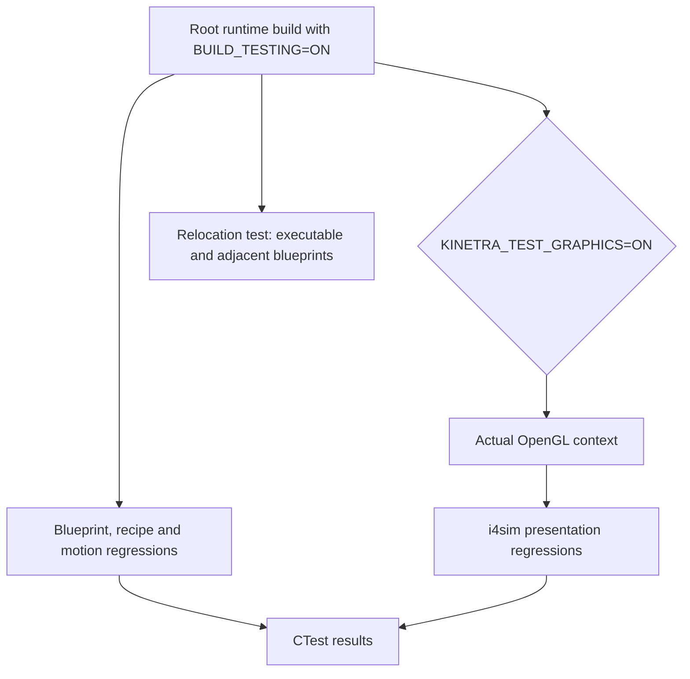

# i4sim verification

## Table of contents

- [Visual overview](#visual-overview)
- [Contents and use](#contents-and-use)
- [Crossing demonstration](#crossing-demonstration)
- [Corridor demonstration](#corridor-demonstration)
- [Motion benchmark](#motion-benchmark)

[Parent guide](../README.md) · [Project overview](../../../README.md) · [Documentation index](../../../docs/README.md)

## Visual overview

The two test paths separate checks without a window from checks requiring a graphics context.



## Contents and use

`simulation_tests.cpp` checks all original blueprints and group expansion, both complete recipes, a 50000-tick original MAS workload regression, queue bounds, producer blocking/resumption, exact production duration, pause/tick cap, determinism, blocked movers, invalid input and metrics export. `presentation_tests.cpp` exercises an actual OpenGL context, blueprint selection, pause, Motion edits while running and paused (including rendered speed changes), every debug layer, right-button edges, return-to-launcher behavior, and rediscovery after repairing a missing catalog. `relocation_tests.cmake` copies the headless resource probe and blueprints into a separate bundle, launches from an unrelated working directory, and verifies both successful discovery and actionable failure without adjacent assets.

The `3840x2400` and `8640x4800` workloads with seed `915839214` exercise route recovery across large factories and guard against spatial query limit failures.

Run from the repository root:

```sh
cmake -S . -B build -DCMAKE_BUILD_TYPE=Release -DKINETRA_SOURCE_DIR="$PWD/external/Kinetra" -DKINETRA_TEST_GRAPHICS=ON
cmake --build build -j2
SDL_VIDEODRIVER=offscreen LIBGL_ALWAYS_SOFTWARE=1 ctest --test-dir build --output-on-failure
```

Run `kinetra_i4sim --blueprint labs/i4sim/blueprints/MAS-demonstrator.json --ticks 50000 --output /tmp/i4sim-check` for a bounded local workload run. Headless tests and the batch executable also build with `KINETRA_LAB_BUILD_RUNTIME=OFF`.

Motion regressions cover manual reservation against factory allocation, paused single-step, all steering profiles, invalid horizons, and frontal/crossing encounters with goal completion and contact comparison. Regressions also verify that a mover does not replan due to its own heatmap footprint,
that a valid geometric detour counts as progress, and that contact cannot displace a
parked mover. Parking regressions depart and return beside a wall, in a corner
and between parked neighbors under Improved, Original and Reciprocal steering. They require
zero contacts (including a flush wall reservation), bounded acceleration, exact
final reservations and no drift after arrival; footprint-invalid manual goals must
fail. Allocation must skip a mover trapped behind blocked neighbors. Frontal/crossing encounters under Improved
and Reciprocal require zero contacts. Reciprocal regressions also verify
tick-unit/UPS independence, bounded acceleration and feasible departure through a
rectangular gap whose circular envelopes overlap,
parked-neighbor immobility and visible profile selection/limitation statistics.
Parking-traffic regressions replay MAS seed 42 for 50000 ticks, require at least
15 completed products with zero contacts, preserve owned reservations and acceleration
bounds, and exercise wait/release, blocked departures, manual replacement and
disabling the interlock without teleportation. Graphics tests toggle the new
Motion row and verify wait statistics. Junction regressions use a single-cell
crossing where one uncoordinated mover remains moving after 5000 ticks; with
admission both arrive within 1000 ticks with zero contacts, exclusive occupancy,
bounded acceleration and unchanged goals. They also cover replay, blocked occupancy,
resumption, disabling, all four approach orientations, a turning T-junction and
early/late cancelled approaches. Graphics tests toggle the appended junction row
and render an actual crossing with cyan zone outlines, lime exit reservations and
manually commanded movers. Exit regressions block one arm in all four orientations,
require waiting outside while another exit clears, then free the blocker and require
all three goals with zero contacts. They also verify reserved space remains free of
an opposing approach and that coasting traffic prevents an unsafe new reservation. Large-factory recovery is explicitly enabled
in its regression.

## Crossing demonstration

[junction-crossing.json](junction-crossing.json) is the shared headless/graphics
fixture and a manually controlled visual example, separate from the fourteen
unchanged original blueprints:

```sh
./build/kinetra_i4sim --blueprint labs/i4sim/tests/junction-crossing.json
```

Keep the simulation paused while setting up. Disable workload with `G`, choose
Reciprocal and enable JUNCTION TRAFFIC in DEBUG → Motion, then close the menu.
Select the west mover and Shift-click the center of the east arm at `(1100, 700)`;
select the north mover and Shift-click the south arm at `(700, 1100)`. Press Space.
The cyan boundary marks the exclusive zone. Repeat with junction traffic disabled
to observe the uncoordinated narrow-crossing failure. There are no producers in
this fixture; goals are manual.

For a blocked-exit demonstration, reload and first send the north mover to
`(900, 700)`. Once it has stopped, command the west mover to `(1100, 700)`; it waits
before entry and `EXIT` increases. Move the blocker farther east to `(1250, 700)`
to free the pocket and let the west mover proceed. Lime outlines show an admitted
exit reservation, which protects enough space to clear the zone, not the entire
outbound corridor.

## Corridor demonstration

[corridor-passing.json](corridor-passing.json) contains two wide rooms joined by a
straight single-cell corridor, with two manually controlled movers:

```sh
./build/kinetra_i4sim --blueprint labs/i4sim/tests/corridor-passing.json
```

While paused, disable workload with `G`, select Reciprocal under DEBUG → Motion,
and enable CORRIDOR TRAFFIC under DEBUG → View. Close the menu. Select the west
mover and Shift-click `(1900, 700)`, then select the east mover and Shift-click
`(300, 700)`. Press Space. One waits in its entrance room while the other traverses
the blue corridor and clears the lime exit pocket. Repeating without corridor
traffic reproduces the head-on standstill. These are prevention/reservation tests;
late activation with both movers already inside does not provide automatic retreat.

The regression runs all four orientations and requires exclusive full-body
occupancy, bounded acceleration, unchanged manual goals, deterministic replay,
arrival of both movers within 5000 ticks and zero contacts. It also checks blocked
occupancy/resumption, a previously parked occupant with no initial exit route,
independent junction toggling, disabling without teleportation, dead-end exclusion
and the 256-cell detection/indexing budget. Graphics tests exercise both the View
toggle/statistics and the actual blue corridor/lime reservation with moving agents.

## Motion benchmark

Build `kinetra_i4sim_motion_benchmark` with `BUILD_TESTING=ON` and run it explicitly:

```sh
./build/kinetra_i4sim_motion_benchmark > /tmp/i4sim-motion.csv
./build/kinetra_i4sim_motion_benchmark --recovery > /tmp/i4sim-recovery.csv
./build/kinetra_i4sim_motion_benchmark --profile reciprocal --ticks 50000 > /tmp/i4sim-reciprocal.csv
./build/kinetra_i4sim_motion_benchmark --profile reciprocal --parking-traffic > /tmp/i4sim-parking-traffic.csv
./build/kinetra_i4sim_motion_benchmark --profile reciprocal --parking-traffic --junction-traffic > /tmp/i4sim-junction-traffic.csv
./build/kinetra_i4sim_motion_benchmark --profile reciprocal --parking-traffic --junction-traffic --corridor-traffic > /tmp/i4sim-corridor-traffic.csv
```

The bundled blueprints run for 50000 ticks each with seeds 42 and 915839214.
`--profile` accepts `improved` (default), `original`, `rvo` or `reciprocal`;
`--ticks` accepts 1 through 1000000. Recovery, parking traffic, junction traffic and corridor traffic remain disabled unless explicitly requested.
CSV reports completed products, contact episodes, pair/segment contact ticks,
summed changes in commanded acceleration, and elapsed milliseconds. Acceleration
change is a diagnostic for steering activity, not a physical jerk measurement;
contact impulses are not included. Elapsed time depends on the machine and load.
The benchmark is deliberately outside CTest. See the
[simulation contract](../../../docs/factory-simulation-architecture.md).

Current wall/parking implementation, default Improved profile, recovery disabled,
50000 ticks per run:

| Blueprint | Seed | Completed products | Contact episodes | Contact ticks |
| --- | --- | --- | --- | --- |
| MAS-demonstrator | 42 | 16 | 53 | 71 |
| MAS-demonstrator | 915839214 | 16 | 204 | 214 |
| 3840x2400 | 42 | 59 | 3 | 3 |
| 3840x2400 | 915839214 | 59 | 0 | 0 |
| 8640x4800 | 42 | 98 | 384 | 395 |
| 8640x4800 | 915839214 | 99 | 726 | 773 |

Contact identities now use merged wall segments and exclude their artificial
0.001 mm collision skin. Counts are therefore not directly comparable to older
runs that counted raster seams and proxy-only touching. Crowded factories still
have physical contacts; these runs do not establish general collision freedom or
verify desktop animation smoothness. The focused parking tests independently
require zero contacts and exact settled reservations.

Reciprocal with fixed axis-aligned rectangular envelopes, the same 50000-tick
workloads and recovery disabled. Paired values compare parking traffic **off/on**:

| Blueprint | Seed | Completed products (off/on) | Contact episodes (off/on) | Contact ticks (off/on) |
| --- | --- | --- | --- | --- |
| MAS-demonstrator | 42 | 10 / 15 | 0 / 0 | 0 / 0 |
| MAS-demonstrator | 915839214 | 16 / 16 | 0 / 0 | 0 / 0 |
| 3840x2400 | 42 | 59 / 57 | 0 / 0 | 0 / 0 |
| 3840x2400 | 915839214 | 61 / 62 | 0 / 0 | 0 / 0 |
| 8640x4800 | 42 | 95 / 108 | 0 / 0 | 0 / 0 |
| 8640x4800 | 915839214 | 93 / 112 | 0 / 0 | 0 / 0 |

The interlock prevents an observed MAS return from sealing another mover's
parking departure. It improves throughput in four runs, preserves one, and reduces
one; it is not a universal improvement. Reciprocal and parking traffic remain
explicit options, with Improved still the default. These measurements do not
establish general collision freedom or starvation prevention. Runtime measurements
are omitted because other verification jobs ran concurrently.

With junction traffic also enabled, the six 50000-tick benchmark outcomes match
the parking-traffic-on column above exactly. These three factory layouts contain
no junctions matching the intentionally narrow detector, so this is a compatibility
check, not evidence of additional factory throughput. Crossing behavior is verified
using the dedicated fixture and its rotated/T-junction/cancellation variants.

Enabling corridor traffic as well preserves all six 50000-tick results above.
MAS-demonstrator, 3840x2400 and 8640x4800 contain no straight corridors matching
the room-to-room detector, so this verifies compatibility rather than added
throughput. The dedicated corridor fixture establishes the new passing behavior.
