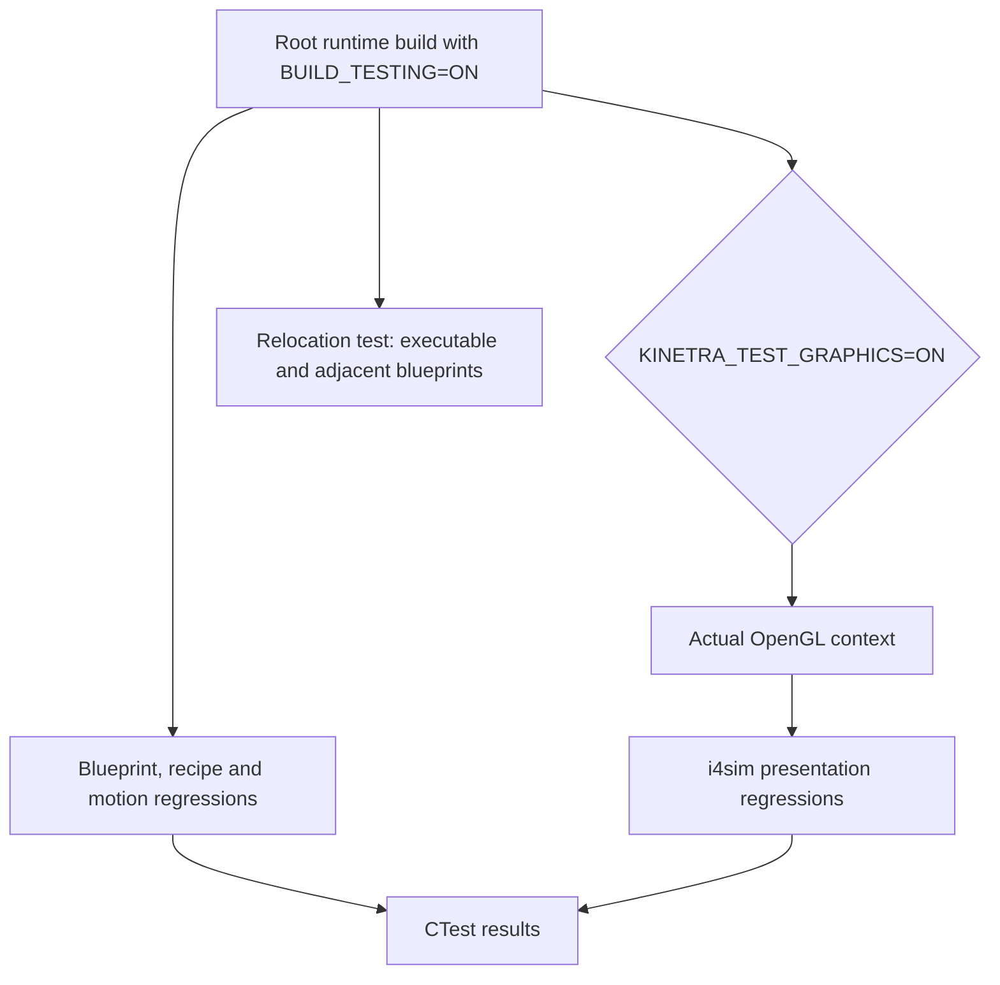

# i4sim verification

## Table of contents

- [Visual overview](#visual-overview)
- [Contents and use](#contents-and-use)
- [Motion benchmark](#motion-benchmark)

[Parent guide](../README.md) · [Project overview](../../../README.md) · [Documentation index](../../../docs/README.md)

## Visual overview

The two test paths separate checks without a window from checks requiring a graphics context.



## Contents and use

`simulation_tests.cpp` checks all original blueprints and group expansion, both complete recipes, a 50000-tick original MAS workload regression, queue bounds, producer blocking/resumption, exact production duration, pause/tick cap, determinism, blocked movers, invalid input and metrics export. `presentation_tests.cpp` exercises an actual OpenGL context, blueprint selection, pause, every debug layer, right-button edges, return-to-launcher behavior, and rediscovery after repairing a missing catalog. `relocation_tests.cmake` copies the headless resource probe and blueprints into a separate bundle, launches from an unrelated working directory, and verifies both successful discovery and actionable failure without adjacent assets.

The `3840x2400` and `8640x4800` workloads with seed `915839214` exercise route recovery across large factories and guard against spatial query limit failures.

Run from the repository root:

```sh
cmake -S . -B build -DCMAKE_BUILD_TYPE=Release -DKINETRA_SOURCE_DIR="$PWD/external/Kinetra" -DKINETRA_TEST_GRAPHICS=ON
cmake --build build -j2
SDL_VIDEODRIVER=offscreen LIBGL_ALWAYS_SOFTWARE=1 ctest --test-dir build --output-on-failure
```

Run `kinetra_i4sim --blueprint labs/i4sim/blueprints/MAS-demonstrator.json --ticks 50000 --output /tmp/i4sim-check` for a bounded local workload run. Headless tests and the batch executable also build with `KINETRA_LAB_BUILD_RUNTIME=OFF`.

Motion regressions cover manual reservation against factory allocation, paused single-step, all steering profiles, invalid horizons, and frontal/crossing encounters with goal completion and contact comparison. Regressions also verify that a mover does not replan due to its own heatmap footprint,
that a valid geometric detour counts as progress, and that contact cannot displace a
parked mover. Improved frontal/crossing encounters require zero contacts.
Large-factory recovery is explicitly enabled in its regression.

## Motion benchmark

Build `kinetra_i4sim_motion_benchmark` with `BUILD_TESTING=ON` and run it explicitly:

```sh
./build/kinetra_i4sim_motion_benchmark > /tmp/i4sim-motion.csv
./build/kinetra_i4sim_motion_benchmark --recovery > /tmp/i4sim-recovery.csv
```

The bundled blueprints run for 50000 ticks each with seeds 42 and 915839214.
CSV reports completed products, contact episodes, pair/segment contact ticks,
summed changes in commanded acceleration, and elapsed milliseconds. Acceleration
change is a diagnostic for steering activity, not a physical jerk measurement;
contact impulses are not included. Elapsed time depends on the machine and load.
The benchmark is deliberately outside CTest. See the
[simulation contract](../../../docs/factory-simulation-architecture.md).

Measured comparison against the preceding default Improved implementation, using
identical seeds, 50000 ticks and recovery disabled in both versions:

| Blueprint | Seed | Products before → after | Contacts before → after | Contact ticks before → after |
| --- | --- | --- | --- | --- |
| MAS-demonstrator | 42 | 10 → 14 | 1744 → 865 | 137057 → 868 |
| MAS-demonstrator | 915839214 | 8 → 15 | 2884 → 1645 | 139265 → 1662 |
| 3840x2400 | 42 | 53 → 56 | 6 → 16 | 9 → 16 |
| 3840x2400 | 915839214 | 44 → 56 | 44 → 29 | 81 → 29 |
| 8640x4800 | 42 | 82 → 92 | 12923 → 507 | 354339 → 516 |
| 8640x4800 | 915839214 | 87 → 97 | 12780 → 1339 | 248428 → 1606 |

The medium factory with seed 42 increases from 6 to 16 contact episodes/ticks
(from 9 contact ticks), while completing 56 rather than 53 products. The improvement
is aggregate, not a guarantee that every configuration has fewer contacts.
Contacts remain in crowded factories. These results do not establish general
collision freedom or verify desktop animation smoothness. Reducing replanning
alone regressed MAS throughput; shortening corners also regressed the medium
factory's contact count. Neither shortcutting nor a new velocity sampler is enabled.
