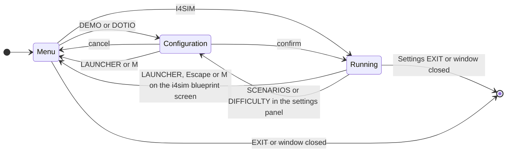

# Bundled launcher

The `kinetra` executable: one window with a menu from which Demo, Dotio and i4sim are started. It is a composition root. It decides which applications exist and how they start, and contains no menu, session or overlay mechanics of its own; those come from Kinetra.

## Table of contents

- [Purpose and scope](#purpose-and-scope)
- [Structure](#structure)
- [How it works](#how-it-works)
- [Arguments](#arguments)
- [Changing this module](#changing-this-module)
- [Tests](#tests)
- [Open points](#open-points)

[Parent guide](../README.md) · [Project overview](../README.md) · [Documentation index](../docs/README.md)

## Purpose and scope

The launcher lets a user try every Lab application without restarting, and gives the Lab one place that composes all three. Not here: application behavior (each application's session), the menu and the loop (`kinetra::LaunchMenu`, `kinetra::run_launcher`), and the shared Lab settings policy (`labs/shared`, described in [launcher and overlays](../docs/launcher-overlays.md)).

## Structure

| File | Responsibility |
| --- | --- |
| [include/launcher/applications.h](include/launcher/applications.h) | `Variant`, `Options`, Lab's `LauncherBindings`, and the `applications()` and `selection()` declarations |
| [src/applications.cpp](src/applications.cpp) | Registrations, Demo scenarios, Dotio difficulties, camera resets and session factories |
| [previews](previews/) and [EmbedPreviews.cmake](EmbedPreviews.cmake) | Captured stills and their build-time embedding |
| [src/main.cpp](src/main.cpp) | Arguments, the world seed and the call to `kinetra::run_launcher` |

`kinetra_sessions` builds `applications.cpp` and links the three presentation libraries and `Kinetra::Launcher`. The `kinetra` executable uses it. The [capture tool](../tools/capture/README.md) starts its sessions through the same registrations, so its screenshots show what the launcher starts.

## How it works



*Takeaway:* sessions leave through their own requests; the launcher binds no keys.

1. `main` reads the arguments and draws one random world seed, printed for reproduction.
2. `launcher::applications(options)` builds the registrations. Each factory resets the camera and creates a fresh session from the options.
3. `kinetra::run_launcher` shows the menu, or starts `--variant` directly, and hosts one session at a time with `launcher::bindings` (no menu key, no Escape shutdown).

Moving the pointer or using the arrow keys on the application list updates the preview with a capture and a short description of the highlighted lab ([screenshot](../docs/media/launcher.png)). Demo scenarios and Dotio difficulties appear on their own pages after confirmation. The first button of Demo's and Dotio's settings panel, SCENARIOS or DIFFICULTY in place of LAUNCHER, returns to that page with the running choice selected (`kinetra::SessionRequest::configurations`); the page's LAUNCHER button, or M, returns to the application list.

Selecting an application always creates a new session, so returning to the menu discards the old run. A factory that throws reports the error and ends the program.

## Arguments

| Argument | Accepted values |
| --- | --- |
| `--variant` | `demo`, `dotio`, `i4sim`; omit for the menu |
| `--difficulty` | `easy`, `medium`, `hard` for Dotio; default `medium` |
| `--scenario` | `terrain`, `gravity`, `maze`, `doorway`, `corridor`, `crossing`, `circle`, `bottleneck`, `chaos`, `fleet`, `swarm`. Starts Demo directly. The default for `--variant demo` is `terrain` |
| `--agents` | 0–300 initial agents in Demo's Terrain scenario. Default 48 |
| `--frames` | 1–100000 rendered frames; omit for unlimited |

Controls are in the [Demo](../labs/demo/README.md), [Dotio](../labs/dotio/README.md) and [i4sim](../labs/i4sim/README.md) guides.

## Changing this module

- **Add an application:** add its value to `Variant` (menu order), a registration in `applications()`, and its presentation library to `kinetra_sessions` in [CMakeLists.txt](CMakeLists.txt). Its session derives from `kinetra_lab::Session`, returns its settings overlay's request (with configurations, it passes `kinetra::LeaveAction{label, SessionRequest::configurations}` to its `SettingsOverlay`, as Demo does with SCENARIOS, so the panel's first button asks for its page), titles the window with the application's name and reports its state through `status()`. Extend `kinetra_menu` with the new name, and add its scenes to the [capture tool](../tools/capture/README.md#changing-this-module).
- **Add an application option:** add it to `Options`, parse it in `main.cpp`, and capture it in the factory. Configurations shown in the menu come from the application (as Dotio's difficulties do), not from the launcher.

To refresh a preview, pass the lab's preview scene (`demo-preview`, `dotio` or `i4sim-preview`), `launcher` and `ui-launcher` to the [capture script](../tools/capture/README.md) in one command. It embeds the new still before capturing the launcher.

## Tests

| CTest | Covers | Needs |
| --- | --- | --- |
| `kinetra_menu` | Registration order and previews, Demo scenarios, Dotio difficulties, defaults, and configuration picking at resized viewports | Runtime build, no window |
| `kinetra_graphics` | Every application through the real launcher sessions: settings toggles, pause and resume, debug gating, the Shift+Ctrl shortcut and debug-menu rows (RUNNING, layers, ZOOM, GHOST CAMERA), FRAME LIMIT, the settings panel's SCENARIOS, DIFFICULTY and EXIT requests | `KINETRA_TEST_GRAPHICS`, an OpenGL context |
| `kinetra_smoke:launcher*` | `kinetra` starts in the menu and with each `--variant`, draws 120 frames and exits with 0 | `KINETRA_TEST_GRAPHICS`, an OpenGL context |

```sh
ctest --preset dev -R '^kinetra_menu'
cmake --workflow --preset graphics
```

## Open points

- The bundled launcher has no `--seed` option, so a launcher run cannot be replayed exactly; of the direct executables `kinetra_i4sim` and `kinetra_dotio` take one.
