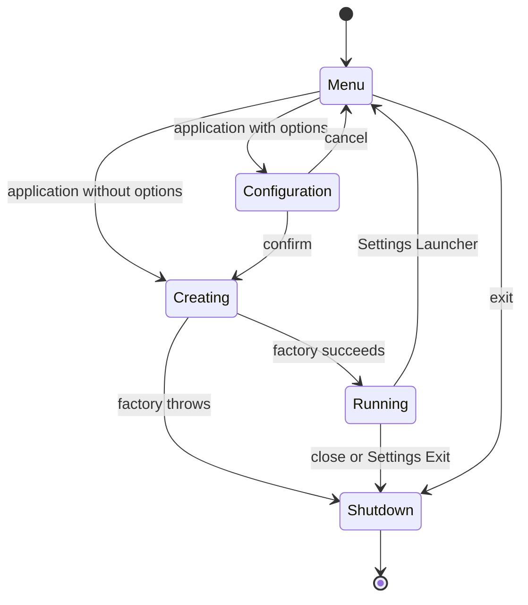

# Bundled application launcher

Composition root for Demo, Dotio and i4sim; generic menu/session infrastructure and tests belong to Kinetra.

## Table of contents

- [Visual overview](#visual-overview)
- [Composition](#composition)
- [Arguments](#arguments)
- [Verification](#verification)

[Parent guide](../README.md) · [Documentation index](../docs/README.md)

Directory guides: [include](include/README.md), [src](src/README.md), [tests](tests/README.md).

## Visual overview

Selection creates a fresh application session; returning to the menu releases it.

## Composition

[main.cpp](src/main.cpp) parses arguments and starts the Lab event loop. [session.cpp](src/session.cpp) chooses application-owned factories, initializes cameras and handles settings-driven navigation. The loop consumes `lab::Session::return_to_menu()` instead of binding M during a run. [menu.h](include/menu.h) adapts application identities and Dotio difficulty to public LaunchMenu. Engine lifecycle/ownership is documented once in [launcher and overlays](../docs/launcher-overlays.md).

## Arguments

| Argument | Accepted values |
| --- | --- |
| `--variant` | `demo`, `dotio`; omit for menu |
| `--difficulty` | `easy`, `medium`, `hard`; default medium |
| `--agents` | 0–300 initial Demo agents; default 48 |
| `--frames` | 1–100000 rendered frames; omit for unlimited |

Both `kinetra` and compatibility `kinetra_sandbox` use this composition root. A process selects and prints one random world seed. Selecting an application creates a fresh session. Detailed controls live in the [Demo](../labs/demo/README.md) [Dotio](../labs/dotio/README.md) and [i4sim](../labs/i4sim/README.md) guides. Build commands live in [Quick start](../README.md#quick-start).

## Verification

[Menu tests](tests/menu_tests.cpp) run without a window in a launcher-enabled build. [Integration tests](tests/runtime_tests.cpp) require an OpenGL context and cover rendering, settings pause/resume, zoom, debug gating and settings-driven navigation. See [development](../README.md#tests-and-resources).

Select `--variant i4sim` to open the factory blueprint Loadscreen. Its application-owned controls and metrics export are described in the i4sim guide.
