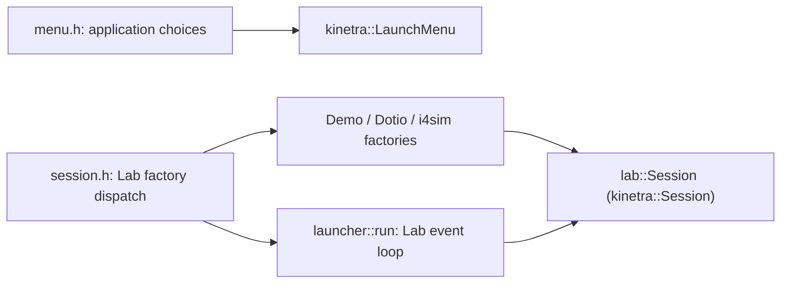

# Launcher interfaces

Sources in this directory belong to `kinetra_sessions`. These are Lab-owned interfaces and implementations; they are not part of the public Kinetra engine API.

## Table of contents

- [Visual overview](#visual-overview)
- [File map](#file-map)
- [Architecture and build](#architecture-and-build)

[Parent guide](../README.md) · [Project overview](../../README.md) · [Documentation index](../../docs/README.md)

## Visual overview

These adapters connect Lab identities and factories to the generic engine menu. Sessions are owned by Lab's own loop, not by `kinetra::SessionHost` (see [system architecture](../../docs/architecture.md#session-ownership-and-frame-flow)).

## File map

| File | Responsibility |
| --- | --- |
| [menu.h](menu.h) | Bundled variant and difficulty menu adapter |
| [session.h](session.h) | Lab session factory dispatch, camera configuration and launcher loop |

## Architecture and build

See the [architecture guide](../../docs/launcher-overlays.md) for ownership and dependency contracts. Build through the repository root; the containing application or launcher CMake file defines these targets.
