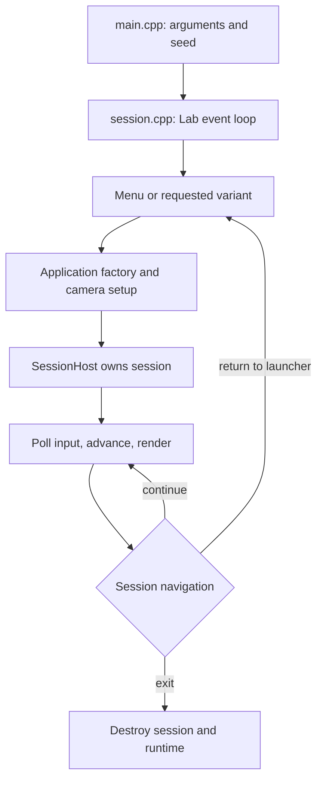

# Launcher implementation

Sources in this directory belong to `kinetra_sessions`. These are Lab-owned interfaces and implementations; they are not part of the public Kinetra engine API.

## Table of contents

- [Visual overview](#visual-overview)
- [File map](#file-map)
- [Architecture and build](#architecture-and-build)

[Parent guide](../README.md) · [Project overview](../../README.md) · [Documentation index](../../docs/README.md)

## Visual overview

The composition root validates launch arguments before the loop creates and drives sessions.

## File map

| File | Responsibility |
| --- | --- |
| [session.cpp](session.cpp) | Application factories, camera setup and settings-driven launcher loop |
| [main.cpp](main.cpp) | CLI validation, seed selection and bundled executable entry point |

## Architecture and build

See the [architecture guide](../../docs/architecture.md) for ownership and dependency contracts. Build through the repository root; the containing application or launcher CMake file defines these targets.
