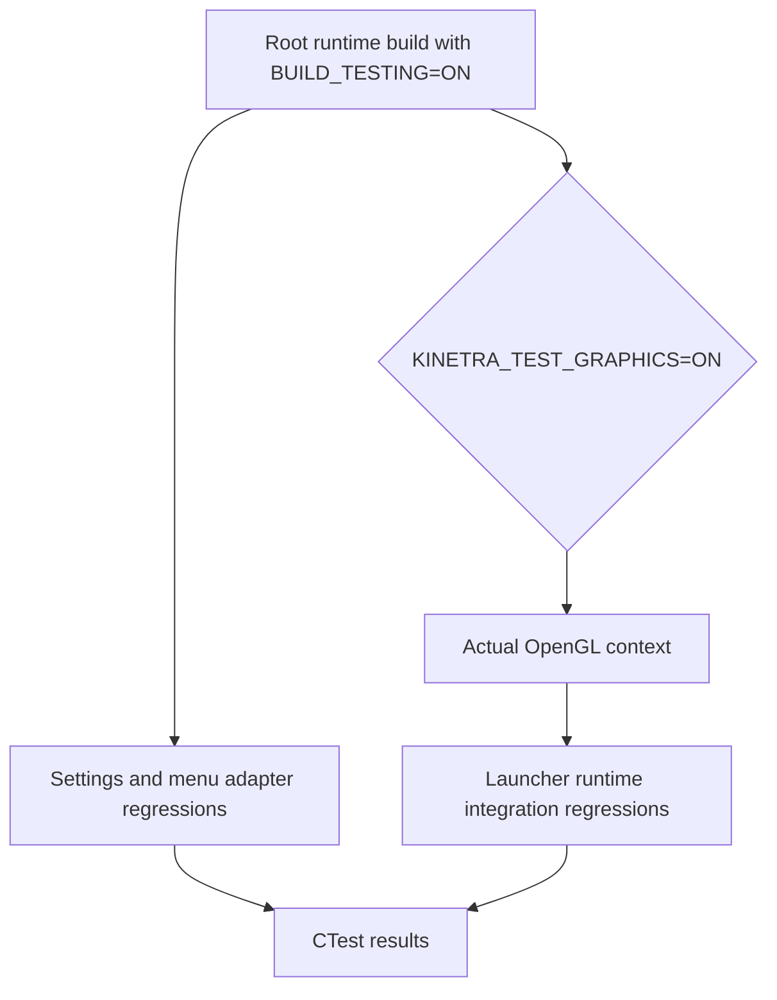

# Launcher tests

Tests for the bundled Demo/Dotio/i4sim menu adapter and application integration. Generic launcher contracts belong to Kinetra; see [Launcher and overlays](../../docs/launcher-overlays.md#contracts-and-verification).

## Table of contents

- [Visual overview](#visual-overview)
- [Coverage](#coverage)
- [Build and run](#build-and-run)

[Parent guide](../README.md) · [Project overview](../../README.md) · [Documentation index](../../docs/README.md)

## Visual overview

The two test paths separate checks without a window from checks requiring a graphics context.



## Coverage

| Source | CTest name | Coverage |
| --- | --- | --- |
| [settings_tests.cpp](settings_tests.cpp) | `kinetra_settings` | Modal input capture, zoom bounds, toggles, navigation and resized picking without a graphics context |
| [menu_tests.cpp](menu_tests.cpp) | `kinetra_menu` | Keyboard selection, Dotio difficulty, resized mouse picking, cancellation and difficulty parsing |
| [runtime_tests.cpp](runtime_tests.cpp) | `kinetra_graphics` | Rendering, settings pause/resume, normal/debug full DEBUG labels, default Demo/i4sim visual layers, wheel gating and settings-driven navigation |

## Build and run

Run from the repository root. Menu tests require the runtime libraries but do not open a window:

```sh
cmake -S . -B build -DKINETRA_LAB_BUILD_RUNTIME=ON -DBUILD_TESTING=ON
cmake --build build --target kinetra_menu_tests --parallel
ctest --test-dir build -R '^kinetra_menu$' --output-on-failure
```

For `kinetra_graphics`, enable `KINETRA_TEST_GRAPHICS=ON`, build `kinetra_runtime_tests` and provide an OpenGL context as described in [Tests and resources](../../README.md#tests-and-resources). Filter that build's CTest run with `-R '^kinetra_graphics$'`.
