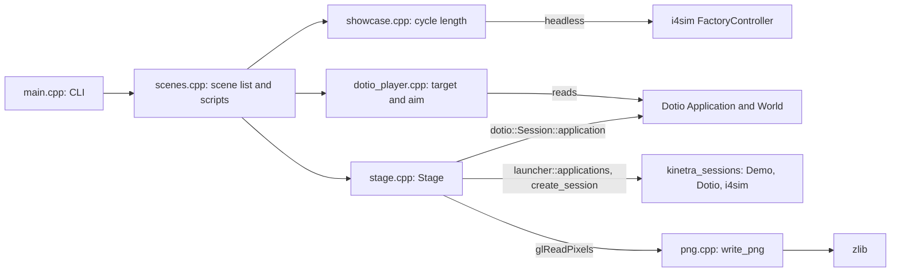
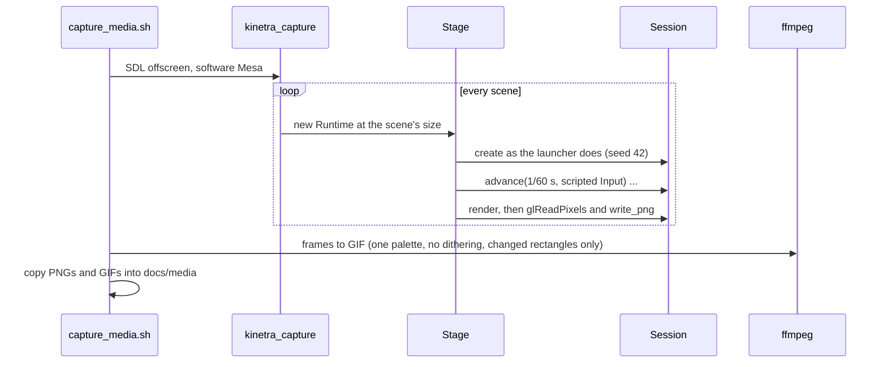

# Media capture

`kinetra_capture` renders every screenshot and clip in [docs/media](../../docs/media/README.md) from the current code: it runs the real Demo, Dotio and i4sim sessions offscreen with a fixed seed and scripted input. `capture_media.sh` turns the clips into looping GIFs with ffmpeg and copies everything into `docs/media`. Maintainers run it when visible behavior changes.

## Table of contents

- [Purpose and scope](#purpose-and-scope)
- [Concepts](#concepts)
- [Structure](#structure)
- [How it works](#how-it-works)
- [Invariants and contracts](#invariants-and-contracts)
- [Changing this module](#changing-this-module)
- [Tests](#tests)
- [Open points](#open-points)

[Media guide](../../docs/media/README.md) · [Project overview](../../README.md) · [Documentation index](../../docs/README.md)

## Purpose and scope

The gallery used to be hand-made window captures from different days, with seeds and options nobody recorded. This tool makes a refresh one command and, apart from Dotio, the same pixels every run:

```sh
cmake --preset graphics
cmake --build --preset graphics --target kinetra_capture
tools/capture/capture_media.sh                # all scenes, into docs/media
tools/capture/capture_media.sh build-graphics dotio dotio-clip   # only these
```

It does not record from a running application, and it changes nothing an application or the launcher does: it calls the same `Session::advance` and `render` the launcher calls. The one thing an application offers it is `dotio::Session::application`, through which the scripted player sees Dotio's world. It is a Linux developer tool; it builds wherever zlib is found, and the script needs bash and ffmpeg.

## Concepts

| Term | Meaning |
| --- | --- |
| Scene | One capture with a name, a kind, a window size and a script. The name is the file name in `docs/media` |
| Screenshot | A scene that writes `<scene>.png`, at 1920 × 1080 |
| Clip | A scene that writes `<scene>/frame-0001.png` onwards, at 960 × 540; the script makes `<scene>.gif` of it |
| Step | One `advance` of the session by 1/60 s, as one frame of a 60 Hz display, so the statistics show real rates |
| Clip frame | Four steps; clips play at 15 frames per second. Demo's clips and Dotio's gameplay clip last four seconds (60 frames), the Dotio debug clip and the i4sim clips twelve (180), a showcase clip one cycle |
| Scripted player | Dotio's player in the captures. It reads the world of the running session between frames and answers with a pointer position and the fire button, because Dotio's AI is not seeded and no timeline could aim for it |
| Menu click | A debug-menu row a script clicks, by number, with the label the row must have at that moment (`MenuClick`), so a test can replay it without a window |
| Showcase cycle | One round of an i4sim showcase scene: out, pause, back and pause for a shuttle; run, pause and restart for corridor recovery. A showcase clip lasts exactly one |
| Stage | The driver of one session: steps, key presses, clicks on overlay rows, and writing frames |

## Structure



*Takeaway:* the scripts know the applications' controls; the stage knows how to drive a session and save a frame; the showcase measurement replays a scene without a window; the scripted player only reads Dotio's world; only `png.cpp` touches zlib.

| File | Responsibility |
| --- | --- |
| [src/main.cpp](src/main.cpp) | `kinetra_capture <output-directory> [scene...]`: one `Runtime` per scene, at the scene's size |
| [src/scenes.h](src/scenes.h), [src/scenes.cpp](src/scenes.cpp) | `Scene`, `scenes()`, `select_scenes()`, the script of every scene, and the menu rows the Dotio and i4sim scripts click (`MenuClick`, `i4sim_motion_clicks`) |
| [src/dotio_player.h](src/dotio_player.h), [src/dotio_player.cpp](src/dotio_player.cpp) | The scripted Dotio player: `dotio_target`, `dotio_bolt_speed`, `lead_offset`, `dotio_aim`, `dotio_recovery_in_view` |
| [src/showcase.h](src/showcase.h), [src/showcase.cpp](src/showcase.cpp) | `showcase_cycle_steps`: the steps of one showcase cycle, measured in a headless `FactoryController` |
| [src/stage.h](src/stage.h), [src/stage.cpp](src/stage.cpp) | `Stage`: starting sessions as the launcher does, steps, `play_until()` a condition, clicks on settings and debug rows, `shot()`, `record()` |
| [src/png.h](src/png.h), [src/png.cpp](src/png.cpp) | `write_png`: eight-bit RGB, rows filtered "none" or "up", one zlib stream |
| [capture_media.sh](capture_media.sh) | Runs the tool offscreen into a temporary directory, makes the GIFs, copies into `docs/media` |
| [tests/](tests/) | Window-free tests and the graphics smoke test |

## How it works



*Takeaway:* every pixel comes from the applications' own drawing; the tool only chooses the input and the moment.

- **Scripts.** Demo and i4sim start in Debug Mode, so their normal scenes turn DEBUG MODE off in the settings panel. Dotio's debug scenes turn it on, open the debug menu and click every visual row; PATHS opens four filters right below it, so the rows after it are clicked in their new places.
- **Dotio's player.** `Stage::start_dotio` creates the session as the launcher's entry does and keeps its `Application` (`dotio::Session::application`). Before every clip frame `dotio_aim` picks the nearest live enemy on screen that a bolt can reach in a straight line: no wall between it and the player, the sight line the enemies' own AI uses, and no crate, because crates stop bolts. It leads that enemy by its velocity for the bolt's flight time (`lead_offset`); the script puts the pointer there and holds the button for the first half of every second. Without an enemy in sight the player holds fire. The screenshots and the gameplay clip run a square through the corridors with it; a screenshot plays on after the warm-up, 20 s at most, until an enemy is in sight and a bolt is on its way.
- **The Dotio debug clip** closes the menu, zooms out nine wheel notches and lets the player hold its ground with a sidestep every two seconds. It first waits without firing (`Stage::play_until`, 60 s at most) until `dotio_recovery_in_view` finds an enemy in Recover a fifth of the window's height inside the view: an enemy recovers only after nine shots at the player, and one that is shot at from the start dies before. Then it records twelve seconds in which the player shoots back.
- **i4sim's scenes** load `4320x2400.json` and click `i4sim_motion_clicks` in the debug menu (MOTION, PROFILE, RECIPROCAL, PLANNER, A*) before Space; the normal view turns Debug Mode off afterwards, because the menu needs it. The floor runs 116 s first, into its busiest stretch, and the clips record twelve seconds at the session's 200 ticks per second with the menu closed. The debug screenshot opens LAYERS instead.
- **Showcase scenes.** Each loads its file from the catalog's `showcase/` directory and keeps Debug Mode and every layer on, with the debug menu closed. Before recording, `showcase_cycle_steps` runs the same scene in a `FactoryController`, the headless half of the i4sim session, with the stage's seed, rate (`i4sim_updates_per_second`) and step, Space first, and counts the steps until a mover sets off again after the last standstill of the cycle. The clip records that many steps, rounded down to whole clip frames, so its last frame is in the final pause and the GIF loops like the application.
- **Clicks.** A settings row is found through a mirror `SettingsOverlay` with the same Lab rows (`row_y`, `half_extent`), and a debug-menu row through `DebugMenu::row_top`, the same public layout the graphics tests use. Presses, clicks and the wheel apply to the first step of a clip frame; held keys and buttons to all four.
- **Frames.** `Runtime::end()` presents the frame, so the stage reads the front buffer, as the graphics tests do, flips the rows and writes the PNG.
- **GIFs.** One palette per clip (`palettegen`), no dithering, because the applications draw flat colors, and only the changed rectangle per frame (`diff_mode=rectangle`). The six application GIFs are about 5.1 MB together, the five showcase GIFs about 2.5 MB.

## Invariants and contracts

- **Determinism.** Same code, same pixels: seed 42, fixed steps, software rendering. Dotio is the exception: its AI still draws from `std::random_device` and `std::rand` ([quality roadmap](../../docs/design/2026-11-18-quality-roadmap.md)), so its captures differ per run. Its scripts therefore react to the world instead of following a timeline.
- **Input only.** A script changes a session through `kinetra::Input` alone. The scripted player reads Dotio's `Application` between frames and never writes to it.
- **One Runtime at a time.** Each scene creates and destroys its own `Runtime`; the stage releases a session before it starts the next, because Dotio's world is a singleton.
- **Names are file names.** A scene's name is its file name in `docs/media`; clip names end in `-clip`. The README gallery and the media guide refer to these names.

## Changing this module

| To | Change | Test with |
| --- | --- | --- |
| Add a capture | A script function and an entry in `scenes()`; the gallery in the root README and the [media guide](../../docs/media/README.md) | Add the name to the scene-list case in `capture_tests.cpp`; run `capture_media.sh <build> <name>` and look at the result |
| Add a showcase clip | An entry in `scenes()` that calls `i4sim_showcase` with the file name, the gallery and the media guide | The scene-list case and the scene list of the cycle case in `capture_tests.cpp`; look at the first and last frames |
| Change what a capture shows | Its script in `scenes.cpp` | Run the scene and inspect the PNG or the frames |
| Change what the Dotio player does | `dotio_player.cpp` for target and aim, `dotio_shoot` and the movement functions in `scenes.cpp` for fire and steps | The player cases in `capture_tests.cpp`, which place enemies by hand in a world without walls; then look at a clip |
| Change the i4sim floor or motion settings | `i4sim_capture_blueprint` and `i4sim_motion_clicks` in `scenes.h`; the warm-up in `scenes.cpp`, which is tied to the floor, the seed and the settings | The menu-click case; look at the clips for a busy stretch |
| Follow a changed menu or settings layout | The rows in `scenes.h` (`i4sim_motion_clicks`, `i4sim_layers_click`, the Dotio debug rows), or `SettingsRow` in `stage.h` | The menu cases in `capture_tests.cpp` name the row that moved; then the smoke test and a full refresh |

Pitfalls: a script clicks rows by number. The debug-menu rows are checked by tests, but the settings rows are not, and no test sees a picture, so look at every refreshed capture. A pointer left on a menu highlights a row; scripts park it in the bottom-right corner before a shot. A Dotio capture differs per run: render the debug clip a few times and keep a take in which the enemies stay around the player.

## Tests

| Suite | Covers | Needs |
| --- | --- | --- |
| `kinetra_capture` (`kinetra_capture_tests`) | `write_png`: signature, header, CRCs and decoded pixels; invalid input; the scene list matches the files in `docs/media`; `select_scenes`; `showcase_cycle_steps` holds each scene's pauses, repeats exactly and rejects a blueprint without a repeating scenario; the i4sim menu clicks find the rows they name and leave Reciprocal with plain A*; the Dotio debug rows turn on every row but GHOST CAMERA; the scripted player's target (walls, crates, the edge of the screen), bolt speed, lead, aim point and recovery check | Nothing |
| `kinetra_capture_smoke` | Runs `launcher`, `i4sim-debug-clip`, `dotio-debug-clip` and `i4sim-showcase-junction-crossing-clip` end to end and checks the files | Graphics (`KINETRA_TEST_GRAPHICS`) |

```sh
cmake --build --preset dev --target kinetra_capture_tests && ctest --preset dev -R '^kinetra_capture'
cmake --build --preset graphics --target kinetra_capture && ctest --preset graphics -R kinetra_capture_smoke
```

## Open points

- A frame read-back helper on Kinetra's `Runtime` would replace the `glReadPixels` code here and in the graphics tests.
- Dotio captures are not reproducible until Dotio's randomness is seeded. Until then the debug clip waits for a recovery instead of a fixed time, and its take is chosen by eye.
- The scripts click rows by number. Tests check the debug-menu rows against the applications' own row lists; the settings rows still follow `lab::settings_rows` by hand.
- The i4sim warm-up is tied to the capture seed and today's simulation. A change in the simulation moves the busy stretch; the clip then still renders, but may show a quieter moment.
