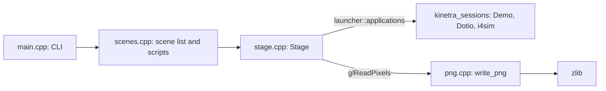
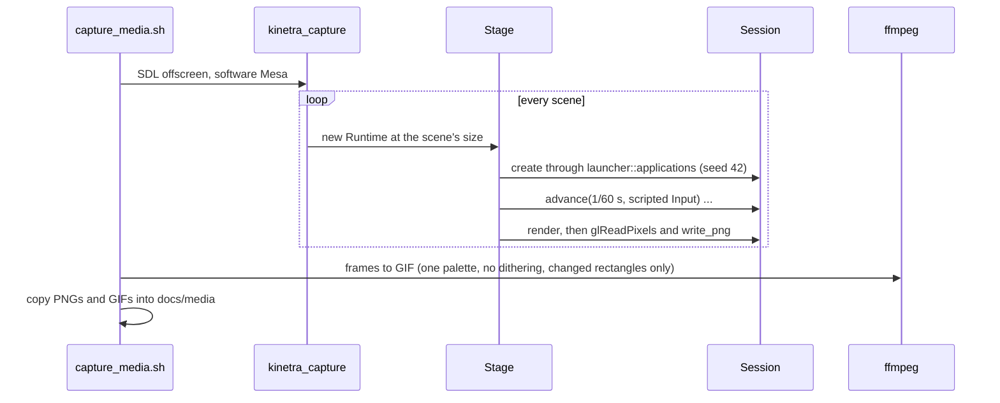

# Media capture

`kinetra_capture` renders every screenshot and clip in [docs/media](../../docs/media/README.md) from the current code: it runs the real Demo, Dotio and i4sim sessions offscreen with a fixed seed and scripted input. `capture_media.sh` turns the clips into looping GIFs with ffmpeg and copies everything into `docs/media`. Maintainers run it when visible behavior changes.

## Table of contents

- [Purpose and scope](#purpose-and-scope)
- [Concepts](#concepts)
- [Structure](#structure)
- [How it works](#how-it-works)
- [Invariants and contracts](#invariants-and-contracts)
- [Changing this module](#changing-this-module)
- [Tests](#tests)
- [Open points](#open-points)

[Media guide](../../docs/media/README.md) · [Project overview](../../README.md) · [Documentation index](../../docs/README.md)

## Purpose and scope

The gallery used to be hand-made window captures from different days, with seeds and options nobody recorded. This tool makes a refresh one command and, apart from Dotio, the same pixels every run:

```sh
cmake --preset graphics
cmake --build --preset graphics --target kinetra_capture
tools/capture/capture_media.sh                # all scenes, into docs/media
tools/capture/capture_media.sh build-graphics dotio dotio-clip   # only these
```

It does not record from a running application, and it adds nothing to the applications or the launcher: it calls the same `Session::advance` and `render` the launcher calls. It is a Linux developer tool; it builds wherever zlib is found, and the script needs bash and ffmpeg.

## Concepts

| Term | Meaning |
| --- | --- |
| Scene | One capture with a name, a kind, a window size and a script. The name is the file name in `docs/media` |
| Screenshot | A scene that writes `<scene>.png`, at 1920 × 1080 |
| Clip | A scene that writes `<scene>/frame-0001.png` onwards, at 960 × 540; the script makes `<scene>.gif` of it |
| Step | One `advance` of the session by 1/60 s, as one frame of a 60 Hz display, so the statistics show real rates |
| Clip frame | Four steps; clips play at 15 frames per second and last four seconds (60 frames) |
| Stage | The driver of one session: steps, key presses, clicks on overlay rows, and writing frames |

## Structure



*Takeaway:* the scripts know the applications' controls; the stage knows how to drive a session and save a frame; only `png.cpp` touches zlib.

| File | Responsibility |
| --- | --- |
| [src/main.cpp](src/main.cpp) | `kinetra_capture <output-directory> [scene...]`: one `Runtime` per scene, at the scene's size |
| [src/scenes.h](src/scenes.h), [src/scenes.cpp](src/scenes.cpp) | `Scene`, `scenes()`, `select_scenes()`, and the script of every scene |
| [src/stage.h](src/stage.h), [src/stage.cpp](src/stage.cpp) | `Stage`: starting sessions as the launcher does, steps, clicks on settings and debug rows, `shot()`, `record()` |
| [src/png.h](src/png.h), [src/png.cpp](src/png.cpp) | `write_png`: eight-bit RGB, rows filtered "none" or "up", one zlib stream |
| [capture_media.sh](capture_media.sh) | Runs the tool offscreen into a temporary directory, makes the GIFs, copies into `docs/media` |
| [tests/](tests/) | Window-free tests and the graphics smoke test |

## How it works



*Takeaway:* every pixel comes from the applications' own drawing; the tool only chooses the input and the moment.

- **Scripts.** Demo and i4sim start in Debug Mode, so their normal scenes turn DEBUG MODE off in the settings panel first. Dotio's debug scenes turn it on, open the debug menu and click every visual row; PATHS opens four filters right below it, so the rows after it are clicked in their new places. The i4sim scenes load `MAS-demonstrator.json`, run it for 20 s first, and the clips run at 800 ticks per second, because at 200 its movers barely move in four seconds.
- **Clicks.** A settings row is found through a mirror `SettingsOverlay` with the same Lab rows (`row_y`, `half_extent`), and a debug-menu row through `DebugMenu::row_top`, the same public layout the graphics tests use. Presses, clicks and the wheel apply to the first step of a clip frame; held keys and buttons to all four.
- **Frames.** `Runtime::end()` presents the frame, so the stage reads the front buffer, as the graphics tests do, flips the rows and writes the PNG.
- **GIFs.** One palette per clip (`palettegen`), no dithering, because the applications draw flat colors, and only the changed rectangle per frame (`diff_mode=rectangle`). The six GIFs are about 2 MB together.

## Invariants and contracts

- **Determinism.** Same code, same pixels: seed 42, fixed steps, software rendering. Dotio is the exception: its AI still draws from `std::random_device` and `std::rand` ([quality roadmap](../../docs/design/2026-11-18-quality-roadmap.md)), so its captures differ per run.
- **One Runtime at a time.** Each scene creates and destroys its own `Runtime`; the stage releases a session before it starts the next, because Dotio's world is a singleton.
- **Names are file names.** A scene's name is its file name in `docs/media`; clip names end in `-clip`. The README gallery and the media guide refer to these names.

## Changing this module

| To | Change | Test with |
| --- | --- | --- |
| Add a capture | A script function and an entry in `scenes()`; the gallery in the root README and the [media guide](../../docs/media/README.md) | Add the name to the scene-list case in `capture_tests.cpp`; run `capture_media.sh <build> <name>` and look at the result |
| Change what a capture shows | Its script in `scenes.cpp` | Run the scene and inspect the PNG or the frames |
| Follow a changed menu or settings layout | The row constants at the top of `scenes.cpp`, or `SettingsRow` in `stage.h` | The smoke test, then a full refresh |

Pitfalls: a script that clicks a row by number breaks silently when the menu changes, and only the picture shows it, so look at every refreshed capture. A pointer left on a menu highlights a row; scripts park it in the bottom-right corner before a shot.

## Tests

| Suite | Covers | Needs |
| --- | --- | --- |
| `kinetra_capture` (`kinetra_capture_tests`) | `write_png`: signature, header, CRCs and decoded pixels; invalid input; the scene list matches the files in `docs/media`; `select_scenes` | Nothing |
| `kinetra_capture_smoke` | Runs `launcher` and `i4sim-debug-clip` end to end and checks the files | Graphics (`KINETRA_TEST_GRAPHICS`) |

```sh
cmake --build --preset dev --target kinetra_capture_tests && ctest --preset dev -R '^kinetra_capture'
cmake --build --preset graphics --target kinetra_capture && ctest --preset graphics -R kinetra_capture_smoke
```

## Open points

- A frame read-back helper on Kinetra's `Runtime` would replace the `glReadPixels` code here and in the graphics tests.
- Dotio captures are not reproducible until Dotio's randomness is seeded.
- The scripts click rows by number; a menu change needs the constants in `scenes.cpp` updated by hand.
