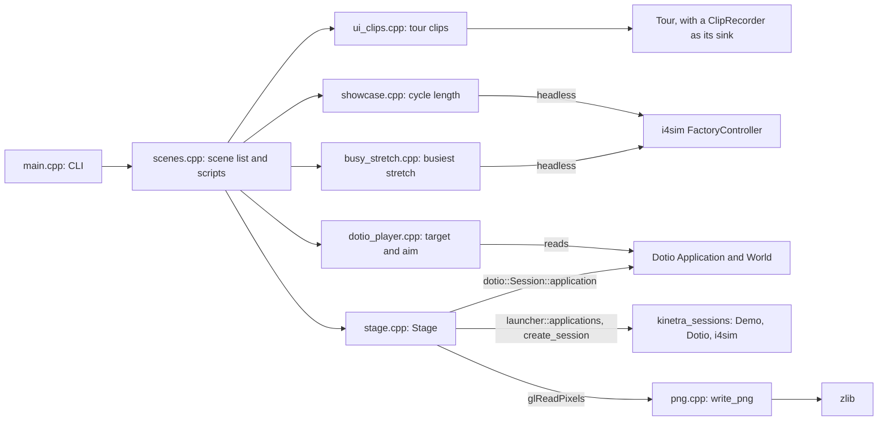
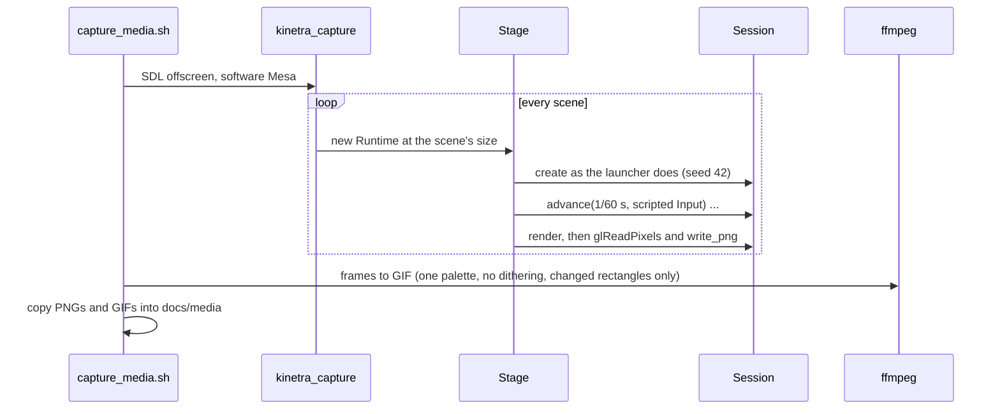
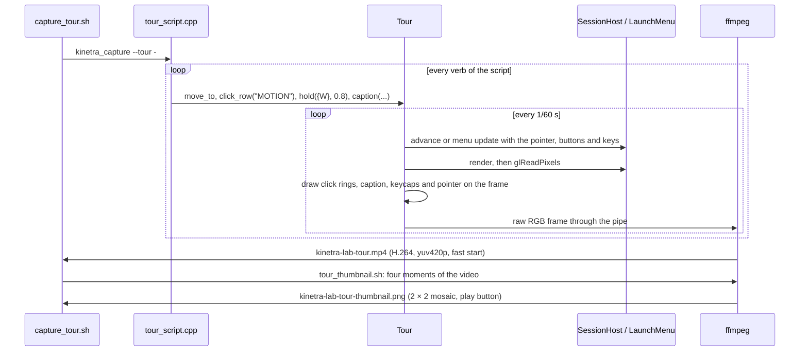

# Media capture

`kinetra_capture` renders every screenshot and clip in [docs/media](../../docs/media/README.md) from the current code: it runs the real Demo, Dotio and i4sim sessions offscreen with a fixed seed and scripted input. It also renders the shared-UI GIFs of Kinetra's README ([Kinetra's media guide](../../external/Kinetra/docs/media/README.md)): the launcher and the overlays, played in Demo with a visible pointer, as it plays i4sim's loadscreen for Lab's README. `capture_media.sh` turns the clips into looping GIFs with ffmpeg and copies everything into `docs/media`, and the shared-UI GIFs into `external/Kinetra/docs/media`. `capture_tour.sh` renders the tour video: the launcher and all three applications played by a scripted user, with a visible pointer, keycaps and captions, and `tour_thumbnail.sh` makes the README's thumbnail of it. A pull request that changes what a capture shows runs `capture_media.sh` for the captures a media guide's table names for it ([Lab's](../../docs/media/README.md#which-captures-a-change-makes-stale), [Kinetra's](../../external/Kinetra/docs/media/README.md#which-gifs-a-change-makes-stale)); the tour is rendered when the user asks for a new video.

## Table of contents

- [Purpose and scope](#purpose-and-scope)
- [Concepts](#concepts)
- [Structure](#structure)
- [How it works](#how-it-works)
- [Invariants and contracts](#invariants-and-contracts)
- [Changing this module](#changing-this-module)
- [Tests](#tests)
- [Open points](#open-points)

[Media guide](../../docs/media/README.md) · [Project overview](../../README.md) · [Documentation index](../../docs/README.md)

## Purpose and scope

The gallery used to be hand-made window captures from different days, with seeds and options nobody recorded. This tool makes a refresh one command and the same pixels every run:

```sh
cmake --preset graphics
cmake --build --preset graphics --target kinetra_capture
tools/capture/capture_media.sh                # all scenes, into docs/media and external/Kinetra/docs/media
tools/capture/capture_media.sh build-graphics dotio dotio-clip   # only these
tools/capture/capture_tour.sh                 # the tour video into .docs/, its thumbnail into docs/media
tools/capture/tour_thumbnail.sh [video]       # only the thumbnail, from .docs/ or the given video
```

It does not record from a running application, and it changes nothing an application or the launcher does: it calls the same `Session::advance` and `render` the launcher calls. The one thing an application offers it is `dotio::Session::application`, through which the scripted player sees Dotio's world. It is a Linux developer tool; it builds wherever zlib is found, and the script needs bash and ffmpeg.

## Concepts

| Term | Meaning |
| --- | --- |
| Scene | One capture with a name, a kind, a window size and a script. The name is the file name in `docs/media` |
| Screenshot | A scene that writes `<scene>.png`, at 1920 × 1080 |
| Clip | A scene that writes `<scene>/frame-0001.png` onwards, at 960 × 540; the script makes `<scene>.gif` of it |
| Gallery | The README a scene belongs to: Lab's (`docs/media`) or Kinetra's (`external/Kinetra/docs/media`). The tool writes Kinetra's scenes into the `kinetra/` subdirectory of its output |
| Tour clip | A clip that a tour plays through the launcher, with the pointer, of which a `ClipRecorder` keeps every fourth frame from the moment the script starts it: Kinetra's shared-UI clips, named `ui-*`, which go into Demo, and Lab's `i4sim-loadscreen-clip` |
| Step | One `advance` of the session by 1/60 s, as one frame of a 60 Hz display, so the statistics show real rates |
| Clip frame | Four steps; clips play at 15 frames per second. Demo's Terrain clips and Dotio's gameplay clip last four seconds (60 frames), Demo's Gravity and Doorway clips eight (120) and its Maze clip twenty (300), the Dotio debug clip and the i4sim clips twelve (180), a showcase clip one cycle |
| Scripted player | Dotio's player in the captures. It reads the world of the running session between frames and answers with a pointer position and the fire button, because a timeline written in advance would have to know where every enemy goes |
| Menu click | A debug-menu row a script clicks, by number, with the label the row must have at that moment (`MenuClick`). `apply_menu_click` runs it on an application's rows without a window, so a test and the headless measurement can replay it |
| Busiest stretch | The twelve seconds of the captured i4sim floor in which most movers drive; the i4sim clips record them |
| Showcase cycle | One round of an i4sim showcase scene: out, pause, back and pause for a shuttle; run, pause and restart for corridor recovery. A showcase clip lasts exactly one |
| Stage | The driver of one session: steps, key presses, clicks on overlay rows, and writing frames |
| Tour | The launcher and its sessions played by a scripted user for the video: a pointer that travels, keys and buttons that go down and up, and a caption for what is shown |
| Canvas | A frame of the tour as pixels, on which the tool draws what a screen recording would show: the pointer, click rings, the keys that are down, the caption |
| Pointer path | One move of the tour's pointer: a slightly bent curve, traveled slowly at both ends, lasting longer for a longer way |

## Structure



*Takeaway:* the scripts know the applications' controls; the stage knows how to drive a session and save a frame; the tour clips borrow the tour's driving and drawing; the two i4sim measurements replay a scene without a window; the scripted player only reads Dotio's world; only `png.cpp` touches zlib.

The files follow the [directory layout](../../external/Kinetra/docs/conventions.md#directory-layout). At the top of `include/capture/` are what both topics use: `stage.h` (and the `png.h` it writes with) and `dotio_player.h`. `scenes/` holds the screenshot and clip scripts, the tour clips and the i4sim measurements; `tour/` holds the tour, its drawing, its pointer motion and the recorder that turns its frames into a clip. `src/` mirrors both folders.

| File | Responsibility |
| --- | --- |
| [src/main.cpp](src/main.cpp) | `kinetra_capture <output-directory> [scene...]`: one `Runtime` per scene, at the scene's size, with Kinetra's scenes in `<output-directory>/kinetra/`. `--tour <file \| ->` writes the tour's raw frames, `--tour-check <frames>` plays its start without writing, `--tour-format` prints frame size and rate |
| [include/capture/scenes/scenes.h](include/capture/scenes/scenes.h), [src/scenes/scenes.cpp](src/scenes/scenes.cpp) | `Scene`, `Gallery`, `output_subdirectory`, `scenes()`, `select_scenes()`, the script of every scene, and the menu rows the scripts click (`MenuClick`, `apply_menu_click`, `demo_motion_click`, `dotio_debug_clicks`, `i4sim_motion_clicks`) |
| [include/capture/scenes/ui_clips.h](include/capture/scenes/ui_clips.h), [src/scenes/ui_clips.cpp](src/scenes/ui_clips.cpp) | The tour clips: Kinetra's shared-UI clips `ui_launcher`, `ui_settings`, `ui_debug_menu`, `ui_inspector`, `ui_debug_layers`, and Lab's `i4sim_loadscreen` |
| [include/capture/dotio_player.h](include/capture/dotio_player.h), [src/dotio_player.cpp](src/dotio_player.cpp) | The scripted Dotio player: `dotio_target`, `dotio_bolt_speed`, `lead_offset`, `dotio_aim`, `dotio_recovery_in_view` |
| [include/capture/scenes/showcase.h](include/capture/scenes/showcase.h), [src/scenes/showcase.cpp](src/scenes/showcase.cpp) | `showcase_cycle_steps`: the steps of one showcase cycle, measured in a headless `FactoryController` |
| [include/capture/scenes/busy_stretch.h](include/capture/scenes/busy_stretch.h), [src/scenes/busy_stretch.cpp](src/scenes/busy_stretch.cpp) | Where the busiest stretch of the captured i4sim floor begins: `apply_menu_clicks`, `driving_movers`, `busiest_window_start` |
| [include/capture/stage.h](include/capture/stage.h), [src/stage.cpp](src/stage.cpp) | `Stage`: starting sessions as the launcher does, steps, `play_until()` a condition, the Ctrl and Shift+Ctrl shortcuts, clicks on settings and debug rows, `shot()`, `record()` |
| [include/capture/png.h](include/capture/png.h), [src/png.cpp](src/png.cpp) | `write_png`: eight-bit RGB, rows filtered "none" or "up", one zlib stream |
| [include/capture/tour/tour.h](include/capture/tour/tour.h), [src/tour/tour.cpp](src/tour/tour.cpp) | `Tour`: the launcher host and menu driven frame by frame, the verbs of the tour script (`move_to`, `click_at`, `hold`, `scroll`, `caption`, `click_row`, `step_row`, `click_setting`), and the overlays; `row_with_label` |
| [src/tour/tour_script.cpp](src/tour/tour_script.cpp) | `play_tour`: what the tour shows, one function per chapter; `require_demo_terrain`, the check that the launcher chapter started Demo Terrain; `demo_application` and `nearest_demo_agent`, which the shared-UI clips use too |
| [include/capture/tour/clip_recorder.h](include/capture/tour/clip_recorder.h), [src/tour/clip_recorder.cpp](src/tour/clip_recorder.cpp) | `ClipRecorder`: a tour's frames from `start()` on, every n-th as the numbered PNG files of a clip, with its `framerate` |
| [include/capture/tour/canvas.h](include/capture/tour/canvas.h), [src/tour/canvas.cpp](src/tour/canvas.cpp) | `Canvas` and its drawing: blended rectangles, bitmap text, ring, pointer, keycap, dimming |
| [include/capture/tour/pointer_path.h](include/capture/tour/pointer_path.h), [src/tour/pointer_path.cpp](src/tour/pointer_path.cpp) | `plan_pointer_path`, `PointerPath::at`, `minimum_jerk` |
| [capture_media.sh](capture_media.sh) | Runs the tool offscreen into a temporary directory, makes the GIFs, copies into `docs/media`, and Kinetra's gallery into `external/Kinetra/docs/media` |
| [capture_tour.sh](capture_tour.sh) | Pipes the tour's raw frames into ffmpeg and writes `.docs/kinetra-lab-tour.mp4`, a folder Git ignores, for YouTube, then runs `tour_thumbnail.sh` |
| [tour_thumbnail.sh](tour_thumbnail.sh) | Four frames of the tour video in a 2 × 2 mosaic with a play button: `docs/media/kinetra-lab-tour-thumbnail.png`, which the README links to the YouTube copy |
| [tests/](tests/) | Window-free tests and the graphics smoke test |

## How it works



*Takeaway:* every pixel comes from the applications' own drawing; the tool only chooses the input and the moment.

- **Scripts.** Demo and i4sim start in Debug Mode, so their normal scenes turn DEBUG MODE off in the settings panel. Debug scenes open the menu with Shift+Ctrl, which in Dotio also switches Debug Mode on. Demo's debug screenshot opens the MOTION section, to show the values that can be tuned. Demo's Gravity, Maze and Doorway clips start their scenario and record from its first step; the Maze clip clicks beyond the last wall in its first frame (`demo_maze_goal`) and lasts until the player has arrived. Dotio's debug scenes click `dotio_debug_clicks`: INVULNERABLE, then the LAYERS section and every layer in it; PATHS opens its four parts right below it, so the rows after it are clicked in their new places.
- **Dotio's player.** `Stage::start_dotio` creates the session as the launcher's entry does and keeps its `Application` (`dotio::Session::application`). Before every clip frame `dotio_aim` picks the nearest live enemy on screen that a bolt can reach in a straight line: no wall between it and the player, the sight line the enemies' own AI uses, and no crate, because crates stop bolts. It leads that enemy by its velocity for the bolt's flight time (`lead_offset`); the script puts the pointer there and holds the button for the first half of every second. Without an enemy in sight the player holds fire. The screenshots and the gameplay clip run a square through the corridors with it; a screenshot plays on after the warm-up, 20 s at most, until an enemy is in sight and a bolt is on its way.
- **The Dotio debug clip** closes the menu again, zooms out nine wheel notches and lets the player hold its ground with a sidestep every two seconds. It first waits without firing (`Stage::play_until`, 60 s at most) until `dotio_recovery_in_view` finds an enemy in Recover a fifth of the window's height inside the view: an enemy recovers only after nine shots at the player, and one that is shot at from the start dies before. Then it records twelve seconds in which the player shoots back.
- **i4sim's scenes** load `4320x2400.json` and click `i4sim_motion_clicks` in the debug menu (MOTION, PROFILE, RECIPROCAL, PLANNER, A*) before Space; the normal view turns Debug Mode off afterwards, because the menu needs it. The clips record twelve seconds at the session's 200 ticks per second with the menu closed; the debug screenshot opens LAYERS instead.
- **The busiest stretch.** How long this floor takes to get busy depends on the simulation, so the scenes measure it: `driving_movers` runs the same floor in a `FactoryController` with the same clicks, seed, rate and step for 150 s and counts the movers that drive after every step, and `busiest_window_start` picks the twelve seconds, starting on a whole second, with the most of them. The clips start there and the screenshots are taken halfway. `apply_menu_clicks`, which the measurement uses for the clicks, stops the tool with the row's name when the menu no longer matches them.
- **Showcase scenes.** Each loads its file from the catalog's `showcase/` directory and keeps Debug Mode and every layer on, with the debug menu closed. Before recording, `showcase_cycle_steps` runs the same scene in a `FactoryController`, the headless half of the i4sim session, with the stage's seed, rate (`i4sim_updates_per_second`) and step, Space first, and counts the steps until a mover sets off again after the last standstill of the cycle. The clip records that many steps, rounded down to whole clip frames, so its last frame is in the final pause and the GIF loops like the application.
- **Clicks and keys.** A settings row is found through a mirror `SettingsOverlay` with the same Lab rows (`row_y`, `half_extent`), and a debug-menu row through `DebugMenu::row_top` and `label_left`, the same public layout the graphics tests use. The panel opens on a tap of Ctrl and the debug menu on Shift+Ctrl; the stage sends both as a press that is not held, which the overlay treats as complete. Presses, clicks and the wheel apply to the first step of a clip frame; held keys and buttons to all four.
- **Frame pacing.** The tool switches the runtime's frame limit off: its frames go to files, so nothing has to wait for a display. It also fixes the frame time the runtime records at one 60 Hz step (`Runtime::fix_frame_times`), so a frame-time graph reads 16.7 ms in every capture instead of the time software rendering took.
- **Frames.** `Runtime::end()` presents the frame, so the stage reads the front buffer, as the graphics tests do, flips the rows and writes the PNG.
- **GIFs.** One palette per clip (`palettegen`), no dithering, because the applications draw flat colors, and only the changed rectangle per frame (`diff_mode=rectangle`). The six GIFs of the normal and debug views are about 5.0 MB together, the three Demo scenario GIFs and the loadscreen GIF about 1.1 MB, the five showcase GIFs about 2.5 MB, the five shared-UI GIFs about 2.6 MB.
- **Tour clips.** Each script in `ui_clips.cpp` builds a `Tour` on the stage's window, at clip size, with a `ClipRecorder` as its frame sink, so the GIF shows the tour's pointer, click rings and keycaps, without captions. It first goes through the launcher to its Demo scenario unrecorded, by clicks on DEMO and the scenario, and checks that the scenario runs; then it starts the recorder, which keeps every fourth frame of the tour's 60 per second, the 15 of a clip. Doorway, with six agents on a calm background, keeps the launcher, settings, debug-menu and inspector GIFs small; the layers clip runs in Terrain with agents that wander by planned routes, and the player stands still, so the camera does not move. The inspector clip finds its X button through the inspector's own layout (`kinetra_lab::inspector_area`, `InspectorView::bounds`). The launcher clip ends with SCENARIOS in Demo's debug menu and checks that the launcher shows Demo's page with DOORWAY selected. The loadscreen clip clicks I4SIM unrecorded and waits for the click's ring to fade; it finds its showcase scene and floor in the catalog by file name, and closes the debug menu after BLUEPRINTS so the floor shows whole.

### The tour video



*Takeaway:* the script names what a viewer should see; the tour gives the input a person would give and draws on each frame what a screen recording would show.

- **A real launcher.** `Tour` owns the engine's `SessionHost` and `LaunchMenu`, with Lab's registrations, and drives them as `kinetra::run_launcher` does. The script opens Demo's scenario page, chooses Terrain, and later shows Dotio's difficulty page, i4sim's loadscreen, LAUNCHER and EXIT. When Demo Terrain did not start, `require_demo_terrain` stops the tour with "The tour did not start Demo Terrain" and what runs instead: a launcher menu page, such as Demo's scenario page, another application by its title, or another Demo scenario.
- **The pointer** is the tool's: sessions only ever get a position. `plan_pointer_path` bends each move sideways by a random amount of at most 12 % of its length and times it by Fitts' law; the position follows the minimum-jerk profile, so a move starts and ends at rest. Before a click the pointer rests a moment; pauses between actions vary. Both draw from one seeded generator.
- **Moving targets.** `click_on` follows a point that moves, such as a Demo agent, and clicks when the pointer is on it. In Dotio the pointer tracks the aim point of the scripted player (`dotio_aim`) a part of the way per frame, as a hand does.
- **Rows by label.** `click_row("WANDER")` and `step_row("MAX SPEED", true, 3)` ask the session for its rows (`kinetra_lab::Session::debug_rows()`), find the label and click its place in the engine's public menu layout. A missing label stops the tour and names the rows that were there. Settings rows are found through a mirror panel that takes the same clicks, so an opened help section moves the rows below it in both.
- **Overlays** are drawn on the frame after it was read back (`Canvas`): rings where a button went down, a caption at the top, a row of caps for the keys that are down or were a moment ago, the pointer, and a fade at the start and the end. The applications draw nothing of this and do not know they are filmed.
- **Frames.** 1920 × 1080 at 60 per second, about a hundred megabytes per second as raw RGB, so they go through a pipe and never to disk. The tool switches the frame limit off; rendering takes about as long as the video lasts.
- **The thumbnail.** GitHub plays a video in a README only when it is uploaded as an attachment of at most 10 MB on a free plan, and the tour is about 90 MB, so the README shows a picture that links to the YouTube copy. `tour_thumbnail.sh` takes four fixed moments of the video (`moments`: the launcher, Demo, Dotio and i4sim), scales each to 640 × 360, stacks them 2 × 2 and draws a play button in the middle with ffmpeg's `geq` filter. It checks the moments against the video's length first and replaces the PNG only when ffmpeg wrote one.

## Invariants and contracts

- **Determinism.** Same code, same pixels: seed 42, fixed steps, software rendering. Dotio's scripts react to the world instead of following a timeline, because its AI used to draw from `std::random_device` and `std::rand`. Since phase 6 Dotio draws from its seed and starts with `capture_seed`; whether its captures are now identical per run is not checked yet ([roadmap](../../docs/roadmap.md#later), *Reproducible Dotio captures*).
- **Input only.** A script changes a session through `kinetra::Input` alone. The scripted player reads Dotio's `Application` between frames and never writes to it.
- **One Runtime at a time.** Each scene creates and destroys its own `Runtime`; the stage releases a session before it starts the next, because Dotio's world is a singleton.
- **Names are file names.** A scene's name is its file name in its gallery's `docs/media`. Lab's clip names end in `-clip`, apart from the screenshots of the same view; Kinetra's gallery holds only clips, named `ui-*` for the part they show. Each README gallery and media guide refers to these names.
- **The tour reads, it does not write.** Besides input, the tour only reads from a session: its debug rows and title, Demo's scenario and agents, and Dotio's world. Its captions use only characters of the engine's bitmap font.

## Changing this module

The capture script converts `demo.png`, `dotio.png` and `i4sim.png` to 320 × 180 RGBA stills in [launcher/previews](../../launcher/previews/). If `launcher` or `ui-launcher` is requested, the script rebuilds the capture tool with CMake after refreshing the stills, then records the requested launcher scenes. For example, `tools/capture/capture_media.sh build-graphics demo launcher ui-launcher` updates the Demo still and both launcher captures together.

| To | Change | Test with |
| --- | --- | --- |
| Add a capture | A script function and an entry in `scenes()`; the gallery in the root README and the [media guide](../../docs/media/README.md) | Add the name to the scene-list case in `capture_tests.cpp`; run `capture_media.sh <build> <name>` and look at the result |
| Add a showcase clip | An entry in `scenes()` that calls `i4sim_showcase` with the file name, the gallery and the media guide | The scene-list case and the scene list of the cycle case in `capture_tests.cpp`; look at the first and last frames |
| Change what a capture shows | Its script in `scenes.cpp` | Run the scene and inspect the PNG or the frames |
| Change what the Dotio player does | `dotio_player.cpp` for target and aim, `dotio_shoot` and the movement functions in `scenes.cpp` for fire and steps | The player cases in `capture_tests.cpp`, which place enemies by hand in a world without walls; then look at a clip |
| Change the i4sim floor or motion settings | `i4sim_capture_blueprint` and `i4sim_motion_clicks` in `scenes.h`; the busiest stretch follows by itself | The menu-click cases; look at the clips |
| Add or change a shared-UI clip | Its script in `ui_clips.cpp`, an entry made with `ui_clip` in `scenes()`, Kinetra's README and [media guide](../../external/Kinetra/docs/media/README.md), whose table says which change makes it stale | The scene-list cases in `capture_tests.cpp`; run `capture_media.sh <build> <name>`, look at the frames, and commit the GIF on the Kinetra branch |
| Add or change a tour clip of Lab's gallery | Its script in `ui_clips.cpp`, an entry made with `clip` in `scenes()`, the README and the [media guide](../../docs/media/README.md) | As a shared-UI clip, with the GIF on the Lab branch |
| Show something new in the tour, or follow a renamed row | The chapter in `tour_script.cpp`; rows are named by label there | `ctest --preset graphics -R kinetra_capture_smoke` plays the first seconds; then `capture_tour.sh` and a look at frames of every chapter and at the thumbnail |
| Show other moments in the thumbnail | `moments` in `tour_thumbnail.sh`, in seconds | Run `tour_thumbnail.sh` and look at the PNG |
| Follow a changed menu or settings layout | The rows in `scenes.h` (`demo_motion_click`, `dotio_debug_clicks`, `i4sim_motion_clicks`, `i4sim_layers_click`), or `SettingsRow` in `stage.h` | The menu cases in `capture_tests.cpp` name the row that moved; then the smoke test and a full refresh |

Pitfalls: a script clicks rows by number. The debug-menu rows are checked by tests, but the settings rows are not, and no test sees a picture, so look at every refreshed capture. A pointer left on a menu highlights a row; scripts park it in the bottom-right corner before a shot. Dotio's captures are reproducible since its randomness comes from the seed ([media guide](../../docs/media/README.md)); only the tour's Dotio chapter still differs per run.

## Tests

| Suite | Covers | Needs |
| --- | --- | --- |
| `kinetra_capture` (`kinetra_capture_tests`) | `write_png`: signature, header, CRCs and decoded pixels; invalid input; the scene list matches the files, media guide and README of each gallery, Lab's and Kinetra's; Kinetra's scenes go into their own subdirectory; `select_scenes`; `showcase_cycle_steps` holds each scene's pauses, repeats exactly and rejects a blueprint without a repeating scenario; the i4sim menu clicks find the rows they name and leave Reciprocal with plain A*; the Dotio debug clicks turn on every layer but not the ghost camera; the Demo click opens MOTION; a click on a renamed or missing row, or on one without an action, is rejected; the count of driving movers repeats exactly, and the busiest window is the one with the largest sum; the scripted player's target (walls, crates, the edge of the screen), bolt speed, lead, aim point and recovery check; the tour's canvas (blending, clipping, text, pointer, ring, keycap), pointer path (end points, forward motion, bend, duration, seed), row lookup, and the start check's message in the menu, in another application and in another Demo scenario; the clip recorder's frames from its start, every n-th, numbered from 1, and its rate | Nothing |
| `kinetra_capture_smoke` | Runs `launcher`, `i4sim-debug-clip`, `dotio-debug-clip`, `i4sim-showcase-junction-crossing-clip` and the shared-UI clip `ui-settings`, and checks the files, the last in `kinetra/`. It then plays the first eight seconds of the tour (`--tour-check 480`) and checks that the script started Demo Terrain | Graphics (`KINETRA_TEST_GRAPHICS`) |

```sh
cmake --build --preset dev --target kinetra_capture_tests && ctest --preset dev -R '^kinetra_capture'
cmake --build --preset graphics --target kinetra_capture && ctest --preset graphics -R kinetra_capture_smoke
```

## Open points

- A frame read-back helper on Kinetra's `Runtime` would replace the `glReadPixels` code here and in the graphics tests.
- The tour is only checked in full by looking at it: its smoke test plays seven seconds, and a wrong click later on shows as a scene that does not match its caption. A missing row stops it.
- Dotio's part of the tour differs per run, like its captures.
- The thumbnail's moments are fixed times. When a tour change moves a chapter, a tile can show another scene than intended; only a look at the thumbnail catches that.
- The clip and screenshot scripts click rows by number, unlike the tour. Tests check the debug-menu clicks against the applications' own rows, and the i4sim clicks are checked again at capture time; the settings rows still follow `kinetra_lab::settings_rows` by hand.
- The two i4sim measurements repeat the session's frame order (`begin_frame`, `suspend`, `handle_input`) by hand. A helper in the i4sim logic that runs one session frame would serve both.
