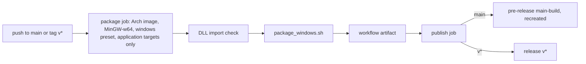

# Windows release

`package_windows.sh` turns a Windows cross build into `Kinetra-Lab-windows-x64.zip`, which runs without installing anything. The [release workflow](../../.github/workflows/release.yml) builds and publishes it as a GitHub Release asset, so someone who wants to try Kinetra-Lab needs no compiler, dependencies or Git.

## Table of contents

- [Download](#download)
- [What the zip contains](#what-the-zip-contains)
- [How it is published](#how-it-is-published)
- [Build the zip locally](#build-the-zip-locally)
- [Changing this tool](#changing-this-tool)

[Windows](../../docs/windows.md) · [Project overview](../../README.md) · [Documentation index](../../docs/README.md)

## Download

- Latest `main`: [Kinetra-Lab-windows-x64.zip](https://github.com/SMB-M87/Kinetra-Lab/releases/download/main-build/Kinetra-Lab-windows-x64.zip) from the [`main-build` pre-release](https://github.com/SMB-M87/Kinetra-Lab/releases/tag/main-build), refreshed on every merge.
- Fixed versions: the [releases](https://github.com/SMB-M87/Kinetra-Lab/releases) tagged `v*`.

Unzip, then start `kinetra.exe`. Windows 10 or later with an OpenGL 3.3 driver is enough. The executables are not signed, so SmartScreen may ask for confirmation (*More info*, *Run anyway*).

## What the zip contains

```text
Kinetra-Lab-windows-x64/
├── kinetra.exe            # bundled launcher
├── kinetra_demo.exe       # standalone applications
├── kinetra_dotio.exe
├── kinetra_i4sim.exe
├── SDL2.dll
├── i4sim-blueprints/      # read next to the executable by i4sim
├── licenses/              # Kinetra-Lab, Kinetra, SDL2, nlohmann_json
└── README.txt             # how to start, and the commit it was built from
```

The executables link the GCC runtime statically ([toolchain](../../docs/windows.md#how-it-works)), so they import only Windows system libraries and `SDL2.dll`. The workflow checks that list before packaging.

## How it is published



*Takeaway:* the zip is built from exactly the merged commit; tests are not repeated, because the pull request's CI already ran them, natively on Windows included.

- The build uses the pinned Arch image and snapshot of [ci.yml](../../.github/workflows/ci.yml); bump them together.
- Only the four application targets are built. The doctest discovery of the test executables would need to run `.exe` files on Linux.
- `main-build` is deleted and created again on every push to `main`, so its tag points at the commit the zip came from and its download URL never changes.
- `workflow_dispatch` on `main` refreshes `main-build` by hand; on another branch it only builds the artifact.

## Build the zip locally

With the MinGW-w64 cross compiler from the [Windows guide](../../docs/windows.md#quick-start-from-wsl):

```sh
cmake --preset windows
cmake --build --preset windows --target kinetra kinetra_demo kinetra_dotio kinetra_i4sim
tools/release/package_windows.sh build-windows dist/Kinetra-Lab-windows-x64.zip
```

## Changing this tool

- A new application executable goes into `executables` in `package_windows.sh`, into the workflow's build targets, and into the tree above.
- A new runtime file that the applications read must be copied next to the executables, like `i4sim-blueprints/`.
- `README-windows.txt` becomes `README.txt` in the zip, with `@COMMIT@` replaced and Windows line endings.
